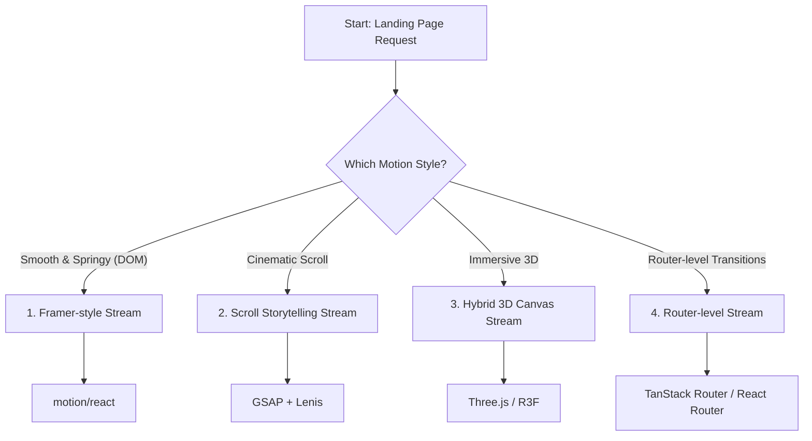

# MotionCraft Skill

Frontend motion design skill for generating production-ready motion UI and landing pages.

## 中文简介

`MotionCraft Skill` 是一个前端动效代码生成技能，核心目标是：

- 先做动效系统设计，再生成代码
- 把风格词翻译为可执行的动效参数与实现策略
- 优先选择轻量可维护方案（DOM/CSS/JS），按需升级到 GSAP 或 WebGL
- 在落地页场景中，优先检查流派选择（快速路径），否则强制用户先选择实现流派（1-4）再开始实现

## English Overview

`MotionCraft Skill` is a frontend motion codegen skill focused on:

- designing the motion system before writing code
- translating style language into concrete implementation decisions
- starting from the lightest viable stack and escalating only when needed
- checking for stream selection (Fast Path) or enforcing numbered selection (1-4) for landing page implementations

## Quick Start (30s) / 快速开始（30秒接入）

1. **Trigger / 触发**: Mention "landing page" and "motion" in your prompt.
2. **Select / 选择**: Choose a stream (1-4) when the skill asks.
3. **Result / 结果**: Receive optimized code following the selected school.

**Example Prompt / 示例提示词:**
> "Build a premium landing page for a SaaS product using stream 1."

## Key Capabilities / 核心能力

- Motion decomposition workflow (trigger, states, timing, feel)
- Style translation (Apple, Stripe, Linear, Vercel, premium, etc.)
- Stack mapping across React, Next.js, Vue, and vanilla JS
- Performance and accessibility guardrails (`transform/opacity`, reduced motion)
- Typography + motion coordination for premium interfaces
- Landing-page stream system with explicit user choice

## Landing Page Streams / 落地页四大流派

For landing-page requests, this skill prioritizes four implementation schools and requires explicit user choice:

1. **Framer-style DOM Motion Stream** (`motion/react`)
2. **Scroll Storytelling Stream** (`GSAP + ScrollTrigger + Lenis`)
3. **Hybrid DOM + Canvas 3D Stream** (`@react-three/fiber` / Three.js)
4. **Router-level Transition Stream** (TanStack Router / React Router)

> Mandatory rule / 强制规则：
> When the request is a landing page, the skill must check for a clear stream selection (Fast Path). If already specified (e.g., "stream 1"), proceed directly. Otherwise, you MUST ask the user to choose `1-4` before implementation.
> 当请求为落地页时，技能必须检查是否有明确的流派选择（快速路径）。如果已指定（例如“流派 1”），则直接继续。否则，在实现之前必须要求用户选择 `1-4`。

## 4-Stream Selection Diagram / 4种流派选择图



## Directory Structure

```text
frontend-motion/
  SKILL.md
  README.md
  references/
    animation-types.md
    style-translation.md
    tech-stack-mapping.md
    motion-tokens.md
    accessibility-fallback-matrix.md
    performance-guardrails.md
    transition-patterns.md
    scroll-strategy-tiering.md
    interaction-state-machines.md
    device-tiering.md
    qa-checklist.md
    text-typography-effects.md
    cursor-pointer-effects.md
    svg-path-effects.md
    layout-transition-effects.md
    scroll-storytelling-effects.md
    visual-reveal-effects.md
    advanced-visual-effects.md
    font-library.md
    landing-page-streams.md
```

## Usage Notes / 使用说明

- Natural input example:
  - `Create an Apple-style landing page with premium motion.`
- Structured input example:
  - Motion type, framework, library preference, style reference, shipping requirement

For landing pages, the recommended prompt style is:

```text
请从以下四种落地页动效流派中选择一种（输入数字 1-4）。
```

Then continue with the selected stream's stack and patterns.

## Implementation Principles / 实现原则

- Prefer `transform` and `opacity`
- Use `requestAnimationFrame` for pointer math when needed
- Use IntersectionObserver for simple reveals
- Use ScrollTrigger only when scroll orchestration is required
- Escalate to Canvas/WebGL only for genuine 3D or shader needs

## License / 许可证

This repository currently contains skill documentation and reference guides.
Add your preferred license (MIT, Apache-2.0, etc.) if you want open-source distribution.
