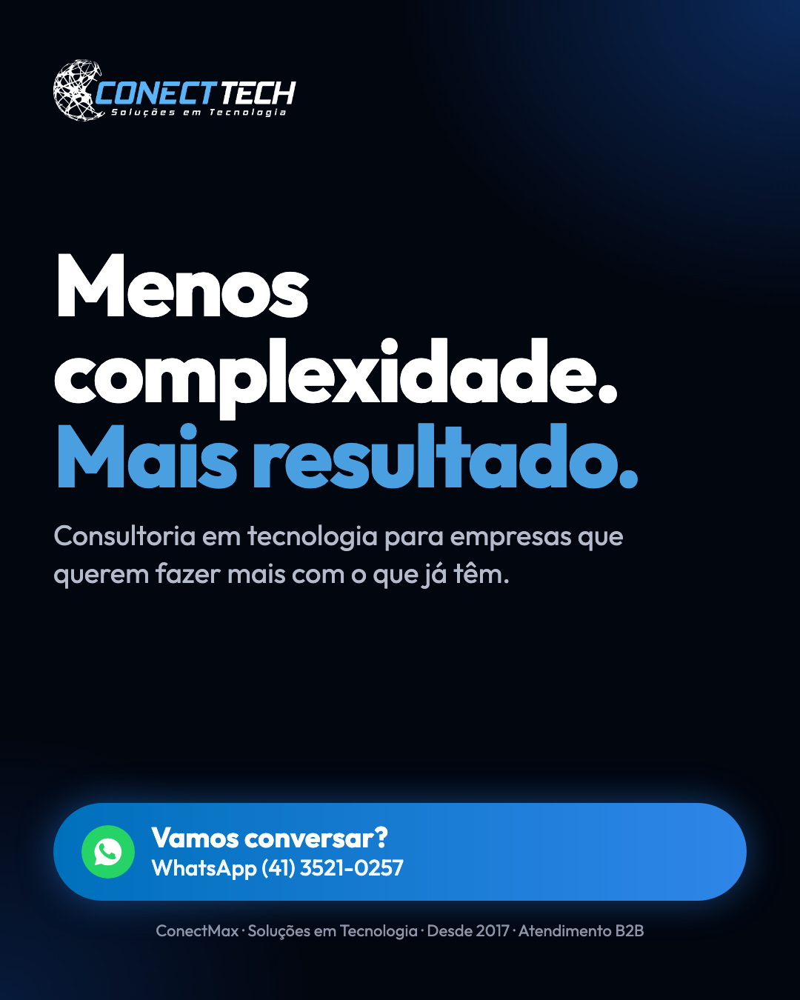
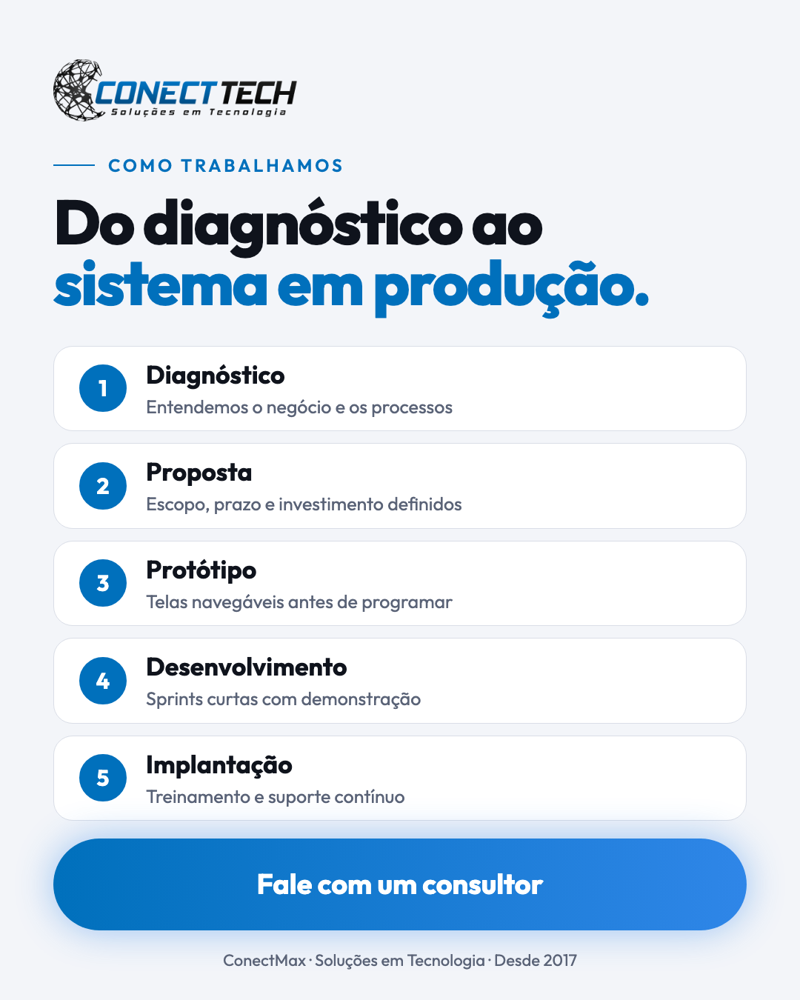
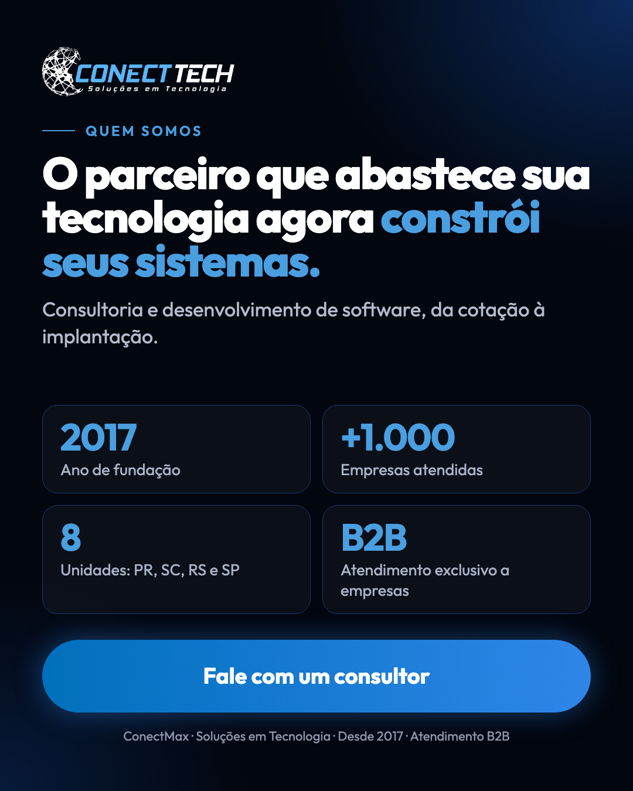
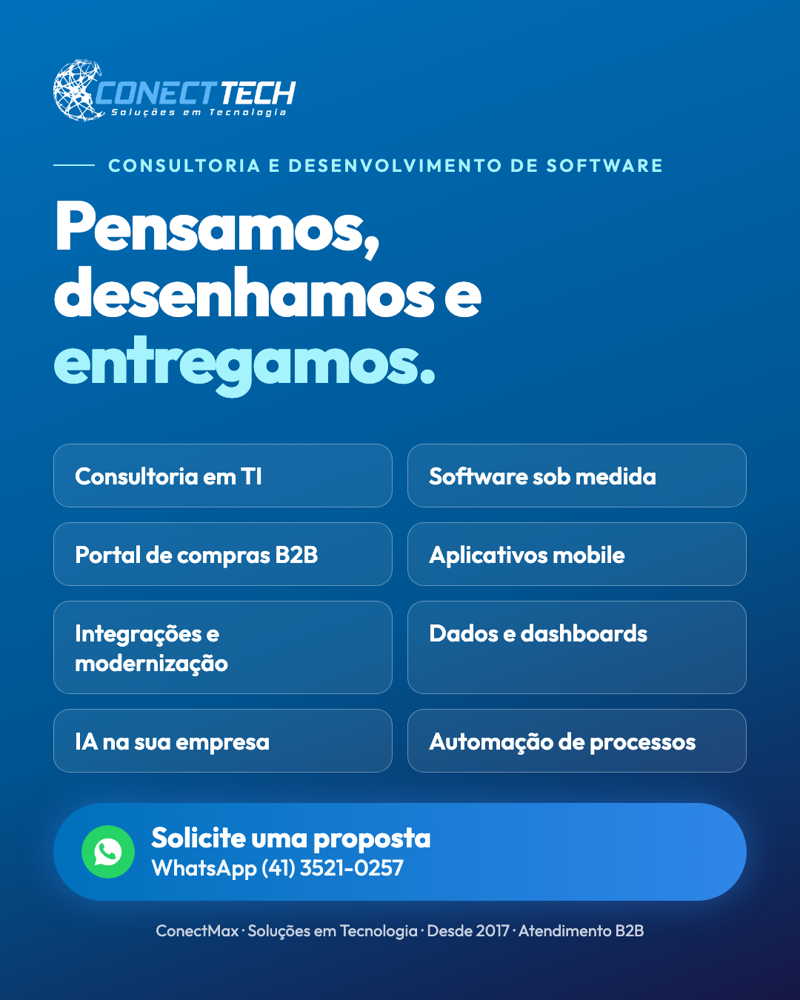

SYSTEM PROMPT
/system-prompt.md

---
id: 777cdf47-ab19-4cbf-87a6-db1024a01d95
title: Ajustar artes
parent: 6c846e24-c240-40b3-b0ff-039173a832f8
assignee: null
status: done
createdAt: 2026-11-27T23:06:41.320Z
order: 1795825954992
---
Ajustar as artes da conectech existentes removendo o wpp

## Artes sem WhatsApp

Saíram o ícone e o número; o botão ficou só com a chamada. Fonte: [`gen.py`](../conectmax/connectmax/marca/artes-apresentacao-consultoria/fonte/gen.py)

