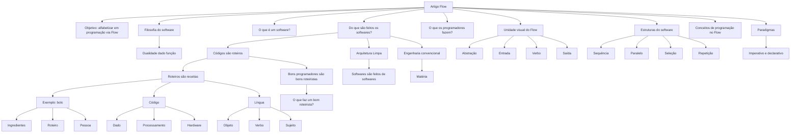
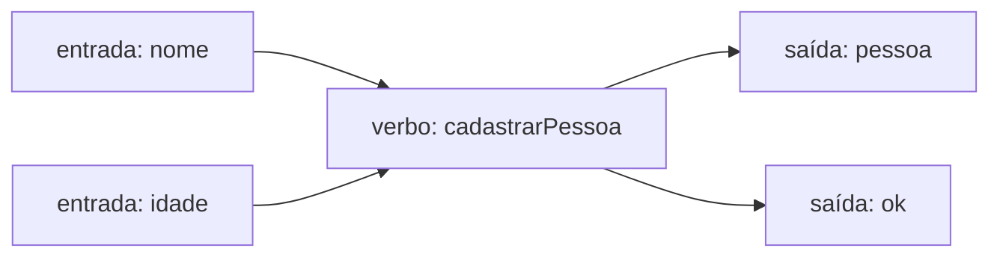
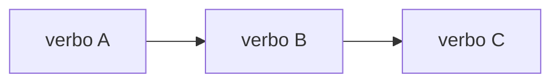
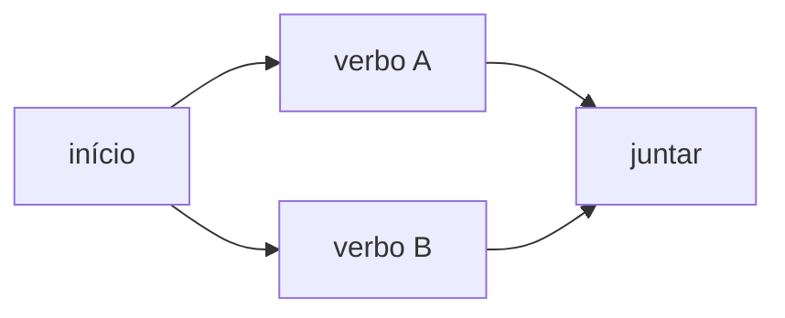
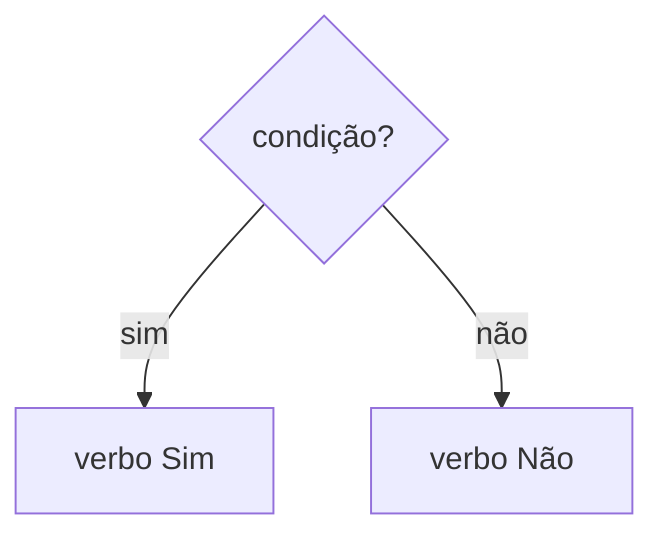
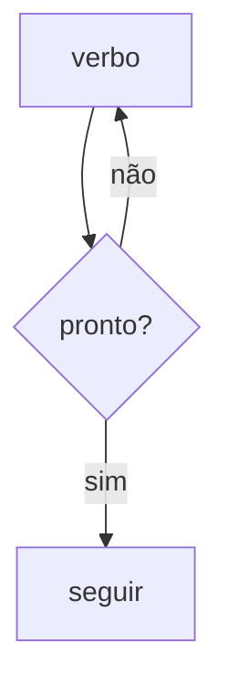

# Artigo Flow — teoria

Parte teórica do projeto que ensina o **Flow**: alfabetização em programação para quem ainda não programa — pelas estruturas do paradigma Flow, sem exigir sintaxe de linguagem.

**Inputs:** [`Livro Flow Oriented Programming.txt`](Livro%20Flow%20Oriented%20Programming.txt) · [`Livro Flow Oriented Programming.pdf`](Livro%20Flow%20Oriented%20Programming.pdf)  
**Produto:** [`../flow/README.md`](../flow/README.md) · [`../flow-language/README.md`](../flow-language/README.md)

## Objetivo

Levar uma pessoa que **não compreende nada de programação** a compreender:

1. o que é um software;
2. de que ele é constituído;
3. o que os programadores fazem;
4. quais são as estruturas do software;
5. como ver tudo isso numa visão visual: **abstrações**, **entradas**, **saídas** e **verbos** — o paradigma **Flow**.

## Público

Quem nunca escreveu código. Quem só usa apps. Quem quer entender o que acontece “por baixo” sem virar engenheiro de uma linguagem específica.

## Mapa



---

## Filosofia do software

Perguntas de fundo sobre o que é software, de que é feito, como se organiza e o que significa programar bem — antes das técnicas e das ferramentas.

### Dualidade dado função

Todo software oscila entre duas faces inseparáveis: o **dado** (o que é, o que se guarda, o que se transforma) e a **função** (o que se faz com o dado). Um sem o outro não completa o roteiro — ingredientes sem passos, ou passos sem matéria.

No Flow, essa dualidade vira desenho: caixas de **informação** ligadas a caixas de **mudança**.

---

## O que é um software?

Um **software** é um **roteiro de mudanças de informação** que uma máquina consegue executar.

Não é a tela. Não é o ícone. Não é o celular. A tela mostra resultado; o software é a receita que transforma **entradas** em **saídas**.

Exemplos do dia a dia:

| Você faz | O software faz |
|---|---|
| Digita uma mensagem | Guarda o texto, envia, confirma entrega |
| Toca “pagar” | Lê o valor, valida, debita, registra |
| Abre um mapa | Lê a posição, busca rotas, desenha o caminho |

Em todos os casos: **informação entra → algo acontece → informação sai** (ou o mundo muda: tela, arquivo, pagamento).

Software = **estado** (informação agora) + **movimento** (verbo que muda o estado).

---

## Do que são feitos os softwares?

Softwares não nascem prontos na tela. Por trás de cada app, site ou sistema há um material básico: **instruções escritas** que alguém (ou alguma máquina) consegue seguir.

Antes, um contraste: a engenharia convencional é constituída de **matéria**. Uncle Bob, em Arquitetura Limpa, diz que **softwares são feitos de softwares**. E o código, em si, é **roteiro**.

### Engenharia convencional

A **engenharia convencional** é constituída de **matéria**: coisas físicas que ocupam espaço, têm peso e se transformam com ferramentas e energia.

#### Matéria

A matéria é o material de construção do mundo físico. Em casa, ela aparece primeiro em **componentes maiores** — peças que usamos no dia a dia — e cada um é feito de matérias-primas (as folhas da árvore).

##### Porta

- Madeira — folha, batente
- Metal — dobradiças, fechaduras

##### Maçaneta

- Metal — corpo, trinco, parafusos

##### Janela

- Vidro — o painel transparente
- Madeira — caixilho
- Metal — perfil, fechos

##### Parede

- Tijolo — alvenaria
- Concreto — estrutura, reboco

##### Piso

- Madeira — tábua, laminado
- Concreto — contrapiso
- Cerâmica — revestimento

##### Torneira

- Metal — corpo, registro
- Plástico — vedações, mangueiras

##### Mesa

- Madeira — tampo, pés
- Metal — estrutura, parafusos

### Arquitetura Limpa

No livro **Arquitetura Limpa**, Robert C. Martin (Uncle Bob) desloca a pergunta “do que são feitos os softwares?” para longe da matéria física: o material do software não é madeira nem metal.

#### Softwares são feitos de softwares

Softwares são feitos de softwares. Um sistema maior é composto de módulos, bibliotecas, serviços e camadas menores — cada um também software. A engenharia aqui monta peças de software umas sobre as outras, não tijolos sobre concreto.

##### Exemplo: casa

A **casa** também junta três peças — o mesmo padrão do bolo, do código e da língua:

| Exemplo: bolo | Código | Língua | Exemplo: casa | Exemplo: fábrica | Exemplo: carpintaria |
|---|---|---|---|---|---|
| Ingredientes | Dado | Objeto | Materiais | Matéria-prima | Madeira |
| Roteiro | Processamento | Verbo | Planta | Processo | Projeto |
| Pessoa | Hardware | Sujeito | Pedreiro | Operários | Carpinteiro |

###### Materiais

O que entra na obra: madeira, tijolo, concreto, metal… e os componentes (porta, janela, parede…). Liga ao ramo de **Matéria** da engenharia convencional.

###### Planta

O roteiro da construção: planta baixa, cortes, sequência de etapas.

###### Pedreiro

Quem executa a planta com os materiais — a pessoa (ou equipe) que leva a obra até o fim.

##### Exemplo: fábrica

A **fábrica** é o mesmo padrão em escala industrial:

###### Matéria-prima

O que entra na linha: aço, plástico, componentes. Corresponde aos **ingredientes** / **materiais**.

###### Processo

A sequência de produção: corte, montagem, inspeção. Corresponde ao **roteiro** / **planta**.

###### Operários

Quem opera a linha — pessoas ou automações. Corresponde à **pessoa** / **pedreiro**.

##### Exemplo: carpintaria

A **carpintaria** é o mesmo padrão no ofício da madeira:

###### Madeira

A matéria-prima do ofício — tábuas, vigas, compensado. Corresponde aos **ingredientes** / **matéria-prima**.

###### Projeto

Medidas, cortes, ordem de montagem — o roteiro da peça. Corresponde ao **roteiro** / **processo**.

###### Carpinteiro

Quem executa o projeto na madeira. Corresponde à **pessoa** / **operários**.

### Códigos são roteiros

Se um software é feito de instruções, o **código** é o texto dessas instruções — um **roteiro** do que deve acontecer.

Um roteiro de teatro lista falas e cenas. Um roteiro de software lista **passos**: ler um dado, calcular, mostrar na tela, guardar no disco. A linguagem muda (JavaScript, Python, etc.), mas o papel é o mesmo: descrever a ação com clareza para quem vai executar.

Roteiros são receitas que precisam de ingredientes, um roteiro conjunto de passos e uma pessoa ou máquinas (agentes).

#### Roteiros são receitas

Roteiros são receitas que precisam de ingredientes, um roteiro conjunto de passos e uma pessoa ou máquinas (agentes).

Por isso um software completo junta as três peças: **o quê** entra, **como** se transforma, e **quem** (pessoa ou máquina) leva o roteiro até o fim.

##### Exemplo: bolo

Pense numa receita de bolo:

| Exemplo: bolo | Código | Língua | Exemplo: casa | Exemplo: fábrica | Exemplo: carpintaria |
|---|---|---|---|---|---|
| Ingredientes | Dado | Objeto | Materiais | Matéria-prima | Madeira |
| Roteiro | Processamento | Verbo | Planta | Processo | Projeto |
| Pessoa | Hardware | Sujeito | Pedreiro | Operários | Carpinteiro |

Sem ingredientes, a receita não produz nada. Sem passos, ninguém sabe o que fazer. Sem quem execute — humano ou agente automatizado — o roteiro fica só no papel.

###### Ingredientes

Farinha, ovos, açúcar, fermento — o material sem o qual o bolo não sai. No software: dados, arquivos, APIs, configs.

###### Roteiro

Misturar, assar, esperar — a sequência de passos. No software: as instruções do código.

###### Pessoa

Quem executa a receita: o cozinheiro, ou uma máquina. No software: uma pessoa ou agentes (máquinas). Sem executor, o roteiro fica só no papel.

#### Código

O **código** é o texto do roteiro: as instruções escritas numa linguagem que a máquina (ou um intérprete) consegue executar. É a forma concreta do roteiro de software — o mesmo papel da receita escrita na cozinha.

##### Dado

O que o código lê e transforma: números, textos, arquivos, respostas de APIs — a matéria-prima da execução. Corresponde aos **ingredientes**.

##### Processamento

As operações que o código aplica aos dados: calcular, filtrar, decidir, combinar — os passos do roteiro em ação. Corresponde ao **roteiro**.

##### Hardware

Onde o código e o processamento acontecem de fato: processador, memória, disco, rede — a máquina que executa o roteiro. Corresponde à **pessoa** (ou agente).

#### Língua

A **língua** falada — português, inglês, etc. — é o roteiro humano: combinamos peças para dizer o que fazer, o que é, o que queremos. O código imita essa lógica num outro meio.

##### Objeto

Sobre o quê se fala — a coisa afetada ou referida. Corresponde aos **ingredientes** / **dado**.

##### Verbo

A ação ou estado — o que acontece. Corresponde ao **roteiro** / **processamento**.

##### Sujeito

Quem age ou de quem se fala — quem põe a frase em movimento. Corresponde à **pessoa** / **hardware**.

#### Bons programadores são bons roteiristas

Se código é roteiro, programar bem é **escrever bem o roteiro**: claro, na ordem certa, sem cenas redundantes e com papéis bem definidos.

Um bom roteirista antecipa o público e as falhas da cena. Um bom programador antecipa quem lê o código (pessoa ou agente), os caminhos felizes e os erros — e deixa o texto fácil de seguir e de mudar.

##### O que faz um bom roteirista?

Um bom roteirista:

- deixa a história **clara** — quem lê entende o que acontece e por quê
- ordena as cenas — cada passo no momento certo
- corta o que não serve — sem falas ou atos sobrando
- define papéis — cada personagem (ou módulo) sabe o que faz
- prevê o público e os imprevistos — caminhos felizes e erros

No código, isso vira: nomes honestos, fluxo legível, responsabilidades pequenas e tratamento explícito do que pode falhar.

---

## O que os programadores fazem?

Programadores **escrevem e mantêm roteiros de mudança de estado**.

No dia a dia, isso parece:

1. **Nomear** a informação que importa (dados / estado).
2. **Definir** o que deve acontecer com essa informação (funções / verbos).
3. **Ligar** saídas de um passo às entradas do próximo.
4. **Compor** o roteiro: sequência, paralelo, escolha, repetição.
5. **Corrigir** quando o roteiro falha ou o mundo muda.
6. **Abstrair** partes repetidas em peças reutilizáveis.

Não é “falar com o computador em código mágico”. É **roteirizar**: deixar explícito *o quê* entra, *o que* muda e *o quê* sai — para a máquina repetir sem improviso.

No Flow, o programador desenha esse roteiro: caixas e ligações no lugar de páginas de texto linear.

---

## Unidade visual do Flow

Toda a programação cabe numa peça visual repetível:

```text
        entradas
           │
           ▼
   ┌───────────────┐
   │    VERBO      │  ← abstração (nome do que acontece)
   │  (função)     │
   └───────────────┘
           │
           ▼
        saídas
```



### Abstração

**Abstração** é dar um **nome** a um pedaço do roteiro e esconder o miolo. Você usa `cadastrarPessoa` sem precisar ver, a cada vez, cada linha interna.

No Flow, a caixa com o verbo **é** a abstração: um bloco com contrato claro (entradas e saídas), substituível por outro bloco que cumpra o mesmo contrato.

### Entrada

**Entrada** é informação (ou outro verbo) que o bloco **precisa** para agir. Endereço nomeado: `nome`, `idade`, `pedido`, `calcularFrete`.

Sem a entrada exigida, o contexto está incompleto — o bloco não deve rodar.

### Verbo

**Verbo** é a **mudança de estado**: a função. Recebe entradas, faz algo, produz saídas.

Exemplos: `somar`, `enviarEmail`, `validarSenha`, `desenharMapa`.

### Saída

**Saída** é o que o bloco **deixa** para o resto do fluxo: um dado novo, um dado alterado, ou outro verbo.

A saída de um bloco vira entrada do próximo — esse encadeamento **é** o fluxo.

### Dado e função no mesmo desenho

| Peça Flow | Papel | Analogia |
|---|---|---|
| Dado | Estado / informação | Ingrediente, objeto, variável |
| Função (verbo) | Mudança de estado | Passo da receita, ação |
| Entrada | Endereço que a função lê | O que a cena precisa |
| Saída | Endereço que a função escreve | O que a cena entrega |
| Ligação | Saída → entrada | Continuidade do roteiro |
| Camada | Endereços que se conhecem | Um ato / um módulo |
| Contexto | Conjunto de entradas prontas | Elenco e cenário montados |

---

## Estruturas do software

Com as peças (dado, verbo, entrada, saída), o software se monta em **quatro estruturas** de composição. São as mesmas em qualquer linguagem; o Flow só as torna visíveis.

### Sequência

Um verbo termina; o próximo começa. A saída de um alimenta a entrada do outro.



Receita: misturar → assar → decorar.

### Paralelo

Dois (ou mais) verbos **independentes** podem rodar juntos; depois o fluxo segue.



Na cozinha: enquanto o forno esquenta, você corta o chocolate.

### Seleção

Uma condição escolhe **qual** caminho seguir.



Se o bolo já está pronto, desenforme; senão, espere mais.

### Repetição

O mesmo verbo (ou trecho) volta enquanto a condição não for satisfeita.



Bater a clara até ficar firme: repetir até a condição.

### As quatro juntas

Todo software grande é combinação dessas quatro. Linguagens, frameworks e paradigmas mudam a **forma de escrever**; o Flow mantém as **mesmas estruturas** no desenho.

---

## Conceitos de programação na visão Flow

Tudo o que se ensina em programação cabe no mesmo mapa:

| Conceito clássico | No Flow |
|---|---|
| Variável | Dado com nome (endereço de estado) |
| Valor | Conteúdo do dado agora |
| Tipo (número, texto, booleano…) | Forma do dado |
| Atribuição | Mudança do conteúdo de um dado |
| Função / método | Verbo (caixa de mudança) |
| Parâmetro / argumento | Entrada |
| Retorno | Saída |
| Expressão | Pequeno verbo que produz um dado |
| Sequência de statements | Composição em sequência |
| `if` / `else` / `switch` | Seleção |
| `for` / `while` / recursão | Repetição |
| `async` / threads / jobs | Paralelo (quando independentes) |
| Módulo / arquivo / classe* | Camada ou abstração com contrato |
| API | Contrato de entradas e saídas entre camadas |
| Estado da aplicação | Conjunto de dados vivos no fluxo |
| Side effect (tela, disco, rede) | Verbo que muda o mundo fora do dado puro |
| Bug | Roteiro com ligação, condição ou dado errado |
| Refatorar | Redesenhar abstrações sem mudar o contrato |
| Teste | Fixar entradas e verificar saídas |
| Imperativo | Enfatiza **como** (passos do verbo) |
| Declarativo | Enfatiza **o quê** (relações e resultado desejado) |
| OOP (objetos) | Agrupa dados + verbos; risco de esconder o fluxo |
| Programação estruturada | Já usa sequência / seleção / repetição — Flow as visualiza |
| Flow Oriented Programming | Dados + funções + I/O explícitos + composição visível |

\*No Flow, o centro não é “objeto com características”, e sim **fluxo de estado**: o que entra, o que muda, o que sai.

---

## Diferença de paradigmas

**Paradigma** é o jeito de **organizar a cabeça** (e o código) em torno do software.

| Paradigma | Enfatiza | O que o Flow preserva |
|---|---|---|
| Estruturado | Sequência, seleção, repetição | As quatro estruturas, visíveis |
| Orientado a objetos | Coisas com dados + comportamentos | Pode virar camadas; o fluxo não pode sumir |
| Funcional | Funções e transformação de dados | Dados + verbos; composição |
| Declarativo | Resultado e relações | O contrato entrada→saída |
| Imperativo | Passos ordenados | Sequência e verbos concretos |
| Flow | Fluxo de estado desenhável | Tudo acima num só modelo visual |

Paradigmas diferentes são **ângulos** sobre as mesmas estruturas. O artigo Flow não pede que você escolha uma religião de código: pede que você **veja o fluxo**.

### Imperativo e declarativo

- **Imperativo:** “faça isto, depois aquilo” — você narra os passos.
- **Declarativo:** “quero este resultado / esta relação” — você descreve o destino; o motor monta parte do caminho.

No Flow:

- o **verbo** pode ser escrito de forma imperativa por dentro;
- o **desenho** (ligações, contratos, composição) é a face declarativa: mostra *o que* se conecta e *o que* se espera, sem forçar a ler o miolo.

Os dois coexistem: o fluxo declara a estrutura; cada caixa implementa a mudança.

---

## O que você passa a ver

Depois desta teoria, software deixa de ser “caixa preta mágica” e vira:

1. **Dados** — informação com nome.
2. **Verbos** — mudanças com entradas e saídas.
3. **Ligações** — saída de um vira entrada de outro.
4. **Quatro estruturas** — sequência, paralelo, seleção, repetição.
5. **Abstrações** — caixas nomeadas com contrato, empilháveis (software feito de software).

Isso é o paradigma **Flow**: a mesma visão serve para ler um app, desenhar um processo, ou exportar o desenho para código ([`../flow-language/README.md`](../flow-language/README.md)).

### Caminho inverso

- Teoria (este artigo) → prática visual no produto [`../flow/README.md`](../flow/README.md).
- Voltar ao texto longo / livro: [`Livro Flow Oriented Programming.txt`](Livro%20Flow%20Oriented%20Programming.txt).
- Notas soltas incorporadas aqui: [`artigo`](artigo) (paradigmas; imperativo × declarativo).
)
