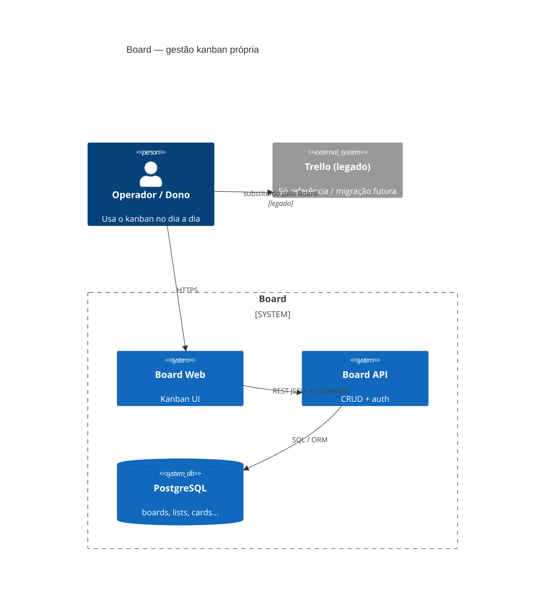
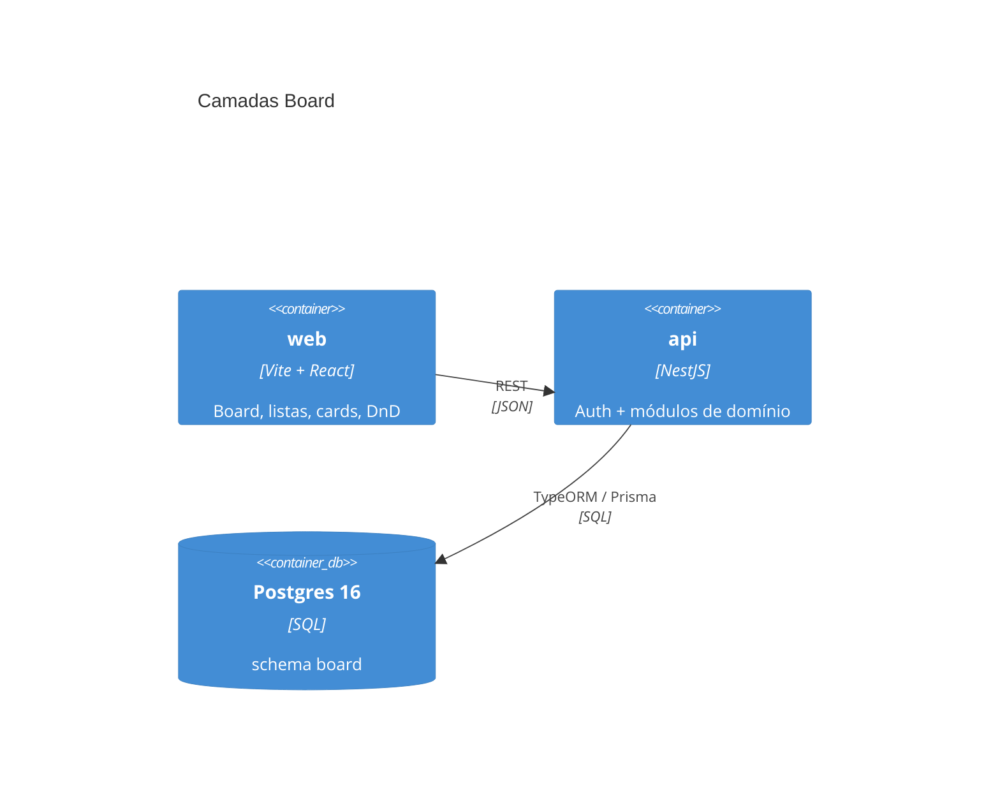
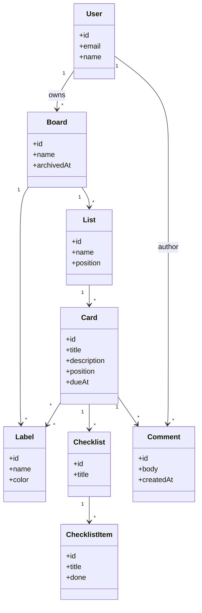
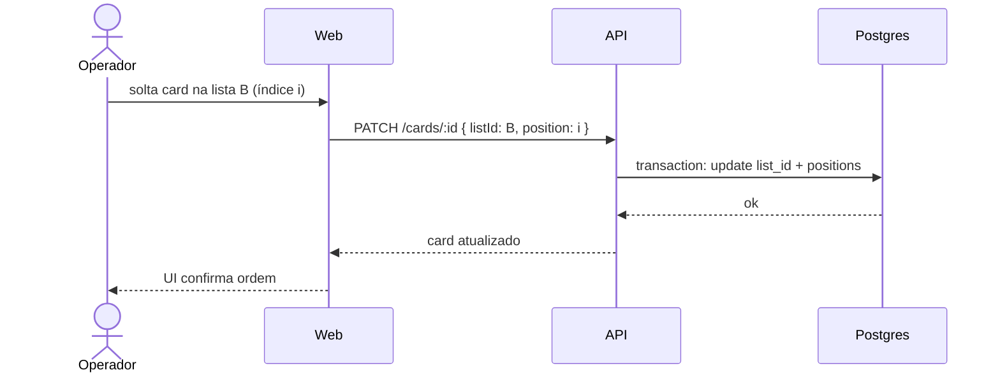

# Arquitetura — Board

**Por quê:** desenho estático e dinâmico do kanban próprio (web → API → Postgres).  
**Visão:** [`../README.md`](../README.md) · **PRD:** [`prd.md`](prd.md) · **DS:** [`design-system.md`](design-system.md)

**Antes → depois:** não havia produto; gestão no Trello + markdown.  
**Rollback:** ignore este doc; remova pastas `api/` / `web/` quando existirem; dados = drop do schema `board`.

---

## 1. Visão de contexto (C4 L1)



---

## 2. Contêineres (C4 L2)



| Contêiner | Responsabilidade |
|-----------|------------------|
| **web** | UI kanban; estado local de DnD; chama API |
| **api** | Auth, validação, regras de posição, persistência |
| **Postgres** | Fonte da verdade |

---

## 3. Stack

| Camada | Tecnologia | Nota |
|--------|------------|------|
| Front | Vite + React + TypeScript | Alinhado a `conectmax/vendas/web` |
| Estilo | CSS variables do DS | [`design-system.md`](design-system.md) |
| API | NestJS + ValidationPipe | Alinhado a `conectmax/vendas/api` |
| Auth | Sessão JWT (httpOnly cookie) ou bearer | MVP lab |
| DB | PostgreSQL 16 | Schema dedicado `board` ou DB `board` |
| ORM | TypeORM ou Prisma | Escolher no 1º épico de dados; documentar ADR |

---

## 4. Modelo de dados (lógico)

```text
User
  id, email, password_hash, name, created_at

Board
  id, owner_id → User, name, background (opcional), archived_at, created_at

List
  id, board_id → Board, name, position (float/int), archived_at

Card
  id, list_id → List, title, description, position, due_at, archived_at, created_at, updated_at

Label
  id, board_id → Board, name, color

CardLabel
  card_id, label_id  (N:N)

Checklist
  id, card_id → Card, title, position

ChecklistItem
  id, checklist_id → Checklist, title, done, position

Comment
  id, card_id → Card, author_id → User, body, created_at
```

### Posição

- `position` em `List` e `Card` é **ordenado crescente** na coleção pai.
- Move/reorder: API recebe `listId` destino + `position` (ou `beforeCardId` / índice); servidor recalcula e persiste.
- Default recomendado ao “concluir”: inserir no **topo** da lista destino (`position` mínima − gap) — espelha regra Trello Concluído da workstation.

---

## 5. API (esboço REST)

Prefixo: `/api/v1`. Auth em todas as rotas exceto login/register.

| Método | Rota | Ação |
|--------|------|------|
| POST | `/auth/register` | Criar usuário |
| POST | `/auth/login` | Sessão |
| POST | `/auth/logout` | Encerrar |
| GET | `/boards` | Listar boards do dono |
| POST | `/boards` | Criar |
| GET | `/boards/:id` | Board + listas + cards (payload de abertura) |
| PATCH | `/boards/:id` | Renomear / background |
| POST | `/boards/:id/archive` | Arquivar |
| POST | `/boards/:boardId/lists` | Criar lista |
| PATCH | `/lists/:id` | Renomear / reordenar |
| POST | `/lists/:id/archive` | Arquivar lista |
| POST | `/lists/:listId/cards` | Criar card |
| PATCH | `/cards/:id` | Título, descrição, due, lista+posição |
| POST | `/cards/:id/archive` | Arquivar |
| POST | `/cards/:id/restore` | Restaurar |
| GET/POST | `/boards/:id/labels` | Catálogo |
| PUT | `/cards/:id/labels` | Set de labels |
| CRUD | `/cards/:id/checklists` … | Checklists e itens |
| GET/POST | `/cards/:id/comments` | Comentários |
| GET | `/boards/:id/search?q=&label=&due=` | Busca/filtro |

Contratos OpenAPI: a produzir no refinamento técnico do EP de API.

---

## 6. Módulos Nest (alvo)

```text
api/src/
  auth/
  users/
  boards/
  lists/
  cards/
  labels/
  checklists/
  comments/
```

Web espelha superfícies: `pages/Home`, `pages/Board`, `components/List`, `Card`, `CardModal`, `Filters`.

---

## 7. Diagrama de classes (domínio)



---

## 8. Fluxo dinâmico — mover card



---

## 9. Deploy (lab)

| Ambiente | Como |
|----------|------|
| Dev | `api` :3001 (ou porta livre) · `web` Vite :5173 · Postgres local/Docker |
| Prod lab | Mesmo padrão Contabo/outros projetos quando houver `deploy/` |

Não reutilizar porta **3000** se a API ConnectMax estiver no ar — documentar `BOARD_API_PORT` no `.env` quando o código existir.

---

## 10. Árvore de pastas (alvo pós-código)

```text
board/
├── README.md
├── docs/
├── config/
├── prompts/
├── api/                 # Nest — a criar no desenvolvimento
├── web/                 # Vite React — a criar no desenvolvimento
└── deploy/              # opcional
```

---

## 11. Riscos técnicos

| Risco | Mitigação |
|-------|-----------|
| Concorrência em `position` | Gaps numéricos ou reorder periódica; transaction |
| Payload grande no GET board | Paginar arquivo; MVP carrega cards ativos só |
| Auth fraca | Cookie httpOnly + HTTPS em deploy |

## Próximos passos

→ Design system aplicado no 1º protótipo · discovery US-01 → scenarios/BDDs · depois EP de scaffold api/web
