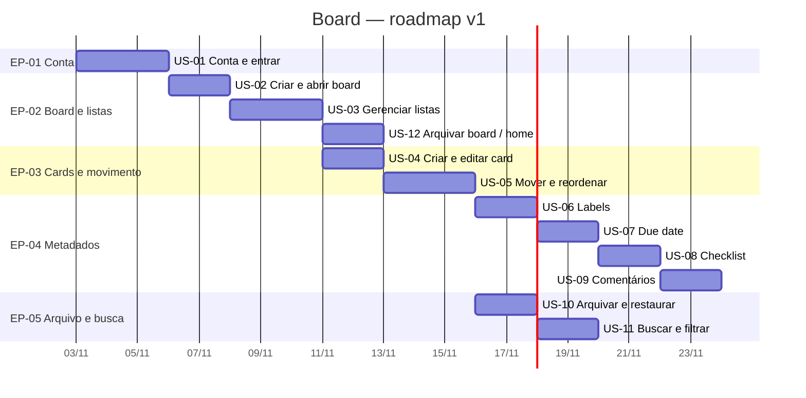

# Roadmap — Board

Artefato 3 do discovery. Epics: [`2.epics.md`](2.epics.md).  
Barras = ordem de entrega (sem SC). Baseline: **2026-11-03**.

## Gantt (EP → US)

## Ordem de ataque (refino)

1. US-01 → scenarios → BDDs → refinamento técnico → código  
2. US-02 → …  
3. Seguir o Gantt; US-10 pode paralelizar após US-05; US-11 após US-06.

## Próximo passo

→ `4.scenarios.md` para **US-01**
