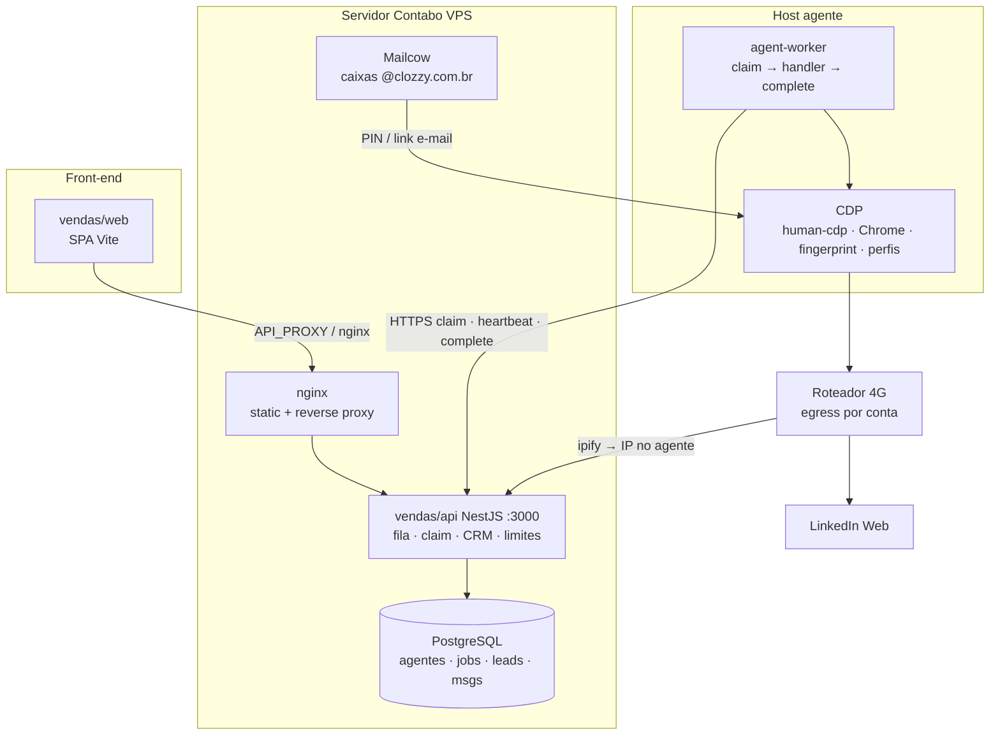

# Arquitetura — Robô de Prospecção (CDP)

**Por quê:** desenho alvo da prospecção LinkedIn só via Chrome CDP (sem AVD).  
**Umbrella:** [`../README.md`](../README.md) · **Docs:** [`README.md`](README.md) · **API:** [`../vendas/api/README.md`](../vendas/api/README.md) · **Worker:** [`../vendas/worker/README.md`](../vendas/worker/README.md) · **CDP:** [`../../screen-robot/pocs/chrome-cdp/human-cdp/README.md`](../../screen-robot/pocs/chrome-cdp/human-cdp/README.md)

**Antes → depois:** prospecção em AVD (`screen-robot` + adb) + CSV de contas → host agente só CDP + estado na API/Postgres + egress por roteador 4G.  
**Rollback:** voltar aos planos AVD ([`plano-implementacao-prospeccao-scripts.md`](plano-implementacao-prospeccao-scripts.md), [`plano-implementacao-worker-avd.md`](plano-implementacao-worker-avd.md)) e [`arquitetura.md`](arquitetura.md).

**Fora deste desenho:** AVD · adb · OmeTV · CSV · bot-lab.

---

## Diagrama

---

## Componentes

| Componente | Papel |
|------------|--------|
| **vendas/web** | Front-end (SPA Vite) |
| **nginx** | Static + reverse proxy → API |
| **vendas/api** | Fila, claim, CRM, limites |
| **PostgreSQL** | Agentes, jobs, leads, mensagens |
| **Mailcow** | Caixas `@clozzy.com.br` (PIN / link e-mail) |
| **agent-worker** | Pull: claim → handler → complete |
| **CDP** | Ecossistema de controle (human-cdp, Chrome, fingerprint, perfis) |
| **Roteador 4G** | Egress por conta; caminho até LinkedIn Web |
| **LinkedIn Web** | Alvo da prospecção |
