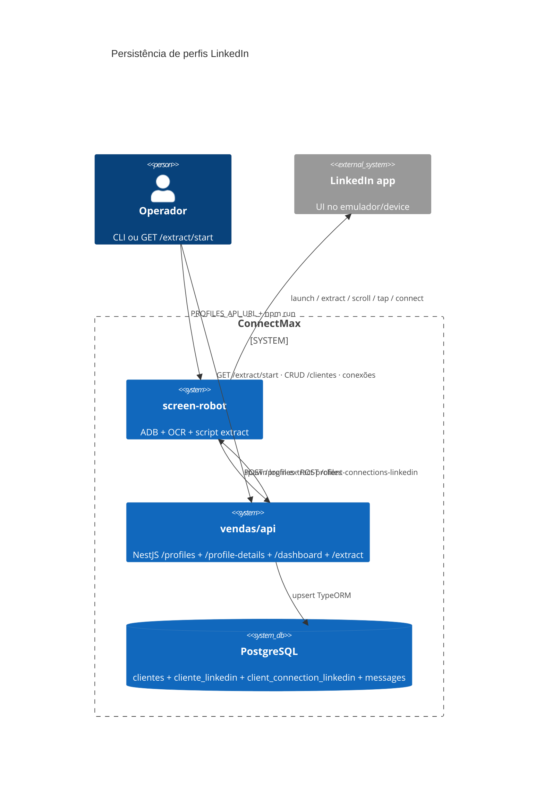
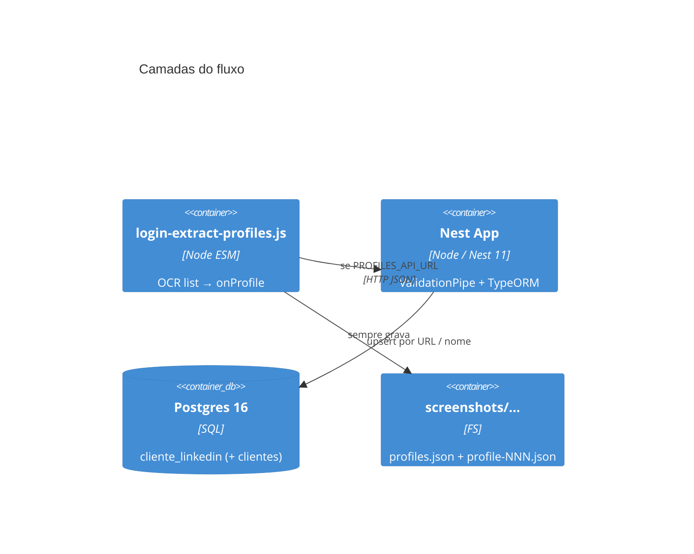
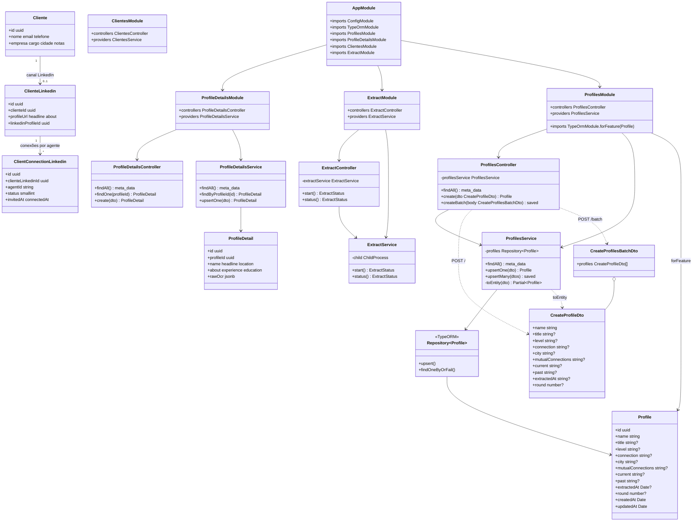
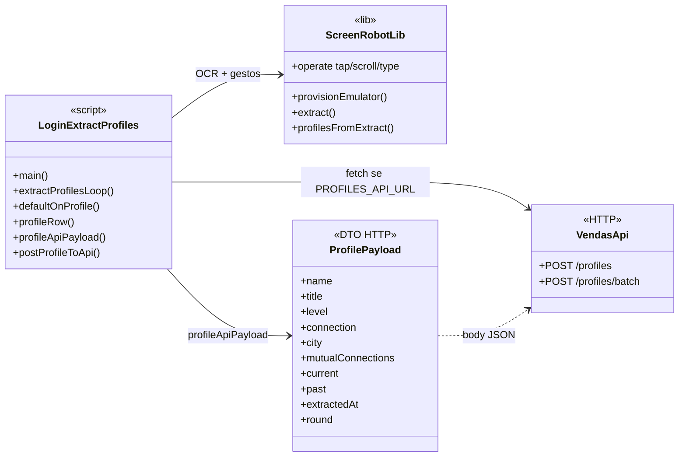
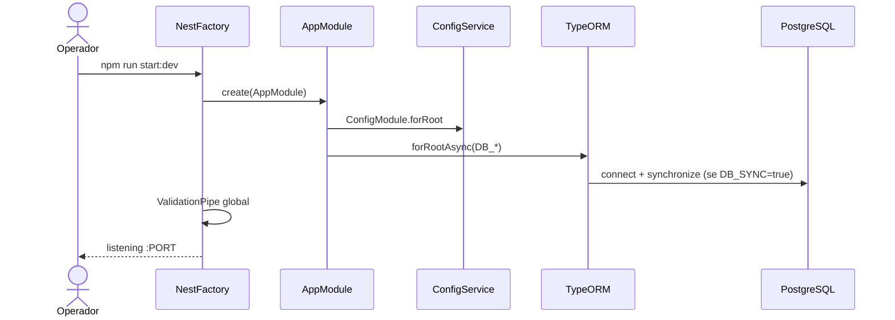
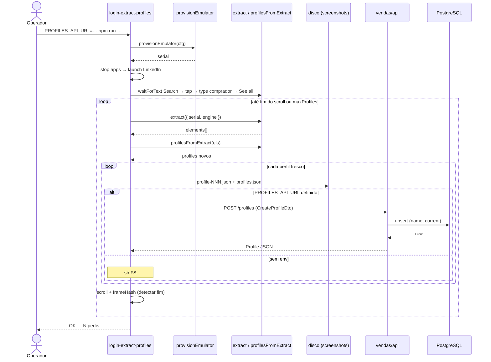
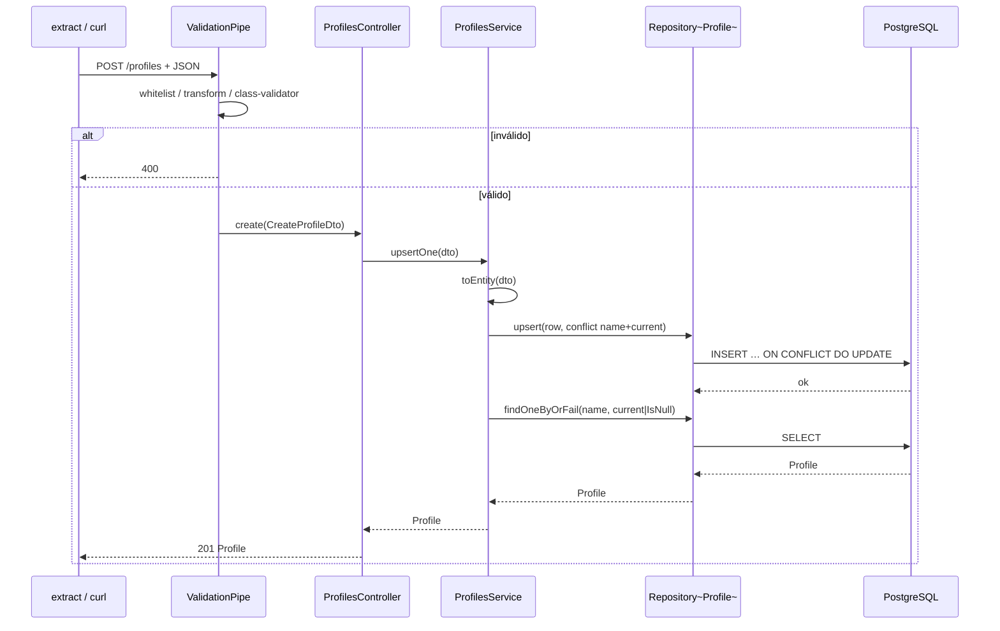
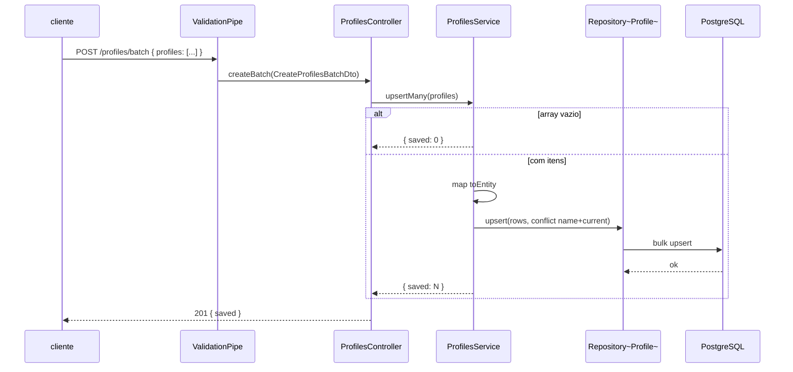
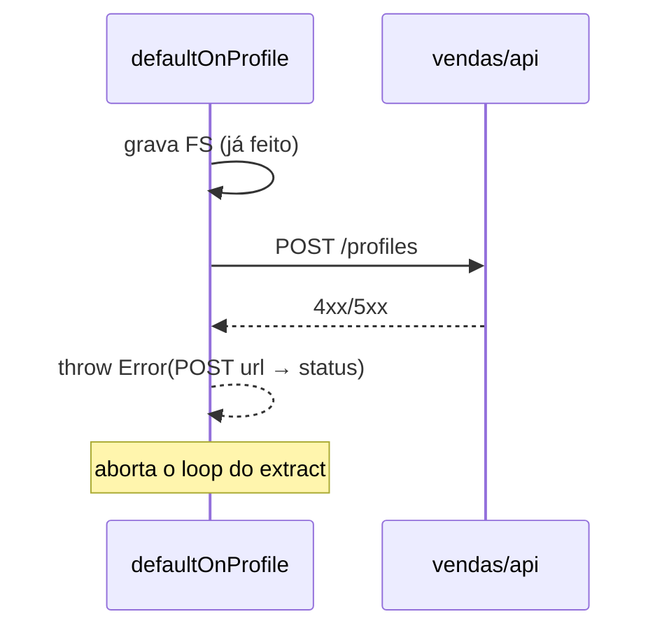

# Arquitetura — ConnectMax (extract → vendas/api → Postgres)

**Por quê:** desenho estático e dinâmico do fluxo extract LinkedIn → Nest → Postgres.  
**API:** [`../vendas/api/README.md`](../vendas/api/README.md) · **Extract:** [`../../screen-robot/src/scripts/login-extract-profiles.js`](../../screen-robot/src/scripts/login-extract-profiles.js) · **Umbrella:** [`../README.md`](../README.md) · **Plano:** [`plano-implementacao-prospeccao-scripts.md`](plano-implementacao-prospeccao-scripts.md)

**Antes → depois:** não havia diagrama; persistência era só JSON local.  
**Rollback:** ignore este doc; remova `PROFILES_API_URL` e pare a API.

---

## 1. Visão de contexto (C4 L1)



**Modelo de dados:** `clientes` (identidade) + `cliente_linkedin` (canal LinkedIn **e** extract: URL, foto, OCR, inviteStatus). `client_connection_linkedin` liga agente ↔ `cliente_linkedin` (status 0/1/2). Rotas `/profiles` e `/profile-details` são fachada sobre `cliente_linkedin`.

---

## 2. Contêineres (C4 L2)



---

## 3. Diagrama de classes — Nest (API)



### Mapeamento entidade ↔ tabela

| Classe / campo | Coluna SQL |
|----------------|------------|
| `Cliente` | `clientes` (`nome`) |
| `ClienteLinkedin` | `cliente_linkedin` |
| `profileUrl` | `profile_url` (unique parcial) |
| `inviteStatus` | `invite_status` |
| `mutualConnections` | `mutual_connections` |
| `extractedAt` / `deletedAt` | `extracted_at` / `deleted_at` |
| `rawOcr` | `raw_ocr` jsonb |
| Fachada `/profiles/:id` | `cliente_linkedin.id` |

---

## 4. Diagrama de classes — extract (lado cliente)

Funções do script (não são classes Nest; modeladas como módulos lógicos):



---

## 5. Sequência — bootstrap da API



---

## 6. Sequência — extract completo (lista → disco → API)



---

## 7. Sequência — `POST /profiles` (um card)



---

## 8. Sequência — `POST /profiles/batch`



---

## 9. Sequência — falha HTTP no extract



---

## 10. Contrato de dados

```text
OCR card (fields)
  → profileRow / profileApiPayload
  → POST /profiles (fachada)
  → clientes.nome + cliente_linkedin
```

Campos alinhados: `name`→`clientes.nome`, `title`→`headline`, `level`→`connection_degree`, URL/foto/OCR/`inviteStatus`/`deleted_at` em `cliente_linkedin`.
