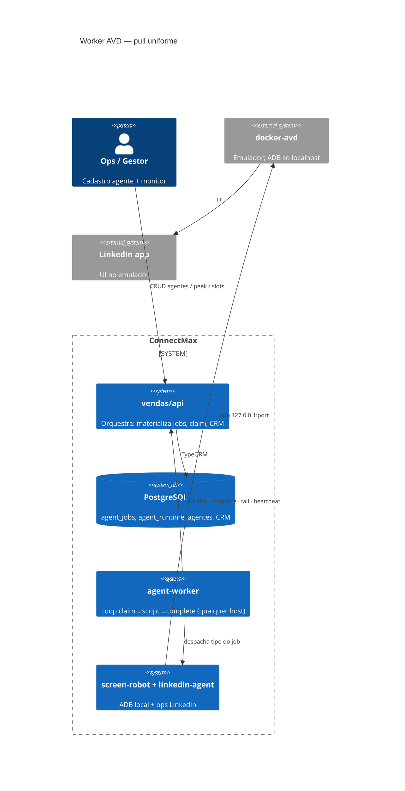
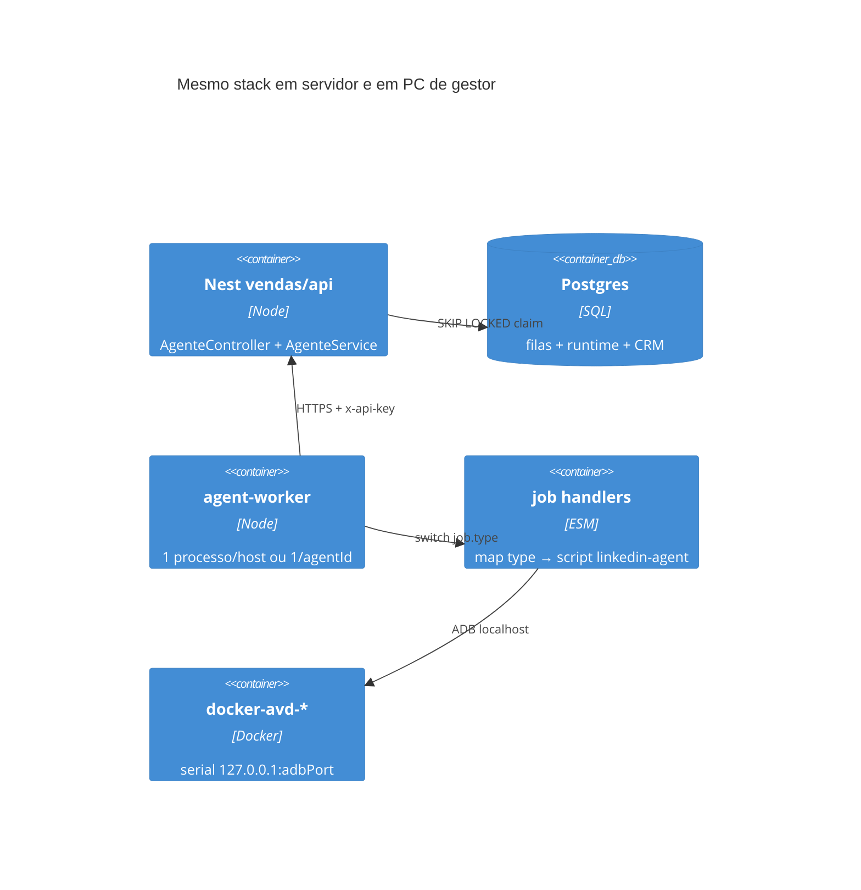
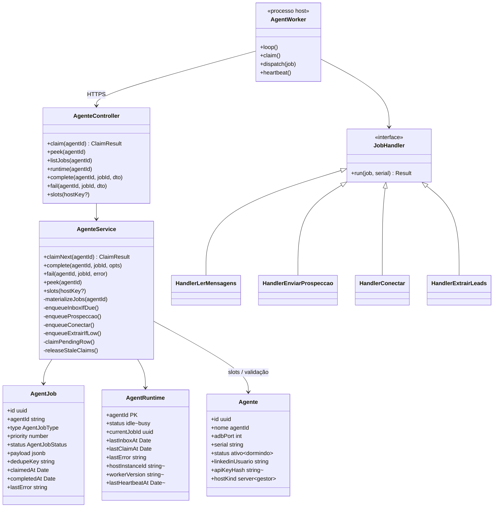
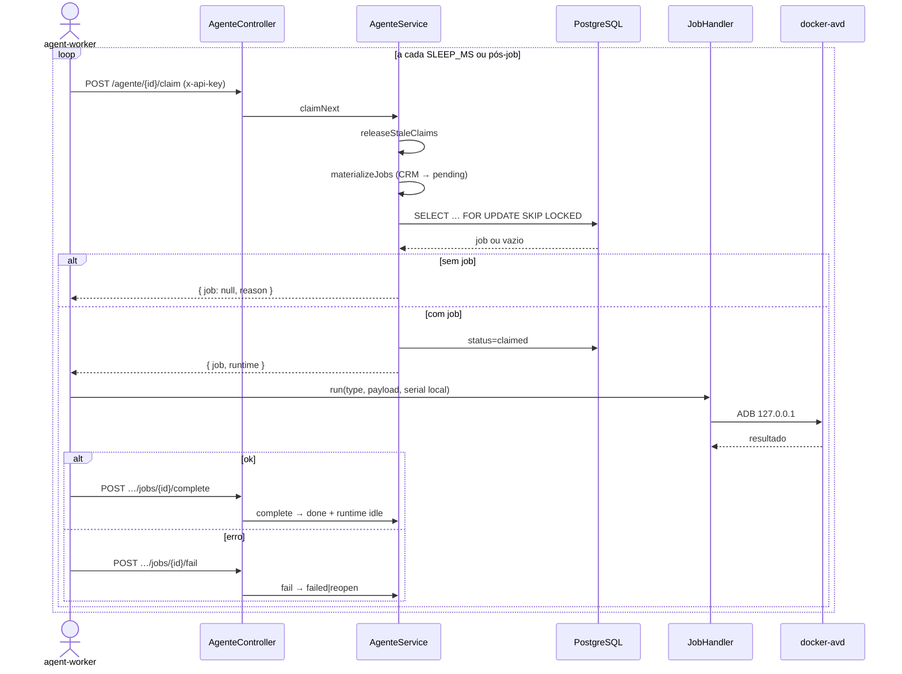
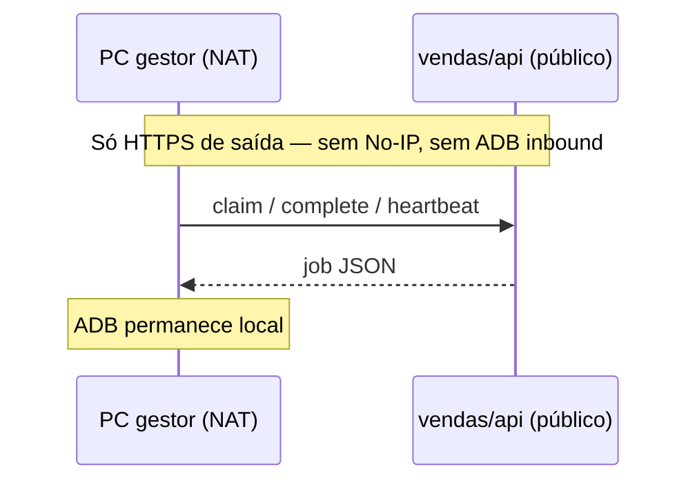
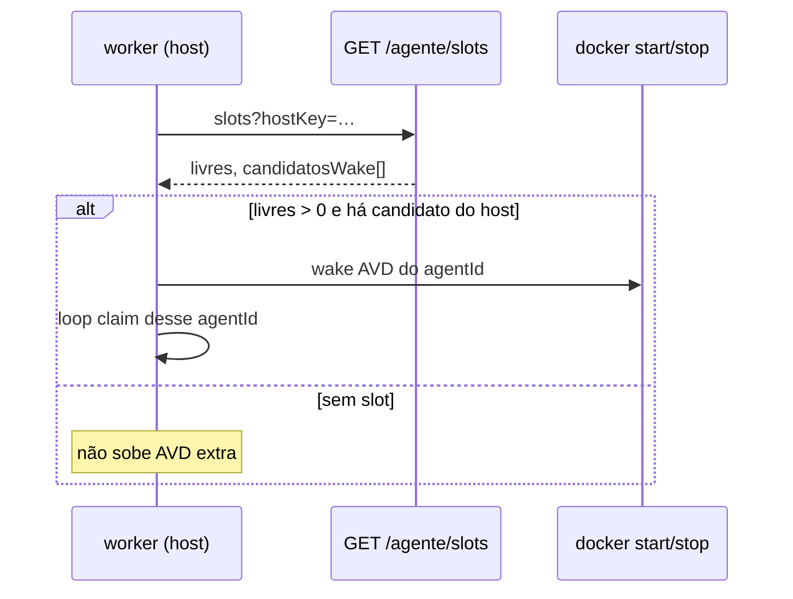
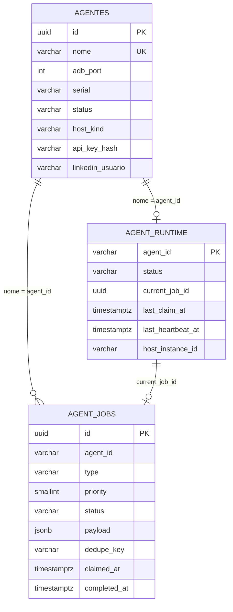

# Plano de implementação — Worker AVD (pull uniforme)

**Por quê:** servidor e máquina de gestor devem operar **igual** — AVD local + worker que puxa jobs da API; sem ADB/SSH no caminho crítico e sem IP público no PC do gestor.  
**Antes:** API pode SSH no host e falar ADB remoto; cadastro de agente exige `ipPublico` (exceto `localhost`); `agent-loop.mjs` só dry-run.  
**Depois:** orquestração só na API (materializa + claim); executor = worker local em qualquer host; ADB só `127.0.0.1`.  
**Rollback:** manter claim/complete como estão; voltar a acionar extract via SSH/`GET /extract/start` nos servidores; não instalar worker em gestores.

**Umbrella:** [`../README.md`](../README.md) · **API:** [`../vendas/api/README.md`](../vendas/api/README.md) · **Arquitetura extract:** [`arquitetura.md`](arquitetura.md) · **Plano scripts/pool:** [`plano-implementacao-prospeccao-scripts.md`](plano-implementacao-prospeccao-scripts.md) · **Stub loop:** [`../vendas/api/scripts/agent-loop.mjs`](../vendas/api/scripts/agent-loop.mjs)

---

## 1. Decisão arquitetural

| Opção | Veredito |
|-------|----------|
| Expor ADB / No-IP no gestor | **Descartado** — inbound, NAT, risco |
| VPN mesh só para ADB | **Evitar no crítico** — ainda é push remoto |
| **Worker pull (HTTPS out)** | **Escolhido** — homogêneo servidor ↔ gestor |

Contrato único em todo host:

```text
Worker local → HTTPS → vendas/api (claim / complete / fail / heartbeat)
              → ADB  → 127.0.0.1:adbPort (docker-avd)
```

SSH da API no host (wake/sleep/backup) fica **fora** do caminho de jobs — ops opcional só em servidores gerenciados.

---

## 2. Visão de contexto (C4 L1)



---

## 3. Contêineres (C4 L2)



**Invariante:** localização do host (IP público ou NAT) **não** muda o protocolo — só muda onde o binário do worker sobe.

---

## 4. Componentes arquiteturais

| Componente | Onde | Responsabilidade | Não faz |
|------------|------|------------------|---------|
| **Orquestrador** (`AgenteService`) | API | Materializar AC-01…04, prioridades, claim `SKIP LOCKED`, timeout de claim, slots por host | Gestos ADB, SSH no caminho crítico |
| **Contrato HTTP** (`AgenteController`) | API | `claim`, `peek`, `complete`, `fail`, `runtime`, `slots` | Executar script |
| **Cadastro** (`Agente` / `AgentesService`) | API | Identidade: `nome`=agentId, serial/porta local, LinkedIn, metadados de host | Decidir próximo job |
| **agent-worker** | Host (servidor ou gestor) | Loop: claim → handler → complete/fail; heartbeat; respeitar AVD local | Regras de CRM / prioridade |
| **Handlers** | Host | Um handler por `AgentJobType` → script linkedin-agent / screen-robot | Persistência de fila |
| **docker-avd** | Host | Emulador + estado `/android-home` | Rede inbound |

### Quem decide o quê

| Pergunta | Responde |
|----------|----------|
| *O quê* fazer? | API (`materializeJobs` a partir do CRM) |
| *Quando* (prioridade)? | API (`AGENT_JOB_PRIORITY` + `created_at`) |
| *Qual agentId*? | Job nasce amarrado ao agente (conta LinkedIn) |
| *Estou livre para pegar*? | Worker (pull quando idle) |
| *Quantos AVDs ativos neste host*? | API `slots()` + worker local (wake/sleep local) |

Não há scheduler que escolhe “servidor vs gestor”: o worker daquele `agentId` está onde o AVD da conta está.

---

## 5. Diagrama de classes



`~` = campo novo a implementar (ver §7).

### Tipos de job (já existentes)

| `type` | Prioridade | Origem (materialize) |
|--------|------------|----------------------|
| `ler_mensagens` | 1 | Intervalo `AGENT_INBOX_INTERVAL_MS` |
| `verificar_conexoes` | 2 | Pending + intervalo `AGENT_CONNECTIONS_INTERVAL_MS` → extract recent + mark-accepted |
| `enviar_prospeccao` | 3 | Conexão status=2 sem `sent` |
| `conectar` | 4 | Candidatos→status=0; ≤ `AGENT_CONNECT_DAILY_LIMIT` (15)/dia; lote + pausa `AGENT_CONNECT_BATCH_*` (local: 1/1 h) |
| `extrair_leads` | 5 | Até `AGENT_EXTRACT_DAILY_LIMIT` candidatos/dia (default 10) |

---

## 6. Diagramas de sequência

### 6.1 Claim → execute → complete (caminho feliz)



### 6.2 Gestor sem IP público (mesmo fluxo)



### 6.3 Slots / wake local (capacidade)



Wake/sleep passa a ser **decisão do worker** (ou sidecar no host), guiada por `slots` — não SSH da API no gestor.

---

## 7. Modelagem de banco de dados

### 7.1 Já existente (manter)

**`agent_jobs`**

| Coluna | Tipo | Notas |
|--------|------|-------|
| `id` | uuid PK | |
| `agent_id` | varchar(120) | = `agentes.nome` |
| `type` | varchar(40) | enum lógico AC-01…04 |
| `priority` | smallint | 1…4 |
| `status` | varchar(20) | pending \| claimed \| done \| failed \| cancelled |
| `payload` | jsonb | |
| `dedupe_key` | varchar(200) | unique parcial quando NOT NULL |
| `claimed_at` / `completed_at` | timestamptz | |
| `last_error` | text | |
| `created_at` / `updated_at` | timestamptz | |

Índices: `(agent_id, status, priority)`, `(agent_id, type, status)`.

**`agent_runtime`**

| Coluna | Tipo | Notas |
|--------|------|-------|
| `agent_id` | varchar PK | |
| `status` | varchar | idle \| busy |
| `current_job_id` | uuid | |
| `last_inbox_at` | timestamptz | AC-01 |
| `last_claim_at` | timestamptz | |
| `last_error` | text | |
| timestamps | | |

**`agentes`** — identidade + device local + LinkedIn (campos atuais de IP/SSH viram metadata opcional).

### 7.2 Evoluções necessárias

```sql
-- agent_runtime: presença do worker
ALTER TABLE agent_runtime
  ADD COLUMN IF NOT EXISTS last_heartbeat_at timestamptz,
  ADD COLUMN IF NOT EXISTS host_instance_id varchar(120),
  ADD COLUMN IF NOT EXISTS worker_version varchar(40);

-- agentes: auth do worker + tipagem de host (sem exigir IP)
ALTER TABLE agentes
  ADD COLUMN IF NOT EXISTS api_key_hash varchar(128),
  ADD COLUMN IF NOT EXISTS host_kind varchar(32) DEFAULT 'server';
  -- server | gestor | localhost
  ALTER COLUMN ip_publico DROP NOT NULL;  -- se ainda NOT NULL
```

Regra: `ip_publico` / SSH **não** são pré-requisito para executar jobs. Worker autentica com `x-api-key` (hash em `api_key_hash`).

### 7.3 ER (fila + runtime + agente)



Estados do job:

```text
pending → claimed → done
                 ↘ failed
claimed (stale > AGENT_CLAIM_TIMEOUT_MS) → pending (reopen)
```

---

## 8. Contrato HTTP (worker)

Base: já em `AgenteController` (`/agente/...`).

| Método | Path | Uso |
|--------|------|-----|
| `POST` | `/agente/:agentId/claim` | Próximo job |
| `POST` | `/agente/:agentId/jobs/:jobId/complete` | Sucesso + `result` |
| `POST` | `/agente/:agentId/jobs/:jobId/fail` | Erro |
| `GET` | `/agente/:agentId/peek` | Debug / UI |
| `GET` | `/agente/:agentId/runtime` | Estado |
| `GET` | `/agente/:agentId/jobs` | Histórico |
| `GET` | `/agente/slots` | Capacidade por host |

**A implementar:**

| Método | Path | Uso |
|--------|------|-----|
| `POST` | `/agente/:agentId/heartbeat` | Atualiza `last_heartbeat_at`, `host_instance_id`, `worker_version` |
| Auth | header `x-api-key` | Obrigatório no worker; validar hash vs agente |

Env do worker:

```bash
API_URL=https://api.exemplo
AGENT_ID=agent-d          # ou lista AGENT_IDS=a,b,c no mesmo host
AGENT_API_KEY=…
SERIAL=127.0.0.1:5560     # ou lido do cadastro via GET autenticado
SLEEP_MS=15000
AVD_MAX_ATIVOS=4          # espelha config API no host
```

---

## 9. Pacote `agent-worker` (a construir)

Evoluir [`../vendas/api/scripts/agent-loop.mjs`](../vendas/api/scripts/agent-loop.mjs) → pacote instalável (ex. `vendas/worker` ou bin no linkedin-agent):

```text
agent-worker/
  src/
    loop.mjs           # claim → dispatch → complete
    auth.mjs
    heartbeat.mjs
    slots-wake.mjs     # opcional: docker start/stop local
    handlers/
      ler_mensagens.mjs
      enviar_prospeccao.mjs
      conectar.mjs
      extrair_leads.mjs
  README.md
```

Cada handler chama o script linkedin-agent correspondente e devolve `{ ok, result }` ou throw → `fail`.

Deploy gestor = mesmo artefato do servidor (systemd / pm2 / Docker sidecar). Sem abrir porta.

---

## 10. Segurança

| Controlo | Detalhe |
|----------|---------|
| Sem ADB na internet | Bind só `127.0.0.1` |
| Sem inbound no gestor | Só HTTPS out |
| API key por agente | Rotação; hash no banco; nunca logar plain |
| Claim amarra agentId | Key do agente A não claima fila B |
| Timeout claim | Reabre job travado |
| TLS | API pública só HTTPS |

---

## 11. Ordem de construção

| Fase | Entrega | Critério de pronto |
|------|---------|--------------------|
| **F0** | Doc + alinhar time (este plano) | Aceite do contrato único | **Feito** |
| **F1** | Auth `x-api-key` + heartbeat no runtime | Worker dry autentica; UI mostra online/offline | **Feito** (API + worker) |
| **F2** | Worker real: 1 handler (ex. `extrair_leads`) | claim→script→complete em localhost | **Feito** (`vendas/worker`) |
| **F3** | Demais handlers AC-01…03 | Funil completo via pull | Feito: `ler_mensagens` → `linkedin-unread-messages --sync` (lista + abre chat + `client_linkedin_message`) |
| **F4** | Multi-agente no host + `slots` wake local | ≤ N AVDs ativos; servidor e gestor iguais | **Feito** (`MODE=host`; rotate **on-empty** pós-claim) |
| **F5** | Cadastro: `host_kind`, IP/SSH opcionais | Gestor cadastra agente sem IP público | **Parcial** (`host_kind` + IP opcional gestor) |
| **F6** | Desacoplar SSH do caminho crítico | Jobs nunca passam por SSH; SSH só ops server | Pendente |

**Já pronto:** `AgentJob` / `AgentRuntime` (+ heartbeat), claim, `POST /agentes/:id/api-key`, [`../vendas/worker/README.md`](../vendas/worker/README.md).

---

## 12. Config (API)

| Env | Default | Papel |
|-----|---------|-------|
| `AGENT_INBOX_INTERVAL_MS` | `14400000` (4 h) | AC-01 |
| `AGENT_EXTRACT_DAILY_LIMIT` | `10` | AC-04 (substitui `AGENT_LEAD_THRESHOLD`) |
| `AGENT_CONNECT_DAILY_LIMIT` | `15` | AC-03 máx. convites/dia por agente |
| `AGENT_CONNECT_BATCH_SIZE` | `5` | AC-03 tamanho do lote antes da pausa |
| `AGENT_CONNECT_BATCH_INTERVAL_MS` | `3600000` (1 h) | AC-03 pausa entre lotes |
| `AVD_MAX_ATIVOS_POR_SERVIDOR` | `4` | slots |
| `AGENT_CLAIM_TIMEOUT_MS` | `600000` (10 min) | reopen |
| `AGENT_HEARTBEAT_STALE_MS` | *(novo)* `120000` | offline se sem heartbeat |

---

## 13. Caminho inverso (rollback)

1. Parar workers nos hosts.  
2. Ignorar `api_key_hash` / heartbeat (colunas podem ficar).  
3. Voltar extract/ops via fluxo SSH ou `GET /extract/start` só em servidores.  
4. Cadastro pode voltar a exigir `ipPublico` no DTO se necessário.  
5. Este doc: arquivar; plano scripts antigo permanece válido para linkedin-agent.

---

## 14. Fora de escopo (agora)

- Expor scrcpy/ADB remoto para suporte visual (canal separado, se um dia existir).  
- Motor de IA no caminho crítico (ver plano de scripts).  
- Filas compartilhadas entre agentIds (trabalho continua **por agente**).
