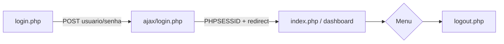
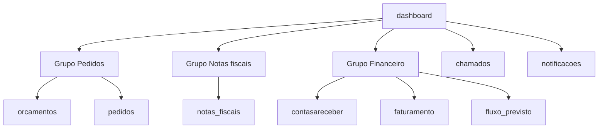
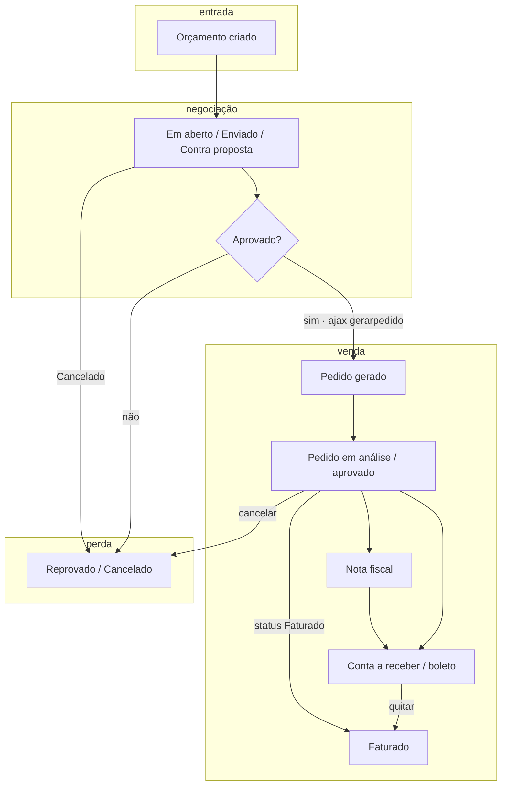
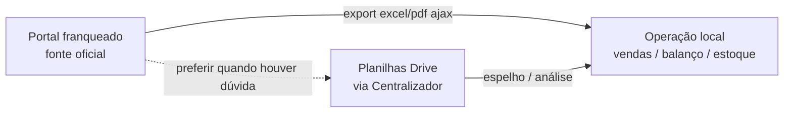

# Portal do Franqueado ConectMax

**Por quê:** mapear o menu e os pontos de integração HTTP do painel oficial (PHP + sessão), para automação e cruzamento com as planilhas do Centralizador.  
**Painel:** https://franqueado.conectmax.com/  
**Login:** https://franqueado.conectmax.com/franqueado/login.php  
**Docs umbrella:** [`README.md`](README.md)

Credenciais **não** ficam neste repositório. Uso local: `~/.config/conectmax-franqueado/credentials.env` (e cookies em `cookies.txt`). Fonte humana: Doc [Centralizador](https://docs.google.com/document/d/1hAptxxK7232o-ZEGUeTAU7AVwNpXsVvX0cd5zQ0RtJU) (seção Portal do Franqueado).

## Autenticação

1. `POST` form `application/x-www-form-urlencoded` em `/franqueado/ajax/login.php` com campos `usuario` e `senha`
2. Resposta de sucesso: `` + cookie `PHPSESSID`
3. Demais páginas: `GET /franqueado/?page=<nome>` com o mesmo cookie
4. Sair: `/franqueado/logout.php`

Não há API REST pública documentada; a “API” prática são endpoints **ajax** PHP sob `/franqueado/ajax/…` e páginas HTML do menu.

## Fluxo: de onde vai para onde

### 1. Entrada e sessão

Sem cookie válido, qualquer `?page=` volta ao login. Scripts locais reutilizam `~/.config/conectmax-franqueado/cookies.txt` após o mesmo POST.

### 2. Navegação no painel

Cada nó é `GET /franqueado/?page=<nó>`. O shell (sidemenu) é o mesmo em todas as páginas; só o miolo muda.

### 3. Funil: orçamento → venda

No portal, a **venda** não é uma tela isolada: é o pedido que avança até faturamento (NF + contas a receber / status *Faturado*). O funil comercial é:

#### Etapas e telas

| # | Etapa do funil | Tela `?page=` | Sinais de avanço | Como cai fora |
|---|---|---|---|---|
| 1 | **Lead/proposta** — orçamento | `orcamentos` | status *Em aberto* → *Enviado* / *Contra proposta* | *Reprovado*, *Cancelado* |
| 2 | **Ganho comercial** — orçamento aprovado | `orcamentos` | status *Aprovado* | — |
| 3 | **Venda aberta** — vira pedido | `pedidos` | `ajax/orcamentos/gerarpedido.php` (pedido aponta `Orçamento: N`) | pedido *Cancelado* / *Reprovado* |
| 4 | **Execução** — pedido em curso | `pedidos` | *Rascunho* → *Em análise* → *Aprovado* | *Cancelado* / *Reprovado* |
| 5 | **Venda faturada** | `notas_fiscais` + `contasareceber` (+ `faturamento`) | NF emitida; CR; status pedido *Faturado*; quitação/boleto | inadimplência fica em CR até quitar |

**Definição prática de “venda” neste funil:** pedido ligado a orçamento que chegou a **faturado** (e/ou NF + título em CR). Contagem intermediária útil: **orçamentos aprovados** e **pedidos gerados**.

#### Métricas (exemplo set/2026)

Extraído do painel com filtro `01/09/2026`–`30/09/2026`:

| Etapa | Qtd | Nota |
|---|---|---|
| Orçamentos (todos) | 126 | topo do funil |
| └ Aprovados | 40 | ganhos comerciais |
| └ Enviados | 19 | ainda em negociação |
| └ Contra proposta | 3 | negociação |
| └ Cancelados | 64 | perda |
| Pedidos no mês | 34 | conversão orçamento→pedido (~27% dos 126; ~85% dos 40 aprovados*) |
| Notas fiscais (linhas) | 22 | snapshot na planilha Drive |
| Contas a receber (linhas) | 52 | snapshot na planilha Drive |
| Faturamento (linhas) | 7 | snapshot na planilha Drive |

\*Aproximação: pedidos do mês podem vir de orçamentos aprovados em outro dia; o vínculo exato é o campo *Orçamento: N* em cada pedido.

#### Planilhas no Drive (Centralizador)

Pasta `ConnectMax - Campinas` — **Orçamentos, Pedidos, NF, Contas a receber e Faturamento 2025–2026** em planilha única por etapa (abas `Mês/Ano`); 2023/2024 ainda por ano. Portal sem dados antes de 2023; NF e CR só a partir de 2024. Links também em **Funil portal — planilhas (todos os anos)** no [Centralizador](https://docs.google.com/document/d/1hAptxxK7232o-ZEGUeTAU7AVwNpXsVvX0cd5zQ0RtJU).

| Etapa | 2023 | 2024 | 2025 | 2026 |
|---|---|---|---|---|
| Orçamentos | [abrir](https://docs.google.com/spreadsheets/d/1wG6TzaHMcYC1w5hiSB-5FBbq_3Pic8kG0l0Ku8htqPM/edit) | [abrir](https://docs.google.com/spreadsheets/d/1YjmJ1nGL729sH3HDpTG2F_HJDm7Pers_liu-5QpenMI/edit) | [2025–2026 unificado](https://docs.google.com/spreadsheets/d/1yj1o76FmsVTDBii59WILNbjmujh8ckeifbkDs830rZ0/edit) (Resumo + **Resumo vendedores** único com blocos Jan/2025…Out/2026 + TOTAL GERAL; Faturamento = Total Aprovado) | ← mesma planilha |
| Pedidos | [abrir](https://docs.google.com/spreadsheets/d/1ia7whr3N08BYSnAZ_LxMREuM-dsXXfJd_5zHxOMFLqM/edit) | [abrir](https://docs.google.com/spreadsheets/d/1K-q0XclibVriviXqPB_Elsh7D8CJVmsOMoLDKCczWcU/edit) | [2025–2026 unificado](https://docs.google.com/spreadsheets/d/1vmumcYEVe--9E97sd-ViEBGnqP220PXhcSOl0pmlrts/edit) (Resumo + **Resumo vendedores** por mês + abas Jan/2025…Out/2026) | ← mesma planilha |
| Notas fiscais | — | [abrir](https://docs.google.com/spreadsheets/d/1tySqm6xpHe7Bg30eCgpMO-hBJzc2suJCj5nQTM_TN-E/edit) | [2025–2026 unificado](https://docs.google.com/spreadsheets/d/1S81Mo5JuO_1irrHAJWkLrZIEJTEX714AMLjrlBxBqoc/edit) (abas Jan/2025…Dez/2025 + Jan/2026…Out/2026) | ← mesma planilha |
| Contas a receber | — | [abrir](https://docs.google.com/spreadsheets/d/1QpyyimV5AvdQyjcSWsz07yMPDBF0UmN8Bi31eAs8vx8/edit) | [2025–2026 unificado](https://docs.google.com/spreadsheets/d/14INvpLdNiGQg9M_wsiHQCiPVrCpreoZIxIm6OpQ3ubs/edit) (abas Jan/2025…Dez/2025 + Jan/2026…Dez/2026) | ← mesma planilha |
| Faturamento | — | [abrir](https://docs.google.com/spreadsheets/d/1Vi2hj1ulFDd-hhc5YkSCU00p5hWvidRhBku6n8rh-j4/edit) | [2025–2026 unificado](https://docs.google.com/spreadsheets/d/1Q0tj17N0AhVRDOgF-LPG3aMFCCCmlbkVBJn-zlyhBxg/edit) (Resumo + **Resumo vendedores** por mês; vendedor no Resumo `#N - Nome`; Jan/2025…Dez/2026) | ← mesma planilha |

Snapshots (não substituem o portal). Reextrair do painel para atualizar.

Cópia local (xlsx) de Orçamentos, Pedidos e Faturamento 2025–2026: [`planilhas-funil/`](planilhas-funil/README.md). Rebaixar: ver README dessa pasta.

#### Ações técnicas nas arestas

| De | Para | Como |
|---|---|---|
| Orçamento | Pedido | `ajax/orcamentos/gerarpedido.php` |
| Orçamento | (mesmo) | `ajax/orcamentos/status.php`, `duplicar.php` |
| Pedido | (mesmo) | `ajax/pedidos/status.php`, `cancelar.php`, `duplicar.php` |
| NF | Pedido | `ajax/notas_fiscais/gerar_pedido.php` (caminho alternativo) |
| Pedido / NF | Contas a receber | lançamento na tela CR |
| CR | Boleto / quitado | `ajax/boletos/*`, `ajax/contasareceber/quitar.php` |
| Pedido / CR | Faturamento | tela `faturamento` (consolidado) |
| Faturamento | Fluxo previsto | projeção (`fluxo_previsto`), não etapa do funil de venda |

### 4. Portal × Drive (Centralizador)

## Opções do menu

Base: `https://franqueado.conectmax.com/franqueado/?page=…`

| Grupo (UI) | Opção | `page` | Papel |
|---|---|---|---|
| Sistema | Dashboard | `dashboard` | Home do portal; resumo / boas-vindas |
| Pedidos | Orçamentos | `orcamentos` | Lista e gestão de orçamentos |
| Pedidos | Pedidos | `pedidos` | Pedidos (status, cancelar, duplicar via ajax) |
| Notas fiscais | Notas fiscais | `notas_fiscais` | NFs; export PDF/XML, gerar pedido |
| Financeiro | Contas a receber | `contasareceber` | Títulos a receber; quitar / status / Excel |
| Financeiro | Faturamento | `faturamento` | Faturamento; relatórios Excel/PDF |
| Financeiro | Fluxo previsto | `fluxo_previsto` | Projeção de fluxo (paralelo à planilha do Drive) |
| Chamados | Chamados | `chamados` | Chamados de suporte / operação |
| — | Notificações | `notificacoes` | Inbox de notificações do franqueado |

## Endpoints ajax observados

Úteis para scripts (sempre com sessão autenticada):

| Endpoint | Uso típico |
|---|---|
| `/franqueado/ajax/login.php` | Login |
| `/franqueado/ajax/active.php` | Ativar/desativar registros em tabelas |
| `/franqueado/ajax/salvar_ordem_registros.php` | Reordenar linhas |
| `/franqueado/ajax/notificacao_ler.php` | Marcar notificação lida |
| `/franqueado/ajax/pedidos/status.php` | Alterar status de pedido |
| `/franqueado/ajax/pedidos/cancelar.php` | Cancelar pedido |
| `/franqueado/ajax/pedidos/duplicar.php` | Duplicar pedido |
| `/franqueado/ajax/orcamentos/status.php` | Status de orçamento |
| `/franqueado/ajax/orcamentos/duplicar.php` | Duplicar orçamento |
| `/franqueado/ajax/orcamentos/gerarpedido.php` | Gerar pedido a partir de orçamento |
| `/franqueado/ajax/contasareceber/quitar.php` | Quitar título |
| `/franqueado/ajax/contasareceber/status.php` | Status CR |
| `/franqueado/ajax/contasareceber/relatorio_excel.php` | Export Excel CR |
| `/franqueado/ajax/faturamento/relatorio_excel.php` | Export Excel faturamento |
| `/franqueado/ajax/faturamento/relatorio_pdf.php` | Export PDF faturamento |
| `/franqueado/ajax/notas_fiscais/*` | PDF/XML/relatório/gerar pedido / deletar arquivos |
| `/franqueado/ajax/boletos/*` | Boletos |

Há também rotas em `/painel/ajax/…` (chat, notificação genérica) usadas pelo shell do painel.

## Relação com o Drive

O Doc Centralizador no Drive aponta planilhas operacionais (vendas, balanço, estoque, etc.). O portal acima é o **sistema oficial** da franquia; as planilhas são espelho / operação local. Ao automatizar, preferir dados do portal quando a fonte de verdade for o ERP/franqueadora.

## Caminho inverso

- Remover este doc: apagar `portal-franqueado.md` e a linha correspondente em [`README.md`](README.md)
- Invalidar sessão local: `rm ~/.config/conectmax-franqueado/cookies.txt` (e opcionalmente `credentials.env`)
- Logout remoto: abrir `/franqueado/logout.php` com o cookie ativo
- Antes desta doc: só o menu no HTML do painel + anotações no Centralizador; sem mapa no repositório
- Remover só o fluxo: apagar a seção **Fluxo: de onde vai para onde** (diagramas mermaid + tabela)
- Remover só o funil: apagar o subitem **3. Funil: orçamento → venda** (voltar ao fluxo operacional genérico se necessário)
- Remover planilhas Funil — *: lixeira no Drive + tirar links da seção no Centralizador
