# Mapa visual — Portal Franqueado ConectMax

**Gerado:** 2026-11-12 (CDP perfil `germano` :9230 + human-cdp)  
**Painel:** https://franqueado.conectmax.com/franqueado/  
**Sessão:** conta gerenciada **LAERCIO** (banner amarelo “Você está gerenciando a conta de LAERCIO”)  
**Complementa:** [`portal-franqueado.md`](../portal-franqueado.md) · [`GETS.md`](../../portal-api/GETS.md)  
**Regenerar:** `node docs/portal-mapa/mapear-portal-cdp.mjs` (Chrome Germano up) · JSON bruto por tela nesta pasta

## Visão geral

Portal PHP de franquia (sessão `PHPSESSID`). Shell fixo: header CONECTMAX + sino de notificações + avatar; sidebar por grupos. Miolo muda com `?page=`.

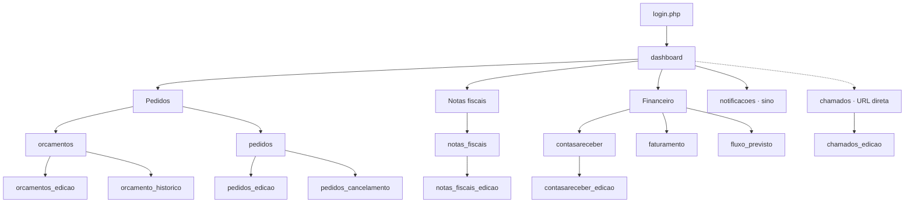

**Funil comercial:** Orçamento → Pedido → NF → Contas a receber → Faturado (detalhe em [`portal-franqueado.md`](../portal-franqueado.md)).

### Achados desta captura

| Achado | Detalhe |
|---|---|
| Menu lateral | Só: Dashboard, Orçamentos, Pedidos, Notas fiscais, Contas a receber, Faturamento, Fluxo previsto |
| Chamados | **Fora do sidebar** nesta conta; acessível por URL `?page=chamados` |
| Notificações | Sino no header + `?page=notificacoes` |
| Links relativos | HTML gera `…/franqueado/franqueado/?page=` (path duplicado). Usar sempre `…/franqueado/?page=` |
| Impersonação | Banner amarelo + Sair; sessão opera como LAERCIO |

---

## Shell (todas as telas)

| Elemento | Função |
|---|---|
| Logo CONECTMAX | Home do painel |
| Hamburger | Colapsa sidebar |
| Tela cheia | Toggle fullscreen |
| Sino (badge) | Inbox; link “Ver todas” → notificações |
| Avatar | Menu do usuário |
| Banner amarelo | Impersonação da conta LAERCIO + **Sair** |
| Modal genérico | Fechar / Excluir (shell) |

### Menu lateral

| Grupo | Item | `page` |
|---|---|---|
| SISTEMA | Dashboard | `dashboard` |
| PEDIDOS | Orçamentos | `orcamentos` |
| PEDIDOS | Pedidos | `pedidos` |
| NOTAS FISCAIS | Notas fiscais | `notas_fiscais` |
| FINANCEIRO | Contas a receber | `contasareceber` |
| FINANCEIRO | Faturamento | `faturamento` |
| FINANCEIRO | Fluxo previsto | `fluxo_previsto` |

---

## Índice de prints

### Listagens / home

| Tela | `page` | Print |
|---|---|---|
| Dashboard | `dashboard` | [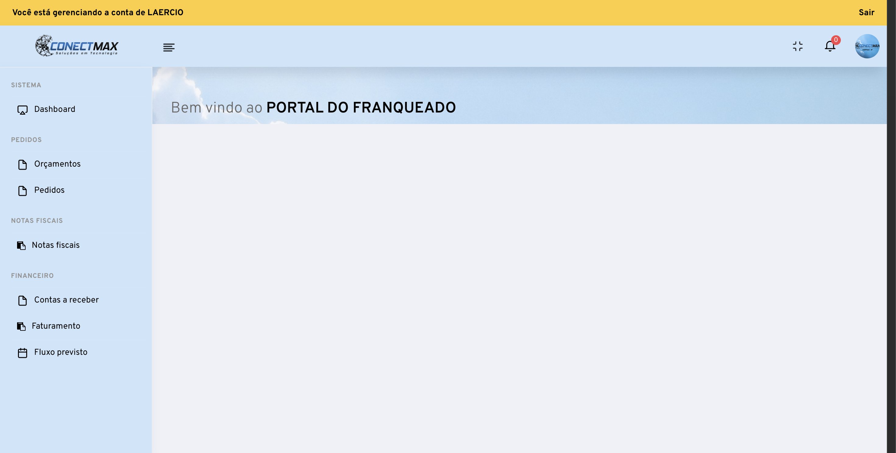](screenshots/dashboard.png) |
| Orçamentos | `orcamentos` | [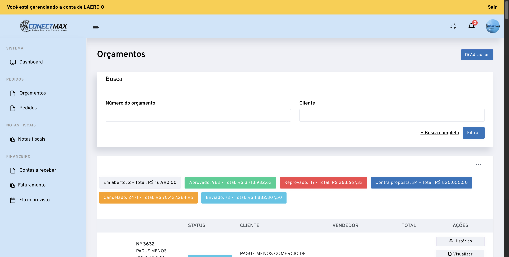](screenshots/orcamentos.png) |
| Pedidos | `pedidos` | [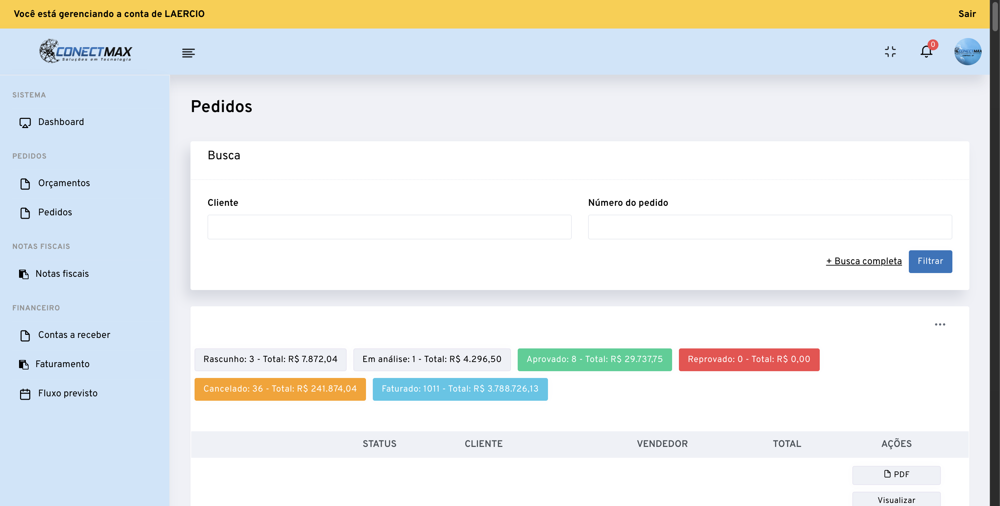](screenshots/pedidos.png) |
| Notas fiscais | `notas_fiscais` | [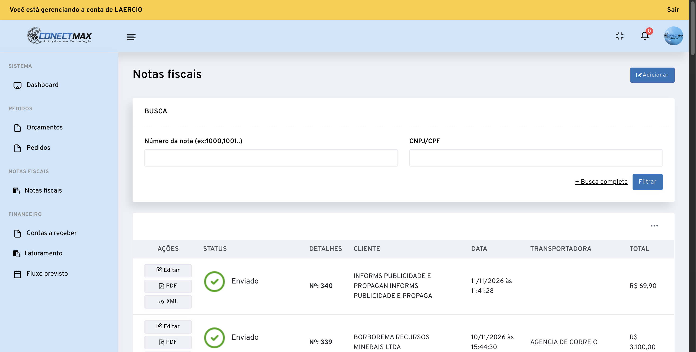](screenshots/notas_fiscais.png) |
| Contas a receber | `contasareceber` | [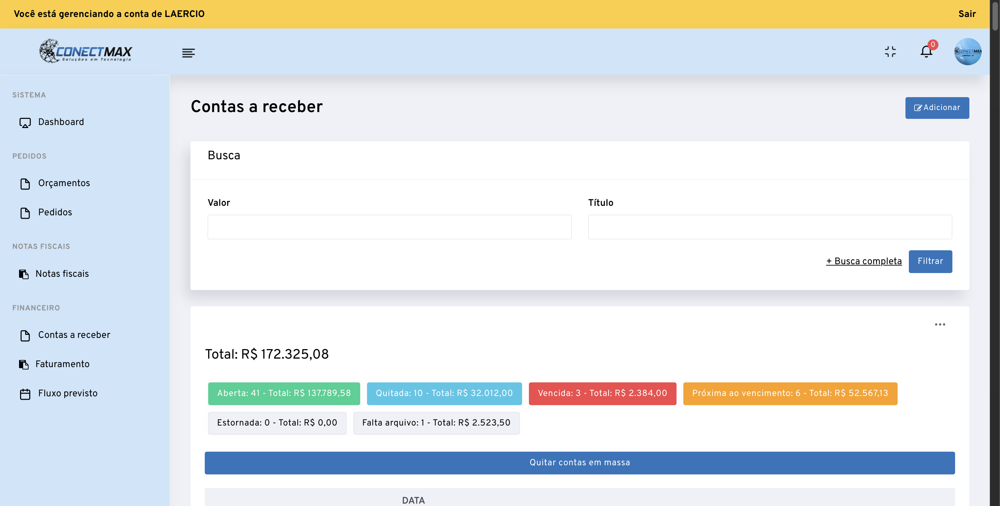](screenshots/contasareceber.png) |
| Faturamento | `faturamento` | [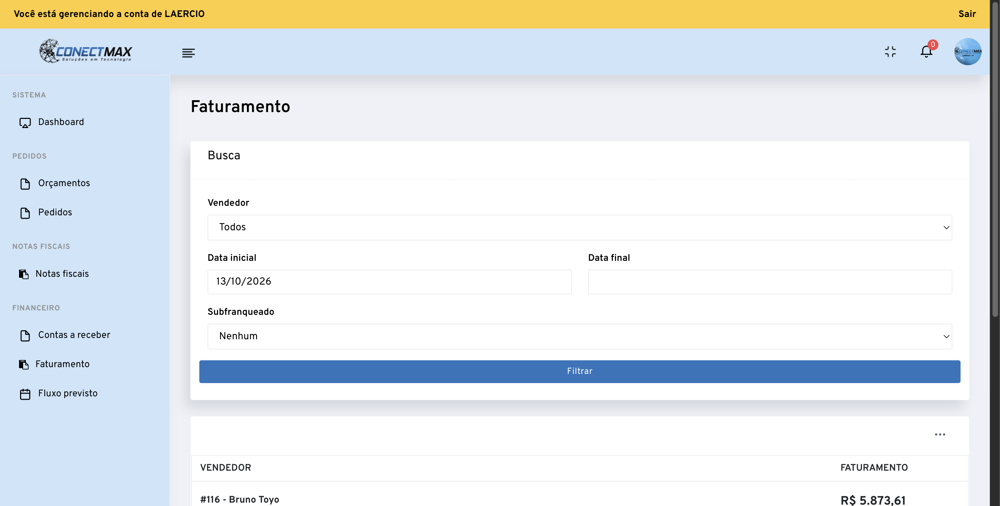](screenshots/faturamento.png) |
| Fluxo previsto | `fluxo_previsto` | [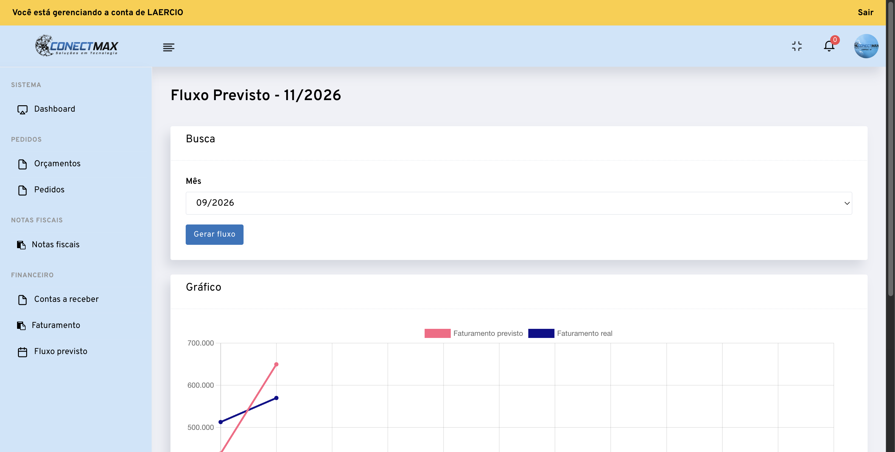](screenshots/fluxo_previsto.png) |
| Chamados | `chamados` | [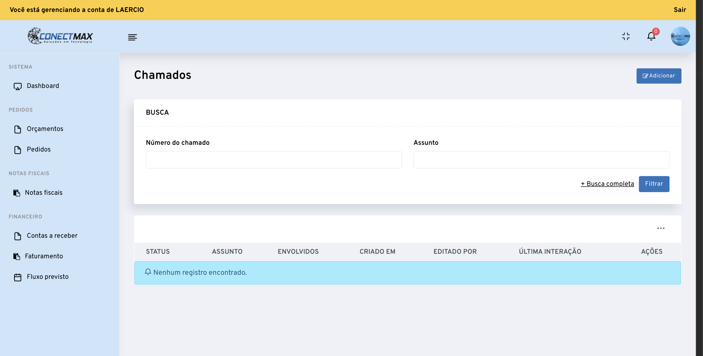](screenshots/chamados.png) |
| Notificações | `notificacoes` | [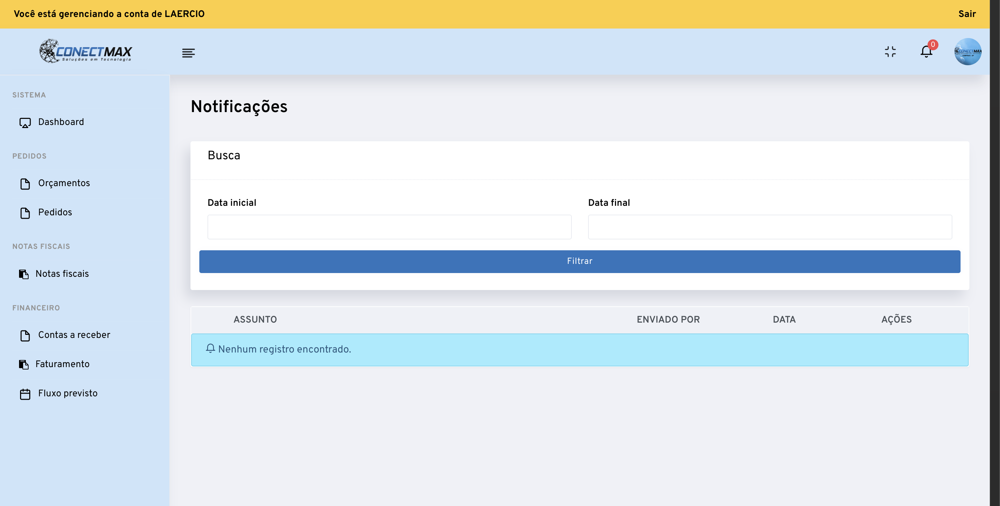](screenshots/notificacoes.png) |

### Detalhe / edição

| Tela | Params | Print |
|---|---|---|
| Novo orçamento | `orcamentos_edicao` | [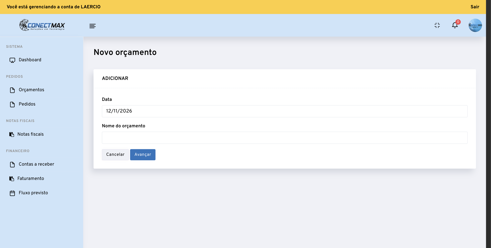](screenshots/orcamentos_edicao-novo.png) |
| Editar orçamento | `id_orcamento=` | [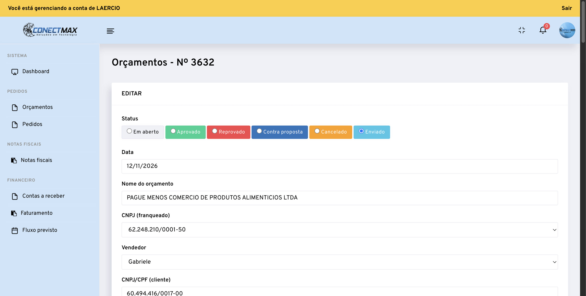](screenshots/orcamentos_edicao-detalhe.png) |
| Histórico orçamento | `orcamento_historico&id_orcamento=` | [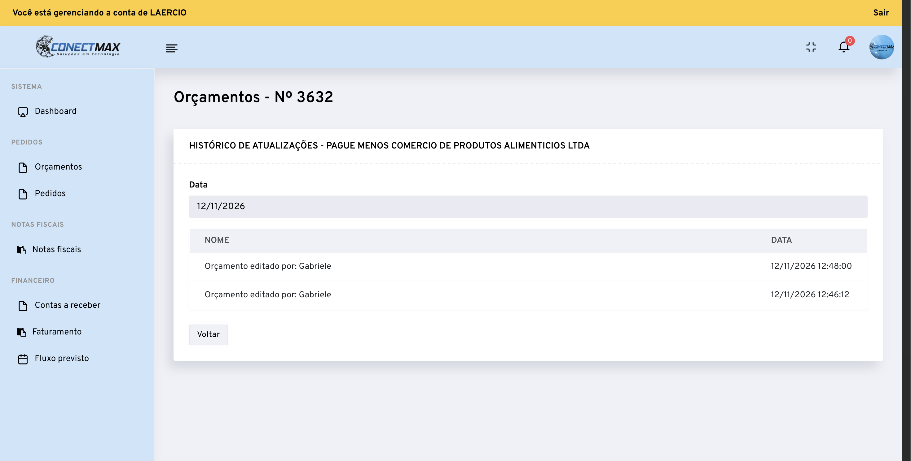](screenshots/orcamento_historico-detalhe.png) |
| Visualizar pedido | `pedidos_edicao&id_pedido=&action=visualizar` |  |
| Editar pedido | `pedidos_edicao&id_pedido=` | [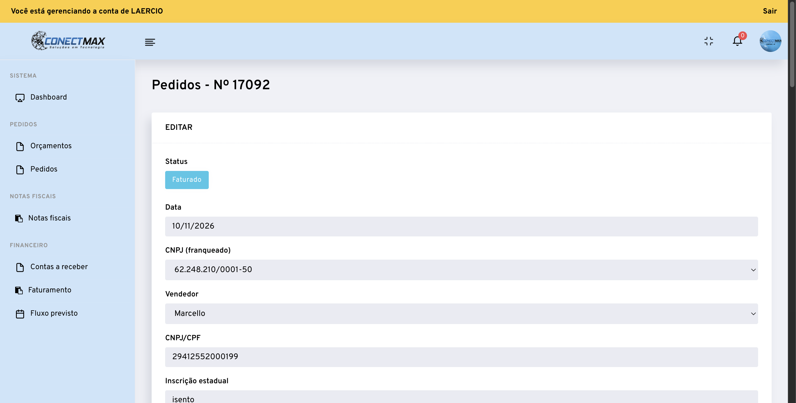](screenshots/pedidos_edicao-editar-detalhe.png) |
| Cancelar pedido | `pedidos_cancelamento&id_pedido=` | [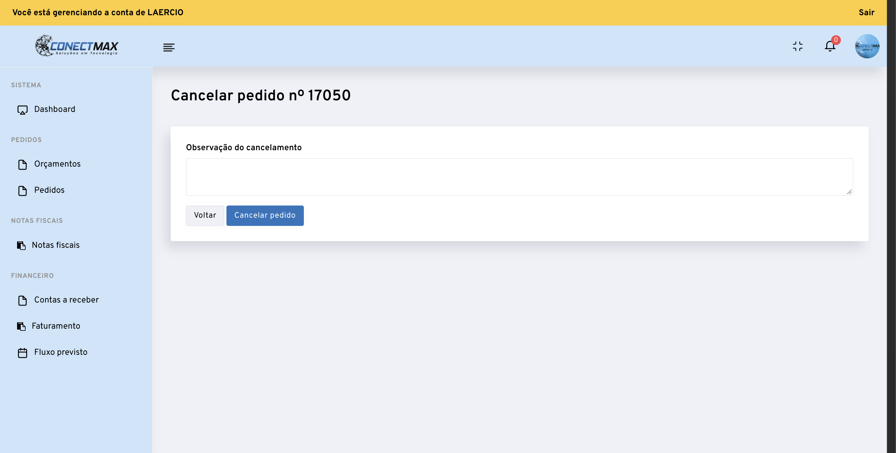](screenshots/pedidos_cancelamento-detalhe.png) |
| Nova NF | `notas_fiscais_edicao` | [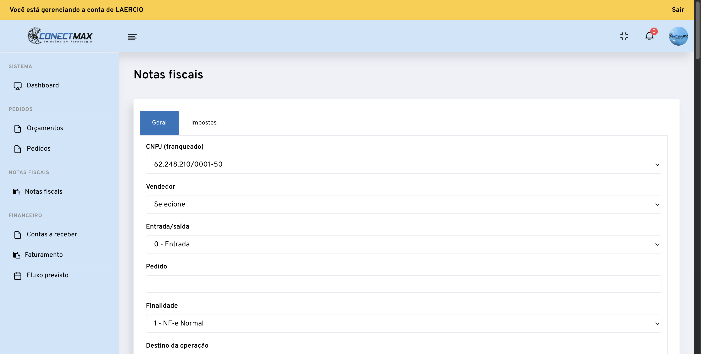](screenshots/notas_fiscais_edicao-novo.png) |
| Editar NF | `notas_fiscais_edicao&id_nota=` | [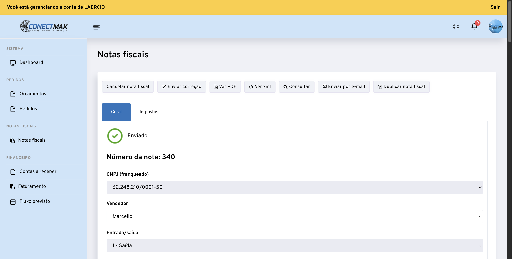](screenshots/notas_fiscais_edicao-detalhe.png) |
| Nova conta a receber | `contasareceber_edicao` | [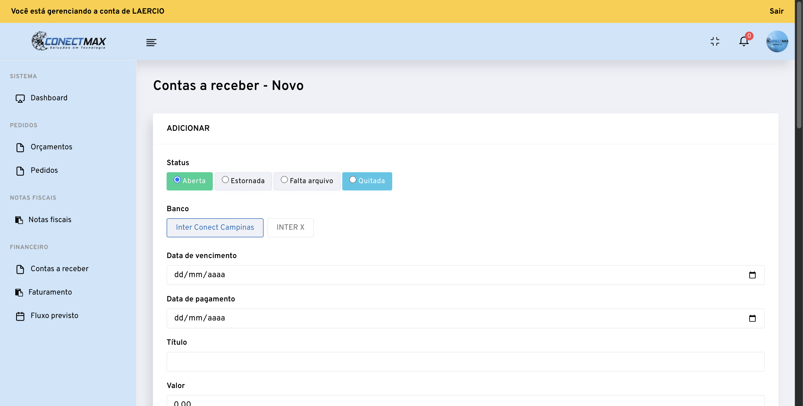](screenshots/contasareceber_edicao-novo.png) |
| Editar conta | `contasareceber_edicao&id_conta=` | [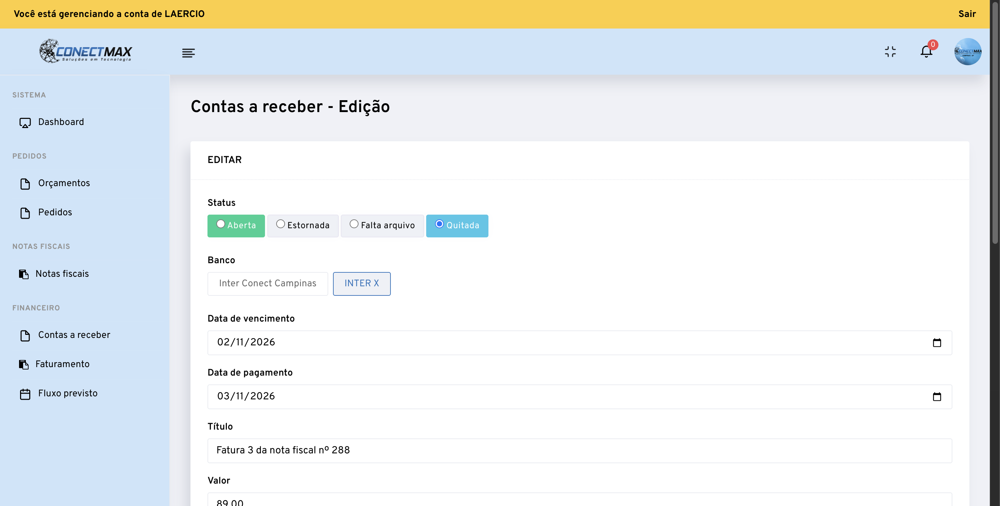](screenshots/contasareceber_edicao-detalhe.png) |
| Criar chamado | `chamados_edicao` | [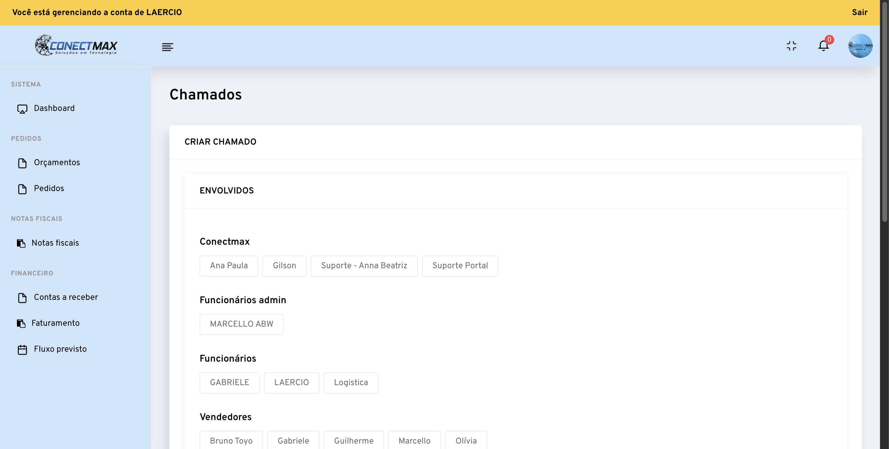](screenshots/chamados_edicao-novo.png) |

---

## 1. Dashboard (`dashboard`)

**Papel:** home / boas-vindas (“Bem vindo ao PORTAL DO FRANQUEADO”). Sem grid de dados.

**Funcionalidades:** navegação pelo menu; sino → notificações; Sair da impersonação.

---

## 2. Orçamentos (`orcamentos`)

**Papel:** lista e gestão comercial de orçamentos (topo do funil).

**Snapshot (sessão):** Em aberto 2 · Aprovado 962 · Reprovado 47 · Contra proposta 34 · Cancelado 2471 · Enviado 72.

| Área | Funcionalidades |
|---|---|
| Header | **Adicionar** → `orcamentos_edicao` |
| Busca rápida | Nº orçamento, Cliente, Filtrar, **+ Busca completa** |
| Busca completa | nome, CNPJ/CPF, valor, status, vendedor, data inicial/final |
| KPIs status | chips clicáveis filtram `?status=` |
| Tabela | STATUS, CLIENTE, VENDEDOR, TOTAL, AÇÕES |
| Ações linha | Histórico · Visualizar · Duplicar orçamento · Editar |

**Status:** Em aberto, Aprovado, Reprovado, Contra proposta, Cancelado, Enviado.

### 2.1 Novo orçamento (`orcamentos_edicao`)

Wizard inicial: Data, Nome do orçamento → **Avançar** / Cancelar.

### 2.2 Editar orçamento (`orcamentos_edicao&id_orcamento=`)

| Bloco | Campos / ações |
|---|---|
| Status | radios dos 6 status |
| Cabeçalho | data, nome, CNPJ franqueado, vendedor |
| Cliente | CNPJ/CPF, IE, cliente, comprador, telefone, e-mail |
| Comercial | prazo entrega, forma pagamento (BOLETO, DEPÓSITO…), pagamento, frete CIF/FOB, validade |
| Texto | observação (editor rich text) |
| Itens | grade de produtos (abaixo do fold no print) |

### 2.3 Histórico (`orcamento_historico`)

Log de atualizações do orçamento + **Voltar**.

---

## 3. Pedidos (`pedidos`)

**Papel:** pedidos gerados a partir de orçamentos (execução / faturamento).

**Snapshot:** Rascunho 3 · Em análise 1 · Aprovado 8 · Reprovado 0 · Cancelado 36 · Faturado 1011.

| Área | Funcionalidades |
|---|---|
| Busca | Cliente, Nº pedido; completa: CNPJ, OC, valor, status, vendedor, datas, subfranqueado |
| KPIs | chips por status |
| Tabela | STATUS, CLIENTE, VENDEDOR, TOTAL, AÇÕES |
| Ações | PDF · Visualizar · Nota fiscal · Duplicar pedido · Editar · (cancelar via fluxo dedicado) |

**Status:** Rascunho, Em análise, Aprovado, Reprovado, Cancelado, Faturado.  
Linha típica mostra vínculo `Orçamento: N`.

### 3.1 Visualizar / Editar (`pedidos_edicao`)

| Bloco | Campos |
|---|---|
| Status | radios (ex.: Faturado) |
| Emitente | CNPJ franqueado, vendedor |
| Destinatário | CNPJ/CPF, IE, isento IE, contribuinte ICMS, nome, e-mail, telefone |
| Endereço | CEP, endereço, número, complemento, bairro, cidade, UF |
| Comercial | prazo, forma pagamento, pagamento, frete, local entrega, OC nº + arquivo |
| Ações | Visualizar: Voltar · Editar: Cancelar / Enviar / Salvar |

### 3.2 Cancelar (`pedidos_cancelamento`)

Campo `observacao_cancelamento` + **Cancelar pedido** / Voltar.

---

## 4. Notas fiscais (`notas_fiscais`)

**Papel:** NF-e emitidas; export PDF/XML.

| Área | Funcionalidades |
|---|---|
| Header | **Adicionar** → `notas_fiscais_edicao` |
| Busca | nº nota, CNPJ/CPF, cliente, valor; completa: vendedor, subfranqueado, CFOP (multi) |
| Tabela | AÇÕES, STATUS, DETALHES (Nº), CLIENTE, DATA, TRANSPORTADORA, TOTAL |
| Ações | Editar · PDF · XML |

**Status observado:** Enviado (também aguardando / cancelado / rejeitado via filtros GET — ver GETS).

### 4.1 Edição NF (`notas_fiscais_edicao`)

Abas **Geral** / **Impostos**. Campos: correção da nota, CNPJ franqueado, vendedor, entrada/saída, pedido, finalidade NF-e, destino operação, nota referenciada, cliente/destinatário completo, endereço. Ações: Enviar · Voltar · Adicionar nota.

---

## 5. Contas a receber (`contasareceber`)

**Papel:** títulos/faturas; boletos; quitação.

**Snapshot:** Total R$ 172.325,08 · Aberta 41 · Quitada 10 · Vencida 3 · Próxima ao vencimento 6 · Estornada 0 · Falta arquivo 1.

| Área | Funcionalidades |
|---|---|
| Header | **Adicionar** |
| Busca | valor, título; completa: cliente, CNPJ, status, datas, subfranqueado |
| KPIs | chips por status |
| Bulk | **Quitar contas em massa** (+ banco / juros / data pagamento no form oculto) |
| Tabela | STATUS, DATA VENCIMENTO, TÍTULO, DESCRIÇÃO, VALOR, AÇÕES |
| Ações | Gerar boleto · Ver boleto · Editar |

### 5.1 Edição título (`contasareceber_edicao`)

Status (Aberta / Estornada / Falta arquivo / Quitada), banco (Inter Conect Campinas, INTER X), vencimento, pagamento, título, valor, descrição (rich text), anexos.

---

## 6. Faturamento (`faturamento`)

**Papel:** consolidado de faturamento por vendedor no período.

| Filtro | Uso |
|---|---|
| Vendedor | Todos / Bruno Toyo / Gabriele / Guilherme / Olívia |
| Data inicial / final | período |
| Subfranqueado | Nenhum / … |
| Filtrar | aplica |

Tabela: VENDEDOR × FATURAMENTO (ex.: `#116 - Bruno Toyo` R$ 5.873,61; total período no rodapé). Export Excel/PDF via ajax (ver GETS) — botões podem estar no menu `…` do card.

---

## 7. Fluxo previsto (`fluxo_previsto`)

**Papel:** projeção vs real do mês.

- Select **Mês** (ex. 09/2026…04/2027) + **Gerar fluxo**
- Gráfico: *Faturamento previsto* × *Faturamento real*

---

## 8. Chamados (`chamados`) — fora do menu

**Papel:** suporte / operação interna. Não aparece no sidebar desta sessão.

| Área | Funcionalidades |
|---|---|
| Header | Adicionar · Transferir |
| Filtro | checkboxes `para[]` (pessoas / franquias / áreas) |
| Tabela | STATUS, ASSUNTO, ENVOLVIDOS, CRIADO EM, EDITADO POR, ÚLTIMA INTERAÇÃO, AÇÕES |

### 8.1 Criar chamado (`chamados_edicao`)

Envolvidos (`para[]`), Assunto, Mensagem, Anexos → **Criar chamado**.

---

## 9. Notificações (`notificacoes`)

Filtro data inicial/final · Filtrar. Tabela: ASSUNTO, ENVIADO POR, DATA, AÇÕES. Acesso também pelo sino do header.

---

## Catálogo `page=` (completo observado)

| `page` | Tipo |
|---|---|
| `dashboard` | home |
| `orcamentos` | lista |
| `orcamentos_edicao` | form novo/editar |
| `orcamento_historico` | histórico |
| `pedidos` | lista |
| `pedidos_edicao` | form (+ `action=visualizar`) |
| `pedidos_cancelamento` | cancelar |
| `notas_fiscais` | lista |
| `notas_fiscais_edicao` | form |
| `contasareceber` | lista |
| `contasareceber_edicao` | form |
| `faturamento` | relatório |
| `fluxo_previsto` | gráfico |
| `chamados` | lista (sem menu) |
| `chamados_edicao` | form |
| `notificacoes` | inbox |
| `login.php` / `logout.php` | auth |

Ajax e filtros GET: [`GETS.md`](../../portal-api/GETS.md) · [`portal-franqueado.md`](../portal-franqueado.md).

---

## Artefatos nesta pasta

| Arquivo | Uso |
|---|---|
| `screenshots/*.png` | prints viewport |
| `*.json` / `mapa.json` / `detalhes.json` | inventário DOM bruto |
| [`mapear-portal-cdp.mjs`](mapear-portal-cdp.mjs) | regenera listagens + README automático |

## Caminho inverso

- Remover mapa: `rm -rf conectmax/connectmax/docs/portal-mapa` e linhas em [`../README.md`](../README.md) / [`portal-franqueado.md`](../portal-franqueado.md)
- Só regenerar prints: Chrome `germano` :9230 + `node mapear-portal-cdp.mjs`
- Doc técnico sem UI: manter só `portal-franqueado.md` + `GETS.md`
