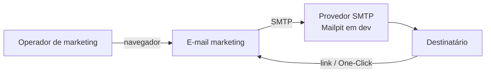
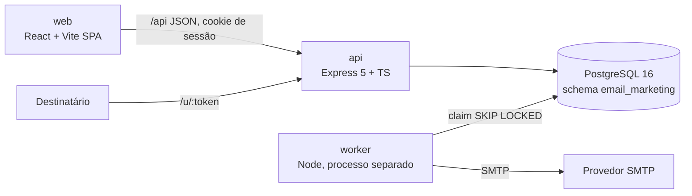

# Arquitetura — E-mail marketing Connect

Formato lean C4 (`core/definir-projeto-moderno/01-arquitetura/03-c4-e-lean/`). Decisões em [`adr/`](adr/).

## 1. Escopo

CU-01 a CU-05 do [README](../README.md): listas, campanhas, lista de destino, disparo e progresso. Mais o mínimo legal de e-mail em massa: descadastro (link + One-Click RFC 8058) respeitado nas próximas campanhas.

Fora do escopo v1: agendamento, templates, métricas de abertura/clique, bounces via webhook, segmentos.

## 2. Contexto (C4 nível 1)



## 3. Containers (C4 nível 2)



| Container | Entrada | Responsabilidade |
|---|---|---|
| `web/` | `src/main.tsx` | Telas de campanhas e listas; polling do progresso a cada 2 s |
| `api/` (web) | `src/server.ts` | HTTP, sessão, validação, regras; congela destinatários no disparo |
| `api/` (worker) | `src/worker.ts` | Consome `deliveries`, envia, faz retry/backoff, fecha campanhas |
| PostgreSQL | `src/db/migrations/` | Fonte da verdade e também a fila (ADR 0002) |

## 4. Módulos da API (monólito modular)

```text
api/src/
  app.ts                composition root HTTP + error boundary
  server.ts / worker.ts processos (12-Factor: web e worker separados)
  shared/               config (zod/env), db, logger (pino), erros, validação
  modules/
    auth/               login, sessão em cookie, requireAuth (deny-by-default)
    lists/              CU-01: listas, contatos, importação colada
    campaigns/          CU-02..05: rascunho, lista de destino, disparo, progresso
    sending/            fila, worker, porta MailSender + adaptador SMTP
    unsubscribe/        páginas públicas de descadastro
```

Módulo só usa outro pelo que ele exporta; SQL fica no repositório de cada módulo.

## 5. Fluxo de envio

1. `POST /api/campaigns/:id/send` — numa transação: trava a campanha, valida assunto/conteúdo/lista, insere uma `deliveries` por contato da lista que não está em `suppressions`, muda o status para `sending`.
2. O worker faz `claim` de até N entregas `pending` (`FOR UPDATE SKIP LOCKED`), marca `sending` e `attempts+1`.
3. Para cada entrega: se descadastrou depois do disparo → `skipped`; senão envia via `MailSender` → `sent`.
4. Falha temporária → volta para `pending` com backoff `30s · 2^(n-1)`; 5xx SMTP ou máximo de tentativas → `failed`.
5. Entrega presa em `sending` por mais de 5 min (worker morreu) volta para `pending`.
6. Campanha sem `pending`/`sending` → `sent`.

Garantia: **at-least-once**. Se o worker cair entre o SMTP aceitar e o `markSent`, o e-mail sai de novo. O `Message-ID` estável por entrega ajuda o provedor a deduplicar.

## 6. Dados

Tabelas: `operators`, `sessions`, `lists`, `contacts`, `suppressions`, `campaigns`, `deliveries`. Convenções de `06-banco-postgresql/POSTGRES.md`: PK `bigint identity`, `public_id uuid` na API, `timestamptz`, `text` + `CHECK`, FKs indexadas e `ON DELETE` explícito.

- `contacts (list_id, email)` único: o mesmo e-mail pode estar em várias listas.
- `suppressions.email` é global: quem descadastra não recebe de nenhuma lista.
- `deliveries (campaign_id, email)` único: ninguém recebe a mesma campanha duas vezes por duplicidade.
- Lista ligada a campanha não pode ser excluída (`ON DELETE RESTRICT`).

## 7. Segurança (checklist `07-seguranca`)

| Item | Como |
|---|---|
| Senha | scrypt (N=2¹⁵) + `timingSafeEqual`; hash fictício quando o e-mail não existe |
| Sessão | token aleatório de 32 bytes, só o SHA-256 no banco; cookie `HttpOnly`, `SameSite=Strict`, `Secure` em produção; 7 dias |
| Authz | `requireAuth` montado antes de todas as rotas de `/api` (exceto `/api/auth`) |
| CSRF | `SameSite=Strict` + a API só lê JSON |
| Input | zod em body/params/query; SQL sempre parametrizado |
| HTML da campanha | pré-visualização em `<iframe sandbox="">` (sem script, origem isolada) |
| Brute force | rate limit no login (10/min por IP) e no descadastro |
| Erros | error boundary central; 500 sem stack; pino com redact de cookie/senha |
| Headers | Helmet (CSP, HSTS etc.) |
| Segredos | só via env; `.env` no `.gitignore` |

## 8. Operação

- Health: `GET /health/live`, `GET /health/ready` (consulta o banco).
- Graceful shutdown: a API para de aceitar conexões e fecha o pool; o worker termina o lote atual.
- Escala: rodar mais de um worker é seguro (`SKIP LOCKED`). O limite de envio (`SEND_RATE_PER_SECOND`) vale **por worker**.
- Produção: `npm run build`; a API serve `web/dist` no mesmo domínio, atrás de um proxy reverso com TLS.

## 9. Riscos e próximos passos

- Sem webhook de bounce/complaint: endereços inválidos não entram automaticamente em `suppressions`.
- Rate limit em memória: com várias réplicas da API, mover para o Postgres.
- Produção Contabo (2026-11-16): SMTP Mailcow `mail.conectmax.email:587` + `marketing@conectmax.email`; DNS Hostinger A/MX/SPF/DKIM/DMARC → `185.250.37.82`. Worker: `SMTP_TLS_REJECT_UNAUTHORIZED=false` (cert SMTP do Mailcow é autoassinado; HTTPS do webmail usa LE em `mail.conectmax.email`). Credenciais em `credenciais.md`. Rollback: apontar DNS/`MAIL_FROM` de volta ao IP/caixa anterior ou Mailpit em dev.
