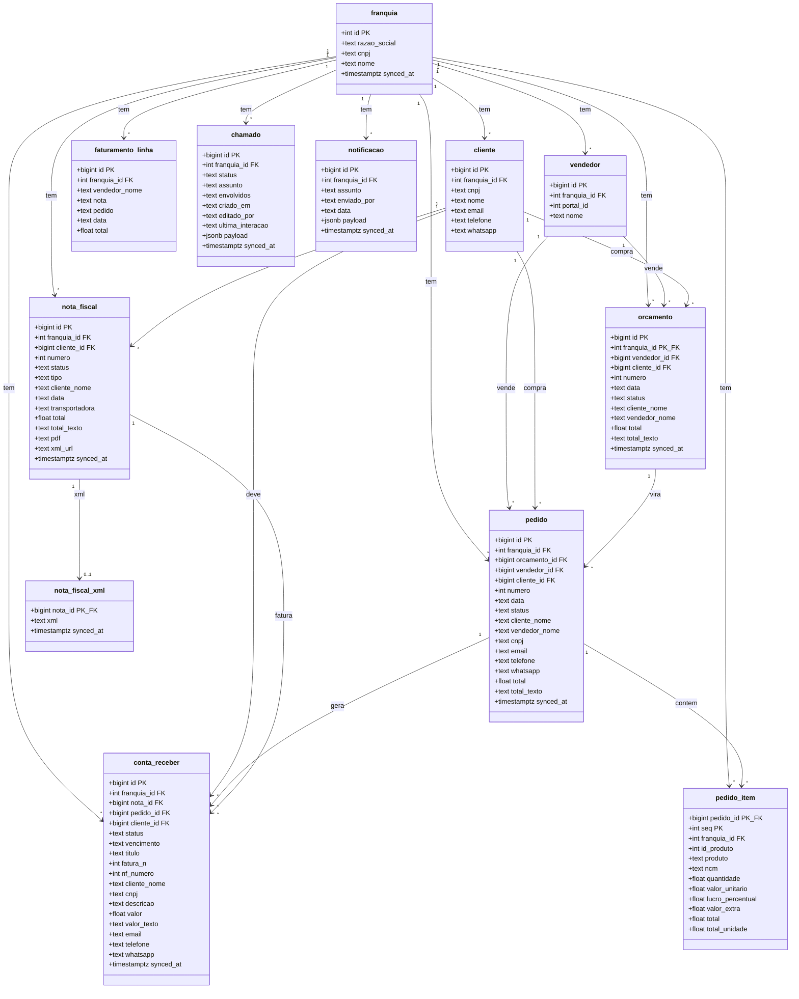

# Schema — réplica normalizada Portal Franqueado

Fonte: HTML/ajax de `franqueado.conectmax.com`.  
Postgres: schema **`portal_franqueado`** — host atual `185.250.37.82` (`DB_HOST` em `../connectmax/vendas/api/.env`; legado `144.126.154.90` offline).  
Sync: `node scripts/sync-campinas-postgres.mjs [--franquia=9]`  
Ordem por volume de faturamento (maior→menor): **3 → 2 → 8 → 1 → 5 → 9 → 4 → 12 → 13**.  
Ex.: maior (Curitiba): `--franquia=3` · segunda (JV): `--franquia=2`  
DDL: [`sql/schema-normalizado.sql`](sql/schema-normalizado.sql)  
Credenciais: `../connectmax/vendas/api/.env` + `credenciais.md`

## Funil

```text
franquia ─┬─ vendedor
          ├─ cliente (CNPJ/nome)
          │
          └─ orcamento ──► pedido ─┬─ pedido_item
                                   ├─ nota_fiscal (+ nota_fiscal_xml opcional)
                                   └─ conta_receber
          └─ faturamento_linha
          └─ chamado / notificacao
```

## Diagrama de classes



## Tabelas

| Tabela | PK | FKs | Conteúdo |
|---|---|---|---|
| `franquia` | `id` | — | razao_social, cnpj, nome |
| `vendedor` | `id` serial | `franquia_id` | nome, `portal_id` |
| `cliente` | `id` serial | `franquia_id` | cnpj, nome, email, tel, whatsapp |
| `orcamento` | `(franquia_id, id)` portal | franquia, vendedor, cliente | numero, data, status, total |
| `pedido` | `id` portal | franquia, **(franquia_id, orcamento_id)→orcamento**, vendedor, cliente | data, status, total, contato |
| `pedido_item` | `(pedido_id, seq)` | pedido | produto, ncm, qtd, valores |
| `nota_fiscal` | `id` portal | franquia, cliente | numero, status, transportadora, total |
| `nota_fiscal_xml` | `nota_id` | nota_fiscal | xml (só se populado) |
| `conta_receber` | `id` portal | franquia, **nota_id**, **pedido_id**, cliente | vencimento, valor, status |
| `faturamento_linha` | serial | franquia | vendedor, nota, pedido, data, total |
| `chamado` | serial | franquia | suporte |
| `notificacao` | serial | franquia | inbox |

## APIs (`/db/*`) — dashboard + modelo

| GET | Origem | Shape |
|---|---|---|
| `/db/health` | contagens | meta |
| `/db/orcamentos` | `orcamento` | igual dashboard (`orcamentos[]`) |
| `/db/pedidos` | `pedido` | `pedidos[]` |
| `/db/notas-fiscais` | `nota_fiscal` | `notasFiscais[]` |
| `/db/faturas` | `conta_receber` | `faturas[]` |
| `/db/atrasados` | `conta_receber` Vencida | `faturas[]` |
| `/db/vendedores` | `vendedor` | `vendedores[]` |
| `/db/clientes` | `cliente` | `clientes[]` |
| `/db/pedido-itens?pedido_id=` | `pedido_item` | `itens[]` |
| `/db/faturamento-linhas` | `faturamento_linha` | `detalhe[]` |

Query comum: `data_inicial`/`data_final`, `status`, `franquia_id` (default **9**).

## Sync

```bash
# completo (listas + itens de pedido — demora; apaga e regrava a franquia)
node scripts/sync-campinas-postgres.mjs

# só listas / FKs (rápido)
node scripts/sync-campinas-postgres.mjs --skip-itens

# incremental: não apaga pedidos/itens; INSERT ON CONFLICT + itens faltantes
node scripts/sync-campinas-postgres.mjs --franquia=3 --delta

# só completar itens de pedidos sem linha
node scripts/sync-campinas-postgres.mjs --franquia=1 --only-itens

# orçamentos por franquia (stubs via pedidos; PK composta evita colisão de id)
node scripts/sync-campinas-postgres.mjs --franquia=2 --only-orcamentos

# atrasados com email/whatsapp
node scripts/sync-campinas-postgres.mjs --contato --skip-itens
```

**Orçamentos cross-franquia:** a lista HTML `page=orcamentos` ignora `id_franqueado_rel` (só a franquia da sessão — default Campinas/`9`). Por isso Campinas fica com ~4× mais orçamentos que pedidos; nas outras o sync antigo só criava stubs dos pedidos (~1:1).

- Pedido HTML: `Orçamento: {numeroLocal}` + href `/orcamento/{idGlobal}` (`parse-pedidos` → `orcamento` + `orcamentoId`).
- Lista completa: `python3 scripts/scan-orcamentos-pdf.py --from=1 --to=66000` (PDF público traz CNPJ da EMPRESA → franquia). Status opcional: `--with-status` via `orcamentos_edicao`.
- Detalhe: `page=orcamentos_edicao&id_orcamento={idGlobal}`.

Antes → depois:
- Sync full limpava tudo da franquia (incluindo itens). Com `--delta`, pedidos/itens existentes ficam; só entram registros novos e itens que faltavam.
- `orcamento.id` era PK global → colisão entre franquias (`ON CONFLICT DO NOTHING` deixava orçamentos=0). Agora PK `(franquia_id, id)` + FK composta em `pedido`. Rollback: restaurar PK só em `id` e FK `pedido.orcamento_id → orcamento(id)` (quebra inserts cross-franquia de novo).
- Stubs de orçamento vinham com `total`/`status` null → dashboard “desconhecido” e R$ 0. Agora herdam do pedido ligado. Rollback: `stubsFromPedidos` com `status/total` null de novo.

## Caminho inverso

- Remover schema: `DROP SCHEMA portal_franqueado CASCADE;`
- Remover código: `sql/schema-normalizado.sql`, `scripts/sync-campinas-postgres.mjs`, `src/db*.js`, rotas `/db` em `src/index.js`
- Voltar sync só full: omitir `--delta` (comportamento antigo)
