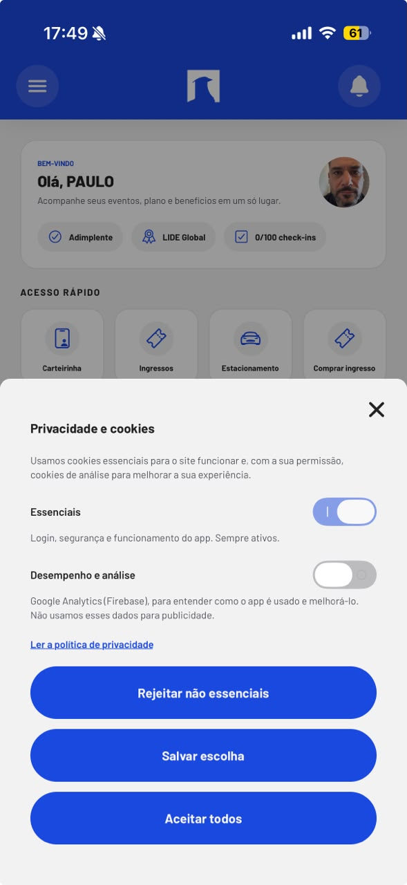
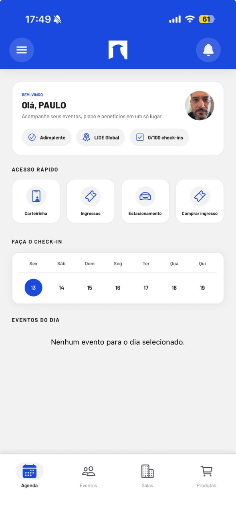
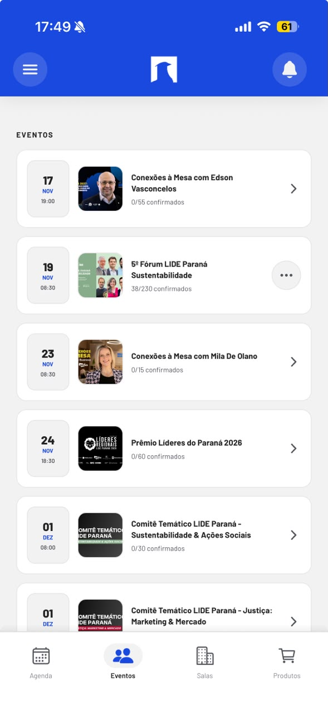
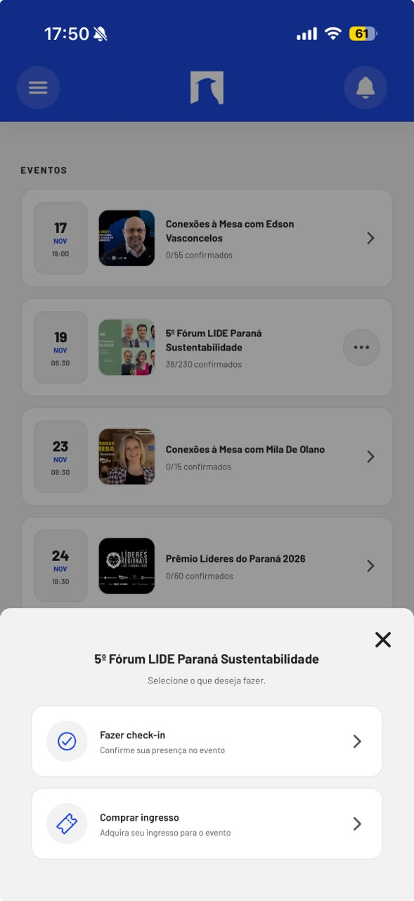
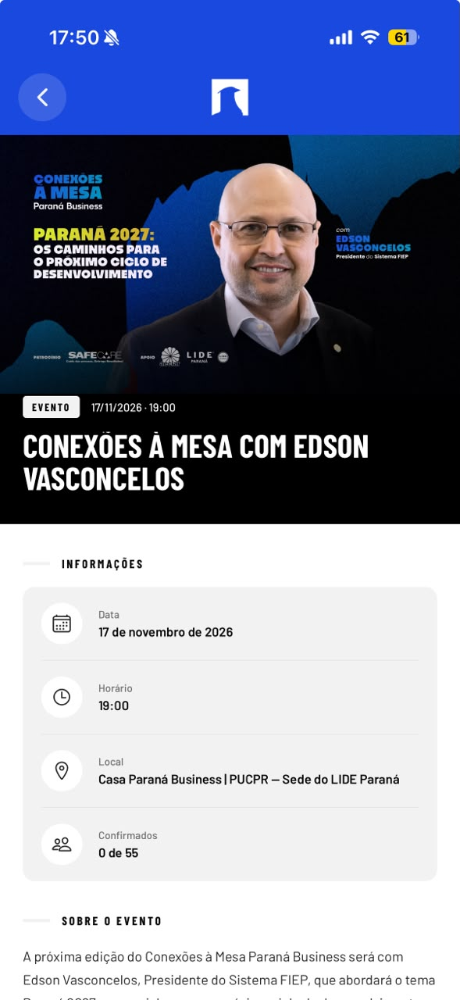
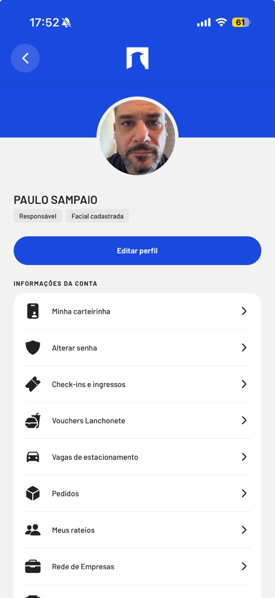
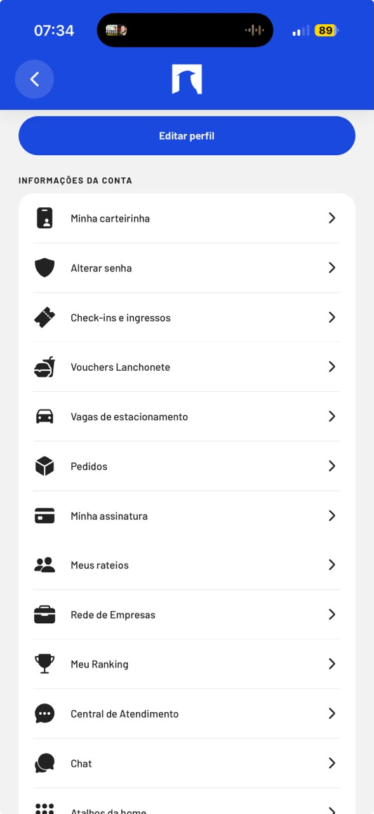
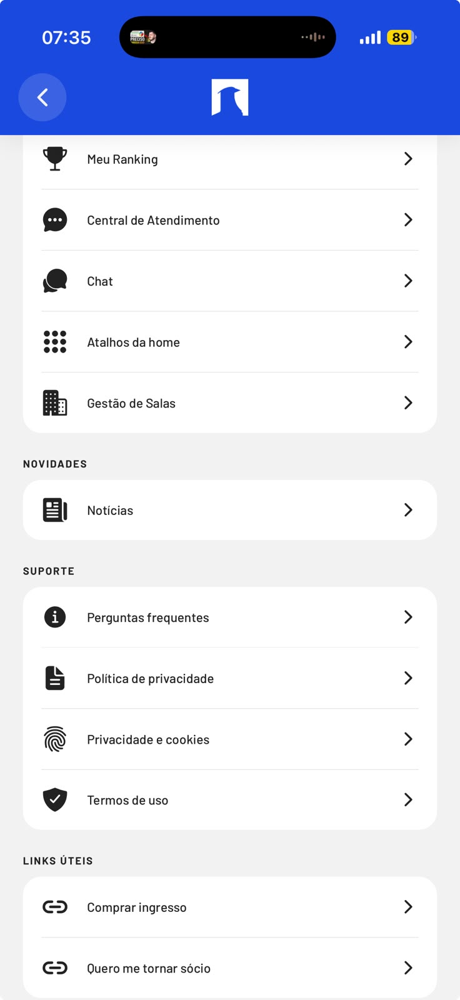
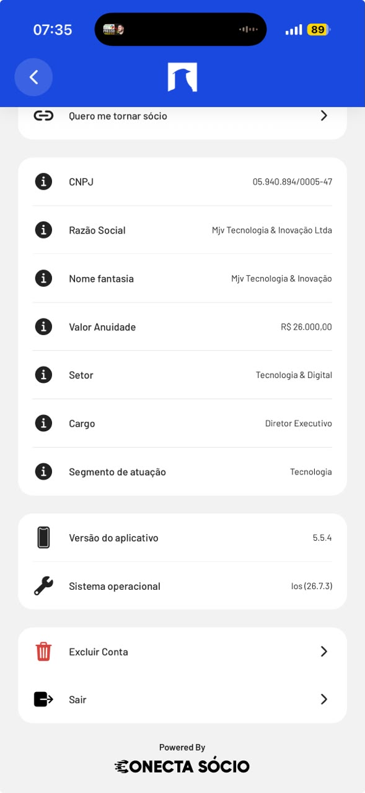

# Documento de visão — Confraternização Maçônica

**Versão:** 3.8 · 2026-11-24

## 1. Contexto

No próximo ano será realizado em Curitiba um **evento mundial** da maçonaria, em comemoração aos **125 anos** da instituição organizadora. O encontro tem caráter de **confraternização**, com **programação distribuída pela cidade** e organizada por **horários**.

O projeto **Confraternização Maçônica** consiste no **aplicativo oficial do evento**, destinado ao **controle operacional** dessa confraternização.

---

## 2. Objetivo

Disponibilizar o aplicativo oficial para o controle do evento mundial, assegurando programação, locais, participantes e comunicação entre inscritos, de forma compatível com a confraternização multi-local em Curitiba.

---

## 3. Personas

1. **Criador do evento** — cria e configura o evento; organiza programação, locais e participantes (antes: Organizador).
2. **Participante do evento** — cadastrado no evento; consulta programação, locais e serviços; comunica-se com outros participantes.
3. **Leiloeiro** — chama e conduz o leilão; cadastra/expõe os itens à venda.
4. **Comprador do leilão** — disputa e compra itens do leilão.

Fonte da expansão (leilão): [`conversa-almoco-paulo-2026-11-22.md`](conversa-almoco-paulo-2026-11-22.md).

---

## 4. Público-alvo

| Critério | Definição |
|----------|-----------|
| **Idade** | 45 a 65 anos |

---

## 5. Funcionalidades citadas

- Controle do evento  
- Cronograma / programação  
- Programação na cidade inteira  
- Horários na programação  
- Locais cadastrados  
- Cadastro de participantes  
- Identificação de quem está participando  
- Mensagem de um participante para outro  
- Nível de organização do evento  
- Aplicativo oficial do evento  

---

## 6. Escopo por tela

Funcionalidades agrupadas pela tela em que o usuário as realiza:

### Autenticação e cadastro

- **CU-01** — Cadastrar participante: cria a conta no aplicativo.
- **CU-02** — Autenticar: entra com as credenciais da conta.

### Eventos (Home)

Tela inicial do app. Mapa no topo, boas-vindas em seguida, calendário e lista de eventos na parte inferior.

- **CU-03** — Ver mapa: mostra a localização dos eventos na cidade.
- **CU-04** — Ver boas-vindas: saudação ao participante.
- **CU-05** — Ver calendário: mostra os dias da programação.
- **CU-06** — Selecionar dia: filtra a lista pelo dia escolhido.
- **CU-07** — Ver lista de eventos: data, horário, título, local e confirmados.
- **CU-08** — Abrir evento: leva à tela do evento, pela lista ou pelo mapa.

### Evento

Tela de cada evento, com as funcionalidades referentes a ele. A inscrição libera o grupo do evento no Chat.

- **CU-09** — Ver informações do evento: data, horário, local, confirmados e descrição.
- **CU-10** — Inscrever-se: confirma a participação e libera o grupo.
- **CU-11** — Ver participantes: lista quem está inscrito no evento.

### Inscrições

- **CU-12** — Ver lista de inscrições: eventos em que o participante está inscrito, com acesso a cada um.

### Chat

Grupos e conversas privadas. O grupo do evento depende da inscrição.

- **CU-13** — Ver lista de grupos: grupos liberados pelas inscrições.
- **CU-14** — Abrir grupo: entra na conversa coletiva do evento.
- **CU-15** — Ver lista de conversas privadas: chats individuais do participante.
- **CU-16** — Abrir conversa privada: abre o diálogo com outro participante.
- **CU-17** — Enviar mensagem: publica no grupo ou envia direto a um participante.

### Menu

- **CU-18** — Abrir menu: exibe a navegação principal.
- **CU-19** — Navegar entre seções: alterna entre Eventos, Inscrições e Chat.

### Menu da conta

- **CU-20** — Abrir menu da conta: acessa as opções da conta.
- **CU-21** — Ver perfil: dados cadastrais do participante.
- **CU-22** — Editar perfil: altera os dados do perfil.
- **CU-23** — Alterar senha: redefine a senha de acesso.

### Conta: serviços do participante

Itens do menu “Informações da conta” da referência ([imagens 07–09](referencias/07-conta-menu-1.jpeg)). Cada um é um componente plugável, ligado ou desligado por evento e visível por papel.

- **CU-26** — Ver carteirinha: identificação digital do participante (nome, loja, potência, CIM).
- **CU-27** — Ver check-ins e ingressos: ingressos dos eventos e registro de presença.
- **CU-28** — Ver vouchers de alimentação: vouchers de lanchonete/refeições do evento.
- **CU-29** — Ver vagas de estacionamento: vagas reservadas ao participante.
- **CU-30** — Ver pedidos: compras feitas pelo app (inclui itens do leilão).
- **CU-31** — Ver minha assinatura: situação da inscrição/anuidade do participante.
- **CU-32** — Ver meus rateios: divisão de custos entre participantes (jantares, traslados).
- **CU-33** — Ver rede de empresas: empresas de irmãos e parceiras do evento.
- **CU-34** — Ver meu ranking: pontuação do participante no evento.
- **CU-35** — Abrir central de atendimento: contato com a organização.
- **CU-36** — Acessar chat: atalho do menu da conta para o Chat.
- **CU-37** — Configurar atalhos da home: escolhe os atalhos exibidos na tela inicial.
- **CU-38** — Gerir salas: reserva e ocupação de salas dos locais (organizador).

### Novidades, suporte e links

- **CU-39** — Ver notícias: comunicados e novidades do evento.
- **CU-40** — Ver perguntas frequentes: respostas às dúvidas comuns.
- **CU-41** — Ver política de privacidade: texto da política.
- **CU-42** — Gerir privacidade e cookies: consentimento do participante.
- **CU-43** — Ver termos de uso: termos do aplicativo.
- **CU-44** — Abrir links úteis: comprar ingresso e quero me tornar sócio/irmão (cadastro na instituição).

### Dados da conta e aplicativo

- **CU-45** — Ver dados institucionais: dados da entidade do participante (loja, potência, CIM, cargo); na referência: CNPJ, razão social, cargo, setor.
- **CU-46** — Ver versão do aplicativo e sistema operacional: informação para suporte.
- **CU-47** — Excluir conta: remove a conta e os dados do participante.
- **CU-48** — Sair: encerra a sessão.

### Organização (organizador)

- **CU-24** — Cadastrar local: registra um local da programação na cidade.
- **CU-25** — Cadastrar item da programação: cria o evento com horário e local.

---

## 7. Prazo

| Marco | Situação |
|-------|----------|
| Realização do evento | Próximo ano, em Curitiba |
| Data exata do evento | A definir |
| Entrega do aplicativo | Vinculada à realização do evento no próximo ano; cronograma detalhado a definir |

---

## 8. Referências

O projeto adota, como referência de experiência, o padrão de aplicativos de evento/clube com:

- Agenda (dias e eventos do dia)  
- Lista e detalhe de eventos (data, horário, local, confirmados, descrição)  
- Inscrição em eventos  
- Chat (grupos e privados)  
- Perfil e conta  

A programação, os locais e os participantes exibidos no aplicativo serão os do **evento do projeto**, e não os de outras instituições usadas apenas como referência de interface.

### Cores e estilo

A referência de **cores e estilo visual** do aplicativo é o site [https://gop.org.br](https://gop.org.br).

### Imagens de referência

**Home com privacidade e cookies**

**Agenda**

**Lista de eventos**

**Ação no evento**

**Detalhe do evento**

**Perfil**

**Conta: menu de serviços (1/3)**

**Conta: menu de serviços (2/3)**

**Conta: dados e saída (3/3)**

---

## 9. Sites de referência maçônicos

| Instituição | Site |
|-------------|------|
| Grande Oriente do Paraná (GOP) — **cores e estilo** | [https://gop.org.br](https://gop.org.br) |
| Grande Oriente do Brasil – Paraná (GOB-PR) | [https://gob-pr.org.br/](https://gob-pr.org.br/) |
| Maçonaria do Paraná | [https://maconariadoparana.org.br/](https://maconariadoparana.org.br/) |
| Grande Loja do Paraná (GLP) | [https://www.glp.org.br/](https://www.glp.org.br/) |
| Grande Oriente do Brasil (GOB) | [http://www.gob.org.br/](http://www.gob.org.br/) |
| Confederação Maçônica do Brasil (COMAB) | [https://comab.org.br/](https://comab.org.br/) |
| Confederação da Maçonaria Simbólica do Brasil (CMSB) | [http://www.cmsb.org.br/](http://www.cmsb.org.br/) |
