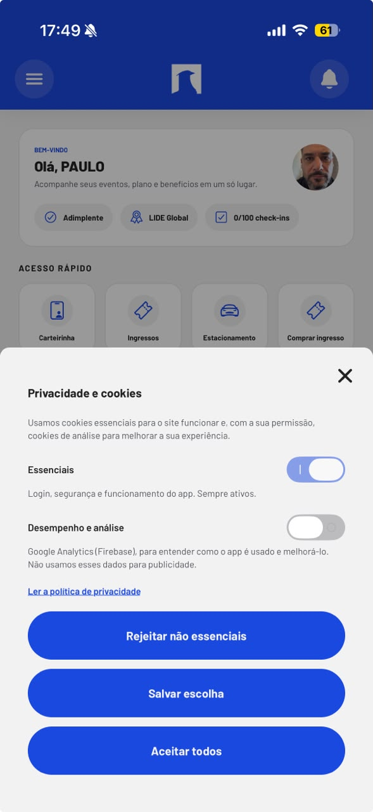
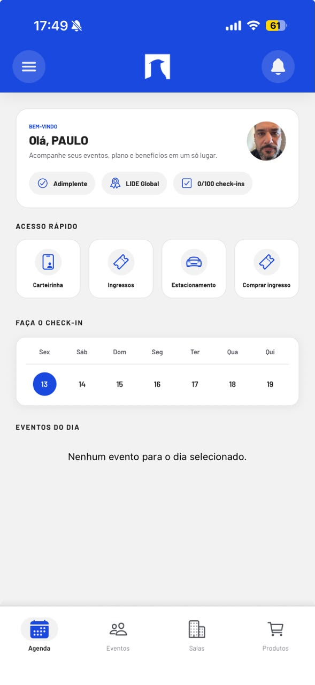
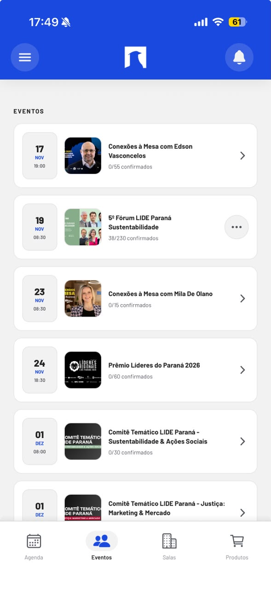
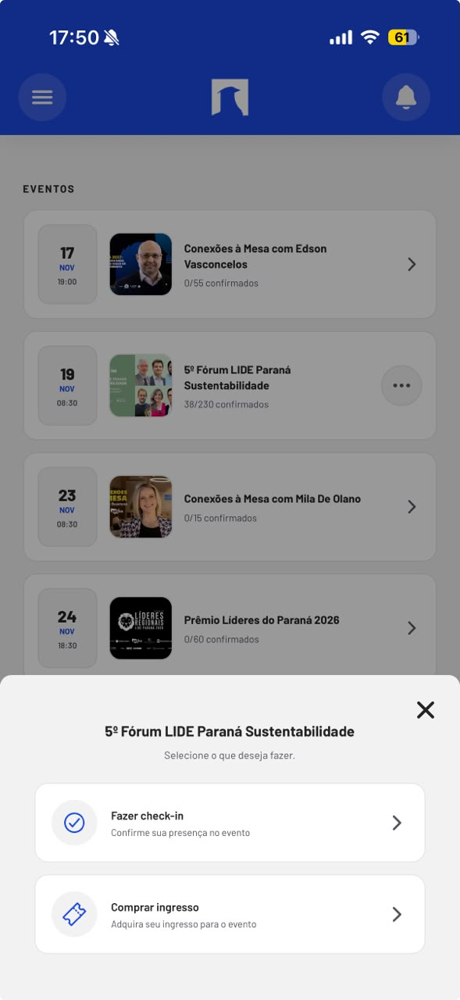
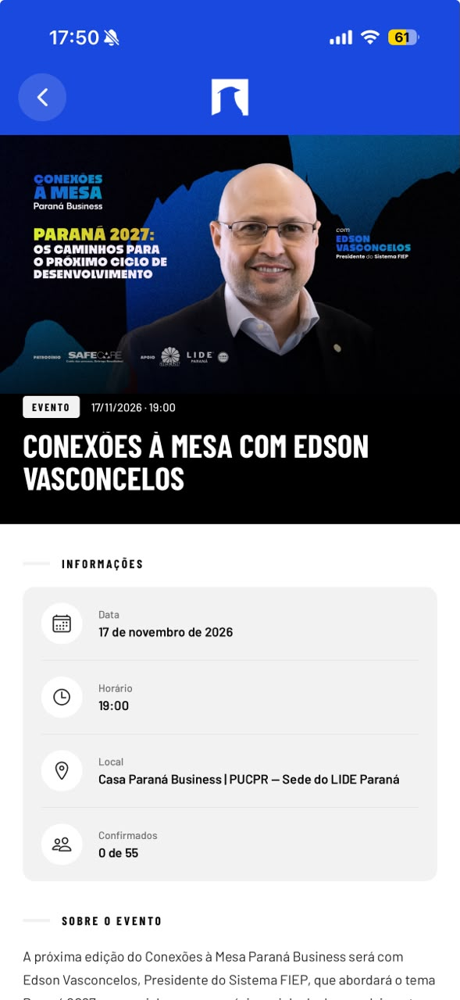
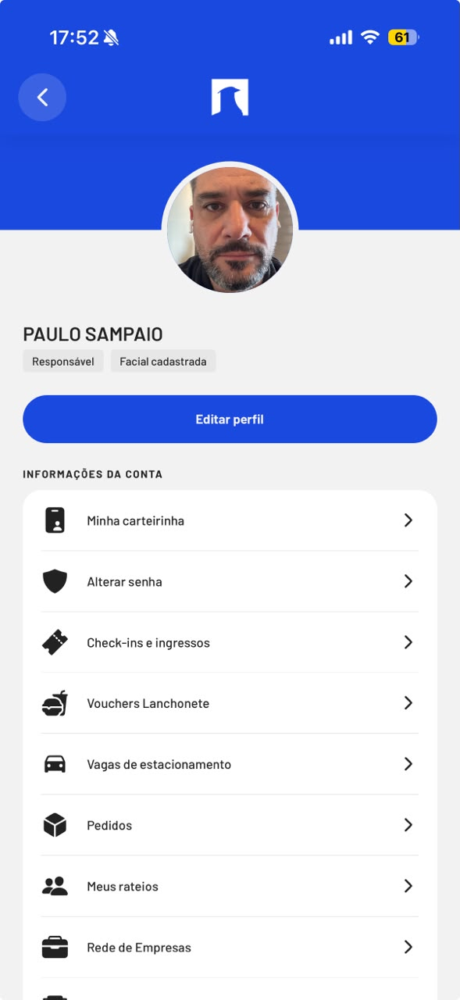

# Documento de visão — Confraternização Maçônica

**Versão:** 1.3 · 2026-11-13

## 1. Contexto

No próximo ano será realizado em Curitiba um **evento mundial** da maçonaria, em comemoração aos **125 anos** da instituição organizadora. O encontro tem caráter de **confraternização**, com **programação distribuída pela cidade** e organizada por **horários**.

O projeto **Confraternização Maçônica** consiste no **aplicativo oficial do evento**, destinado ao **controle operacional** dessa confraternização.

---

## 2. Objetivo

Disponibilizar o aplicativo oficial para o controle do evento mundial, assegurando programação, locais, participantes e comunicação entre inscritos, de forma compatível com a confraternização multi-local em Curitiba.

---

## 3. Personas

| Persona | Papel |
|---------|--------|
| **Organizador** | Responsável pelo controle do evento e pela organização da programação, dos locais e dos participantes |
| **Participante** | Pessoa cadastrada que consulta a programação, utiliza locais e serviços do evento e se comunica com outros participantes |

---

## 4. Público-alvo

| Critério | Definição |
|----------|-----------|
| **Idade** | 45 a 65 anos |

---

## 5. Funcionalidades citadas

- Controle do evento  
- Cronograma / programação  
- Programação na cidade inteira  
- Horários na programação  
- Locais cadastrados  
- Cadastro de participantes  
- Identificação de quem está participando  
- Mensagem de um participante para outro  
- Nível de organização do evento  
- Aplicativo oficial do evento  

---

## 6. Casos de uso

Casos de uso derivados das funcionalidades citadas e das imagens de referência:

- O organizador acessa o aplicativo oficial para controlar o evento  
- O organizador organiza a confraternização com programação na cidade inteira  
- O organizador cadastra o cronograma / programação do evento  
- O organizador define horários na programação  
- O organizador cadastra os locais do evento  
- O organizador visualiza quem está participando  
- O participante realiza cadastro no evento  
- O participante envia mensagem para outro participante  
- O participante abre o aplicativo e vê boas-vindas com nome e foto de perfil  
- O participante abre o menu do aplicativo  
- O participante visualiza notificações pelo sino  
- O participante visualiza badges de status, incluindo contagem de check-ins  
- O participante acessa rapidamente a carteirinha  
- O participante acessa rapidamente os ingressos  
- O participante acessa rapidamente o estacionamento  
- O participante acessa rapidamente a compra de ingresso  
- O participante gerencia privacidade e cookies (essenciais; desempenho/análise opcional; rejeitar não essenciais, salvar escolha ou aceitar todos)  
- O participante navega pela agenda e seleciona um dia  
- O participante visualiza os eventos do dia selecionado  
- O participante navega entre as abas Agenda, Eventos, Salas e Produtos  
- O participante consulta a lista de eventos com data e horário  
- O participante consulta a lista de eventos com imagem  
- O participante consulta a lista de eventos com título  
- O participante visualiza a quantidade de confirmados (X/Y) em cada evento  
- O participante abre um evento e escolhe fazer check-in para confirmar presença  
- O participante abre um evento e escolhe comprar ingresso  
- O participante abre o detalhe do evento e visualiza o banner  
- O participante abre o detalhe do evento e visualiza a data  
- O participante abre o detalhe do evento e visualiza o horário  
- O participante abre o detalhe do evento e visualiza o local  
- O participante abre o detalhe do evento e visualiza os confirmados  
- O participante abre o detalhe do evento e lê o texto “sobre o evento”  
- O participante consulta as salas do evento  
- O participante consulta os produtos  
- O participante visualiza o próprio perfil com foto e nome  
- O participante edita o perfil  
- O participante registra ou visualiza facial cadastrada  
- O participante visualiza a carteirinha  
- O participante altera a senha  
- O participante consulta check-ins e ingressos na conta  
- O participante consulta vouchers  
- O participante consulta vagas de estacionamento  
- O participante consulta pedidos  
- O participante consulta rateios  
- O participante consulta a rede de empresas  

---

## 7. Referências

O projeto adota, como referência de experiência, o padrão de aplicativos de evento/clube com:

- Agenda (dias e eventos do dia)  
- Lista e detalhe de eventos (data, horário, local, confirmados, descrição)  
- Check-in  
- Ingressos  
- Carteirinha  
- Salas  
- Estacionamento  
- Produtos  
- Perfil e conta  
- Privacidade e cookies  
- Notificações na interface  

A programação, os locais e os participantes exibidos no aplicativo serão os do **evento do projeto**, e não os de outras instituições usadas apenas como referência de interface.

### Imagens de referência

**Home com privacidade e cookies**

**Agenda**

**Lista de eventos**

**Check-in e ingresso**

**Detalhe do evento**

**Perfil**

---

## 8. Sites de referência maçônicos

| Instituição | Site |
|-------------|------|
| Grande Oriente do Brasil – Paraná (GOB-PR) | [https://gob-pr.org.br/](https://gob-pr.org.br/) |
| Maçonaria do Paraná | [https://maconariadoparana.org.br/](https://maconariadoparana.org.br/) |
| Grande Loja do Paraná (GLP) | [https://www.glp.org.br/](https://www.glp.org.br/) |
| Grande Oriente do Brasil (GOB) | [http://www.gob.org.br/](http://www.gob.org.br/) |
| Confederação Maçônica do Brasil (COMAB) | [https://comab.org.br/](https://comab.org.br/) |
| Confederação da Maçonaria Simbólica do Brasil (CMSB) | [http://www.cmsb.org.br/](http://www.cmsb.org.br/) |

---

## 9. Prazo

| Marco | Situação |
|-------|----------|
| Realização do evento | Próximo ano, em Curitiba |
| Data exata do evento | A definir |
| Entrega do aplicativo | Vinculada à realização do evento no próximo ano; cronograma detalhado a definir |
