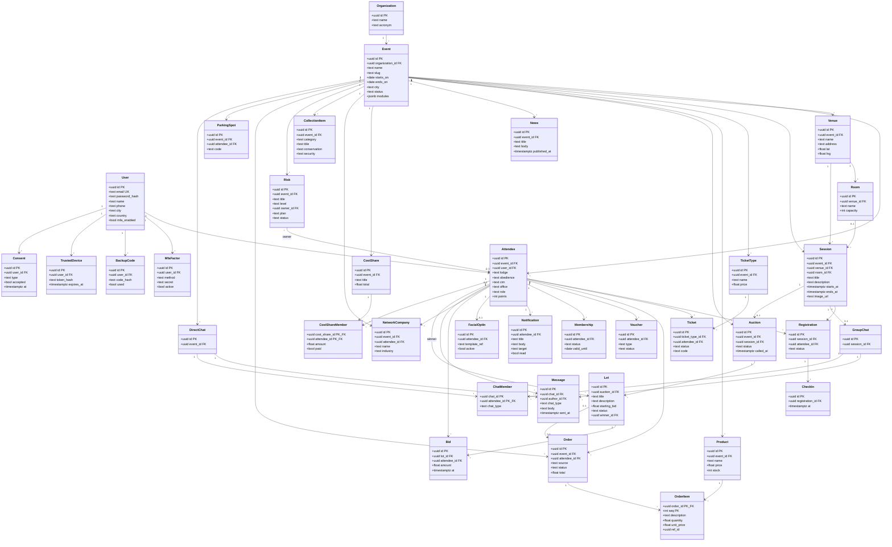

# Modelagem de dados — Confraternização Maçônica

Fonte: [`documento-de-visao.md`](documento-de-visao.md) · stack: [`documento-de-implementacao.md`](documento-de-implementacao.md)

PostgreSQL. IDs `uuid`. Timestamps `created_at` / `updated_at` implícitos onde fizer sentido. **Nomes de tabelas, colunas, enums e flags em inglês.**

## Roles (`Attendee.role`)

| Valor | Uso |
|-------|-----|
| `attendee` | Irmão / inscrito |
| `family` | Visibilidade restrita de módulos |
| `organizer` | Criador / gestão do evento |
| `auctioneer` | Chama leilão e lotes |

## Modules (`Event.modules` jsonb)

Flags plugáveis: `auction`, `membership_card`, `tickets`, `orders`, `news`, `vouchers`, `parking`, `membership`, `cost_shares`, `network`, `ranking`, `support`, `products`, `rooms`, `museum`, `risks`.

## Order source (`Order.source`)

`shop` · `auction` · `ticket`

## Rollback

Remover este arquivo e o link em [`documento-de-implementacao.md`](documento-de-implementacao.md) / [`README.md`](README.md).
