# Modelagem de dados — Confraternização Maçônica

Fonte: [`documento-de-visao.md`](documento-de-visao.md) · stack: [`documento-de-implementacao.md`](documento-de-implementacao.md)

PostgreSQL. IDs `uuid`. Timestamps `created_at` / `updated_at` implícitos onde fizer sentido.

```mermaid
classDiagram
  direction TB

  class Organizacao {
    +uuid id PK
    +text nome
    +text sigla
  }

  class Evento {
    +uuid id PK
    +uuid organizacao_id FK
    +text nome
    +text slug
    +date data_inicio
    +date data_fim
    +text cidade
    +text status
    +jsonb modulos
  }

  class Usuario {
    +uuid id PK
    +text email UK
    +text senha_hash
    +text nome
    +text telefone
    +text cidade
    +text pais
    +bool mfa_ativo
  }

  class FatorMfa {
    +uuid id PK
    +uuid usuario_id FK
    +text metodo
    +text segredo
    +bool ativo
  }

  class CodigoReserva {
    +uuid id PK
    +uuid usuario_id FK
    +text codigo_hash
    +bool usado
  }

  class AparelhoConfiavel {
    +uuid id PK
    +uuid usuario_id FK
    +text token_hash
    +timestamptz expira_em
  }

  class Participante {
    +uuid id PK
    +uuid evento_id FK
    +uuid usuario_id FK
    +text loja
    +text potencia
    +text cim
    +text cargo
    +text papel
    +int pontos
  }

  class Local {
    +uuid id PK
    +uuid evento_id FK
    +text nome
    +text endereco
    +float lat
    +float lng
  }

  class Sala {
    +uuid id PK
    +uuid local_id FK
    +text nome
    +int capacidade
  }

  class Programacao {
    +uuid id PK
    +uuid evento_id FK
    +uuid local_id FK
    +uuid sala_id FK
    +text titulo
    +text descricao
    +timestamptz inicio
    +timestamptz fim
    +text imagem_url
  }

  class Inscricao {
    +uuid id PK
    +uuid programacao_id FK
    +uuid participante_id FK
    +text status
  }

  class CheckIn {
    +uuid id PK
    +uuid inscricao_id FK
    +timestamptz em
  }

  class IngressoTipo {
    +uuid id PK
    +uuid evento_id FK
    +text nome
    +float preco
  }

  class Ingresso {
    +uuid id PK
    +uuid ingresso_tipo_id FK
    +uuid participante_id FK
    +text status
    +text codigo
  }

  class ChatGrupo {
    +uuid id PK
    +uuid programacao_id FK
  }

  class ChatPrivado {
    +uuid id PK
    +uuid evento_id FK
  }

  class ChatMembro {
    +uuid chat_id PK
    +uuid participante_id PK_FK
    +text tipo_chat
  }

  class Mensagem {
    +uuid id PK
    +uuid chat_id FK
    +uuid autor_id FK
    +text tipo_chat
    +text corpo
    +timestamptz enviada_em
  }

  class Pedido {
    +uuid id PK
    +uuid evento_id FK
    +uuid participante_id FK
    +text origem
    +text status
    +float total
  }

  class PedidoItem {
    +uuid pedido_id PK_FK
    +int seq PK
    +text descricao
    +float quantidade
    +float valor_unitario
    +uuid ref_id
  }

  class Produto {
    +uuid id PK
    +uuid evento_id FK
    +text nome
    +float preco
    +int estoque
  }

  class Leilao {
    +uuid id PK
    +uuid evento_id FK
    +uuid programacao_id FK
    +text status
    +timestamptz chamado_em
  }

  class Lote {
    +uuid id PK
    +uuid leilao_id FK
    +text titulo
    +text descricao
    +float lance_inicial
    +text status
    +uuid vencedor_id FK
  }

  class Lance {
    +uuid id PK
    +uuid lote_id FK
    +uuid participante_id FK
    +float valor
    +timestamptz em
  }

  class Voucher {
    +uuid id PK
    +uuid participante_id FK
    +text tipo
    +text status
  }

  class VagaEstacionamento {
    +uuid id PK
    +uuid evento_id FK
    +uuid participante_id FK
    +text codigo
  }

  class Assinatura {
    +uuid id PK
    +uuid participante_id FK
    +text status
    +date vigencia
  }

  class Rateio {
    +uuid id PK
    +uuid evento_id FK
    +text titulo
    +float total
  }

  class RateioParte {
    +uuid rateio_id PK_FK
    +uuid participante_id PK_FK
    +float valor
    +bool pago
  }

  class EmpresaRede {
    +uuid id PK
    +uuid evento_id FK
    +uuid participante_id FK
    +text nome
    +text ramo
  }

  class Noticia {
    +uuid id PK
    +uuid evento_id FK
    +text titulo
    +text corpo
    +timestamptz publicada_em
  }

  class Notificacao {
    +uuid id PK
    +uuid participante_id FK
    +text titulo
    +text corpo
    +text destino
    +bool lida
  }

  class AcervoItem {
    +uuid id PK
    +uuid evento_id FK
    +text categoria
    +text titulo
    +text conservacao
    +text seguranca
  }

  class Risco {
    +uuid id PK
    +uuid evento_id FK
    +text titulo
    +text nivel
    +uuid responsavel_id FK
    +text plano
    +text status
  }

  class Consentimento {
    +uuid id PK
    +uuid usuario_id FK
    +text tipo
    +bool aceito
    +timestamptz em
  }

  class FacialOptIn {
    +uuid id PK
    +uuid participante_id FK
    +text template_ref
    +bool ativo
  }

  Organizacao "1" --> "*" Evento
  Evento "1" --> "*" Participante
  Evento "1" --> "*" Local
  Evento "1" --> "*" Programacao
  Evento "1" --> "*" IngressoTipo
  Evento "1" --> "*" Produto
  Evento "1" --> "*" Leilao
  Evento "1" --> "*" Noticia
  Evento "1" --> "*" Rateio
  Evento "1" --> "*" EmpresaRede
  Evento "1" --> "*" AcervoItem
  Evento "1" --> "*" Risco
  Evento "1" --> "*" Pedido
  Evento "1" --> "*" VagaEstacionamento
  Evento "1" --> "*" ChatPrivado

  Usuario "1" --> "*" Participante
  Usuario "1" --> "*" FatorMfa
  Usuario "1" --> "*" CodigoReserva
  Usuario "1" --> "*" AparelhoConfiavel
  Usuario "1" --> "*" Consentimento

  Participante "1" --> "*" Inscricao
  Participante "1" --> "*" Ingresso
  Participante "1" --> "*" Pedido
  Participante "1" --> "*" Voucher
  Participante "1" --> "*" Assinatura
  Participante "1" --> "*" Notificacao
  Participante "1" --> "0..1" FacialOptIn
  Participante "1" --> "*" Lance
  Participante "1" --> "*" EmpresaRede

  Local "1" --> "*" Sala
  Local "1" --> "*" Programacao
  Sala "0..1" --> "*" Programacao
  Programacao "1" --> "*" Inscricao
  Programacao "1" --> "0..1" ChatGrupo
  Programacao "1" --> "0..1" Leilao
  Inscricao "1" --> "*" CheckIn
  IngressoTipo "1" --> "*" Ingresso

  ChatGrupo "1" --> "*" Mensagem
  ChatPrivado "1" --> "*" Mensagem
  ChatGrupo "1" --> "*" ChatMembro
  ChatPrivado "1" --> "*" ChatMembro
  Participante "1" --> "*" Mensagem

  Pedido "1" --> "*" PedidoItem
  Produto "1" --> "*" PedidoItem

  Leilao "1" --> "*" Lote
  Lote "1" --> "*" Lance
  Lote "0..1" --> "0..1" Pedido
  Participante "0..1" --> "*" Lote : vencedor

  Rateio "1" --> "*" RateioParte
  Participante "1" --> "*" RateioParte
  Risco "*" --> "0..1" Participante : responsavel
```

## Papéis (`Participante.papel`)

| Valor | Uso |
|-------|-----|
| `participante` | Irmão / inscrito |
| `familiar` | Visibilidade restrita de módulos |
| `organizador` | Criador / gestão do evento |
| `leiloeiro` | Chama leilão e lotes |

## Módulos (`Evento.modulos` jsonb)

Flags plugáveis: `leilao`, `carteirinha`, `ingressos`, `pedidos`, `noticias`, `vouchers`, `estacionamento`, `assinatura`, `rateios`, `rede`, `ranking`, `atendimento`, `produtos`, `salas`, `museu`, `riscos`.

## Origem do pedido (`Pedido.origem`)

`loja` · `leilao` · `ingresso`

## Rollback

Remover este arquivo e o link em [`documento-de-implementacao.md`](documento-de-implementacao.md) / [`README.md`](README.md).
