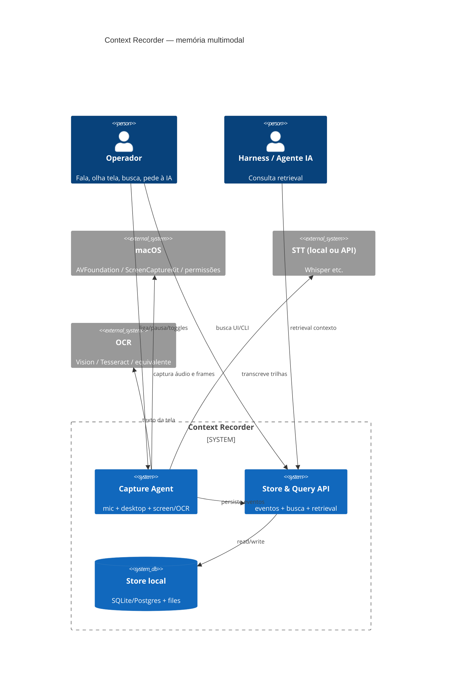
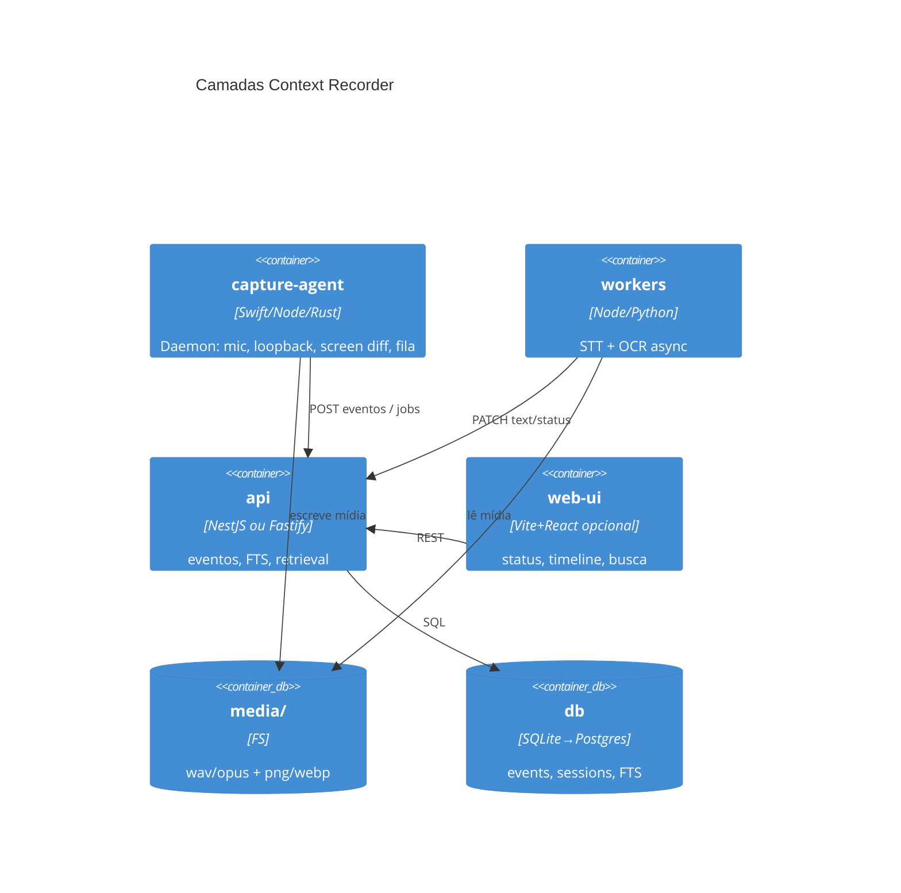

# Arquitetura — Context Recorder

**Por quê:** desenho estático e dinâmico da memória contínua (captura → indexação → retrieval).  
**Visão:** [`../README.md`](../README.md) · **PRD:** [`prd.md`](prd.md) · **Plano:** [`plano-implementacao.md`](plano-implementacao.md)

**Antes → depois:** sem produto; contexto oral/visual se perdia.  
**Rollback:** ignore este doc; remova `capture/` / `api/` / `store/` quando existirem; apague o diretório de dados local.

---

## 1. Visão de contexto (C4 L1)



---

## 2. Contêineres (C4 L2)



| Contêiner | Responsabilidade |
|-----------|------------------|
| **capture-agent** | Permissões OS; capturar mic/desktop/tela; detectar mudança; enqueue |
| **workers** | STT por trilha; OCR por frame; idempotência |
| **api** | Sessões, CRUD eventos, FTS, endpoint `/context` para harness |
| **media/** | Blobs; paths relativos no DB |
| **db** | Fonte da verdade textual + metadados |
| **web-ui** | Opcional no MVP (CLI pode bastar) |

---

## 3. Stack (proposta v1)

| Camada | Tecnologia | Nota |
|--------|------------|------|
| Capture macOS | ScreenCaptureKit + AVAudio (mic) + loopback (BlackHole / ScreenCaptureKit audio) | Validar PoC cedo |
| Agent runtime | Node ou Rust sidecar + scripts | Alinhar ao lab (screen-robot Node ok se permissões ok) |
| STT | Whisper local (faster-whisper) ou API | pt-BR; fila |
| OCR | Apple Vision (mac) ou Tesseract | Preferir on-device |
| Diff de tela | hash perceptual / block hash + threshold | Debounce no PRD |
| API | NestJS ou Fastify + TS | Mesmo espírito Board/vendas |
| DB | SQLite (MVP) → Postgres | FTS5 / tsvector |
| Retrieval | HTTP + CLI `cr context` | MCP na v1.1 |

ADR formal na 1ª task de PoC de captura.

---

## 4. Modelo de dados (lógico)

```text
Session
  id, device, started_at, ended_at, status (active|paused|closed)
  flags: mic_enabled, desktop_enabled, screen_enabled

Event
  id, session_id → Session
  source: mic | desktop | screen_ocr
  started_at, ended_at
  text                  -- STT ou OCR (nullable enquanto pending)
  text_status: pending|ready|failed
  media_path            -- áudio ou imagem
  media_kind: audio|image
  confidence            -- opcional
  meta_json             -- app_focus, window_title, display_id, phash, …
  created_at

EventFTS / índice
  event_id, text (FTS)

Job (opcional)
  id, event_id, type: stt|ocr, status, attempts, error
```

**Regra:** um utterance de mic e um de desktop **nunca** compartilham o mesmo `Event` — sempre `source` distinto. OCR é sempre `screen_ocr`.

---

## 5. Fluxos dinâmicos

### 5.1 Áudio (mic ou desktop)

```text
stream → VAD/segmento → gravar media → Event(text pending)
  → worker STT → Event.text = transcript
```

### 5.2 Tela + OCR on change

```text
frame loop (N fps baixo ou on-demand)
  → comparar com último frame de referência (phash/diff)
  → se Δ >= threshold e passou debounce:
       salvar imagem → Event(screen_ocr, text pending)
       → worker OCR → Event.text
       → atualizar frame de referência
```

### 5.3 Retrieval para IA

```text
GET /context?from=&to=&q=&sources=mic,desktop,screen_ocr&limit=
  → FTS + filtro tempo/fonte
  → ordenar por started_at
  → render prompt:
       [2026-11-04T08:51:02 mic] …
       [2026-11-04T08:51:10 screen_ocr] …
       [2026-11-04T08:51:40 desktop] …
```

---

## 6. API (contrato mínimo)

| Método | Path | Função |
|--------|------|--------|
| POST | `/sessions` | Inicia sessão |
| PATCH | `/sessions/:id` | pause/resume/close + toggles |
| GET | `/events` | Lista / filtra |
| GET | `/search?q=` | FTS |
| GET | `/context` | Bloco para harness |
| DELETE | `/sessions/:id` | Apaga sessão + mídia (política) |

Auth: local token / loopback only no MVP.

---

## 7. Segurança e privacidade

- Bind API em `127.0.0.1` por default.
- Sem telemetria de conteúdo no MVP.
- Exclusão cascade mídia + DB.
- Documentar apps sensíveis (banco, senhas) — *should* allowlist/denylist na v1.2.

---

## 8. Árvore de arquivos (alvo)

```text
context-recorder/
  README.md
  docs/
  config/
  prompts/
  capture/          # agent macOS
  workers/          # stt + ocr
  api/
  web/              # opcional
  store/            # ou path em $HOME/Library/... 
  cli/
```

Detalhe por fase: [`plano-implementacao.md`](plano-implementacao.md).

---

## 9. Integração com a workstation

- Harness / Cursor: CLI `context-recorder context …` ou MCP depois.
- Não usar cursor-ide-browser para captura; captura é OS-level.
- Relação com `screen-robot`: **não** substitui ADB/CDP; Context Recorder observa o **desktop humano**, screen-robot opera **AVD/Chrome**.
