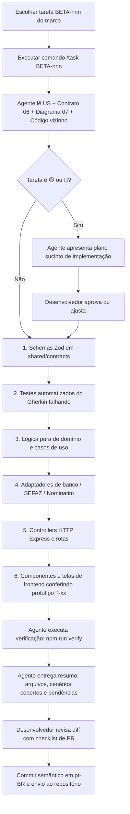

# notinhas.shop Beta — Guia de desenvolvimento com IA

Diretrizes práticas para utilização de agentes autônomos de inteligência artificial (Claude Code, Cursor e similares) na construção do **notinhas.shop Beta** a partir da base documental deste repositório.

## 1. Princípios de trabalho com IA

1. **Os documentos representam a intenção; o código representa a verdade fática.** O agente deve ler a documentação canônica em `beta-docs/` para compreender regras de negócio e contratos, e o código vizinho para manter a consistência de implementação. Havendo divergência, o agente formula uma pergunta objetiva ao desenvolvedor humano em vez de assumir premissas silenciosas.
2. **Uma tarefa por sessão.** Cada sessão de trabalho deve focar estritamente em uma única tarefa atômica (`BETA-nnn`). Sessões infladas com múltiplos objetivos resultam em perda de contexto e degradação da qualidade do código.
3. **Plano antes do código em tarefas complexas.** Para tarefas classificadas como 🟡 (pareadas) ou 🔴 (críticas/infraestrutura) no [Plano de Implementação](11-plano-de-implementacao.md#3-backlog-detalhado-por-marco-beta-nnn), o agente deve expor um plano sucinto com arquivos a alterar, testes a criar e dúvidas pendentes antes de editar qualquer arquivo.
4. **Testes primeiro a partir da especificação BDD.** Cenários Gherkin documentados em [`02-historias/`](02-historias/) devem ser transformados em testes automatizados que falham antes da escrita da lógica de negócio.
5. **Marca sagrada:** O agente deve checar proativamente que a palavra "e-notas" jamais seja introduzida na interface do usuário (sempre **notinhas.shop**).
6. **Revisão humana obrigatória em pontos críticos:** Alterações em parsers de notas da SEFAZ, descarte de CPF, regras de deduplicação transacional, migrations de banco de dados e arquivos de infraestrutura Nginx/deploy demandam inspeção humana cuidadosa do diff.
7. **Sem dados fiscais reais em prompts:** Nunca colar cupons fiscais reais com identificação de terceiros, chaves privadas ou senhas de banco nos prompts. Use sempre as fixtures e seeds sintéticos de teste.

## 2. Arquivos de contexto essenciais

| Arquivo | Localização no Repositório | Finalidade e Conteúdo |
|---|---|---|
| **`CLAUDE.md`** | Raiz do repositório / `ia/CLAUDE.md` | Resumo executivo de alto impacto (≤ 150 linhas) contendo stack, comandos essenciais e regras inegociáveis. |
| **`06-contratos-api.md`** | `beta-docs/06-contratos-api.md` | Fonte de verdade de todos os endpoints REST, parâmetros, DTOs e códigos de erro Problem Details. |
| **`08-boas-praticas-codigo.md`** | `beta-docs/08-boas-praticas-codigo.md` | Convenções de nomenclatura, arquitetura de pastas, padrões TypeScript e checklist de PR. |
| **`09-estrategia-de-testes.md`** | `beta-docs/09-estrategia-de-testes.md` | Pirâmide de testes, matriz de riscos críticos e convenções de tags `@US-xx.yy`. |
| **`10-seguranca-privacidade-lgpd.md`** | `beta-docs/10-seguranca-privacidade-lgpd.md` | Diretrizes de anonimização, isolamento de extrato e descarte de CPF. |
| **`12-prototipos.md`** | `beta-docs/12-prototipos.md` | Inventário de telas `T-xx` para conferência visual de fidelidade da interface. |
| **`prompts.md`** | `beta-docs/ia/prompts.md` | Comandos reutilizáveis padronizados (`/task`, `/new-endpoint`, `/review-privacy`, `/gherkin-to-tests`, `/docs-drift`). |
| **`referencias/`** | [`16-referencias-mercado.md`](16-referencias-mercado.md) · [`referencias/README.md`](referencias/README.md) | Espelhos oficiais de mercado (Node/TS, React, Postgres, arquitetura, filas, OWASP, AGENTS.md). Abrir **on-demand**; não substituem `01`–`15`. |

## 3. Fluxo operacional por tarefa (`BETA-nnn`)

## 4. Ordem de implementação em camadas dentro da tarefa

1. **Contratos e Tipagem:** Especificar ou atualizar schemas Zod de entrada/saída e códigos de erro de negócio em `shared/contracts`.
2. **Testes de Especificação:** Escrever testes unitários e de integração com base nos cenários Gherkin (os testes devem falhar inicialmente).
3. **Domínio:** Implementar funções puras de regras de negócio, cálculos de menor preço, percentual de split ou normalização de endereços.
4. **Aplicação (Casos de Uso):** Orquestrar chamadas entre repositórios e serviços de domínio através de use cases focados.
5. **Infraestrutura:** Implementar repositórios PostgreSQL (com migrations revisadas) e adaptadores de rede (SEFAZ Cheerio, Nominatim).
6. **Borda HTTP:** Implementar handlers enxutos no Express com validação Zod e presenters formatadores.
7. **Frontend:** Desenvolver ou ajustar componentes e views, garantindo o uso estrito dos tokens `--nt-*` e a fidelidade ao protótipo `T-xx`.
8. **Verificação E2E:** Rodar o teste ponta a ponta do fluxo mobile simulado no Playwright.

## 5. Instruções explícitas a solicitar ao agente

Ao disparar instruções para o agente, utilize comandos que exijam rastreabilidade e rigor:
- *"Cite a US e o cenário Gherkin específico que este teste cobre."*
- *"Confirme que nenhum elemento da interface exibe o termo 'e-notas', utilizando unicamente 'notinhas.shop'."*
- *"Assegure que os campos de CPF ou dados pessoais do consumidor sejam descartados no parser antes de qualquer persistência."*
- *"Execute a verificação local (`npm run verify`) e cole o resultado antes de encerrar o turno."*
- *"Se encontrar uma decisão de arquitetura ou produto ambígua, pare e apresente as alternativas antes de codificar."*

## 6. Antipadrões severos (Rejeitar no Code Review)

| Antipadrão | Risco / Por que Rejeitar | Ação Corretiva |
|---|---|---|
| **Exposição de 'e-notas' na UI** | Degrada a identidade de marca voltada ao consumidor final. | Substituir imediatamente por `notinhas.shop` ou termos neutros como "nota" / "comprovante". |
| **Persistência de CPF da NFC-e** | Violação grave da LGPD e risco de vazamento de dados de compradores. | Eliminar qualquer coluna de CPF de consumidor e garantir descarte no parser Cheerio. |
| **Cores hexadecimais soltas no CSS** | Quebra a manutenibilidade e a consistência do Design System Light Mist. | Substituir valores hex soltos por variáveis `--nt-*` (ex.: `--nt-blue-primary`). |
| **Scraping síncrono bloqueante** | Trava o event loop do Node.js e derruba a latência de todas as rotas. | Implementar timeouts estritos (8s) e isolar processamento pesado em rotinas assíncronas. |
| **`SELECT *` em queries de produção** | Degrada performance de rede e vaza colunas internas indevidas. | Declarar explicitamente as colunas necessárias na projeção SQL. |
| **Uso de `new Date()` no domínio** | Inviabiliza testes determinísticos de janelas de frescor de preços. | Injetar porta de relógio (`ClockPort.now()`). |
| **Alteração de migration já aplicada** | Causa dessincronização de schema entre ambiente local, staging e produção. | Criar sempre uma nova migration sequencial incremental. |
| **Desativação de linters para 'passar'** | Mascara falhas estruturais de tipagem ou boas práticas. | Corrigir a causa-raiz do erro apontado pelo linter. |

## 7. Revisão assistida por IA e comandos de auditoria

Antes de abrir o Pull Request, execute os comandos especializados de auditoria:
- **`/review-privacy`**: Analisa o diff procurando vazamentos de CPF de notas fiscais, exposição de extrato financeiro pessoal para usuários não autorizados ou ausência de sanitização em logs.
- **`/docs-drift`**: Compara os contratos e diagramas de `beta-docs/` com os arquivos alterados no código, apontando divergências que exigem sincronização documental.

## 8. Manutenção da documentação viva

- Qualquer mudança de regra de produto decidida durante o desenvolvimento deve ser refletida no mesmo commit em `01-prd.md`, `02-historias/` e `requisitos.md`.
- Alterações em payloads de API exigem atualização concomitante de `06-contratos-api.md`.
- No encerramento de cada marco (`M0` a `M6`), deve-se executar uma rodada de `/docs-drift` para manter a documentação 100% alinhada à realidade do repositório.

## 9. Métricas de eficiência do processo

| Métrica de Qualidade | Meta Alvo |
|---|---|
| **Tamanho médio de PR** | ≤ 400 linhas modificadas por entrega |
| **Taxa de PRs devolvidos por violação de boas práticas** | < 10% |
| **Divergência entre protótipo visual e tela implementada** | Zero discrepâncias visíveis em componentes chave |
| **Tempo médio entre início da task e merge no repositório** | < 1 dia útil |
