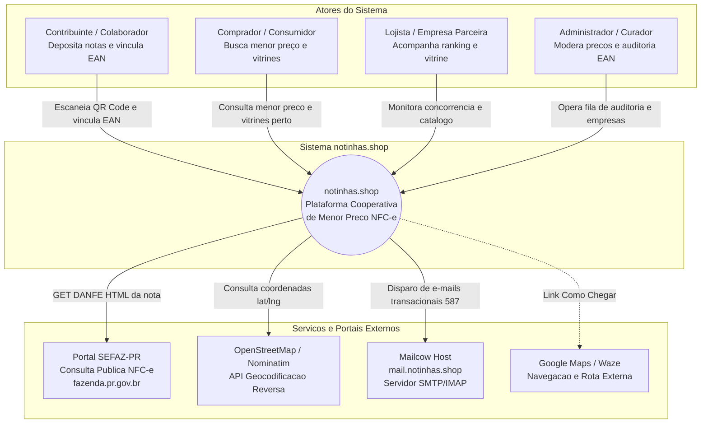

# notinhas.shop Beta — Arquitetura de Software

Documento de arquitetura técnica para a versão **Beta 1.0** do **notinhas.shop** (repositório `works/e-notas`), estabelecendo a evolução do código funcional validado no laboratório (`app/`) para um monólito modular robusto em produção.

---

## 1. Drivers de Arquitetura

Os drivers abaixo orientam todas as escolhas de infraestrutura, organização de pastas, isolamento de dados e contratos de interface do Beta 1.0:

| Driver | Requisito / Desafio | Consequência Arquitetural |
|---|---|---|
| **Evolução ágil e time enxuto** | Aproveitar a validação funcional já concluída no lab sem retrabalho prematuro de reescrita total. | **Monólito modular em Node.js (ESM) com Express**, organizando o código em módulos desacoplados com repositórios e serviços especializados ([ADR-003](04-adrs.md#adr-003)). |
| **Persistência corporativa estável** | Base de dados PostgreSQL existente na VPS Contabo com histórico transacional. | **Schema dedicado `enotas`** no banco `connectmax`, utilizando o driver nativo `pg` com pool de conexões gerenciado e transações ACID ([ADR-002](04-adrs.md#adr-002)). |
| **NFC-e sem código de barras** | A nota fiscal traz apenas o código interno privado do mercado (`codigo_unidade`); o EAN vem da comunidade. | **Módulo Barcode desacoplado**, com persistência da relação `(empresa_id, codigo_unidade) ↔ EAN` na tabela `codigos_barras` e propagação retroativa para busca ([ADR-005](04-adrs.md#adr-005)). |
| **Geolocalização e raio territorial** | Busca "onde comprar perto" e ranking de lojas mais baratas no raio (1 a 30 km). | **Geocodificação em segundo plano via Nominatim/OSM** com normalização de endereço fiscal, armazenamento de `lat`/`lng` e cálculo de distância por fórmula esférica Haversine ([ADR-010](04-adrs.md#adr-010)). |
| **Anonimização estrita do índice** | Dados pessoais do comprador na DANFE e identificação do usuário que depositou não podem vazar. | **Isolamento físico e lógico**: o índice público de observações de preço é 100% dissociado do usuário depositante e do CPF do cupom ([ADR-008](04-adrs.md#adr-008)). |
| **Mobile-first com câmera web** | Necessidade de capturar QR Code e códigos de barras direto no navegador do celular sem fricção de loja. | **PWA Web com HTTPS obrigatório**, shell visual no tema Light institucional (DESIGN.md v2) e decodificação via biblioteca JavaScript HTML5 QR Code ([ADR-001](04-adrs.md#adr-001)). |
| **Comunicação transacional própria** | Recuperação de senhas, notificações de preços e boas-vindas com domínio oficial. | **Mailcow dedicado em `mail.notinhas.shop`** rodando na VPS Contabo com envio via SMTP autenticado (587 STARTTLS) ([ADR-007](04-adrs.md#adr-007)). |

---

## 2. Visão C4 (Modelagem Mermaid)

### 2.1 Diagrama de Contexto de Sistema (C1)

O diagrama abaixo ilustra os usuários do notinhas.shop e as integrações externas no nível de contexto:



---

### 2.2 Diagrama de Containers (C2)

O diagrama abaixo detalha a estrutura de containers e processos na infraestrutura de produção (VPS Contabo):

```mermaid
flowchart TB
  subgraph Cliente[Dispositivo do Usuario]
    PWA[PWA Web Client<br/>HTML5, CSS Tokens, Vanilla/SPA<br/>Html5Qrcode, Leaflet JS]
  end

  subgraph VPS_Contabo[VPS Contabo - 144.126.154.90]
    NGX[Nginx Reverse Proxy & TLS<br/>Porta 443 / SSL Let's Encrypt<br/>notinhas.shop / /enotas/]
    
    subgraph AppNode[Processo de Aplicacao Node.js]
      API[Backend Modular Express<br/>Node.js 22 ESM / Porta 4174<br/>Controllers, Services, Repositories]
    end

    subgraph StorageDisco[Armazenamento em Disco]
      MEDIA[/opt/e-notas/public/ean-fotos/<br/>Acervo de Imagens de Produtos por EAN]
    end

    subgraph BancoDados[Instancia PostgreSQL]
      DB[(PostgreSQL 16 - connectmax<br/>Schema: enotas<br/>Tabelas: empresas, notas, itens,<br/>codigos_barras, usuarios, logs)]
    end

    subgraph MailService[Pilha de E-mail Local]
      MC[Mailcow Dockerized<br/>mail.notinhas.shop<br/>Postfix, Dovecot, SOGo]
    end
  end

  subgraph ServicosRemotos[Portais Externos]
    PR[SEFAZ Parana<br/>Portal NFC-e]
    OSM[Nominatim API<br/>Geocodificacao]
  end

  PWA -->|HTTPS / REST JSON| NGX
  PWA -->|HTTPS Midia de Fotos| NGX
  NGX -->|Proxy Reverso HTTP 127.0.0.1:4174| API
  NGX -->|Serve arquivos estaticos e imagens| MEDIA

  API -->|SQL via pool de conexoes pg| DB
  API -->|Gravacao e leitura de fotos EAN| MEDIA
  API -->|Consulta publica da DANFE| PR
  API -->|Consulta coordenadas estruturadas| OSM
  API -->|SMTP 587 STARTTLS transacional| MC
```

---

### 2.3 Diagrama de Componentes da API (C3 — Módulos Internos)

O monólito modular da API divide-se nos seguintes módulos funcionais com fronteiras explícitas:

```mermaid
flowchart LR
  subgraph Modules[Módulos da Aplicação (src/modules)]
    ING[ingest<br/>Recepção QR, SEFAZ Parser,<br/>Deduplicação, Ingestão de Itens]
    BAR[barcode<br/>Vínculo EAN ↔ Código Loja,<br/>Fotos do EAN, Propagação]
    SCH[search<br/>Busca Textual/EAN, Menor Preço,<br/>Histórico Temporal, Contexto]
    GEO[geo<br/>Geocodificação Nominatim,<br/>Filtro Raio Haversine, Mapa]
    RNK[ranking<br/>Nível de Preço da Loja,<br/>Mediana Regional, Mais/Menos Cobram]
    HLG[highlights<br/>Gatilho de Queda de Preço,<br/>Feed de Concorrência]
    BSK[basket<br/>Cesta de Compras, Cotação,<br/>Simulação de Split Apartada]
    FIN[finance<br/>Extrato Pessoal do Contribuinte,<br/>Gasto Mensal, Ticket Médio]
    AUT[auth<br/>Cadastro, Login, JWT,<br/>Refresh Token, Gestão de Senha]
    ADM[admin<br/>Auditoria de EAN, Moderação,<br/>Unificação de Lojas, Métricas]
  end

  subgraph SharedInfra[Infraestrutura Compartilhada (src/shared)]
    DBP[DatabasePool<br/>Driver pg, Transações, Migrations]
    LOG[Logger<br/>Pino JSON com RequestId]
    MAI[EmailClient<br/>Nodemailer SMTP Mailcow]
    GEO_C[NominatimClient<br/>Cache de Coordenadas e Rate Limit]
    SEF_C[SefazClient<br/>Cheerio HTML Scraper com Timeout]
  end

  ING --> SEF_C
  ING --> DBP
  ING -.dispara calculo.-> HLG
  BAR --> DBP
  BAR -.enriquece busca.-> SCH
  SCH --> DBP
  GEO --> GEO_C
  GEO --> DBP
  RNK --> DBP
  RNK --> GEO
  HLG --> DBP
  BSK --> SCH
  FIN --> DBP
  AUT --> DBP
  AUT --> MAI
  ADM --> DBP
```

---

## 3. Stack Tecnológica Detalhada

| Camada | Tecnologia Escolhida | Versão | Justificativa Técnica |
|---|---|---|---|
| **Runtime de Aplicação** | Node.js | v22 LTS (ESM nativo) | Suporte nativo a ES Modules (`import`/`export`), alta performance em I/O assíncrono e conformidade com o ecossistema moderno. |
| **Framework Web** | Express.js | 4.x / 5.x | Simplicidade, baixíssimo overhead, ampla disponibilidade de middlewares maduros e alinhamento com a base de código do laboratório validada. |
| **Banco de Dados Relacional** | PostgreSQL | 16.x (Contabo) | Transações ACID, integridade referencial rígida, suporte a operações em schemas dedicados (`enotas`) e alta performance em queries analíticas e de agrupamento. |
| **Driver de Banco de Dados** | `pg` (node-postgres) | 8.x | Driver oficial com pool de conexões robusto, suporte nativo a transações com `BEGIN/COMMIT/ROLLBACK` e excelente compatibilidade. |
| **Parser Fiscal (SEFAZ)** | Cheerio + Axios/Fetch | 1.0.0-rc / nativo | Extração rápida e confiável da árvore DOM do HTML retornado pela consulta pública da Fazenda PR, sem overhead de navegadores headless. |
| **Geocodificação & Mapas** | Nominatim API + Leaflet.js | OSM / 1.9.x | Solução open-source com custo zero de licença, respeito a cache local e compatibilidade total com dispositivos móveis. |
| **Front-end / Cliente** | PWA Mobile-First (Vanilla/SPA) | HTML5 / CSS3 / ES6 | Leveza máxima, carregamento instantâneo no celular, sem dependência pesada de frameworks, implementando os tokens oficiais do DESIGN.md v2. |
| **Scanner Óptico** | Html5-Qrcode | 2.3.x | Leitura em tempo real de QR Code e códigos de barras (EAN-13) direto da câmera do smartphone via canvas WebRTC, com suporte a upload de arquivo de foto. |
| **Servidor de E-mail** | Mailcow Dockerized | Latest | Servidor de correio próprio em `mail.notinhas.shop` na Contabo, permitindo envio ilimitado de e-mails transacionais com SPF, DKIM e DMARC. |
| **Proxy Reverso & TLS** | Nginx + Certbot (Let's Encrypt) | 1.24+ | Terminação TLS com nota A+ no SSL Labs, compressão gzip, rate limiting per-IP e roteamento estático eficiente para `/media/ean-fotos/`. |
| **Logging Estruturado** | Pino | 9.x | Logger de altíssima performance gerando JSON estruturado com carimbo de tempo, níveis de log e correlação de requisições (`reqId`). |

---

## 4. Módulos do Sistema e Responsabilidades

A estrutura modular organiza o código dentro de `src/modules/` para assegurar que cada contexto de domínio mantenha suas responsabilidades isoladas:

### 4.1 Módulo `ingest` (Ingestão Fiscal)
- **Responsabilidade:** Receber a URL do QR Code ou a chave de acesso da NFC-e enviada pelo usuário, validar a origem governamental autorizada (Fazenda PR), realizar o download da página da DANFE, extrair os dados estruturados via Cheerio e persistir a nota e seus itens.
- **Deduplicação:** Verifica se a `chave_acesso` já existe na tabela `enotas.notas`. Se existir, retorna status `created: false` sem processar novamente os itens.
- **Transação:** A persistência da empresa (se inédita), da nota fiscal e de todos os itens é realizada dentro de uma transação SQL única (`BEGIN ... COMMIT`).
- **Gatilho de Atualização:** Notifica o módulo `highlights` caso algum item ingerido possua valor atipicamente baixo frente à referência histórica.

### 4.2 Módulo `barcode` (Códigos de Barras e Catálogo)
- **Responsabilidade:** Gerenciar o vínculo cooperativo entre o código interno da unidade em um supermercado (`codigo_unidade`) e o código universal de barras (`codigo_barras` EAN-13).
- **Operação de Upsert:** Grava em `enotas.codigos_barras` com chave primária composta `(empresa_id, codigo_unidade)`.
- **Propagação de Vínculo:** Ao vincular um EAN a determinado código da loja, todos os itens já persistidos daquela loja com aquele código interno tornam-se imediatamente consultáveis pelo EAN global nas buscas do sistema.
- **Repositório de Imagens:** Gerencia a associação do EAN ao arquivo estático da embalagem em `/media/ean-fotos/{ean}.jpg`.

### 4.3 Módulo `search` (Motor de Busca e Menor Preço)
- **Responsabilidade:** Fornecer os endpoints de consulta de produtos por código de barras exato (EAN) ou busca textual por descrição fonética e aproximada.
- **Cálculo do Menor Preço:** Identifica a observação de menor valor unitário registrada para aquele produto dentro da janela temporal ativa (padrão de 14 dias), destacando a loja emissora e a data da nota.
- **Comparação Cross-Loja:** Retorna a listagem comparativa de todos os supermercados que comercializaram aquele item na região, ordenados do menor para o maior preço.
- **Histórico:** Consolida as observações de preços ao longo das semanas para geração do gráfico de tendência de preço.

### 4.4 Módulo `geo` (Geolocalização e Proximidade)
- **Responsabilidade:** Normalizar endereços fiscais obtidos na DANFE (removendo numerações prediais nulas ou caracteres especiais que quebram a busca geográfica) e consultar as coordenadas via Nominatim.
- **Cálculo de Distância:** Executar o cálculo esférico de Haversine para determinar a distância precisa em quilômetros entre a âncora geográfica do usuário e os estabelecimentos cadastrados:
  \[
  d = 2R \arcsin\left(\sqrt{\sin^2\left(\frac{\Delta \phi}{2}\right) + \cos(\phi_1)\cos(\phi_2)\sin^2\left(\frac{\Delta \lambda}{2}\right)}\right)
  \]
- **Filtro Espacial:** Filtrar e ordenar resultados de produtos e lojas pelo raio configurado pelo usuário (1 a 30 km).

### 4.5 Módulo `ranking` (Classificação de Lojas)
- **Responsabilidade:** Computar o score agregado de nível de preços de cada estabelecimento dentro de um determinado raio geográfico.
- **Algoritmo de Mediana Relativa:** Para cada produto com cobertura concorrente no período, compara o preço da loja com a mediana regional dos concorrentes. O índice da loja é a média ponderada desses desvios.
- **Visão Mais Baratas / Mais Caras:** Apresenta a lista das lojas ordenadas pelo score relativo, informando ao comprador quais supermercados no seu bairro são sistematicamente mais econômicos ou mais caros.

### 4.6 Módulo `highlights` (Destaques de Concorrência)
- **Responsabilidade:** Manter o feed público de ofertas agressivas na página inicial do aplicativo.
- **Gatilho de Disparo:** Avalia se o preço registrado em uma nova nota é pelo menos 5% inferior e tem diferença absoluta de no mínimo R$ 0,50 frente à mediana do mercado para o respectivo EAN nos últimos 14 dias.
- **Selo Visual:** Atribui o badge "Destaque" ao produto na vitrine da loja correspondente.

### 4.7 Módulo `basket` (Cesta de Compras e Split Inteligente)
- **Responsabilidade:** Permitir ao usuário criar uma lista de compras cotada simultaneamente em todos os mercados da região.
- **Montagem Apartada (Split):** Algoritmo combinatório que analisa o custo total da lista e sugere a divisão ótima da compra entre dois ou mais estabelecimentos próximos, quantificando a economia líquida gerada.
- **Cobertura Estrita:** Indica com transparência quais itens da lista foram localizados em cada estabelecimento, sem interpolar valores para itens ausentes.

### 4.8 Módulo `finance` (Gestão Financeira Pessoal)
- **Responsabilidade:** Área privativa do contribuinte autenticado com o extrato cronológico das notas que ele próprio depositou.
- **Análise Financeira:** Apresentação de indicadores de ticket médio, despesa total por mês, distribuição de gastos por estabelecimento e listagem histórica dos itens comprados com suas respectivas datas.
- **Privacidade LGPD:** Garante que apenas o titular da conta tenha visibilidade sobre o seu histórico financeiro individual.

### 4.9 Módulo `auth` (Identidade e Acesso)
- **Responsabilidade:** Gerenciar o cadastro, autenticação e recuperação de credenciais de usuários.
- **Token JWT:** Emissão de Access Tokens assinados de curta duração (15 minutos) e Refresh Tokens rotativos persistidos em banco de dados para manutenção de sessão segura no navegador.
- **Integração de E-mail:** Disparo de links seguros de confirmação de e-mail e redefinição de senha via Mailcow (`mail.notinhas.shop`).

### 4.10 Módulo `admin` (Curadoria e Moderação)
- **Responsabilidade:** Prover interface de controle para operadores internos gerenciarem conflitos de vínculos EAN, mesclarem cadastros duplicados de empresas e auditarem observações fiscais anômalas.

---

## 5. Decisões Transversais (Cross-Cutting Concerns)

### 5.1 Padrão de Respostas da API REST
Todas as rotas da API respondem com um envelope JSON padronizado e previsível:
```json
{
  "ok": true,
  "data": { ... },
  "error": null,
  "timestamp": "2026-11-04T12:00:00.000Z"
}
```
Em caso de falha de validação ou erro interno:
```json
{
  "ok": false,
  "data": null,
  "error": {
    "code": "NOTA_INVALIDA_SEFAZ",
    "message": "A URL fornecida não pertence ao portal oficial da SEFAZ Paraná.",
    "details": null
  },
  "timestamp": "2026-11-04T12:00:00.000Z"
}
```

### 5.2 Resiliência na Ingestão Fiscal (SEFAZ-PR)
- **Timeout Rígido:** Requisições de download da DANFE na SEFAZ possuem timeout máximo de 10 segundos.
- **Retentativas com Backoff:** Em caso de erro 502/503/504 da SEFAZ, o cliente executa até 2 tentativas com intervalo exponencial (1s e 3s).
- **Headers Normatizados:** As requisições HTTP para a Fazenda utilizam cabeçalhos de navegador padrão (`User-Agent`, `Accept`, `Accept-Language`) para evitar bloqueios por identificação incorreta de bot.

### 5.3 Anonimização Estrita do Índice Público
- O processo de ingestão grava os dados do cupom no banco associando o `usuario_id` apenas quando o depósito é realizado em sessão autenticada.
- As consultas públicas de preços (`/api/itens`, `/api/busca`, `/api/destaques`, `/api/ranking`) realizam `SELECT` exclusivamente sobre as tabelas fiscais e de produtos, sendo terminantemente proibido qualquer JOIN ou exposição de dados pessoais do consumidor nas rotas públicas.

### 5.4 Observabilidade e Monitoramento
- **Logs Estruturados:** Utilização da biblioteca `pino` registrando eventos em JSON com identificador único de requisição (`reqId`) propagado nos cabeçalhos HTTP.
- **Métricas Operacionais:** Coleta de contadores de: notas ingeridas por hora, latência média da consulta à SEFAZ, taxa de cache de geocodificação e contagem de erros 4xx/5xx.
- **Healthcheck:** Rota `/health` respondendo o status de conectividade com o PostgreSQL e a disponibilidade de leitura e escrita no disco de mídia.
