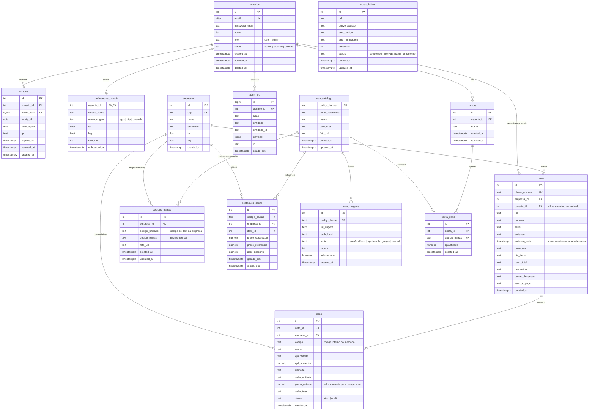

# Notinhas Beta — Modelo de dados

Persistência: **PostgreSQL 16 + PostGIS** (hospedado no ambiente Contabo, banco `connectmax`, schema `enotas`).  
O modelo evolui a estrutura existente do protótipo v0 (`empresas`, `notas`, `itens`, `codigos_barras`) integrando autenticação segura de usuários, preferências geográficas, catálogo universal de EAN, fotos candidatas, listas de compras (cesta/split), cache de destaques e rastreamento de auditoria.

---

## 1. Diagrama Entidade-Relacionamento (ERD)



---

## 2. DDL Detalhado e Índices

```sql
-- Schema e extensões
CREATE SCHEMA IF NOT EXISTS enotas;
CREATE EXTENSION IF NOT EXISTS citext;
CREATE EXTENSION IF NOT EXISTS pg_trgm;
CREATE EXTENSION IF NOT EXISTS postgis;

-- 2.1 Usuários e Autenticação
CREATE TABLE IF NOT EXISTS enotas.usuarios (
  id SERIAL PRIMARY KEY,
  email CITEXT NOT NULL UNIQUE,
  password_hash TEXT NOT NULL,
  nome TEXT,
  role TEXT NOT NULL DEFAULT 'user' CHECK (role IN ('user', 'admin')),
  status TEXT NOT NULL DEFAULT 'active' CHECK (status IN ('active', 'blocked', 'deleted')),
  created_at TIMESTAMPTZ NOT NULL DEFAULT now(),
  updated_at TIMESTAMPTZ NOT NULL DEFAULT now(),
  deleted_at TIMESTAMPTZ
);

CREATE TABLE IF NOT EXISTS enotas.sessoes (
  id SERIAL PRIMARY KEY,
  usuario_id INTEGER NOT NULL REFERENCES enotas.usuarios(id) ON DELETE CASCADE,
  token_hash BYTEA NOT NULL UNIQUE,
  family_id UUID NOT NULL,
  user_agent TEXT,
  ip INET,
  expires_at TIMESTAMPTZ NOT NULL,
  revoked_at TIMESTAMPTZ,
  created_at TIMESTAMPTZ NOT NULL DEFAULT now()
);

CREATE INDEX IF NOT EXISTS sessoes_usuario_idx ON enotas.sessoes(usuario_id);
CREATE INDEX IF NOT EXISTS sessoes_family_idx ON enotas.sessoes(family_id);

CREATE TABLE IF NOT EXISTS enotas.preferencias_usuario (
  usuario_id INTEGER PRIMARY KEY REFERENCES enotas.usuarios(id) ON DELETE CASCADE,
  cidade_nome TEXT DEFAULT 'Curitiba - PR',
  modo_origem TEXT DEFAULT 'gps' CHECK (modo_origem IN ('gps', 'city', 'override')),
  lat DOUBLE PRECISION,
  lng DOUBLE PRECISION,
  raio_km INTEGER DEFAULT 5 CHECK (raio_km BETWEEN 1 AND 100),
  onboarded_at TIMESTAMPTZ
);

-- 2.2 Empresas e Notas (Legado + Enriquecimento)
CREATE TABLE IF NOT EXISTS enotas.empresas (
  id SERIAL PRIMARY KEY,
  cnpj TEXT NOT NULL UNIQUE,
  nome TEXT,
  endereco TEXT,
  lat DOUBLE PRECISION,
  lng DOUBLE PRECISION,
  created_at TIMESTAMPTZ NOT NULL DEFAULT now()
);

CREATE INDEX IF NOT EXISTS empresas_coords_idx ON enotas.empresas(lat, lng) WHERE lat IS NOT NULL AND lng IS NOT NULL;

CREATE TABLE IF NOT EXISTS enotas.notas (
  id SERIAL PRIMARY KEY,
  chave_acesso TEXT NOT NULL UNIQUE,
  empresa_id INTEGER NOT NULL REFERENCES enotas.empresas(id),
  usuario_id INTEGER REFERENCES enotas.usuarios(id) ON DELETE SET NULL,
  url TEXT NOT NULL,
  numero TEXT,
  serie TEXT,
  emissao TEXT,
  emissao_data TIMESTAMPTZ,
  protocolo TEXT,
  qtd_itens TEXT,
  valor_total TEXT,
  descontos TEXT,
  outras_despesas TEXT,
  valor_a_pagar TEXT,
  created_at TIMESTAMPTZ NOT NULL DEFAULT now()
);

CREATE INDEX IF NOT EXISTS notas_empresa_idx ON enotas.notas(empresa_id);
CREATE INDEX IF NOT EXISTS notas_usuario_idx ON enotas.notas(usuario_id);
CREATE INDEX IF NOT EXISTS notas_emissao_data_idx ON enotas.notas(emissao_data DESC);

CREATE TABLE IF NOT EXISTS enotas.itens (
  id SERIAL PRIMARY KEY,
  nota_id INTEGER NOT NULL REFERENCES enotas.notas(id) ON DELETE CASCADE,
  empresa_id INTEGER NOT NULL REFERENCES enotas.empresas(id),
  codigo TEXT NOT NULL,
  nome TEXT,
  quantidade TEXT,
  qtd_numerica NUMERIC(10,3),
  unidade TEXT,
  valor_unitario TEXT,
  preco_unitario NUMERIC(10,2),
  valor_total TEXT,
  status TEXT NOT NULL DEFAULT 'ativo' CHECK (status IN ('ativo', 'oculto')),
  created_at TIMESTAMPTZ NOT NULL DEFAULT now(),
  UNIQUE (nota_id, codigo)
);

CREATE INDEX IF NOT EXISTS itens_codigo_idx ON enotas.itens(codigo);
CREATE INDEX IF NOT EXISTS itens_nota_idx ON enotas.itens(nota_id);
CREATE INDEX IF NOT EXISTS itens_empresa_idx ON enotas.itens(empresa_id);
CREATE INDEX IF NOT EXISTS itens_preco_unitario_idx ON enotas.itens(preco_unitario);
CREATE INDEX IF NOT EXISTS itens_nome_trgm_idx ON enotas.itens USING gin (nome gin_trgm_ops);

-- 2.3 Códigos de Barras e Catálogo EAN
CREATE TABLE IF NOT EXISTS enotas.codigos_barras (
  id SERIAL PRIMARY KEY,
  empresa_id INTEGER NOT NULL REFERENCES enotas.empresas(id),
  codigo_unidade TEXT NOT NULL,
  codigo_barras TEXT NOT NULL,
  foto_url TEXT,
  created_at TIMESTAMPTZ NOT NULL DEFAULT now(),
  updated_at TIMESTAMPTZ NOT NULL DEFAULT now(),
  UNIQUE (empresa_id, codigo_unidade)
);

CREATE INDEX IF NOT EXISTS codigos_barras_ean_idx ON enotas.codigos_barras(codigo_barras);
CREATE INDEX IF NOT EXISTS codigos_barras_emp_cod_idx ON enotas.codigos_barras(empresa_id, codigo_unidade);

CREATE TABLE IF NOT EXISTS enotas.ean_catalogo (
  codigo_barras TEXT PRIMARY KEY,
  nome_referencia TEXT NOT NULL,
  marca TEXT,
  categoria TEXT,
  foto_url TEXT,
  created_at TIMESTAMPTZ NOT NULL DEFAULT now(),
  updated_at TIMESTAMPTZ NOT NULL DEFAULT now()
);

CREATE INDEX IF NOT EXISTS ean_catalogo_nome_trgm_idx ON enotas.ean_catalogo USING gin (nome_referencia gin_trgm_ops);

CREATE TABLE IF NOT EXISTS enotas.ean_imagens (
  id SERIAL PRIMARY KEY,
  codigo_barras TEXT NOT NULL REFERENCES enotas.ean_catalogo(codigo_barras) ON DELETE CASCADE,
  url_origem TEXT NOT NULL,
  path_local TEXT NOT NULL,
  fonte TEXT NOT NULL CHECK (fonte IN ('openfoodfacts', 'upcitemdb', 'google', 'upload')),
  ordem INTEGER NOT NULL DEFAULT 0,
  selecionada BOOLEAN NOT NULL DEFAULT false,
  created_at TIMESTAMPTZ NOT NULL DEFAULT now()
);

CREATE INDEX IF NOT EXISTS ean_imagens_ean_idx ON enotas.ean_imagens(codigo_barras);

-- 2.4 Cestas e Split
CREATE TABLE IF NOT EXISTS enotas.cestas (
  id SERIAL PRIMARY KEY,
  usuario_id INTEGER NOT NULL REFERENCES enotas.usuarios(id) ON DELETE CASCADE,
  nome TEXT NOT NULL DEFAULT 'Minha Lista',
  created_at TIMESTAMPTZ NOT NULL DEFAULT now(),
  updated_at TIMESTAMPTZ NOT NULL DEFAULT now()
);

CREATE TABLE IF NOT EXISTS enotas.cesta_itens (
  id SERIAL PRIMARY KEY,
  cesta_id INTEGER NOT NULL REFERENCES enotas.cestas(id) ON DELETE CASCADE,
  codigo_barras TEXT NOT NULL,
  quantidade NUMERIC(10,3) NOT NULL DEFAULT 1.000 CHECK (quantidade > 0),
  created_at TIMESTAMPTZ NOT NULL DEFAULT now(),
  UNIQUE (cesta_id, codigo_barras)
);

CREATE INDEX IF NOT EXISTS cesta_itens_cesta_idx ON enotas.cesta_itens(cesta_id);

-- 2.5 Destaques de Concorrência (Cache)
CREATE TABLE IF NOT EXISTS enotas.destaques_cache (
  id SERIAL PRIMARY KEY,
  codigo_barras TEXT NOT NULL,
  empresa_id INTEGER NOT NULL REFERENCES enotas.empresas(id),
  item_id INTEGER NOT NULL REFERENCES enotas.itens(id),
  preco_observado NUMERIC(10,2) NOT NULL,
  preco_referencia NUMERIC(10,2) NOT NULL,
  perc_desconto NUMERIC(5,2) NOT NULL,
  gerado_em TIMESTAMPTZ NOT NULL DEFAULT now(),
  expira_em TIMESTAMPTZ NOT NULL
);

CREATE INDEX IF NOT EXISTS destaques_expira_idx ON enotas.destaques_cache(expira_em);
CREATE INDEX IF NOT EXISTS destaques_desconto_idx ON enotas.destaques_cache(perc_desconto DESC);

-- 2.6 Backoffice e Auditoria
CREATE TABLE IF NOT EXISTS enotas.notas_falhas (
  id SERIAL PRIMARY KEY,
  url TEXT NOT NULL,
  chave_acesso TEXT,
  erro_codigo TEXT,
  erro_mensagem TEXT,
  tentativas INTEGER NOT NULL DEFAULT 1,
  status TEXT NOT NULL DEFAULT 'pendente' CHECK (status IN ('pendente', 'resolvida', 'falha_persistente')),
  created_at TIMESTAMPTZ NOT NULL DEFAULT now(),
  updated_at TIMESTAMPTZ NOT NULL DEFAULT now()
);

CREATE INDEX IF NOT EXISTS notas_falhas_status_idx ON enotas.notas_falhas(status);

CREATE TABLE IF NOT EXISTS enotas.audit_log (
  id BIGSERIAL PRIMARY KEY,
  usuario_id INTEGER REFERENCES enotas.usuarios(id) ON DELETE SET NULL,
  acao TEXT NOT NULL,
  entidade TEXT NOT NULL,
  entidade_id TEXT NOT NULL,
  payload JSONB,
  ip INET,
  criado_em TIMESTAMPTZ NOT NULL DEFAULT now()
);

CREATE INDEX IF NOT EXISTS audit_log_entidade_idx ON enotas.audit_log(entidade, entidade_id);
CREATE INDEX IF NOT EXISTS audit_log_usuario_idx ON enotas.audit_log(usuario_id);
```

---

## 3. Consultas SQL Críticas

### 3.1 Menor Preço e Comparação por EAN com Loja, Data e Foto
Resolve a ponte entre o EAN universal, o mapeamento `codigos_barras` por mercado e a tupla mais recente daquele item em cada loja.

```sql
WITH ultimas_observacoes_por_loja AS (
  SELECT DISTINCT ON (i.empresa_id)
    i.id AS item_id,
    i.empresa_id,
    e.nome AS empresa_nome,
    e.endereco AS empresa_endereco,
    e.lat,
    e.lng,
    i.preco_unitario,
    i.unidade,
    n.emissao_data,
    n.id AS nota_id
  FROM enotas.itens i
  INNER JOIN enotas.notas n ON n.id = i.nota_id
  INNER JOIN enotas.empresas e ON e.id = i.empresa_id
  INNER JOIN enotas.codigos_barras cb 
    ON cb.empresa_id = i.empresa_id 
   AND cb.codigo_unidade = i.codigo
  WHERE cb.codigo_barras = :ean
    AND i.status = 'ativo'
    AND n.emissao_data >= now() - INTERVAL '30 days'
  ORDER BY i.empresa_id, n.emissao_data DESC, i.id DESC
)
SELECT 
  o.*,
  COALESCE(cat.foto_url, cat_img.path_local, cb.foto_url) AS foto_resolvida,
  cat.nome_referencia AS produto_nome_oficial
FROM ultimas_observacoes_por_loja o
LEFT JOIN enotas.ean_catalogo cat ON cat.codigo_barras = :ean
LEFT JOIN enotas.ean_imagens cat_img ON cat_img.codigo_barras = :ean AND cat_img.selecionada = true
LEFT JOIN enotas.codigos_barras cb ON cb.empresa_id = o.empresa_id AND cb.codigo_barras = :ean
ORDER BY o.preco_unitario ASC, o.emissao_data DESC;
```

### 3.2 Busca Geo: Onde Comprar Perto no Raio com Haversine
Localiza estabelecimentos no raio de `X km` a partir das coordenadas informadas pelo usuário (`:user_lat`, `:user_lng`), listando as lojas e a distância em linha reta.

```sql
SELECT 
  e.id AS empresa_id,
  e.nome AS empresa_nome,
  e.endereco,
  e.lat,
  e.lng,
  (6371 * acos(
    cos(radians(:user_lat)) * cos(radians(e.lat)) *
    cos(radians(e.lng) - radians(:user_lng)) +
    sin(radians(:user_lat)) * sin(radians(e.lat))
  )) AS distancia_km,
  i.preco_unitario,
  n.emissao_data
FROM enotas.empresas e
INNER JOIN enotas.itens i ON i.empresa_id = e.id
INNER JOIN enotas.notas n ON n.id = i.nota_id
INNER JOIN enotas.codigos_barras cb 
  ON cb.empresa_id = i.empresa_id AND cb.codigo_unidade = i.codigo
WHERE cb.codigo_barras = :ean
  AND i.status = 'ativo'
  AND e.lat IS NOT NULL 
  AND e.lng IS NOT NULL
  AND (6371 * acos(
    cos(radians(:user_lat)) * cos(radians(e.lat)) *
    cos(radians(e.lng) - radians(:user_lng)) +
    sin(radians(:user_lat)) * sin(radians(e.lat))
  )) <= :raio_km
  AND n.emissao_data >= now() - INTERVAL '30 days'
ORDER BY distancia_km ASC, i.preco_unitario ASC;
```

### 3.3 Ranking Agregado de Lojas (Mais Baratas x Mais Caras)
Calcula o índice de competitividade de cada supermercado comparando o preço médio praticado em itens comuns contra a mediana da região.

```sql
WITH precos_referencia AS (
  SELECT 
    cb.codigo_barras,
    percentile_cont(0.5) WITHIN GROUP (ORDER BY i.preco_unitario) AS mediana_preco
  FROM enotas.itens i
  INNER JOIN enotas.notas n ON n.id = i.nota_id
  INNER JOIN enotas.codigos_barras cb 
    ON cb.empresa_id = i.empresa_id AND cb.codigo_unidade = i.codigo
  WHERE i.status = 'ativo'
    AND n.emissao_data >= now() - INTERVAL '30 days'
  GROUP BY cb.codigo_barras
  HAVING COUNT(DISTINCT i.empresa_id) >= 3 -- itens presentes em ao menos 3 concorrentes
),
desvio_por_loja_item AS (
  SELECT 
    i.empresa_id,
    cb.codigo_barras,
    i.preco_unitario,
    ref.mediana_preco,
    ((i.preco_unitario - ref.mediana_preco) / ref.mediana_preco) * 100.0 AS perc_desvio
  FROM enotas.itens i
  INNER JOIN enotas.notas n ON n.id = i.nota_id
  INNER JOIN enotas.codigos_barras cb 
    ON cb.empresa_id = i.empresa_id AND cb.codigo_unidade = i.codigo
  INNER JOIN precos_referencia ref ON ref.codigo_barras = cb.codigo_barras
  WHERE i.status = 'ativo'
    AND n.emissao_data >= now() - INTERVAL '30 days'
)
SELECT 
  e.id AS empresa_id,
  e.nome AS empresa_nome,
  e.lat,
  e.lng,
  COUNT(DISTINCT d.codigo_barras) AS qtd_itens_amostra,
  ROUND(AVG(d.perc_desvio), 2) AS indice_desvio_medio
FROM enotas.empresas e
INNER JOIN desvio_por_loja_item d ON d.empresa_id = e.id
GROUP BY e.id, e.nome, e.lat, e.lng
HAVING COUNT(DISTINCT d.codigo_barras) >= 10 -- amostragem mínima de 10 produtos
ORDER BY indice_desvio_medio ASC; -- ASC = Mais baratas | DESC = Mais caras
```

### 3.4 Cotação e Cobertura de Cesta por Mercado
Determina o valor total da lista de compras e a quantidade de itens encontrados em cada supermercado.

```sql
WITH cesta_itens_user AS (
  SELECT ci.codigo_barras, ci.quantidade
  FROM enotas.cesta_itens ci
  WHERE ci.cesta_id = :cesta_id
),
total_itens_cesta AS (
  SELECT COUNT(*) AS total_itens FROM cesta_itens_user
),
precos_na_loja AS (
  SELECT DISTINCT ON (cb.empresa_id, cb.codigo_barras)
    cb.empresa_id,
    cb.codigo_barras,
    c.quantidade,
    i.preco_unitario,
    (c.quantidade * i.preco_unitario) AS subtotal_item
  FROM cesta_itens_user c
  INNER JOIN enotas.codigos_barras cb ON cb.codigo_barras = c.codigo_barras
  INNER JOIN enotas.itens i ON i.empresa_id = cb.empresa_id AND i.codigo = cb.codigo_unidade
  INNER JOIN enotas.notas n ON n.id = i.nota_id
  WHERE i.status = 'ativo'
    AND n.emissao_data >= now() - INTERVAL '30 days'
  ORDER BY cb.empresa_id, cb.codigo_barras, n.emissao_data DESC
)
SELECT 
  e.id AS empresa_id,
  e.nome AS empresa_nome,
  e.endereco,
  COUNT(p.codigo_barras) AS itens_encontrados,
  t.total_itens,
  ROUND((COUNT(p.codigo_barras)::numeric / t.total_itens::numeric) * 100, 1) AS percentual_cobertura,
  SUM(p.subtotal_item) AS valor_total_cesta
FROM enotas.empresas e
INNER JOIN precos_na_loja p ON p.empresa_id = e.id
CROSS JOIN total_itens_cesta t
GROUP BY e.id, e.nome, e.endereco, t.total_itens
ORDER BY percentual_cobertura DESC, valor_total_cesta ASC;
```

### 3.5 Extrato e Gestão Financeira Pessoal Mensal
Agrupa o gasto real do usuário logado mês a mês com base nas notas fiscais depositadas.

```sql
SELECT 
  to_char(n.emissao_data, 'YYYY-MM') AS mes_ano,
  COUNT(n.id) AS total_notas,
  SUM(NULLIF(regexp_replace(n.valor_total, '[^0-9.]', '', 'g'), '')::numeric) AS gasto_total_mes
FROM enotas.notas n
WHERE n.usuario_id = :usuario_id
  AND n.emissao_data IS NOT NULL
GROUP BY to_char(n.emissao_data, 'YYYY-MM')
ORDER BY mes_ano DESC;
```

---

## 4. Regras de Integridade e Governança

1. **Imutabilidade Fiscal e Colaboração:**
   - Notas fiscais (`notas`) e itens (`itens`) são registros fidedignos extraídos da DANFE oficial da SEFAZ. Nenhuma alteração manual de valores, códigos ou datas é permitida.
   - Em caso de inconsistência evidente ou spam, o status do item é alterado para `'oculto'` por moderador (`US-ADM.02`), preservando a tupla original e a auditoria em `audit_log`.

2. **Chaves Naturais de Ingestão e Mapeamento:**
   - `notas.chave_acesso UNIQUE`: chave universal de 44 dígitos da NFC-e. Garante que reenvios ou scans acidentais não dupliquem a nota nem os itens (`US-01.08`).
   - `itens(nota_id, codigo) UNIQUE`: assegura que o mesmo código interno não se repita dentro da mesma nota fiscal.
   - `codigos_barras(empresa_id, codigo_unidade) UNIQUE`: garante que cada código interno de uma empresa aponte para exatamente um código de barras universal EAN. O cadastro cooperativo aplica `UPSERT`.

3. **Privacidade e LGPD:**
   - O vínculo `notas.usuario_id` é configurado com `ON DELETE SET NULL`. Quando o usuário solicita exclusão de conta (`US-01.12`), o e-mail e credenciais na tabela `usuarios` são anonimizados e os dados da pessoa física desaparecem, enquanto as notas fiscais e itens continuam alimentando o índice público de preços da comunidade.
   - Localização precisa em coordenadas (`lat, lng`) de usuários só é armazenada se houver consentimento explícito, e pode ser arredondada para proteger a residência do indivíduo.

4. **Gerenciamento de Sessão e Ataques de Reuso:**
   - Sessões usam UUID de família (`family_id`). Quando um refresh token já consumido é apresentado novamente à API, o sistema identifica violação de integridade (reuso de token), revoga imediatamente toda a família daquela sessão e força novo login.
