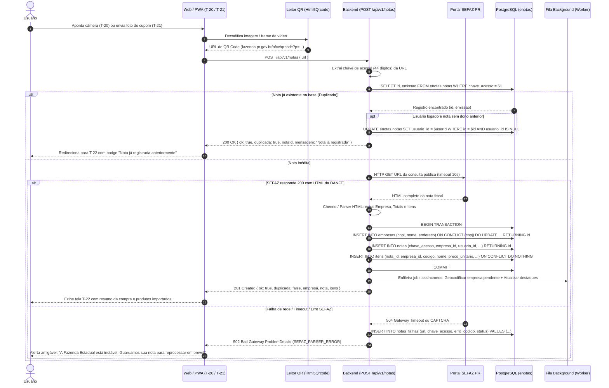
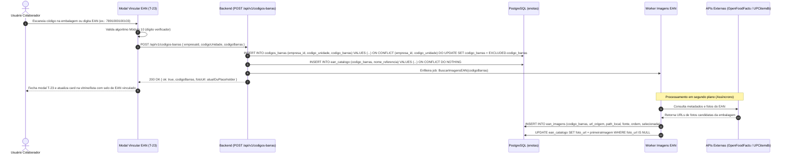
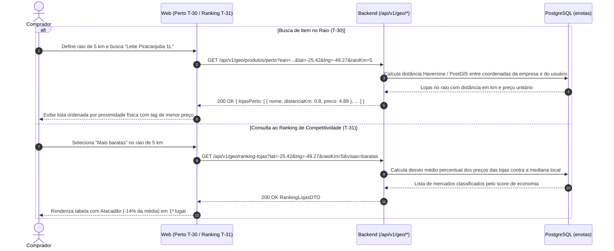
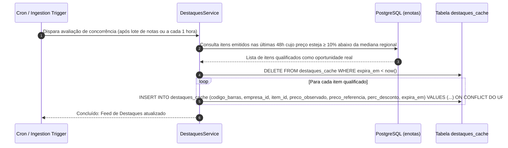
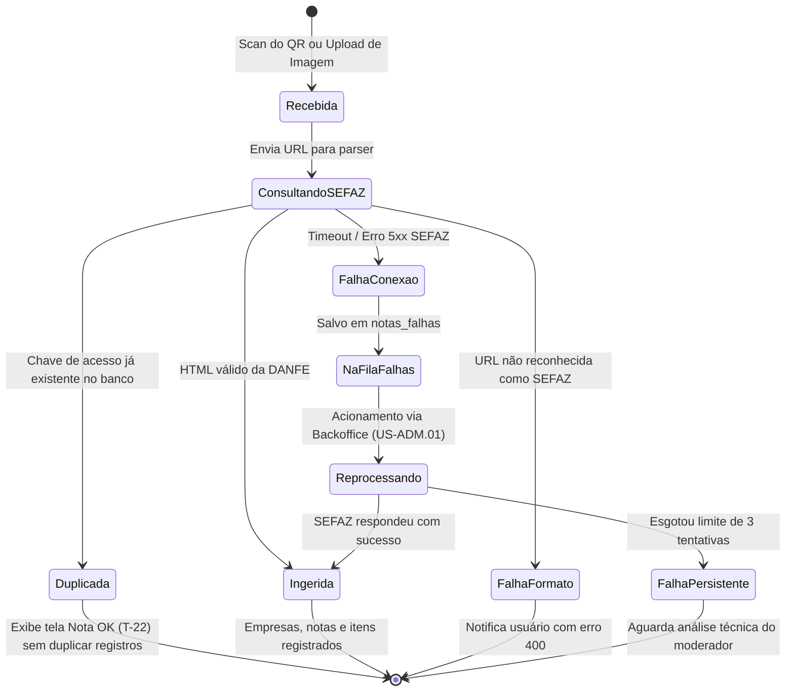
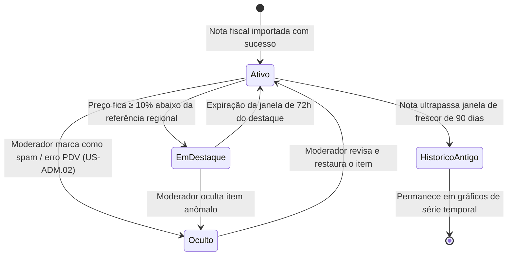
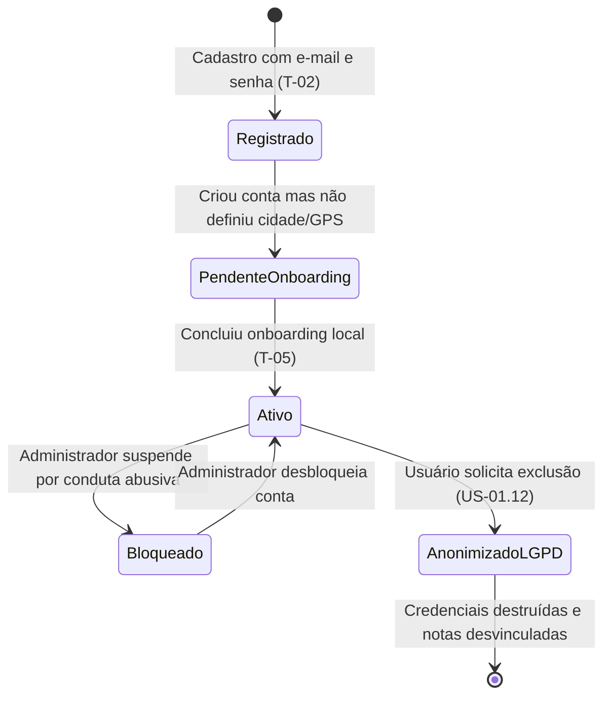
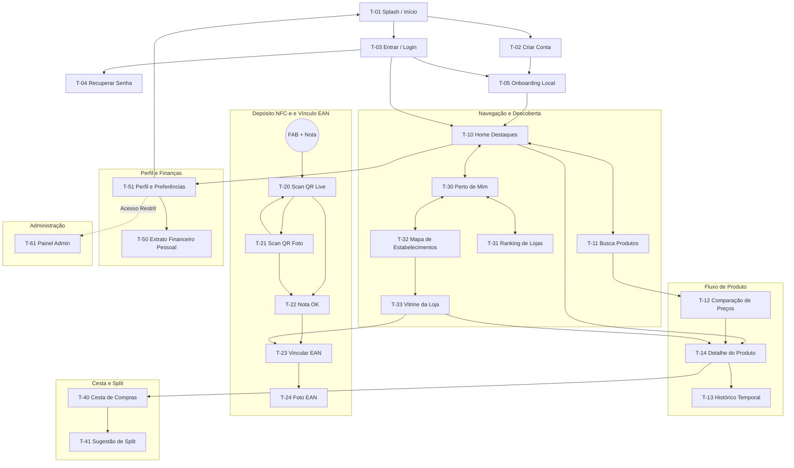

# Notinhas Beta — Diagramas de sequência, estados e navegação

Todos os diagramas utilizam sintaxe **Mermaid** compatível com renderização nativa no GitHub, Cursor e visualizadores Markdown. Eles modelam a arquitetura de processamento assíncrono, a máquina de estados das notas fiscais e do usuário, e o mapa de transição das telas do app.

---

## 1. Diagramas de Sequência

### 1.1 Ingestão de NFC-e (Câmera ao Vivo e Upload de Foto)
Cobre os fluxos de captura, consulta à SEFAZ Paraná, parse da DANFE e idempotência para notas duplicadas.



---

### 1.2 Vínculo Cooperativo de EAN e Busca de Imagens
Modela a associação colaborativa do código de barras ao item e o disparo assíncrono para obter imagens de embalagens.



---

### 1.3 Busca e Comparação de Menor Preço por EAN
Mostra a agregação de observações do mesmo código de barras entre estabelecimentos concorrentes com ordenação por menor preço e frescor.

```mermaid
sequenceDiagram
  autonumber
  actor C as Comprador
  participant W as Web (Busca T-11 / Comparação T-12)
  participant API as Backend (GET /api/v1/produtos/:ean)
  participant DB as PostgreSQL (enotas)

  C->>W: Digita EAN ou pesquisa por nome na Busca (T-11)
  W->>API: GET /api/v1/produtos/7891000100103?frescorDias=30&lat=-25.42&lng=-49.27
  
  API->>DB: Executa CTE de agregação de preços por loja nos últimos 30 dias
  DB-->>API: Lista de observações (Condor: R$ 34,90; Muffato: R$ 41,50; Festval: R$ 47,90)
  
  API->>API: Identifica o menor preço (Condor R$ 34,90) e calcula economia vs concorrentes
  API-->>W: 200 OK ProdutoDetalheDTO { resumoPrecos, comparacaoLojas }
  
  W-->>C: Renderiza tela T-12 destacando o Condor em VERDE (#00984B) com badge "MENOR PREÇO"
```

---

### 1.4 Busca Geográfica de Item Perto e Ranking de Mercados
Demonstra a consulta de lojas físicas no raio do usuário e a computação do ranking de competitividade.



---

### 1.5 Atualização do Cache de Destaques de Concorrência
Gatilho e processamento da esteira que popula as oportunidades da Home.



---

## 2. Máquinas de Estado

### 2.1 Ciclo de Vida da Ingestão de Nota Fiscal



---

### 2.2 Ciclo de Vida da Observação de Preço do Item



---

### 2.3 Ciclo de Vida da Conta de Usuário e Sessão



---

## 3. Mapa de Navegação da Aplicação


