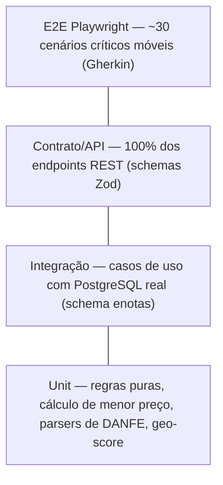

# notinhas.shop Beta — Estratégia de testes e qualidade

Documento canônico definindo os padrões de garantia de qualidade para o **notinhas.shop Beta**, cobrindo a pirâmide de testes, automação a partir de especificações Gherkin, testes obrigatórios para riscos críticos, gates de CI e instrumentação analítica.

## 1. Pirâmide de testes



| Nível | Ferramenta | Onde executa | Meta de cobertura |
|---|---|---|---|
| **Unit** | Vitest | Pre-commit (arquivos alterados) e pipeline de CI | 100% dos ramos de cálculo de menor preço, desvio de concorrência, split de cesta e parsers de DANFE |
| **Integração** | Vitest + PostgreSQL real (schema `enotas` isolado) | CI | Todo caso de uso cobrindo caminho feliz, erros de domínio e concorrência de banco |
| **Contrato** | Vitest + Supertest + Schemas Zod de [`06-contratos-api.md`](06-contratos-api.md) | CI | 100% das rotas: validação estrita do formato de request e payload de response |
| **Componente** | Vitest + Testing Library / JSDOM | CI | Componentes interativos de UI (Cards de preço, modais de scan, abas, timeline) |
| **E2E Móvel** | Playwright (emulação Chromium mobile 390×844 e 360×800) | CI (smoke nos PRs) / Nightly (bateria completa) | Todos os cenários críticos com tag `@US-xx.yy` das histórias |
| **Visual** | Playwright Screenshots contra baselines dos protótipos `T-xx` | Nightly | Telas-chave (Home, Detalhe Produto, Vitrine da Loja, Extrato) sem regressão visual |
| **Carga** | k6 | Pré-lançamento do Beta aberto | Busca de produtos e cálculo de ranking p95 < 300 ms sob 50 req/s |
| **Acessibilidade** | `@axe-core/playwright` | Bateria E2E | Zero violações graves (*serious* ou *critical*) |

## 2. Rastreabilidade Gherkin → teste automatizado

- Toda história de usuário em [`02-historias/`](02-historias/) possui cenários estruturados no formato BDD (Dado / Quando / Então).
- Cada cenário é diretamente convertido em um caso de teste automatizado (unitário, de integração ou E2E) mantendo o mesmo título e anotado com a tag correspondente:
  ```typescript
  // e2e/features/deposito-nota.spec.ts
  test.describe('@US-01.02 Depósito de NFC-e por QR Code', () => {
    test('Nota duplicada retorna status de já processada sem criar novos itens', async ({ page }) => {
      // Cenário correspondente ao Gherkin da US-01.02
    });
  });
  ```
- O relatório do pipeline de CI categoriza a execução por tag (`@US-xx.yy`), fornecendo a matriz de cobertura de requisitos em tempo real.

## 3. Dados de teste, fixtures e isolamento

- **Fixtures de DANFE realistas (SEFAZ PR):** amostras estáticas de HTML de notas fiscais da Fazenda PR, abrangendo diferentes formatos de emissores (grandes redes atacadistas, supermercados de bairro, postos), com todos os dados pessoais do consumidor descaracterizados.
- **Clock determinístico:** porta de relógio (`ClockPort`) com injeção de data fixa em testes (`FAKE_NOW="2026-11-20T10:00:00Z"`), viabilizando testes de janelas de frescor de preços (ex.: preços observados nas últimas 24h vs 30 dias).
- **Seed determinístico de Curitiba e região:** conjunto padronizado contendo 10 estabelecimentos reais mapeados (Condor, Festval, Muffato, Jacomar) com coordenadas precisas, 50 itens de cesta básica com códigos EAN válidos e histórico de preços com variações planejadas.
- **Isolamento transacional:** cada teste de integração executa dentro de uma transação isolada com rollback ao final, ou em schema temporário dedicado.

## 4. Testes que não podem faltar (Riscos críticos do PRD e REQ)

| Risco / Requisito | Tipo de Teste | Descrição da Verificação |
|---|---|---|
| **Deduplicação de nota (REQ-005)** | Integração | Submissão concorrente (`Promise.all`) da mesma chave de acesso de 44 dígitos por 5 clientes simultâneos. Deve resultar em exatamente **1** nota gravada no banco, zero duplicações e respostas com código de idempotência. |
| **Item único por nota (REQ-009)** | Integração | Ingestão de DANFE com itens repetidos para o mesmo código de produto. A constraint `UNIQUE (nota_id, codigo)` e a cláusula `ON CONFLICT DO NOTHING` garantem que nenhum item seja duplicado na nota. |
| **Corrida no vínculo de EAN (REQ-011)** | Integração | Dois usuários enviando vínculos diferentes de código de barras para o mesmo par `(empresa_id, codigo_unidade)` no mesmo milissegundo. Testar resolução determinística via `UPSERT` sem travamento (*deadlock*) nem estado corrompido. |
| **Exatidão do cálculo de menor preço (PRD §5.1)** | Unitário + Contrato | Consulta de produto vinculado a 10 notas com preços e datas distintas. O menor preço ativo deve ser identificado com precisão, apontando o estabelecimento correto, a data de emissão exata e aplicando a cor verde oficial (`#00984B`). |
| **Correção do ranking geográfico de lojas (PRD §5.6)** | Integração | Cálculo de desvio agregado de preços em um raio de 5 km em relação à média regional. Estabelecimentos mais caros e mais baratos devem ocupar as posições corretas do ranking, excluindo lojas abaixo do limiar de cobertura mínima de itens observados. |
| **Privacidade estrita do extrato financeiro (PRD §5.10)** | Contrato + Integração | Usuário autenticado A acessa `/api/extrato`. O teste valida que notas depositadas pelo usuário B **nunca** aparecem na resposta. Validação em teste de contrato de que o endpoint público de produtos (`/api/itens`) **não contém** nenhum campo identificador de quem depositou a nota. |
| **Descarte de dados do consumidor na NFC-e (REQ-004)** | Unitário (Scraper) | Ingestão de DANFE contendo CPF e nome do cliente no cabeçalho do cupom. O teste inspeciona a saída do parser e a carga persistida no Postgres, garantindo que CPF e nome foram sumariamente eliminados antes de qualquer persistência. |
| **Indisponibilidade ou CAPTCHA da SEFAZ PR** | Integração | Mock da chamada à Fazenda PR retornando timeout de rede ou página de CAPTCHA. O backend deve responder com erro de negócio padronizado (`SEFAZ_SERVICE_UNAVAILABLE`), mantendo o serviço estável e sem vazamento de stacktrace. |
| **Sanitização de endereço no Nominatim (REQ-013)** | Unitário | Endereços com vírgulas soltas `, 0,` ou complementos corrompidos da DANFE são higienizados pela função de normalização antes do envio ao Nominatim, resultando em consulta válida e pin posicionado. |
| **Rate limit de geocoding** | Integração | Disparo em lote de 10 geocodificações pendentes. O adaptador deve enfileirar as requisições respeitando o intervalo mínimo de 1 segundo entre chamadas externas. |
| **Busca de fotos por EAN (REQ-032)** | Integração | Cadastro de EAN dispara busca assíncrona de imagens candidatas sem bloquear a resposta do modal. Validação de que até 5 imagens são persistidas e uma é eleita para a vitrine. |

## 5. Critérios de qualidade e gates de CI

| Gate de Qualidade | Ferramenta | Momento | Bloqueia Merge? |
|---|---|---|---|
| **Lint & Typecheck** | ESLint + TypeScript strict | CI em todo PR | **Sim** |
| **Estilos e Design System** | Stylelint (proibição de hex solto) | CI em todo PR | **Sim** |
| **Testes Unitários e Integração** | Vitest (cobertura de ramos) | CI em todo PR | **Sim** (mínimo 100% domínio / 80% geral) |
| **Testes de Contrato de API** | Supertest + Schemas Zod | CI em todo PR | **Sim** |
| **E2E Smoke Móvel** | Playwright (fluxo de scan → produto) | CI em todo PR | **Sim** |
| **Segurança e Segredos** | Gitleaks | CI em todo PR | **Sim** (zero credenciais expostas) |
| **Auditoria de Dependências** | `npm audit` | CI semanal / PR | **Sim** para falhas *High* ou *Critical* |
| **Lighthouse Mobile** | CI / Staging | Nightly | Não (alerta para pontuações < 85 em performance ou a11y) |
| **Regressão Visual** | Playwright Snapshots | Nightly | Não (abre card de revisão visual para o time de design) |

## 6. Testes manuais em dispositivos reais e Beta fechado

- **Ambiente de testes móveis:** testes em smartphones reais (iOS / Safari e Android / Chrome) conectados via rede móvel 4G, cobrindo:
  - Câmera em condições de baixa luminosidade para leitura de QR Code em papel térmico amassado.
  - Teste de upload de foto tirada no momento (`capture=environment`) versus imagem selecionada da galeria.
  - Leitura de códigos de barras 1D (EAN-13) em embalagens cilíndricas ou com reflexo.
- **Validação de visualização de links compartilhados:** verificação da renderização do preview do Open Graph (`og:image`, `og:title`) no WhatsApp, Telegram e Instagram Direct.
- **Canal de feedback integrado:** botão flutuante de feedback na tela de perfil para reporte rápido de discrepâncias de preço.

## 7. Plano de eventos de analytics (Métricas sem PII)

Instrumentação analítica orientada a medir a saúde do índice e a adoção das funcionalidades, sem armazenar dados pessoais:

| Nome do Evento | Propriedades Registradas | Hipótese / Métrica Associada |
|---|---|---|
| `receipt_scan_started` | `mode` (`camera_live`, `photo_capture`, `file_upload`) | Funil de depósito de notas |
| `receipt_processed_success` | `items_count`, `has_new_store`, `processing_time_ms` | Liquidez e performance do catálogo |
| `receipt_duplicate_rejected` | `reason` (`already_in_database`) | Taxa de reenvio de notas |
| `ean_modal_opened` | `source` (`vitrine_loja`, `detalhe_produto`, `lista_itens`) | Intenção de contribuição colaborativa |
| `ean_link_created` | `is_first_link_for_store`, `method` (`barcode_scan`, `manual_input`) | Expansão do grafo de EANs |
| `product_searched` | `query_length`, `results_count`, `has_exact_ean` | Eficiência da busca de produtos |
| `lowest_price_viewed` | `has_multiple_stores`, `price_variance_percent` | Percepção de economia pelo usuário |
| `store_vitrine_viewed` | `store_id`, `items_count`, `source` (`map_pin`, `product_timeline`) | Engajamento na vitrine do comércio local |
| `geo_ranking_viewed` | `radius_km`, `sort_order` (`cheapest_first`, `most_expensive_first`) | Interesse no ranking agregado de mercados |
| `price_timeline_expanded` | `points_count`, `days_span` | Interesse no histórico temporal do produto |
| `basket_split_calculated` | `items_count`, `stores_count`, `savings_cents` | Validação da economia na montagem apartada |
| `financial_extract_viewed` | `period` (`month`, `week`), `total_receipts` | Adoção da gestão financeira pessoal |
