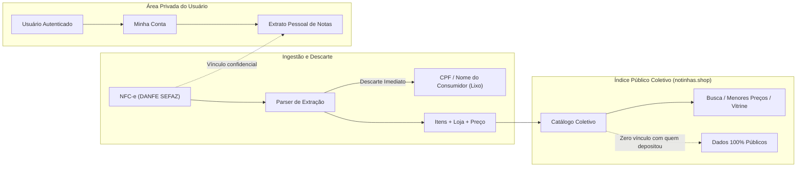

# notinhas.shop Beta — Segurança, privacidade e LGPD

> **Aviso de conformidade:** Este documento descreve as salvaguardas técnicas e a governança de dados adotada pela arquitetura do **notinhas.shop**. Ele não substitui a consulta jurídica formal para elaboração dos Termos de Uso e da Política de Privacidade canônica antes do lançamento público.

## 1. Inventário de dados pessoais e fiscais

O **notinhas.shop** opera sob o princípio da **minimização de dados** (LGPD, art. 6º, III). O objetivo do produto é construir um índice coletivo de preços de balcão a partir de documentos fiscais públicos (NFC-e), sem monitorar individualmente hábitos de consumo de pessoas naturais.

| Categoria do Dado | Itens Coletados | Finalidade de Uso | Base Legal (LGPD art. 7º) | Nível de Visibilidade | Política de Retenção |
|---|---|---|---|---|---|
| **Documento Fiscal Bruto** | URL da NFC-e e Chave de Acesso (44 dígitos da SEFAZ PR) | Ingestão técnica, verificação de integridade e deduplicação de notas fiscais | Legítimo interesse (IX) e Execução de contrato (V) | Uso interno restrito do backend | Enquanto o índice de preços estiver ativo |
| **Identificação do Consumidor na Nota** | CPF do consumidor ou Nome impresso no cupom fiscal | **NENHUMA FINALIDADE.** O sistema não utiliza dados de identificação do comprador da nota | **Descarte sumário obrigatório** | **Invisível (não persistido)** | **Zero retenção:** eliminado da memória imediatamente no ato da extração |
| **Itens de Consumo e Preços** | Descrição do item, código de unidade da loja, quantidade, unidade e valor unitário | Formação do índice público de comparação de preços e histórico | Legítimo interesse (IX) | **Público irrestrito** | Permanente no histórico agregado |
| **Vínculos de EAN** | Código EAN-13, código de unidade e ID do estabelecimento | Padronização e vinculação de produtos entre diferentes redes | Colaboração pública / Legítimo interesse (IX) | **Público irrestrito** | Permanente no catálogo |
| **Conta de Usuário** | E-mail, hash criptográfico da senha (argon2id) | Autenticação no sistema e gestão do extrato pessoal de compras | Execução de contrato (V) | Exclusivo do titular e do sistema de auth | Enquanto a conta permanecer ativa |
| **Localização do Usuário** | Coordenadas aproximadas (lat/lng truncadas a 3 casas) | Cálculo de distância para lojas próximas e ordenação de ranking no raio | **Consentimento explícito** (I) | Exclusivo do servidor durante a requisição | Apenas a última coordenada aproximada; eliminada ao revogar |
| **Imagens e Comprovantes** | Imagem do QR Code enviado para decodificação | Extração do link oficial da SEFAZ para processamento da nota | Execução do serviço solicitado | Processada em memória | Descartada logo após o reconhecimento do QR |
| **Fotos de Embalagens (EAN)** | Fotografias de produtos / códigos de barras | Identificação visual de itens no catálogo público e vitrines | Colaboração pública / Legítimo interesse (IX) | **Público irrestrito** | Permanente na galeria pública de produtos |
| **Logs Técnicos de Acesso** | IP do cliente (truncado), User-Agent, endpoint e timestamp | Segurança da aplicação e prevenção de fraudes | Cumprimento de obrigação legal (Marco Civil, art. 15) | Exclusivo da equipe técnica de infraestrutura | 6 meses (em armazenamento rotativo protegido) |

## 2. Segregação e anonimização do índice público

A integridade e privacidade do **notinhas.shop** apoiam-se em uma separação arquitetural rígida entre o **Índice Coletivo de Preços** e o **Extrato Pessoal do Usuário**:



### Regras de Ouro da Segregação:
1. **Anonimato no Catálogo:** As APIs públicas (`/api/itens`, `/api/produtos`, `/api/estabelecimentos`, `/api/busca`) jamais expõem quem realizou o upload da nota fiscal correspondente.
2. **Controle de Acesso ao Extrato:** A rota de extrato financeiro pessoal (`/api/extrato`) exige autenticação via JWT em cookie seguro `HttpOnly`. Um usuário jamais tem acesso a itens ou comprovantes enviados por outras contas.
3. **Impossibilidade de Rastreamento Cruzado:** Mesmo que um terceiro examine as tuplas de itens no índice público, é tecnicamente inviável correlacionar diferentes compras para reconstruir a cesta de consumo de uma pessoa específica.

## 3. Modelo de ameaças (STRIDE adaptado ao notinhas.shop)

| Categoria | Vetor de Ameaça | Impacto Potencial | Salvaguardas e Controles Implementados |
|---|---|---|---|
| **Spoofing (Identidade)** | Injeção de notas fiscais fraudulentas ou URLs arbitrárias | Poluição do índice com preços irreais ou falsos | Validação criptográfica da chave da SEFAZ na URL oficial (`fazenda.pr.gov.br`). Domínios externos não homologados são rejeitados imediatamente (prevenção de SSRF). |
| **Spoofing (Autenticação)** | Sequestro de sessão ou roubo de tokens | Acesso indevido ao extrato financeiro do usuário | Cookies `HttpOnly`, `Secure` e `SameSite=Strict`. Tokens JWT com algoritmo fixo EdDSA (rejeitando `none` e `HS*`), tempo de expiração curto (15 min) e refresh tokens rotativos com detecção de reuso. |
| **Tampering (Adulteração)** | Vínculo forjado de código EAN com intenção de deturpar preços | Danos à reputação de lojas ou quebra da comparação | Restrição a formatos GTIN válidos com conferência de dígito verificador. Histórico auditável de vínculos com rastreamento por IP/usuário. |
| **Repudiation (Repúdio)** | Reclamação de lojista sobre divergência de preço exibido | Disputa legal ou questionamento sobre a vitrine | Toda observação de preço mantém o hash da chave da NFC-e, número da nota e data precisa da emissão na SEFAZ, provando a origem fática do valor. |
| **Information Disclosure (Vazamento)** | Exposição acidental de CPF em tela, logs ou APIs | Violação grave da LGPD | Sanitização do parser no momento da leitura da DANFE. Auditoria contínua de logs via testes de contrato automatizados que barram qualquer campo de CPF. |
| **Information Disclosure (Geo)** | Triangulação da residência do usuário pelo histórico de busca | Exposição de localização habitual | Apenas coordenadas truncadas a 3 casas decimais (precisão ~100 metros) são trafegadas. A geolocalização do usuário nunca é persistida no histórico de produtos. |
| **Denial of Service (DoS)** | Bombardeio de uploads ou abuso do parser contra a SEFAZ | Bloqueio do IP do servidor pela Fazenda PR | Fila com limitação de vazão (rate limiting estrito de 5 notas/minuto por cliente). Cache agressivo de empresas e produtos já consultados. |
| **Elevation of Privilege** | Usuário comum manipulando cadastros de redes de supermercados | Corrupção de coordenadas no mapa ou dados da loja | Separação rígida de papéis (*roles*) no backend. Endpoints de manutenção de empresas restritos a credenciais administrativas. |

## 4. Direitos do titular de dados (LGPD, art. 18)

O **notinhas.shop** garante os direitos fundamentais do titular através de canais e interfaces automatizadas:

- **Confirmação e Acesso (art. 18, I e II):** O usuário pode visualizar todos os seus dados cadastrais e as notas fiscais enviadas através da aba de perfil e extrato.
- **Correção de Dados (art. 18, III):** Possibilidade de atualizar dados cadastrais e senha diretamente na interface da conta.
- **Anonimização ou Eliminação (art. 18, IV e VI):**
  - O titular pode solicitar a **exclusão definitiva de sua conta**.
  - No momento da exclusão, o vínculo entre a conta e as notas fiscais depositadas é definitivamente desfeito. Os dados fiscais e os preços permanecem no índice público sob anonimização irreversível, resguardando o histórico coletivo e o legítimo interesse da base pública.
- **Revogação do Consentimento de Localização (art. 18, IX):** O usuário pode, a qualquer instante, revogar a permissão de geolocalização no navegador ou optar pelo uso de uma âncora fixa (ex.: "Centro de Curitiba").
- **Canal de Atendimento do Titular / DPO:** Requisições sobre privacidade e dados pessoais devem ser encaminhadas diretamente ao e-mail institucional:  
  **`privacidade@notinhas.shop`** (prazo de resposta: até 15 dias úteis, conforme art. 19, II).

## 5. Controles técnicos e diretrizes de infraestrutura

- **Criptografia em trânsito:** HTTPS obrigatório em todas as origens públicas, com HSTS ativo (`Strict-Transport-Security: max-age=31536000; includeSubDomains`). Certificados emitidos via Let's Encrypt (Certbot) para `notinhas.shop`.
- **Criptografia de senhas:** Funções de derivação de chave modernas utilizando **argon2id** com salt criptográfico único por usuário.
- **Isolamento de banco de dados:** PostgreSQL operando em rede local interna (`localhost` na VPS da Contabo), sem exposição de porta TCP pública para a internet.
- **Armazenamento de segredos:** Todas as chaves e credenciais residem exclusivamente em arquivos `.env` protegidos com permissão `600`, sem jamais serem incluídas em commits de código ou imagens de container.
- **Política de Cabeçalhos HTTP (Helmet):**
  ```text
  Content-Security-Policy: default-src 'self'; img-src 'self' data: blob: https://*.tile.openstreetmap.org; connect-src 'self'; frame-ancestors 'none';
  X-Content-Type-Options: nosniff
  X-Frame-Options: DENY
  Referrer-Policy: strict-origin-when-cross-origin
  Permissions-Policy: camera=(self), geolocation=(self)
  ```

## 6. Checklist de lançamento (Segurança e LGPD)

Antes da abertura do Beta do notinhas.shop para o público geral, os seguintes itens devem ser estritamente cumpridos:

- [ ] **Termos de Uso e Política de Privacidade** publicados nas rotas `/termos` e `/privacidade`, em linguagem clara e acessível.
- [ ] **Canal de DPO / Encarregado** ativo e testado via `privacidade@notinhas.shop`.
- [ ] **Varredura de CPF / PII:** Teste automatizado de ponta a ponta confirmando que nenhuma nota gravada no schema `enotas` contém dados de identificação do consumidor.
- [ ] **Validação de domínios SEFAZ:** Endpoint `POST /api/nota` rejeita estritamente qualquer URL que não pertença aos subdomínios autorizados da Fazenda PR.
- [ ] **Headers de Segurança e SSL:** Classificação A no teste SSL Labs para o domínio `notinhas.shop`.
- [ ] **Rate Limiting Ativo:** Limites de requisição por IP e por sessão habilitados contra força bruta e DoS.
- [ ] **Cookies Seguros:** Todos os cookies de sessão e autenticação marcados com `HttpOnly`, `Secure` e `SameSite=Strict`.
- [ ] **Rotina de Backup Criptografada:** Backups diários do Postgres testados com restauração validada em ambiente isolado.
- [ ] **Consentimento de Geolocalização:** Explicação clara do uso das coordenadas no momento da solicitação de permissão no browser.
- [ ] **Fluxo de Exclusão de Conta:** Teste automatizado de remoção de usuário com dissociação limpa dos dados de catálogo.
