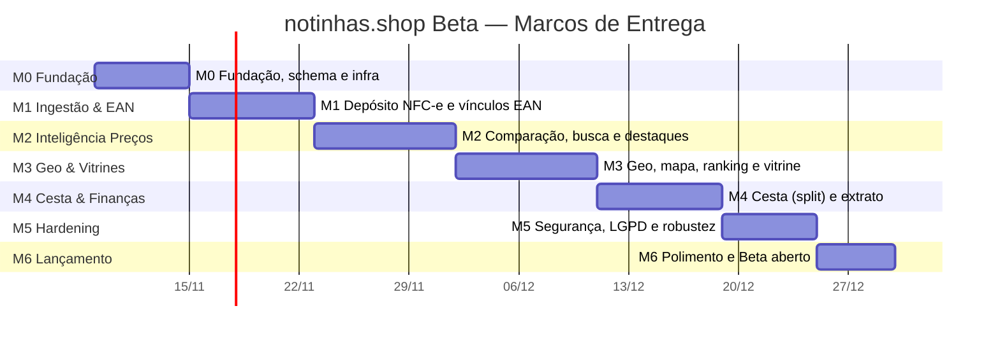
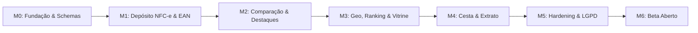
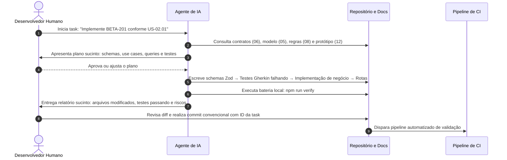

# notinhas.shop Beta — Plano de implementação

Plano estruturado em **7 marcos (M0–M6)** para implementação do **notinhas.shop Beta**. O backlog organiza cerca de 80 tarefas atômicas (`BETA-nnn`), cada uma concebida para **um PR objetivo** (≤ 1 dia de esforço) com dependências explícitas, mapeamento de User Stories, estimativa de tamanho e nível sugerido de autonomia para agentes de inteligência artificial.

## 1. Visão geral e cronograma



| Marco | Entregável Principal e Demonstração Verificável | Épicos e Histórias Mapeadas |
|---|---|---|
| **M0 — Fundação** | Repositório estruturado, schema PostgreSQL `enotas` provisionado na Contabo, bootstrap do Express (:4174), contratos Zod base, design system com tokens `--nt-*` e CI ativo. | Infraestrutura / REQ-006, REQ-010, REQ-015, REQ-016 |
| **M1 — Ingestão & EAN** | Leitor de QR Code (câmera ao vivo + foto/arquivo), parser Cheerio da SEFAZ PR com descarte de CPF, deduplicação estrita de notas/itens e modal de vínculo colaborativo de EAN (com foto). | US-01.01 → US-01.06 (REQ-001, REQ-004, REQ-005, REQ-009, REQ-011, REQ-030) |
| **M2 — Comparação & Destaques** | Motor de menor preço ativo (verde `#00984B`), página de detalhe do produto com timeline histórica de observações, busca textual e feed de produtos em destaque com concorrência de preços. | US-02.01 → US-02.08 (REQ-008, REQ-012, REQ-014, REQ-028) |
| **M3 — Geo, Ranking & Vitrine** | Geocoding de estabelecimentos via Nominatim com cache, mapa interativo com pins no Leaflet, ranking de lojas no raio (mais baratas e mais caras) e vitrines comerciais completas (*read-only*). | US-03.01 → US-03.08 (REQ-013, REQ-018, REQ-026, REQ-031) |
| **M4 — Cesta & Gestão Pessoal** | Montagem apartada de lista de compras com cálculo de split ótimo entre estabelecimentos, e área restrita de extrato financeiro pessoal com histórico de gastos mensais. | US-04.01 → US-04.06 (PRD §5.3, §5.10) |
| **M5 — Hardening & Observabilidade** | Sanitização contra SSRF/XSS, garantia de anonimização no catálogo público, testes de concorrência com k6, monitoramento com logs Pino e adequação estrita à LGPD. | Transversal / Qualidade e Segurança (Doc 09, 10) |
| **M6 — Polimento & Beta Aberto** | Revisão visual contra todos os protótipos `T-xx`, testes móveis de campo em Curitiba/SJP, verificação de SEO/Open Graph, emissão de SSL definitivo em `notinhas.shop` e abertura pública. | Lançamento Oficial Beta |

## 2. Grafo de dependências entre marcos



## 3. Backlog detalhado por marco (`BETA-nnn`)

**Legenda das Colunas:**
- **Dep.:** ID da(s) tarefa(s) predecessora(s) mandatória(s).
- **US:** User Story correspondente em [`02-historias/`](02-historias/) ou requisito canônico.
- **Tam.:** Tamanho estimado — **P** (≤ ½ dia), **M** (≤ 1 dia), **G** (1–2 dias).
- **IA:** Nível de autonomia do agente — 🟢 Autônomo com revisão de diff; 🟡 Pareado / supervisão em regras críticas; 🔴 Humano lidera (infra/segredos).

---

### M0 — Fundação, Infraestrutura e Tokens Base

| ID | Descrição da Tarefa | Dep. | US | Tam. | IA |
|---|---|---|---|---|---|
| **BETA-001** | Estruturação do repositório modular `e-notas`, scripts `package.json`, ESLint, Prettier e TypeScript strict | — | — | M | 🟢 |
| **BETA-002** | Configuração do servidor Express (`:4174`), validação de variáveis de ambiente com Zod e logger Pino estruturado | 001 | — | M | 🟢 |
| **BETA-003** | Conexão pool PostgreSQL na Contabo com schema dedicado `enotas` no banco `connectmax` | 002 | REQ-006 | M | 🟢 |
| **BETA-004** | Migration inicial M0: tabelas `empresas`, `notas`, `itens` e `codigos_barras` com constraints UNIQUE e chaves naturais | 003 | REQ-005, 009 | M | 🟢 |
| **BETA-005** | Camada de contratos Zod base (`shared/contracts`): schemas de erro Problem Details, paginação e coordenadas | 001 | — | P | 🟢 |
| **BETA-006** | Design System Tokens CSS (`tokens.css`): paleta Light Mist, `--nt-blue-primary: #0069B4`, `--nt-green-price: #00984B` e tipografia Plus Jakarta Sans | 001 | REQ-015, 016 | M | 🟢 |
| **BETA-007** | Componentes base de UI: Button, Chip, Card, Input de busca, Header com wordmark notinhas.shop e TabBar mobile | 006 | REQ-016, 027 | G | 🟡 |
| **BETA-008** | Configuração do pipeline de testes (Vitest para unit/integração com DB real + Playwright configurado) | 002, 004 | — | M | 🟢 |
| **BETA-009** | Pipeline de CI GitHub Actions (lint, typecheck, stylelint de tokens, testes e checagem de segredos) | 008 | — | M | 🟢 |
| **BETA-010** | Configuração de deploy Contabo: revisão da unit `enotas.service`, proxy reverso Nginx e porta `:4173` HTTPS | 003 | REQ-010 | M | 🔴 |
| **BETA-011** | Endpoint de healthcheck `/api/health` inspecionando conexão ativa com o banco PostgreSQL e status do processo | 002 | — | P | 🟢 |
| **BETA-012** | Teste de contrato de isolamento de marca: linter que barra a palavra "e-notas" em qualquer arquivo de visualização web | 001 | REQ-015 | P | 🟢 |

---

### M1 — Conta, Depósito de NFC-e e Vínculo de EAN

| ID | Descrição da Tarefa | Dep. | US | Tam. | IA |
|---|---|---|---|---|---|
| **BETA-101** | Schema de contas de usuário e sessões (`enotas.usuarios`, `enotas.sessoes`) com senhas em argon2id | 004 | — | M | 🟢 |
| **BETA-102** | Autenticação por cookie seguro `HttpOnly` com token JWT assinado, middleware de autenticação e rotas `/api/auth` | 101 | — | G | 🟡 |
| **BETA-103** | Adaptador de scraping SEFAZ PR (Cheerio): download de DANFE com timeout de 8s, parser resiliente e descarte imediato de CPF | 004 | REQ-004 | G | 🟡 |
| **BETA-104** | Caso de uso `IngestNotaUseCase`: persistência transacional de empresa, nota e itens com deduplicação de 44 dígitos | 103 | REQ-005, 009 | G | 🟡 |
| **BETA-105** | Endpoint `POST /api/nota`: recepção de URL de QR Code da Fazenda PR e retorno estruturado dos itens processados | 104 | REQ-003 | M | 🟢 |
| **BETA-106** | Frontend Scan: tela `scan.html` com câmera contínua ao vivo via Html5Qrcode e indicador visual de mira | 007, 105 | REQ-001 | M | 🟢 |
| **BETA-107** | Frontend Scan: suporte a "Tirar foto" e "Escolher imagem" da galeria para decodificação de QR via arquivo | 106 | REQ-030 | M | 🟢 |
| **BETA-108** | Tratamento de erros de scan na UI: feedback para notas ilegíveis, notas de fora do PR e notas já cadastradas | 106, 107 | REQ-030 | P | 🟢 |
| **BETA-109** | Backend EAN: tabela `enotas.codigos_barras` e endpoint `POST /api/codigos-barras` com UPSERT atômico | 004 | REQ-011 | M | 🟢 |
| **BETA-110** | Frontend EAN Modal: componente reutilizável com leitor de código de barras 1D pela câmera + digitação manual | 007, 109 | REQ-011 | G | 🟡 |
| **BETA-111** | Frontend EAN Modal: opção de captura de foto e envio de arquivo para reconhecimento de código de barras | 110 | REQ-031 | M | 🟢 |
| **BETA-112** | Ingestão assíncrona de fotos de produtos vinculadas ao EAN (`enotas.ean_imagens`) com seleção de foto principal | 109 | REQ-026, 032 | G | 🟡 |
| **BETA-113** | Lightbox no frontend para visualização em alta resolução da fotografia do produto | 112 | REQ-026 | P | 🟢 |
| **BETA-114** | Testes de integração e concorrência para deduplicação de notas e vínculo simultâneo de EAN | 104, 109 | — | M | 🟢 |

---

### M2 — Comparação de Preços, Histórico e Destaques

| ID | Descrição da Tarefa | Dep. | US | Tam. | IA |
|---|---|---|---|---|---|
| **BETA-201** | Query service de produtos: agregação de itens por EAN/descrição com cálculo de menor preço ativo e loja emissora | 104, 109 | REQ-008, 014 | M | 🟢 |
| **BETA-202** | Endpoint `GET /api/produtos`: listagem paginada de produtos com destaque visual do menor preço em verde (`#00984B`) | 201 | REQ-014, 018 | M | 🟢 |
| **BETA-203** | Frontend Aba Produtos: grade de cards com foto do item, nome, chip de menor preço, nome da loja e data da nota | 007, 202 | REQ-018 | G | 🟢 |
| **BETA-204** | Query service de histórico temporal: série cronológica de todas as observações de preços por produto | 201 | REQ-012, 028 | M | 🟢 |
| **BETA-205** | Endpoint `GET /api/produtos/:id/timeline`: histórico detalhado com data, mercado emissor, preço unitário e ID da nota | 204 | REQ-028 | M | 🟢 |
| **BETA-206** | Frontend Detalhe do Produto: tela dedicada com estatísticas do item, menor preço e linha do tempo de observações | 203, 205 | REQ-028 | G | 🟢 |
| **BETA-207** | Deep-linking no frontend: suporte a rotas com parâmetro `?produto=<key>` e restauração de estado | 206 | REQ-028 | P | 🟢 |
| **BETA-208** | Motor de busca textual de produtos com suporte a remoção de acentos (`unaccent`) e busca fonética / trigramas | 201 | REQ-008 | M | 🟢 |
| **BETA-209** | Algoritmo de Destaques de Preço: detecção de observações com valor significativamente abaixo da mediana regional | 201 | REQ-014, PRD §5.7 | M | 🟡 |
| **BETA-210** | Endpoint `GET /api/destaques`: feed de produtos com concorrência acentuada de preços e percentual de economia | 209 | PRD §5.7 | M | 🟢 |
| **BETA-211** | Frontend Feed de Destaques: carrossel/grid visual na home indicando "Ofertas observadas abaixo do mercado" | 203, 210 | PRD §5.7 | M | 🟢 |
| **BETA-212** | Testes automatizados de cálculo de menor preço, ordenação da timeline e assertividade da busca textual | 201, 204, 208 | — | M | 🟢 |

---

### M3 — Geolocalização, Vitrines de Lojas e Ranking

| ID | Descrição da Tarefa | Dep. | US | Tam. | IA |
|---|---|---|---|---|---|
| **BETA-301** | Normalizador de endereços fiscais: limpeza de números soltos `, 0,` e complementos inválidos da DANFE | 104 | REQ-013 | P | 🟢 |
| **BETA-302** | Geocoding Adapter (Nominatim): fila resiliente com rate limit de 1 req/s, User-Agent customizado e cache no Postgres | 301 | REQ-013 | M | 🟡 |
| **BETA-303** | Endpoint `POST /api/empresas/geocode`: disparo em lote de geocodificação para estabelecimentos pendentes | 302 | REQ-013 | P | 🟢 |
| **BETA-304** | Endpoint `GET /api/estabelecimentos`: listagem de lojas com coordenadas, endereço formatado e total de itens observados | 302 | REQ-008, 013 | M | 🟢 |
| **BETA-305** | Frontend Aba Estabelecimentos: mapa interativo com Leaflet e OpenStreetMap, exibindo pins das lojas cadastradas | 007, 304 | REQ-013 | G | 🟡 |
| **BETA-306** | Interatividade do mapa: clique no pin foca na loja, abre popup com resumo e lista os mercados em cards inferiores | 305 | REQ-018 | M | 🟢 |
| **BETA-307** | Motor de cálculo de Ranking de Lojas no raio: score agregado baseado no desvio percentual de preços da cesta básica | 304 | REQ-014, PRD §5.6 | G | 🟡 |
| **BETA-308** | Endpoint `GET /api/ranking`: estabelecimentos próximos ordenados por "Mais baratos" ou "Mais caros" no raio selecionado | 307 | PRD §5.6 | M | 🟢 |
| **BETA-309** | Frontend Tela de Ranking: visualização com seletor de raio (1 km, 5 km, 15 km), toggle de ordenação e score da loja | 305, 308 | PRD §5.6 | M | 🟢 |
| **BETA-310** | Query service de Vitrine da Loja: catálogo completo de produtos observados no estabelecimento com preço mais recente | 201, 304 | REQ-018 | M | 🟢 |
| **BETA-311** | Frontend Vitrine da Loja: tela com catálogo em grade (estilo e-commerce, sem checkout) e botão para vincular EAN | 310, 110 | REQ-018, 031 | G | 🟢 |
| **BETA-312** | Testes de integração do cálculo de distância geoespacial e consistência do ranking de mercados | 307, 308 | — | M | 🟢 |

---

### M4 — Cesta de Compras (Split) e Extrato Pessoal

| ID | Descrição da Tarefa | Dep. | US | Tam. | IA |
|---|---|---|---|---|---|
| **BETA-401** | Estrutura de Cesta de Compras local (IndexedDB/LocalStorage) permitindo adicionar produtos navegados | 203 | PRD §5.3 | M | 🟢 |
| **BETA-402** | Algoritmo de Cotização de Cesta: cálculo do custo total da lista em cada supermercado com cobertura de itens | 401 | PRD §5.3 | M | 🟢 |
| **BETA-403** | Algoritmo de Montagem Apartada (Split): otimização que sugere divisão da compra entre 2+ lojas para menor custo | 402 | REQ-014, PRD §5.3 | G | 🟡 |
| **BETA-404** | Frontend Tela de Cesta: resumo da cotação única vs divisão inteligente, indicando economia absoluta em R$ | 403 | PRD §5.3 | G | 🟢 |
| **BETA-405** | Tabela de vínculo entre notas e usuários (`enotas.usuarios_notas`) para gestão de compras pessoais | 101, 104 | PRD §5.10 | M | 🟢 |
| **BETA-406** | Query service do Extrato Pessoal: consolidação de notas depositadas pelo usuário, somas mensais e ticket médio | 405 | PRD §5.10 | M | 🟢 |
| **BETA-407** | Endpoint protegido `GET /api/extrato`: dados confidenciais de compras, gráficos de gastos por mês e lojas mais frequentadas | 406, 102 | PRD §5.10 | M | 🟢 |
| **BETA-408** | Frontend Tela de Extrato Financeiro: resumo pessoal com total gasto no mês, lista cronológica de notas e gráficos simples | 407 | PRD §5.10 | G | 🟢 |
| **BETA-409** | Detalhe da nota no extrato pessoal: visualização de itens comprados, descontos e tributos da NFC-e do titular | 408 | PRD §5.10 | M | 🟢 |
| **BETA-410** | Testes de segurança e isolamento garantindo que nenhum usuário visualize o extrato de outra conta | 407 | — | M | 🟢 |

---

### M5 — Hardening, Segurança, LGPD e Observabilidade

| ID | Descrição da Tarefa | Dep. | US | Tam. | IA |
|---|---|---|---|---|---|
| **BETA-501** | Auditoria e sanitização de dados fiscais: assegurar que CPF e nome do consumidor jamais sejam persistidos | 104 | Doc 10 | M | 🟢 |
| **BETA-502** | Implementação de cabeçalhos Helmet (CSP estrito, HSTS, X-Frame-Options) e proteção contra ataques de injeção | 002 | Doc 10 | P | 🟢 |
| **BETA-503** | Validação rigorosa de URLs da SEFAZ PR para impedir requisições maliciosas internas (mitigação de SSRF) | 105 | Doc 10 | P | 🟢 |
| **BETA-504** | Rate limiting de requisições por IP e sessão nas rotas de depósito de notas (`express-rate-limit`) | 105 | Doc 10 | P | 🟢 |
| **BETA-505** | Endpoint e fluxo de exclusão definitiva de conta do titular com anonimização desvinculada das notas (LGPD art. 18) | 405 | Doc 10 | M | 🟡 |
| **BETA-506** | Páginas públicas de Termos de Uso e Política de Privacidade em `/termos` e `/privacidade` | 007 | Doc 10 | P | 🟢 |
| **BETA-507** | Instrumentação de métricas e analytics sem dados pessoais (registro dos eventos descritos no Doc 09) | 002 | Doc 09 | M | 🟢 |
| **BETA-508** | Testes de carga com k6 simulando consultas concorrentes de menor preço e ranking de lojas | 202, 308 | Doc 09 | M | 🟡 |
| **BETA-509** | Script automatizado de backup criptografado do schema `enotas` para armazenamento externo | 003 | Doc 14 | M | 🔴 |
| **BETA-510** | Teste prático de restauração de banco a partir de dump limpo com validação de integridade | 509 | Doc 14 | M | 🔴 |

---

### M6 — Polimento do Beta Aberto e Lançamento

| ID | Descrição da Tarefa | Dep. | US | Tam. | IA |
|---|---|---|---|---|---|
| **BETA-601** | Revisão visual minuciosa e confronto de telas contra todos os protótipos aprovados `T-xx` | M4 | Doc 12 | G | 🟡 |
| **BETA-602** | Otimização de performance web mobile: lazy loading de imagens de produtos e carregamento assíncrono de tiles do mapa | 203, 305 | REQ-019 | M | 🟢 |
| **BETA-603** | Validação de metatags de compartilhamento Open Graph (`og:image`, `og:title`) com testes em WhatsApp e Telegram | 007 | REQ-020 | P | 🟢 |
| **BETA-604** | Testes de campo com smartphones reais em redes 4G/5G com catálogo real da região de Curitiba/SJP | M3, M4 | — | G | 🔴 |
| **BETA-605** | Configuração do serviço de e-mail transacional via Mailcow (`contato@notinhas.shop`) para avisos e recuperação de conta | 010 | REQ-027, Doc 14 | M | 🔴 |
| **BETA-606** | Certificado SSL Let's Encrypt definitivo no domínio oficial `https://notinhas.shop` via script `issue-ssl-notinhas.sh` | 010 | REQ-022, Doc 14 | M | 🔴 |
| **BETA-607** | Configuração final de redirects: `http://notinhas.shop` → `https://notinhas.shop` e proxy para a porta `:4174` | 606 | REQ-022 | P | 🔴 |
| **BETA-608** | Alimentação inicial (*seed de produção*): depósito de 100 notas reais da região para garantir liquidez imediata no lançamento | 104, 606 | — | G | 🔴 |
| **BETA-609** | Canal integrado de feedback in-app com envio direto para `contato@notinhas.shop` | 007, 605 | — | P | 🟢 |
| **BETA-610** | Publicação do anúncio do Beta aberto e monitoramento contínuo de logs de produção | 607, 608 | — | P | 🔴 |

## 4. Caminho crítico de execução

```text
BETA-001 (Setup) 
  → BETA-003 (Postgres) 
  → BETA-004 (Schema M0) 
  → BETA-103 (Scraper SEFAZ) 
  → BETA-104 (Ingestão & Dedupe) 
  → BETA-105 (API Nota) 
  → BETA-106 (Scan Front) 
  → BETA-109 (Vínculo EAN) 
  → BETA-201 (Menor Preço Engine) 
  → BETA-203 (Grid Produtos) 
  → BETA-302 (Geocoding) 
  → BETA-305 (Mapa Lojas) 
  → BETA-307 (Ranking Engine) 
  → BETA-403 (Split Cesta) 
  → BETA-407 (API Extrato) 
  → BETA-501 (Anonimização LGPD) 
  → BETA-606 (SSL notinhas.shop) 
  → BETA-608 (Seed Real & Abertura)
```

**Principais Riscos e Gargalos:**
- **Estabilidade do Scraper da Fazenda PR (BETA-103):** Mudanças no layout HTML do portal da SEFAZ exigem isolamento com testes de fixtures determinísticas.
- **Normalização de Endereços (BETA-301/302):** A DANFE frequentemente contém sujeiras no campo de logradouro que falham na busca do Nominatim caso não sejam devidamente expurgadas.
- **Liquidez Inicial do Índice:** O valor do ranking e das comparações depende da densidade de notas depositadas na mesma micro-região.

## 5. Sequência operacional por tarefa (Desenvolvedor + IA)



## 6. Definition of Done (DoD)

Uma tarefa `BETA-nnn` é considerada **concluída** apenas quando satisfaz integralmente os seguintes requisitos:
1. **Critérios de Aceite Validados:** Todos os cenários Gherkin associados passam em testes automatizados.
2. **Contratos Sincronizados:** Schemas Zod de entrada e saída atualizados e em perfeita sincronia com [`06-contratos-api.md`](06-contratos-api.md).
3. **Verificação Limpa:** Comandos de lint, typecheck e testes executam com sucesso (`npm run verify` verde).
4. **Fidelidade Visual ao Protótipo:** A interface renderizada confere fielmente com a tela de referência correspondente (`T-xx`) do protótipo nos viewports de 390×844 e 360×800 (screenshot anexado ao card/PR).
5. **Aderência aos Tokens da Marca:** Nenhuma cor hexadecimal solta no CSS; uso exclusivo de variáveis `--nt-*` da paleta oficial.
6. **Proteção da Marca:** O termo "e-notas" não aparece em nenhuma tela ou texto voltado ao usuário final (uso exclusivo de **notinhas.shop**).
7. **Salvaguarda de Privacidade:** Testes confirmam ausência de CPF ou identificação pessoal de consumidores nas notas e logs.
8. **Caminho Inverso Documentado:** Qualquer migration de banco de dados ou alteração de infraestrutura inclui documentação clara de reversão (*rollback*).

## 7. Cerimônias e rituais ágeis

- **Ciclos Semanais de Desenvolvimento:** Planejamento e priorização de tarefas `BETA-nnn` na segunda-feira; demonstração dos incrementos na sexta-feira em ambiente de teste/staging.
- **Gestão no Board Trello:** Cada tarefa `BETA-nnn` equivale a um card no board oficial do projeto, movimentado para a coluna *Concluído* no topo ao finalizar.
- **Sincronização Contínua de Documentação:** Toda decisão arquitetural ou de regra de negócio tomada durante a execução do código é imediatamente refletida nos documentos vivos de `beta-docs/`.
