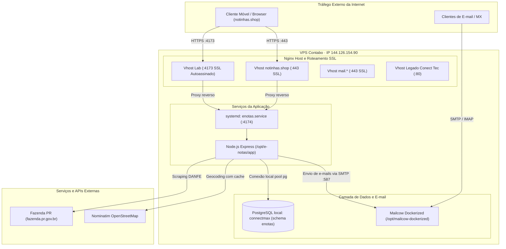

# notinhas.shop Beta — Operação, infraestrutura e deploy

Documento canônico de arquitetura operacional, topologia de rede, serviços de sistema, rotinas de contingência e procedimentos de rollback para o **notinhas.shop Beta** hospedado no ambiente da Contabo.

## 1. Ambientes e endereçamento

O serviço opera na VPS da Contabo convivendo de forma harmoniosa com serviços legados e stacks compartilhados de e-mail:

| Ambiente / Serviço | URL de Acesso | Porta / Processo | Destinação e Comportamento |
|---|---|---|---|
| **Produção Principal** | **`https://notinhas.shop/`** | Nginx `:443` → Node `:4174` | Domínio canônico voltado ao público consumidor. Certificado SSL Let's Encrypt ativo. |
| **Lab HTTPS Direto** | **`https://144.126.154.90:4173/`** | Nginx `:4173` → Node `:4174` | Porta de teste direto com certificado autoassinado em `/opt/e-notas/certs/` (aceitar aviso no navegador). |
| **Path Alternativo IP** | **`https://144.126.154.90/enotas/`** | Nginx `:443` SNI → Node `:4174` | Snippet integrado ao Nginx do Mailcow para acesso direto pelo IP do servidor. |
| **Aplicação Node (Local)** | `http://127.0.0.1:4174/` | `enotas.service` | Processo Node.js Express em execução contínua com `USE_HTTP=1`. |
| **Banco de Dados** | `localhost:5432` | PostgreSQL (Contabo) | Banco de dados `connectmax`, schema dedicado **`enotas`**. Acesso local sem porta exposta à internet. |
| **Serviço de E-mail** | `https://mail.notinhas.shop/` | Mailcow Dockerized | Stack corporativo unificado. Caixas postais incluindo `contato@notinhas.shop`. |
| **Conect Tec (Legado)** | `http://144.126.154.90/` | Nginx `:80` | Aplicação web legada hospedada no mesmo servidor. |

## 2. Topologia de infraestrutura



## 3. Serviços do sistema: `enotas.service`

A aplicação é gerenciada pelo systemd do Linux como serviço de inicialização automática.

- **Arquivo de Unidade:** `/etc/systemd/system/enotas.service`
- **Conteúdo de Referência:**
  ```ini
  [Unit]
  Description=notinhas.shop (e-notas) Express Application
  After=network.target postgresql.service

  [Service]
  Type=simple
  User=root
  WorkingDirectory=/opt/e-notas/app
  ExecStart=/usr/bin/node server.js
  Restart=always
  RestartSec=5
  Environment=NODE_ENV=production
  Environment=PORT=4174
  Environment=USE_HTTP=1
  EnvironmentFile=/opt/e-notas/.env

  [Install]
  WantedBy=multi-user.target
  ```
- **Comandos Operacionais de Manutenção:**
  ```bash
  # Verificar status operacional do processo
  systemctl status enotas

  # Reiniciar a aplicação após atualização de código
  systemctl restart enotas

  # Acompanhar logs em tempo real
  journalctl -u enotas -f -n 100
  ```

## 4. Servidor web Nginx e certificados SSL/TLS

### 4.1 Vhost Principal: `notinhas.shop`
Configurado em `/etc/nginx/sites-available/notinhas` com link simbólico em `sites-enabled`:
```nginx
server {
    server_name notinhas.shop www.notinhas.shop;

    location / {
        proxy_pass http://127.0.0.1:4174;
        proxy_http_version 1.1;
        proxy_set_header Upgrade $http_upgrade;
        proxy_set_header Connection 'upgrade';
        proxy_set_header Host $host;
        proxy_set_header X-Real-IP $remote_addr;
        proxy_set_header X-Forwarded-For $proxy_add_x_forwarded_for;
        proxy_set_header X-Forwarded-Proto $scheme;
        proxy_cache_bypass $http_upgrade;
    }

    listen 80;
}
```

### 4.2 Emissão de Certificados Let's Encrypt (Certbot)
Quando o DNS público apontar o registro A `@` para `144.126.154.90`, o certificado é emitido via:
```bash
certbot --nginx -d notinhas.shop -d www.notinhas.shop --non-interactive --agree-tos -m laerciogermanoo@gmail.com --redirect
```
Script automatizado de polling e emissão disponível em `/opt/e-notas/deploy/issue-ssl-notinhas.sh`.

## 5. E-mail corporativo com Mailcow Dockerized

Não é permitido rodar mais de um stack Mailcow na mesma VPS (portas 25, 465, 587 e 993 compartilhadas). O Mailcow em `/opt/mailcow-dockerized` atende múltiplos domínios através de configuração unificada:

- **Domínios Gerenciados:** `clozzy.com.br`, `notinhas.shop`, `conectmax.email`, `brsupply.email`.
- **Configuração de SAN (`mailcow.conf`):**
  ```bash
  MAILCOW_HOSTNAME=mail.clozzy.com.br
  ADDITIONAL_SAN=mail.notinhas.shop,mail.conectmax.email,mail.brsupply.email
  ```
- **Registros DNS na Hostinger para `notinhas.shop`:**
  - `A mail` → `144.126.154.90` (TTL 300)
  - `MX @` → `mail.notinhas.shop` (Prioridade 10)
  - `TXT @` → `v=spf1 mx a:mail.notinhas.shop ip4:144.126.154.90 ~all`
  - `TXT dkim._domainkey` → Chave pública DKIM gerada via API do Mailcow (`GET /api/v1/get/dkim/notinhas.shop`)
  - `TXT _dmarc` → `v=DMARC1; p=none; rua=mailto:contato@notinhas.shop`
- **Caixa Postal Oficial:** `contato@notinhas.shop` (Webmail SOGo: `https://mail.notinhas.shop/SOGo/`).

## 6. Banco de dados PostgreSQL (Contabo)

- **Acesso:** Conexão TCP local em `localhost:5432` pelo usuário `postgres` ou usuário dedicado.
- **Banco:** `connectmax`
- **Schema Exclusivo:** `enotas`
- **Tabelas do Schema:**
  - `empresas` (cadastro e geocodificação de lojas)
  - `notas` (cabeçalho de NFC-e com chave de 44 dígitos)
  - `itens` (itens e preços observados)
  - `codigos_barras` (vínculos colaborativos EAN ↔ código interno da loja)
  - `ean_imagens` (fotos de produtos)
  - `usuarios` / `usuarios_notas` (autenticação e extrato confidencial)

## 7. Rotinas de backup e restauração

| Componente | Mecanismo de Backup | Frequência | Retenção | Destino do Armazenamento |
|---|---|---|---|---|
| **PostgreSQL (Schema enotas)** | `pg_dump -Fc -n enotas connectmax` | Diário às 03:00 | 14 diários + 4 mensais | `/backups/postgres/` e storage externo cifrado |
| **Imagens de Produtos** | `rsync` incremental de `/opt/e-notas/app/public/ean-fotos/` | Diário | 7 dias | `/backups/fotos/` |
| **Configurações Nginx / Env** | Cópia compactada cifrada com `age` | A cada deploy | Versões históricas | Storage seguro |
| **Mailcow (Caixas e DKIM)** | Script oficial `./helper-scripts/backup_and_restore.sh` | Diário | 7 dias | `/backups/mailcow/` |

### Procedimento de Restauração de Banco:
```bash
# 1. Parar a aplicação para evitar escritas concorrentes
systemctl stop enotas

# 2. Restaurar o schema a partir do dump
pg_restore -c -n enotas -d connectmax /backups/postgres/enotas_backup_latest.dump

# 3. Reiniciar a aplicação
systemctl start enotas
```

## 8. Monitoramento e observabilidade

- **Logs de Aplicação:** Acessíveis via `journalctl -u enotas -f`.
- **Healthcheck HTTP:** Rota `GET /api/health` retorna `200 OK` se a conectividade com o PostgreSQL estiver íntegra e `503 Service Unavailable` em falha de conexão.
- **Alertas de Queda:** Sondagem externa de uptime via blackbox HTTP verificando `https://notinhas.shop/api/health`.

---

## 9. Procedimento de Rollback e Caminho Inverso

Conforme as diretrizes de governança do projeto, qualquer alteração na infraestrutura ou no código deve possuir caminho documentado para reverter ao estado imediatamente anterior.

### 9.1 Matriz "Antes → Depois" das Mudanças de Infraestrutura

| Componente | Estado Anterior (Antes) | Estado Atual (Depois) | Ação de Rollback (Caminho Inverso) |
|---|---|---|---|
| **Serviço Web** | Aplicação offline / acessível apenas por IP | `enotas.service` ativo respondendo em `:4174` | `systemctl stop enotas && systemctl disable enotas` |
| **Vhost Nginx** | Sem site `notinhas` em `sites-enabled` | Proxy reverso ativo em `/etc/nginx/sites-available/notinhas` | `rm /etc/nginx/sites-enabled/notinhas && nginx -t && systemctl reload nginx` |
| **Certificado SSL** | Apenas certificado autoassinado na porta 4173 | Certificado Let's Encrypt para `notinhas.shop` | `certbot delete --cert-name notinhas.shop` e restaurar vhost HTTP puro |
| **DNS Domínio** | Registro A apontando para parking Hostinger (`2.57.91.91`) | Registro A apontando para a Contabo (`144.126.154.90`) | No painel da Hostinger, reverter registro A `@` para `2.57.91.91` |
| **DNS E-mail** | Sem entradas MX de notinhas.shop | Entradas MX/SPF/DKIM/DMARC ativas no Mailcow | Remover registros MX, SPF e DKIM no painel DNS da Hostinger; apagar domínio no Mailcow |
| **Código da Aplicação** | Versão anterior do repositório em `/opt/e-notas` | Nova versão com migrations aplicadas | `git checkout <hash-anterior> && systemctl restart enotas` |
| **Banco de Dados** | Schema `enotas` na migration N | Schema `enotas` na migration N+1 | Executar script `DOWN` da migration correspondente |

### 9.2 Roteiro Completo de Desativação e Desinstalação (Rollback Total)

Caso seja necessário remover completamente o serviço notinhas.shop do servidor Contabo sem afetar os demais sistemas:

```bash
# 1. Parar e desativar o serviço systemd
systemctl disable --now enotas
rm /etc/systemd/system/enotas.service
systemctl daemon-reload

# 2. Desabilitar sites Nginx e remover snippets
rm -f /etc/nginx/sites-enabled/notinhas
rm -f /etc/nginx/sites-enabled/enotas
# Remover linhas de include do snippet no /etc/nginx/sites-available/mailcow se houver
nginx -t && systemctl reload nginx

# 3. Remover certificados SSL Let's Encrypt emitidos
certbot delete --cert-name notinhas.shop

# 4. Remover domínio do Mailcow
# Acessar interface administrativa do Mailcow ou via API:
# DELETE https://mail.clozzy.com.br/api/v1/delete/domain com payload {"items":["notinhas.shop"]}

# 5. Opcional: Arquivar e expurgar diretórios da aplicação
tar -czf /backups/e-notas-abandonado-$(date +%F).tar.gz /opt/e-notas
rm -rf /opt/e-notas
```
