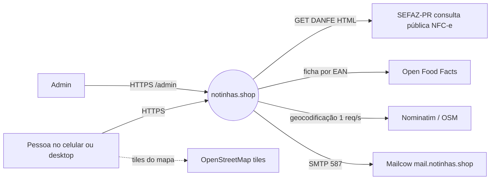
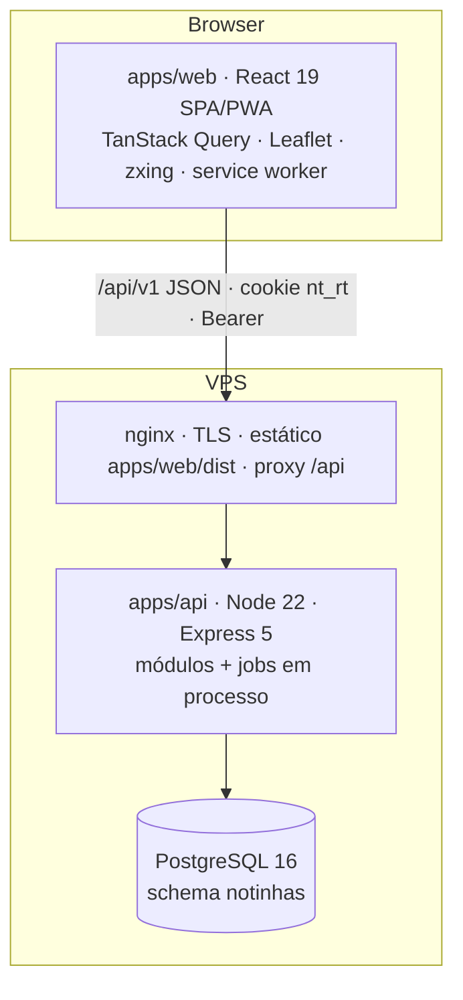
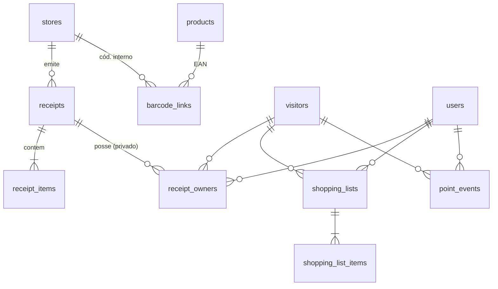

# Arquitetura — notinhas.shop Beta (lean C4)

Modelo: `core/definir-projeto-moderno/01-arquitetura/03-c4-e-lean/architecture-lean-template.md`. Decisões em [`adr/`](adr/). Contexto de produto em [`../../beta-docs/03-arquitetura.md`](../../beta-docs/03-arquitetura.md).

## 1. Objetivo e restrições

- Transformar o QR da NFC-e em **índice público de menor preço** com loja e data; EAN vem da comunidade (a nota não traz).
- Time enxuto, uma VPS (Contabo), Postgres já existente, Beta em São José dos Pinhais/PR.
- Restrições duras: RN-06 (índice anônimo), RN-07 (HTTPS), RN-13 (não inventar preço), LGPD.

## 2. Contexto (C1)

## 3. Containers (C2)

Um processo de API (12-Factor: config por env, logs em stdout, SIGTERM limpo). Jobs (geocode, nova tentativa SEFAZ, outliers) rodam no mesmo processo — ver ADR-0003 para quando separar.

## 4. Componentes da API (C3)

| Módulo | Responsabilidade | Rotas |
|---|---|---|
| `identity` | visitante por fingerprint (HMAC), IP, conta, JWT + refresh rotativo, merge, exclusão LGPD | `/auth/*`, `/me` |
| `receipts` | allow-list da URL, dedupe pela chave do QR, porta SEFAZ, ingestão transacional, fila de falhas | `/notas` |
| `barcodes` | vínculo (loja, cód.) ↔ EAN, primeiro vale + moderação, sugestões pg_trgm + ean-serp/SI5, fotos | `/codigos-barras`, `/produtos/:gtin/fotos` |
| `catalog` | snapshot do índice + regras do domínio: home, busca, detalhe, ranking, vitrine | `/produtos/*`, `/lojas/*`, `/categorias` |
| `lists` | várias listas, cotação uma loja / split, crédito de cotação | `/listas` |
| `spending` / `points` | gastos do titular, extrato de pontos | `/gastos`, `/pontos` |
| `admin` | métricas, fila de falhas, moderação, ocultar item (audit_log) | `/admin/*` |

Fronteiras: rotas validam com Zod (`packages/contracts`) → serviço → SQL parametrizado. Regras de preço são funções puras de `packages/domain`, usadas pela API e testadas sem banco.

## 5. Dados

- Público: `stores`, `receipts`, `receipt_items`, `products`, `barcode_links`, view `v_price_observations` (nenhuma coluna de pessoa).
- Privado: `visitors` (só HMAC do fingerprint + IP), `users`, `sessions`, `receipt_owners`, `shopping_lists`, `point_events`, `usage_events`.
- Backoffice: `ingest_failures`, `moderation_flags`, `audit_log`.

## 6. Fluxos críticos

**Ingestão (US-01.06/08, RN-01/03/15):** URL → allow-list + chave do QR (DV mod-11) → se a chave existe: “duplicada”, liga ao histórico, 0 pontos, **sem ir à SEFAZ** → senão baixa a DANFE (timeout 10 s, retry 502/503/504) → parse (sem CPF) → transação: loja, nota, itens, posse, +10 pontos → invalida snapshot. Falha da SEFAZ → `ingest_failures` com o dono; job tenta de novo (5 min, 30 min, 3 h).

**Vínculo EAN (US-01.10, RN-12, Q2):** valida GTIN (mod-10) → ficha do produto (Open Food Facts fora da transação; senão a descrição humanizada) → `SELECT … FOR UPDATE` no vínculo → novo: grava + 5 pontos; igual: nada; diferente: flag de moderação.

**Leitura:** `catalog` usa um snapshot das observações (180 dias) com TTL de 15 s, invalidado em escrita, e aplica `bestOffer`, `highlightOf` (RN-11), `rankStores` (RN-10) e `quoteBasket` (RN-13).

## 7. Qualidade

| Atributo | Como |
|---|---|
| Privacidade | índice sem pessoa (teste de integração), CPF descartado no parser (teste), redação de logs, exclusão LGPD |
| Segurança | Helmet, CSRF por cabeçalho, rate limit, allow-list anti-SSRF, scrypt, refresh rotativo com detecção de reuso, SQL parametrizado, Zod em toda entrada |
| Confiabilidade | idempotência por chave/vínculo/pontos `(kind, ref)`, transações curtas, retry com backoff, graceful shutdown |
| Performance | snapshot em memória, `Cache-Control` público curto, code-splitting por rota, zxing/Leaflet sob demanda |
| Acessibilidade | roles/labels testados com Testing Library, alvos ≥ 44 px, `prefers-reduced-motion` |

## 8. Riscos e dívidas

- SEFAZ muda o HTML → parser quebra (fixture + fila de falhas mitigam; monitorar `SEFAZ_PARSER_ERROR`).
- Snapshot em memória não escala para muitas instâncias/milhões de observações → ADR-0004 descreve a migração para SQL/materialized view.
- Fingerprint é identificador fraco (troca de navegador perde o histórico anônimo) — por isso o convite a criar conta.
- Fotos externas (Open Food Facts) são hotlink; baixar para mídia própria antes do Beta aberto.
