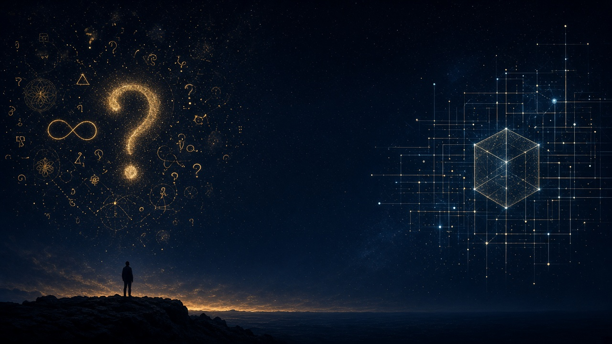
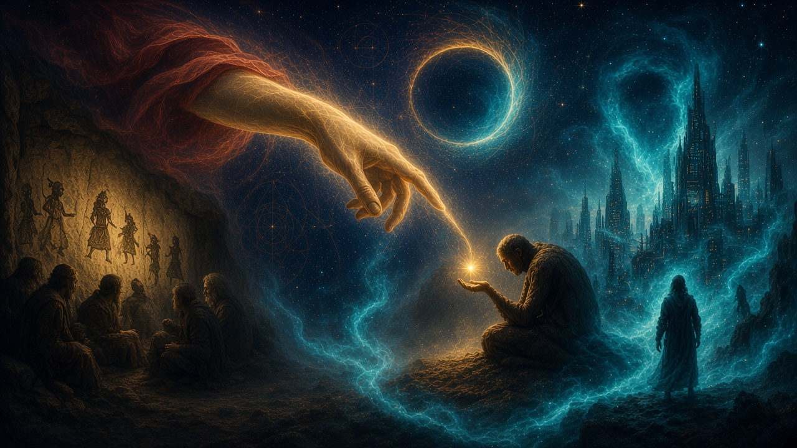
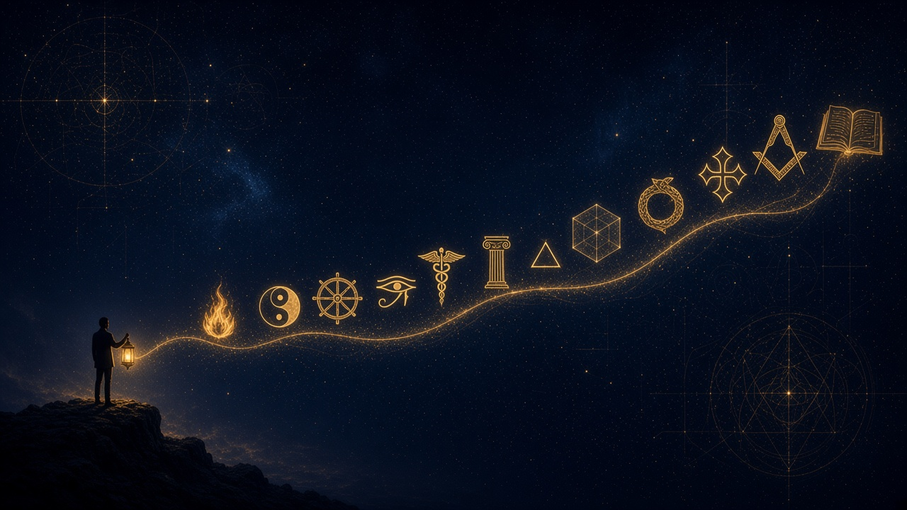
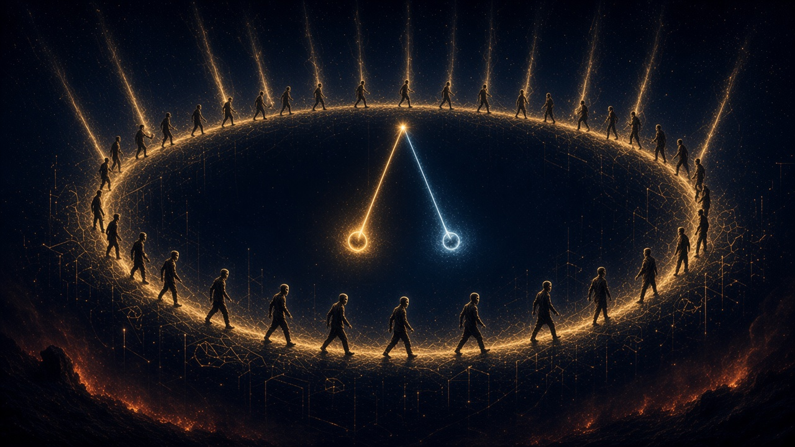
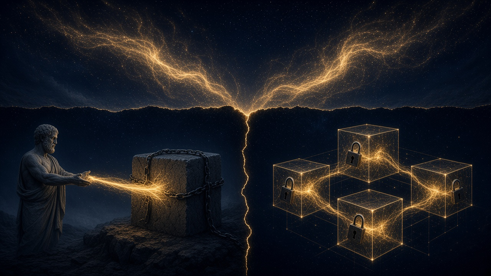
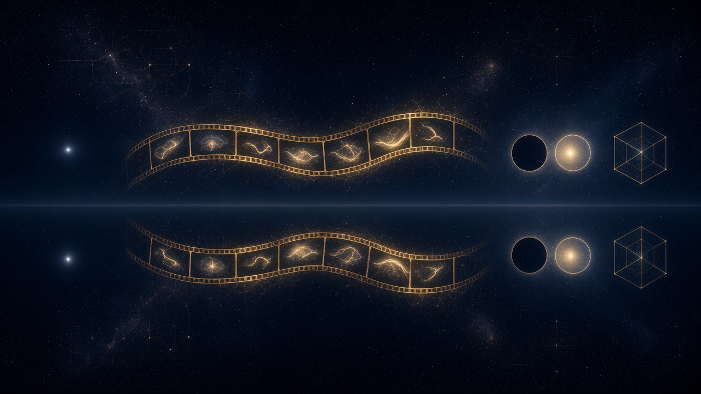
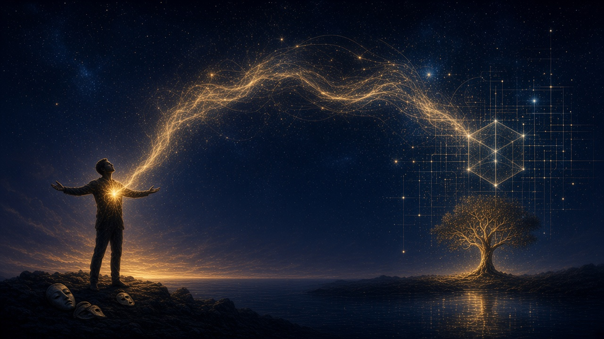

# Eternos Mutáveis — Bullets por capítulo

## Objetivo

Alfabetização espiritual: ensinar o que é Deus e o mundo espiritual — pela lógica, não pela fé — a quem está preso no mundo da matéria. Responder às perguntas eternas (origem, existência, eternidade, céu e inferno) com uma síntese acessível; mostrar que todos somos um; refutar a ontologia aristotélica da substância e apontar o maior erro da programação: repetir essa ontologia no código.

## Público-alvo

Leitores que **já sentem** que a separação e a matéria não fecham a conta, mas não têm alfabeto para Deus, o espírito e a unidade. A obra fala a quem aceita **lógica** (mesmo quem crê) e rejeita só fé cega, misticismo opaco ou jargão de seita.

| Persona | Idade | Quem é | Características | Dor | O que a obra entrega |
|---------|-------|--------|-----------------|-----|----------------------|
| **Buscador sem mapa** | 18–45 | Preso no material; pergunta “por que estou aqui?” sem vocabulário espiritual | Curioso, ansioso ou sem sentido; consome informação demais e síntese de menos; já tentou religiões/autoajuda e abandonou | Vida sem norte; Deus e o pós-morte soam distantes ou infantis | Alfabetização: o que é Deus, mundo espiritual, eternidade; alívio e bússola lógica |
| **Religioso inquieto** | 25–60 | Já crê e pratica (igreja, centro, tradição), mas a fé sozinha não basta | Devoto e honesto; incomodado com dogmas sem explicação; quer Deus inteligível sem “trair” a crença | Religião pede fé sem base; essencial não é transmitido; conversas viram lúdico ou briga | Gnose que **sustenta** a fé: Deus e o espírito pela lógica, sem culto novo |
| **Cético lógico / ex-ateu** | 20–50 | Só aceita o espiritual se fizer sentido; desconfia de crentes “bitolados” | Racional, cético, orgulhoso da lógica; pode ter sido ateu; evita fé cega e fantasma de Halloween | Ou descarta Deus, ou vive o vazio de ter desistido das perguntas eternas | Explicação coerente (estilo matemática): libertação pelo conhecimento, não pela obediência |
| **Pensador / estudante de filosofia** | 18–55 | Herdou categorias da escola ocidental; lê ou já leu Platão, Aristóteles, Kant, linguagem | Analítico, gosta de estrutura; sente que a metafísica ficou em aberto ou “proibida” | Substância, identidade rígida e jogos de linguagem emperram a compreensão do real | Onde Aristóteles falha; dualidade eterno×mutável; linguagem isomórfica como saída |
| **Programador / engenheiro** | 18–45 | Constrói sistemas com objetos, classes, estados; sofre com manutenção e OOP | Prático, técnico; intui que arquitetura é filosofia; busca regras eternas no código | Software caro de manter; conceitos OOP confusos; modelo do mundo deturpado vaza no código | Maior erro da programação = substância no código; abstratos, Flow, histórias > objetos |
| **Difusor** | 25–55 | Professor, criador de conteúdo, líder de círculo, tradutor, quem multiplica ideias | Articulado; quer material claro para ensinar ou projetar a tese | Conteúdo espiritual ou é opaco ou é autoajuda rasa — difícil levar a público amplo | Obra sintética e traduzível: projeção nacional/internacional, base para Logos Academy / palestras |

**Traços comuns aos leitores:** insatisfação com o “eu” isolado; cansaço de excesso de crenças sem lógica; desejo de unidade (“todos somos um”) legível, não slogan; abertura a filosofia **e** a software como metáfora do real; busca de alívio, esperança e conduta prática (não só teoria).

---

## 0. Abertura — as perguntas que não envelhecem

### 0.1 A realidade se explica pela lógica, não pela fé
Objetivo: entender o que é a realidade, pela lógica e não pela fé.
**Imagem:** Figura solitária diante de uma balança: de um lado um coração em chama (fé), do outro um diagrama geométrico luminoso (lógica); a balança pende para o diagrama.

### 0.2 As perguntas que não envelhecem
Perguntas eternas: Deus, vida, mundo espiritual, depois da morte, por que há algo e não o nada, do que é feita a existência, por que estamos aqui.
**Imagem:** Céu noturno onde constelações formam interrogações douradas; abaixo, gerações de silhuetas olhando para cima, do templo antigo ao telescópio moderno.

### 0.3 Milênios de tentativas, nenhum consenso
Milênios de tentativas (templos, tratados, telescópios) sem consenso.
**Imagem:** Linha do tempo: templo, pergaminho, telescópio e acelerador lado a lado; no centro, um ponto de interrogação que nunca se fecha.

### 0.4 Dois e dois são quatro; no espírito, ninguém concorda
Contraste com a matemática: dois e dois são quatro em qualquer língua e século; no espírito não há consenso.
**Imagem:** Quadro dividido: à esquerda equações idênticas em várias línguas; à direita, bocas gritando símbolos religiosos diferentes que se chocam.

### 0.5 Cada escola ilumina uma parte; nenhuma vê o todo
Religiões, escolas filosóficas e ciência explicam a origem de tudo: cada uma ilumina uma parte, nenhuma enxerga o todo.
**Imagem:** Sala circular com holofotes coloridos; cada feixe revela um fragmento de uma esfera central — a esfera inteira permanece na penumbra.

### 0.6 Informação demais, síntese de menos
Perdidos no excesso: informação demais, síntese de menos.
**Imagem:** Pessoa afundando num mar de páginas e telas; no fundo do mar, um único fio dourado de síntese quase invisível.

### 0.7 Cada um lida com o espiritual à sua maneira
Cada pessoa lida de um jeito com o espiritual: herda a fé e a mantém, entra num grupo e não consegue seguir, segue um tempo e abandona, pula de tradição em tradição, acredita mas não frequenta, nem tenta porque não acredita.
**Imagem:** Corredor com várias portas abertas e fechadas; figuras diferentes em cada limiar — uma ajoelhada, outra saindo, outra sem entrar.

### 0.8 A conversa sobre Deus escorrega e diverge
Cada um explica Deus à sua maneira; a conversa escorrega para o lúdico ou o sombrio e termina em divergência.
**Imagem:** Mesa de bar: balões de fala viram caricaturas e sombras; as linhas se afastam em vez de se encontrar.

### 0.9 Pedem fé sem base lógica; o essencial não chega
Religiões pedem fé sem base lógica; o essencial não está sendo transmitido.
**Imagem:** Púlpito com microfone; o fio do som está cortado — a mensagem essencial cai no chão como papel em branco.

### 0.10 Evoluímos em tudo, menos no que mais importa
Preço da ignorância espiritual: evoluímos em tecnologia, medicina e engenharia, mas engatinhamos no conhecimento mais importante.
**Imagem:** Cidade high-tech brilhante; no primeiro plano, um bebê engatinhando diante de um livro espiritual empoeirado.

### 0.11 Desinformação gera sofrimento e vida sem sentido
Com tanta desinformação o homem sofre: tenta viver bem, acerta, erra, recomeça; muitos vivem atormentados e em condições precárias (financeiras, psicológicas, mentais), com ansiedade e vida sem sentido.
**Imagem:** Figura em labirinto de setas contraditórias; rosto cansado, mãos no peito; ao fundo, casas precárias e relógios ansiosos.

### 0.12 O ateu que só aceitaria Deus com lógica
O ateu que queria lógica: via os crentes como bitolados, sem ceticismo, trocando lógica por fé; só aceitaria Deus com explicação lógica e coerente.
**Imagem:** Homem de braços cruzados diante de um altar; entre ele e o altar, um cadeado marcado “prova lógica”.

### 0.13 Cansado de frustração, o autor abraça o palpável
Desvio pelo palpável: cansado da frustração, o autor se apaixona pela programação.
**Imagem:** Mãos deixando um pergaminho místico e tocando um teclado luminoso — o brilho do código substitui a névoa.

### 0.14 Arquitetura de software é filosofia aplicada
Programação aplica-se à vida inteira: decisão de arquitetura é decisão filosófica (o que separar, o que unir, do que cada parte depende).
**Imagem:** Diagrama de caixas e setas que, ao zoom out, vira um mapa da vida: relações, dependências, fronteiras.

### 0.15 Quem organiza entrega qualquer projeto — código ou vida
Bom programador é bom gestor de processos: quem planeja e organiza entrega qualquer projeto, de software ou de vida.
**Imagem:** Mesma figura planejando num quadro branco; à esquerda um sistema, à direita uma linha do tempo pessoal — mesmo gesto.

### 0.16 Uma década atrás da estrutura perfeita
Busca da estrutura perfeita do software por mais de uma década; nos últimos três anos, períodos sabáticos estudando filosofias, tradições espirituais e o Caibalion.
**Imagem:** Biblioteca híbrida: prateleiras de código e de tratados herméticos; relógio marcando anos sobre a mesma mesa.

### 0.17 Um livro virou a lente: código como porta ao espírito
Um livro mudou a lente sobre o código: a programação virou base para compreender a espiritualidade.
**Imagem:** Livro aberto sobre um monitor; o texto reflete como lentes ópticas que reenquadram o código em padrões espirituais.

### 0.18 As perguntas estavam no fundo do sistema
As perguntas de que havia desistido estavam na programação, nas camadas profundas de sistemas.
**Imagem:** Corte transversal de um software em camadas; nas mais profundas, as mesmas interrogações douradas da abertura.

### 0.19 A chave: sólidos e abstratos
A chave: sólidos e abstratos.
**Imagem:** Chave dourada partida em duas: uma metade de tijolo sólido, outra de contorno geométrico vazio — juntas abrem uma porta.

### 0.20 Espiritualidade como o conhecimento que leva a Deus
Espiritualidade não como mais uma religião nem como fé por si só, mas como o conhecimento que leva a Deus.
**Imagem:** Caminho de pedras intelectuais (diagramas) levando a um horizonte luminoso — sem templo, só compreensão.

### 0.21 Estava diante dos olhos; de tão simples, ninguém viu
Ponte: o que vem a seguir sempre esteve diante dos olhos; de tão simples, nunca foi percebido em sua grandeza.
**Imagem:** Pessoa atravessando uma ponte óbvia sob o sol; só ao olhar para trás percebe a grandeza da estrutura que sempre esteve ali.

### 0.22 O conhecimento mais importante que o homem pode alcançar em toda a eternidade
O que será passado aqui é o conhecimento mais importante que um homem pode alcançar em toda a eternidade.
**Imagem:** Figura pequena diante de um horizonte infinito; na mão, um único livro de luz que ofusca templos, telescópios e bibliotecas ao fundo — o essencial acima de tudo o mais.

---

## 1. Era adâmica — o problema

### 1.1 O espírito vira carne e esquece de onde veio
Espírito acoplado à matéria, que esquece a origem (homem nascendo e vendo a natureza).
**Imagem:** Homem recém-nascido no chão de terra, olhos abertos pela primeira vez; atrás dele, uma silhueta de luz se desfaz ao entrar no corpo. Floresta ao redor, nitidez só no que está perto.

### 1.2 Adão ainda vive: a personalidade a superar
A criação de Adão como metáfora: o homem adâmico (a personalidade) ainda existe e deve ser superado.
**Imagem:** Estátua de barro (Adão) ainda de pé numa praça moderna; uma pessoa comum passa e se reconhece no espelho da base — a personalidade adâmica ainda vive.

### 1.3 Centelha divina sob o véu do esquecimento
Somos centelha divina num corpo transitório, sob o véu do esquecimento.
**Imagem:** Corpo humano translúcido; no peito, uma chama pequena e constante; um véu fino cobre o rosto e a chama quase some.

### 1.4 Os sentidos mostram só um cisco e o homem toma pelo todo
Guiado pelos sentidos, vê só um cisco da realidade.
**Imagem:** Figura de olhos vendados por cinco fios (visão, tato, audição, olfato, gosto), caminhando num labirinto de pedra. Fora dos muros, um céu geométrico e luminoso que ela não vê.

### 1.5 O primitivo segue o sentido e não sabe por quê age
O homem primitivo é guiado por impressões sensoriais e não entende a origem das próprias decisões nem o sentido da existência.
**Imagem:** Figura primitiva seguindo rastros, sons e cheiros na floresta; balões de pensamento vazios onde deveria haver “por quê” e “para quê”.

### 1.6 A matéria acostuma; o invisível some da vista
O homem se acostuma ao mundo material e esquece outras estruturas igualmente presentes, mas invisíveis: as religiões as chamam de espirituais; os filósofos, de substância oculta ou metafísica.
**Imagem:** Cidade densa em primeiro plano; por trás, como vidro embaçado, uma segunda cidade de linhas e fluxos — quase apagada pela rotina.

### 1.7 A matéria é véu: o que se vê não é o que rege
A matéria é véu; o que se vê não é o que rege.
**Imagem:** Véu de tecido denso cobrindo um mecanismo luminoso; o que se vê é a superfície; o que move está por baixo, só entrevisto.

### 1.8 Há um mundo que transforma o mundo e os olhos não o veem
Esse lado oculto é o "mundo que transforma o mundo", um agente processador invisível aos olhos.
**Imagem:** Engrenagens e fios invisíveis (só contornos de luz) movendo prédios, pessoas e tempestades; o “operador” não aparece, só o efeito.

### 1.9 A experiência é efeito; a ordem está nos bastidores
A experiência é produto de algo maior que ordena tudo por trás.
**Imagem:** Teatro: o público vê só o palco iluminado; nos bastidores, um mecanismo ordena cenários, luzes e atores — a peça é efeito, não causa.

### 1.10 Além do físico: verbos, vazios e espíritos no mesmo espaço
*Meta* (além) + *physis* (físico); o suprassensível, o mundo dos verbos, dos vazios, dos movimentos, das ideias, dos espíritos, que divide espaço com a matéria.
**Imagem:** Espaço dividido: sólido (objetos, corpos) e o vazio entre eles preenchido por setas, verbos escritos no ar e silhuetas de espírito — mesmos cômodos, duas camadas.

### 1.11 O mundo espiritual só é alcançado pelo intelecto
Estruturas metafísicas só o intelecto alcança.
**Imagem:** Sala escura com uma única lâmpada sobre uma mesa: livros e diagramas. Fora da janela, estruturas translúcidas flutuam no ar — só quem lê as enxerga.

### 1.12 O que parece mistério cabe no intelecto
Parece místico, mas pode ser compreendido pelo intelecto, por via diferente da ciência experimental.
**Imagem:** Porta marcada “mistério” que, ao abrir, revela um quadro-negro com diagramas claros — não fantasmas, e sim ordem legível.

### 1.13 Estudar a estrutura não é o mesmo que vivê-la
Metafísica (estudo da estrutura) × espiritualidade (experiência dela).
**Imagem:** Díptico: à esquerda, arquiteto medindo um esquema geométrico no ar; à direita, a mesma pessoa de olhos fechados, mão no peito, sentindo a mesma estrutura.

### 1.14 Metafísica: religião sem santidade, só intelecto
Metafísica como “religião sem santidade”: acesso pelo intelecto, sem culto nem fé cega.
**Imagem:** Templo sem altares nem fiéis: só uma mesa, luz natural e alguém estudando esquemas — intelecto no lugar do culto.

### 1.15 Sem metafísica, Deus permanece incompreensível
Sem metafísica (filosofia primeira, causa dos efeitos) Deus permanece incompreensível.
**Imagem:** Figura erguendo as mãos a um céu vazio; sem diagrama nem causa, só silêncio — ausência de “filosofia primeira”.

### 1.16 Não saber explicar Deus não prova que Ele não é
Não confundir a incapacidade humana de explicar Deus com a inexistência de Deus.
**Imagem:** Pessoa pequena diante de um horizonte infinito; um balão “não sei explicar” não apaga o sol no céu — o sol continua lá.

### 1.17 Quase tudo que se diz de Deus está errado
Muito do que se sabe sobre Deus e o lado espiritual está equivocado.
**Imagem:** Biblioteca com prateleiras tortas: livros rotulados “Deus”, “alma”, “céu” tombando; no centro, uma página em branco aguardando reescrita.

### 1.18 O mapa chega antes da pergunta
Mapa do mundo recebido antes de poder questionar.
**Imagem:** Criança pequena recebendo um mapa antigo e rasgado das mãos de um adulto; o mapa cobre seu rosto. Ao fundo, caminhos reais divergem do traçado.

### 1.19 A crença já move o pé antes da dúvida
Mapa recebido vira comportamento antes do questionamento.
**Imagem:** Mapa antigo colado nas mãos; os pés já estão no caminho marcado antes que a cabeça questione — movimento sem pausa.

### 1.20 O homem não é mau: copia sem perceber
A ignorância se perpetua de forma inconsciente; "o homem não é mau, reproduz comportamentos sem perceber".
**Imagem:** Cadeia de pessoas em fila, cada uma copiando o gesto da anterior (mesmo erro, mesmo olhar perdido); nenhuma parece má — só automática.

### 1.21 A língua do homem se contradiz e ninguém se entende
A linguagem do homem é contraditória e mal compreendida.
**Imagem:** Duas bocas falando a mesma palavra; de uma sai um sentido, da outra outro — linhas se cruzam e formam um nó no meio.

### 1.22 Tem intelecto, mas vive como autômato de carne
Homem tem intelecto, mas ignora a própria condição de autômato e reduz-se a corpo e instinto.
**Imagem:** Homem com cérebro iluminado, mas o corpo puxa-o para baixo como ímã; ele olha o reflexo e vê só carne e fome.

### 1.23 Mais concreto e tela que natureza: a visão se deturpa
Estamos mais em contato com criações humanas do que com a natureza; isso deturpa a visão da realidade.
**Imagem:** Pessoa cercada de telas, concreto e logos; ao fundo, uma árvore e um rio quase fora de foco, como paisagem esquecida.

### 1.24 Sem manual da vida, o espiritual vira medo
Não existe um manual sintético e acessível da vida; o mundo espiritual vira paranormal e gera medo.
**Imagem:** Estante vazia onde deveria haver um “manual da vida”; ao lado, cartazes de “fantasma” e “medo”, com gente se afastando.

### 1.25 O problema central é o analfabetismo espiritual
O problema central.
**Imagem:** Multidão diante de um mural cheio de símbolos; ninguém sabe ler. Uma pessoa aponta, outra copia o gesto, nenhuma compreende.

### 1.26 Civilização que não lê o espírito: guerra e máscaras
Divergência, conflito e guerra; sintomas: violência, desigualdade, complexo de identidade, excesso de informação, baile de máscaras.
**Imagem:** Panorama urbano rachado: violência numa esquina, máscaras numa festa, telas saturadas, abismos entre ricos e pobres — um único rótulo no céu: “sintomas”.

### 1.27 A insatisfação nasce da realidade vista torta
Insatisfação e busca por sentido nascem da visão deturpada da realidade.
**Imagem:** Espelho distorcido: a realidade aparece torta; a pessoa ao lado segura o peito, inquieta, sem achar o “porquê” na imagem falsa.

### 1.28 Há um conhecimento que tira o homem da matéria
O conhecimento que separa a era adâmica da superação adâmica: o homem encarnado que transcende a matéria.
**Imagem:** Homem de um lado preso a correntes de pedra; do outro, a mesma figura atravessando um limiar de luz — matéria atrás, entendimento à frente.

### 1.29 Alfabetizar a metafísica desde a infância
Ensinar os padrões e símbolos desde a infância, numa linguagem unificada.
**Imagem:** Sala de aula: crianças desenhando padrões e símbolos simples no quadro; um alfabeto unificado de formas, não de letras sozinhas.

### 1.30 O óbvio só une quando é dito em voz alta
O óbvio precisa ser dito para se tornar unânime; sem síntese acessível, cada um inventa o seu mapa.
**Imagem:** Praça: cada um segura um mapa diferente e improvisado; no centro, um cartaz simples e claro que ninguém ainda leu em voz alta — a síntese que faltava.

---

## 2. Busca por respostas — contexto histórico

### 2.1 A experiência sozinha não responde: a busca começa
Por que a busca começa: a experiência sensorial não resolve.
**Imagem:** Homem tocando pedra, água e fogo — sentidos acesos — com um ponto de interrogação intocado acima da cabeça.

### 2.2 Quando a linguagem chega, a experiência deixa de bastar
A busca começa quando o homem domina a linguagem e a experiência sozinha não responde.
**Imagem:** Boca aprendendo a falar; o mundo sensorial encolhe enquanto diagramas crescem.

### 2.3 Oriente: dualidades que se respondem
Persas, taoísmo, budismo, hinduísmo.
**Imagem:** Mandala com yin-yang, roda do samsara e chama zoroastriana orbitando o mesmo centro.

### 2.4 Persas e taoísmo: dualidade que se relaciona
Persas (Zoroastro) e orientais (taoísmo): conceitos de dualidade que se relacionam entre si.
**Imagem:** Sol e lua unidos por um fio; Zoroastro e sábio taoísta em espelho.

### 2.5 Budismo, hinduísmo, judaísmo: roda, Gita e “Sou o que sou”
Budismo (roda do samsara), hinduísmo (Bhagavad Gita), judaísmo ("Sou o que sou")
**Imagem:** Três altares: roda do samsara, Gita aberto, arbusto ardente com “Sou o que sou”.

### 2.6 Egito hermético: o Todo e o Caibalion
Egito e hermetismo: o Todo, Caibalion, Hermes Trismegisto.
**Imagem:** Hermes Trismegisto com o Caibalion aberto; sete selos de luz flutuam sobre o Nilo.

### 2.7 Caibalion: sete princípios de como o universo opera
Egito: corpo hermético e Caibalion, com sete princípios gerais de como o universo opera.
**Imagem:** Sete portas em arco egípcio, cada uma com um princípio hermético em hieróglifo de luz.

### 2.8 Hermetismo: Corpus, Roseta e princípios do Caibalion
Hermetismo: Corpus Hermeticum, Pedra de Roseta e hieróglifos como linguagem; princípios do Caibalion (o Todo é mente, correspondência, polaridade, causa e efeito, fluxo e refluxo, gênero)
**Imagem:** Pedra de Roseta: hieróglifos virando princípios — mente, correspondência, polaridade.

### 2.9 Judaísmo, Logos e Cabala no mesmo fio
Judaísmo, Logos, Cabala.
**Imagem:** Árvore da vida cabalística; letras hebraicas formam a palavra Logos em luz.

### 2.10 Gregos: inventário dos que perguntaram pela estrutura
Gregos: Heráclito, Parmênides, Sócrates, Platão, Aristóteles (inventário)
**Imagem:** Friso grego: Heráclito, Parmênides, Sócrates, Platão e Aristóteles como colunas do mesmo templo.

### 2.11 Gregos: do mito ao logos e às ordens iniciáticas
Gregos: do mito ao logos; matemáticos que buscavam estruturas eternas; Pitágoras e a herança egípcia; ordens iniciáticas já no Egito e na Grécia.
**Imagem:** Templo grego onde mitos nas paredes viram equações e círculos pitagóricos.

### 2.12 Tales e Anaximandro: a arché sob a aparência
Pré-socráticos também: Tales e Anaximandro (arché); aparência × realidade.
**Imagem:** Fonte primordial sob a superfície das aparências — água e ápeiron como raiz.

### 2.13 Parmênides × Heráclito: nada muda × tudo muda
Pré-socráticos: Parmênides (nada muda) × Heráclito (tudo muda, exceto a mudança; ninguém entra duas vezes no mesmo rio; ensinava por aforismos)
**Imagem:** Rio partido: água congelada de um lado, fluxo do outro; no meio, a mudança como única constante.

### 2.14 Heráclito: Logos, opostos e os que acordam
Heráclito: o Logos, o que não muda, tensão dos opostos, os que dormem e os que acordam.
**Imagem:** Homem dormindo e homem acordado na mesma margem; entre eles, o Logos como correnteza.

### 2.15 Sócrates e o Demiurgo do Timeu
Sócrates: a razão como virtude; Platão no *Timeu*: o Demiurgo como artesão organizador.
**Imagem:** Sócrates questionando; ao fundo, o Demiurgo organizando o caos em cosmos.

### 2.16 Platão: ideias de um lado, sentidos do outro; Demiurgo no meio
Platão: mundo das ideias × mundo dos sentidos; Deus como Demiurgo, o artesão.
**Imagem:** Duas esferas — cristalina e terrosa — ligadas pelas mãos de um artesão cósmico.

### 2.17 Platão une o que não muda e o que muda
Platão integra Parmênides (o que não muda) e Heráclito (o que muda) nos dois mundos.
**Imagem:** Dois mundos no mesmo eixo: esfera imóvel e esfera em rotação.

### 2.18 Aristóteles: forma e matéria fundidas; causa primeira
Aristóteles: substância como forma e matéria; filosofia primeira e causa primeira (usada por Tomás de Aquino); o autor questiona a leitura de que ele rompe com Platão.
**Imagem:** Objeto único onde forma e matéria se fundem; seta para um motor imóvel no alto.

### 2.19 Cristianismo e gnósticos no mesmo horizonte
Cristianismo e gnósticos.
**Imagem:** Cruz e manuscrito gnóstico lado a lado; luz e sombra dividem o quadro.

### 2.20 Cristianismo fala hermético: Terra como céu, Verbo como Logos
Cristianismo: "assim na Terra como no céu" é a correspondência hermética; "No princípio era o Verbo" dialoga com o Logos de Heráclito.
**Imagem:** “Assim na Terra como no céu” escrito entre céu e chão; a palavra Verbo brilha como Logos.

### 2.21 Gnose: libertar o espírito pelo conhecimento, não pela fé
Gnósticos: libertação do espírito pelo conhecimento, não pela fé; um deus maligno teria aprisionado o espírito à carne; Jesus lido como ser humano iluminado pela gnose.
**Imagem:** Espírito subindo escada de livros; fé ajoelhada fica no degrau de baixo.

### 2.22 Apócrifo de João: Aion, Sophia e o demiurgo maligno
Gnósticos: Apócrifo de João (Aion, Sophia) e o demiurgo maligno.
**Imagem:** Emanações luminosas no alto; abaixo, artesão sombrio aprisionando luz na matéria.

### 2.23 Plotino: Uno e emanação como ponte ao cristianismo
Helenismo/neoplatonismo: Plotino, Uno e emanacionismo — ponte para o cristianismo.
**Imagem:** Luz do Uno derramando-se em círculos até a matéria; na ponta, uma cruz recebe o raio.

### 2.24 Agostinho e Tomás: Platão e Aristóteles a serviço da fé
Agostinho: síntese de Platão e cristianismo; Tomás: Aristóteles a serviço da teologia.
**Imagem:** Dois doutos: um com Timeu, outro com Ética; ambos sob a mesma cúpula.

### 2.25 Idade Média: perseguição e monopólio do saber
Idade Média: além da perseguição, monopólio do conhecimento.
**Imagem:** Chave única nas mãos de um clérigo; bibliotecas trancadas; fogueiras ao fundo.

### 2.26 Da fogueira medieval à razão e às ordens
Idade Média, Renascimento, Iluminismo, ordens (maçonaria, Rosa-Cruz)
**Imagem:** Tríptico: fogueira de livros, atelier renascentista com símbolos, salão com compasso maçônico.

### 2.27 Idade Média queima; Renascimento pinta; Iluminismo ilumina
Idade Média perseguiu e destruiu o saber; Renascimento o resgatou em símbolos e pinturas; Iluminismo buscou a razão.
**Imagem:** Sequência: fogueira → quadro simbólico → lâmpada da razão sobre o mesmo manuscrito.

### 2.28 Renascimento: Ficino e Pico retomam o fio hermético
Renascimento: Ficino e Pico della Mirandola retomam neoplatonismo, hermetismo e cabala.
**Imagem:** Humanistas costurando fios de Platão, Hermes e Cabala num mesmo tapete.

### 2.29 Ordens e matemáticos: o eterno como língua de Deus
Ordens (Rosa-Cruz, maçonaria) estudam princípios eternos e imutáveis; matemáticos veneravam símbolos e viam a matemática como linguagem de Deus.
**Imagem:** Compasso e esquadro sob céu de símbolos matemáticos tratados como sagrados.

### 2.30 Abraâmicos como herdeiros órfãos de Hermes
Linhagem hermética nas religiões abraâmicas: judaísmo, cristianismo e islamismo como herdeiros órfãos de Hermes.
**Imagem:** Torá, Evangelho e Alcorão sobre pedestal hermético rachado e sem dono.

### 2.31 Deus virado fantasma: explicações lúdicas
Explicações lúdicas deturpadas: Deus materializado, alma como fantasma.
**Imagem:** Nuvem infantil com barba e alma-fantasma de Halloween — caricatura no lugar do conceito.

### 2.32 Anjos, demônios e “conexão direta” entre planos
Explicações lúdicas também: anjos, demônios e “conexão direta” entre planos.
**Imagem:** Escada kitsch entre nuvens e abismos, com figuras de cartão — lúdico demais para ser estrutura.

### 2.33 Ciência vê o particular; metafísica, o geral
Ciência (particulares) × metafísica (gerais)
**Imagem:** Microscópio apontando um ponto; ao lado, mapa de padrões abstratos cobrindo o mundo.

### 2.34 Ciência prova o que não é; metafísica pensa o geral; Deus não se experiencia
Ciência × metafísica: a ciência olha os estados e os particulares, depende de teste e "prova o que não é"; a metafísica olha os movimentos e os gerais, pelo intelecto; a matemática prova o que é, para todos os casos; Deus não pode ser experienciado.
**Imagem:** Laboratório de testes negativos; sala de padrões gerais; trono vazio intocável.

### 2.35 A ciência ocupa o trono da metafísica; o espírito atrasa
Racionalismo e empirismo (Descartes a Hume): a ciência ocupa o lugar da metafísica; evolução espiritual fica tardia.
**Imagem:** Trono da metafísica vazio; a ciência senta; relógio espiritual atrasado na parede.

### 2.36 Críticos da metafísica: Kant, Nietzsche, Schopenhauer
Críticos da metafísica: Kant, Nietzsche, Schopenhauer.
**Imagem:** Três martelos batendo numa estátua chamada Metafísica — rachaduras, base firme.

### 2.37 Kant a Jung: a metafísica sob o olhar moderno
Kant, Nietzsche, ciência, Jung, Saussure, espiritismo.
**Imagem:** Galeria de bustos (Kant, Nietzsche, Jung, Saussure) sob teto rachado marcado “metafísica”.

### 2.38 Jung: arquétipos anteriores ao próprio homem
Jung: arquétipos e inconsciente coletivo; símbolos que se repetem em civilizações sem contato, anteriores ao próprio homem.
**Imagem:** Símbolos idênticos em cavernas distantes sem contato; oceano coletivo sob todas.

### 2.39 Heidegger: esquecimento do ser
Heidegger: esquecimento do ser — eco moderno da mesma lacuna metafísica.
**Imagem:** Palavra SER apagada por névoa numa floresta; figura moderna passa sem notar.

### 2.40 Um nome, vários sentidos; vários nomes, um sentido
Linguagem: polimorfismo (um nome, vários sentidos) e redundância (vários nomes, um sentido)
**Imagem:** Árvore linguística: um tronco com muitos frutos iguais; muitos troncos apontando ao mesmo fruto.

### 2.41 Saussure: só é porque não é
Saussure: signo (significante e significado) e valor por oposição ("só é porque não é")
**Imagem:** Dois signos em oposição: preto e branco se definindo um pelo outro; seta “valor”.

### 2.42 A linguagem é o nó: Russell, Whitehead, Wittgenstein
Problema da linguagem: Russell, Whitehead, Wittgenstein.
**Imagem:** Três figuras puxando fios de um novelo de palavras — prisão e chave ao mesmo tempo.

### 2.43 Busca de linguagem única: do Tractatus aos jogos
Russell e Whitehead buscavam uma linguagem única, sem redundância; Wittgenstein tentou no Tractatus ("do que não se pode falar, deve-se calar"; a linguagem é o limite do conhecimento) e depois recuou para os jogos de linguagem.
**Imagem:** Wittgenstein diante de um muro de silêncio; depois, num tabuleiro de jogos de linguagem.

### 2.44 O referente precisa existir antes do predicado
Russell: o referente precisa existir antes do predicado (“o rei é burro”); a linguagem já embute ontologia.
**Imagem:** Frase “o rei é burro” no ar; o trono está vazio — a linguagem exige o referente.

### 2.45 Esta obra continua Russell e Whitehead: linguagem isomórfica
Esta obra dá continuidade a Russell e Whitehead: uma linguagem única e isomórfica, que resolve a linguagem para resolver a filosofia.
**Imagem:** Ponte de pedras idênticas ligando filosofia e linguagem; placa: “uma forma, um sentido”.

### 2.46 Do software à ontologia: a origem do autor
Origem do autor: a complexidade do software o levou à ontologia e à espiritualidade.
**Imagem:** Tela de código complexo abrindo-se como flor para diagramas ontológicos e luz espiritual.

### 2.47 Metafísica entre realismo e idealismo, sem acordo
Metafísica entre realismo e idealismo, sem consenso.
**Imagem:** Campo de batalha: bandeiras “real” e “ideia” sem vencedor.

### 2.48 Avanços de todos; manual lógico da existência, de ninguém
Cada civilização, religião e filósofo avançou, mas não existe manual lógico da existência.
**Imagem:** Biblioteca mundial de religiões e filósofos; a prateleira “manual da existência” vazia.

### 2.49 Resultado provisório: a metafísica segue em aberto
Resultado provisório: a metafísica segue em aberto.
**Imagem:** Porta entreaberta com placa “metafísica”; luz vaza, o interior ainda é névoa.

---

## 3. Consequências — o inferno cíclico

### 3.1 Problemas nascem da forma deturpada de ver a realidade
Analfabetos espirituais: os problemas vêm da forma deturpada de enxergar a realidade.
**Imagem:** Óculos tortos sobre o mundo; a paisagem aparece distorcida e a dor segue o desenho.

### 3.2 O analfabetismo espiritual fere o indivíduo, a família e a sociedade
Mazelas do analfabetismo: individuais, familiares, sociais.
**Imagem:** Três círculos concêntricos rachados: pessoa, mesa familiar, cidade — a mesma fratura.

### 3.3 Violência e desigualdade nascem da ignorância
Violência, desigualdade e conflitos como frutos da ignorância.
**Imagem:** Cidade rachada por violência e abismos sociais; raiz subterrânea rotulada “ignorância”.

### 3.4 Baile de máscaras: quem finge saber confunde mentes
Baile de máscaras: gente que finge saber e confunde mentes; excesso de crenças sem base lógica.
**Imagem:** Salão de máscaras sorridentes; atrás, rostos confusos sendo guiados pelo fingimento.

### 3.5 Máscaras + manada: confiança confundida com verdade
Baile de máscaras + manada: a massa confunde confiança com verdade; egrégora do fingir se espalha.
**Imagem:** Multidão seguindo uma máscara confiante; a verdade fica caída no chão.

### 3.6 Excesso de opções e crenças sem bússola lógica
Excesso de opções e crenças sem base lógica.
**Imagem:** Prateleira infinita de crenças coloridas; no centro, uma bússola quebrada.

### 3.7 Crença deturpada gera comportamento torto
Crença deturpada gera comportamento deturpado; sem bússola lógica, a ação já nasce torta.
**Imagem:** Bússola torta na mão; os passos já saem no ângulo errado.

### 3.8 Autômato: crença, DNA e ambiente empurram a ação
Autômato: crença, DNA e ambiente empurram a ação.
**Imagem:** Marionete cujos fios são DNA, crença e ambiente; o “eu” no rosto não segura os fios.

### 3.9 Livre-arbítrio ilusório: não se escolhe o que se acredita
Livre-arbítrio ilusório: o homem é produto de crenças, DNA e ambiente, e não escolhe o que acredita.
**Imagem:** Mão “escolhendo” entre portas; as maçanetas já estão gravadas com crença, DNA e ambiente.

### 3.10 O universo opera como um grande autômato
Autômato: máquina de estados em que cada estado tem um movimento e um próximo estado; o estado molda a percepção; o universo opera como um grande autômato.
**Imagem:** Diagrama de estados cósmico: cada estado com seta de movimento para o próximo.

### 3.11 O ego nasce da separação do todo na infância
Individualização na infância: o ego nasce da separação do todo; a individualidade é ilusão e "o mal da humanidade"
**Imagem:** Criança cortada do círculo luminoso do “nós”; o corte vira a palavra EU.

### 3.12 A identidade vista como linha reta é ilusão
Identidade individualizada, tratada como linha reta.
**Imagem:** Linha reta desenhada sobre um rio que serpenteia; a linha mente, o rio é o real.

### 3.13 Não existe identidade fixa: tudo muda a cada instante
A identidade fixa não existe: tudo muda a cada instante, e o tempo e a existência são vistos como linha reta.
**Imagem:** Espelho em que o rosto muda a cada frame; uma linha reta do “eu” atravessa e mente.

### 3.14 Se os estados mudam, somos muitos — não um
Se o comportamento nos define e os estados mudam, somos muitos — a identidade única não se sustenta.
**Imagem:** Montagem de fotografias da mesma pessoa em estados distintos; a moldura “um só” rachada.

### 3.15 O cérebro reinicia em pulsos e ignora o comum
O cérebro processa em pulsos, como uma máquina que reinicia a cada momento, e ignora o que é comum para poupar energia.
**Imagem:** Máquina cerebral piscando on/off; o que é comum some para poupar energia.

### 3.16 Memória limitada: desejo e tédio em círculo
Memória limitada: desejos giram em círculo (Schopenhauer: desejo de ter × tédio de possuir)
**Imagem:** Schopenhauer no centro: seta “ter” e seta “tédio” formando um loop.

### 3.17 Desejo, posse, hábito, tédio, novo desejo: o ciclo
Dialética e esquecimento: desejo, posse, hábito, tédio, novo desejo.
**Imagem:** Pêndulo: desejo → posse → tédio → desejo; setas formando um círculo fechado.

### 3.18 Desejo é medo do oposto; o pêndulo começa no medo
Desejo é medo do oposto (pobreza→riqueza, solidão→companhia); o pêndulo começa no medo.
**Imagem:** Pêndulo: pobreza↔riqueza, solidão↔companhia; o impulso parte do medo.

### 3.19 Sem tédio não haveria desejo; espaço cheio gera espaço novo
Sem tédio não haveria desejo; todo espaço preenchido gera novos espaços.
**Imagem:** Jarra que, ao encher, revela outro vazio ao lado — desejo renascendo do preenchimento.

### 3.20 Completude também é inferno: o Jardim que paralisa
Completude também é inferno: sem desejo, sensação de parada; “quisestes o Jardim, tivestes o Jardim”
**Imagem:** Jardim perfeito e imóvel; placa: “quisestes o Jardim, tivestes o Jardim”.

### 3.21 Dialética como perda de memória: a mosca que volta
Dialética (Heráclito, Hegel, yin-yang): tese, antítese, síntese lidas como perda de memória; exemplos do cabelo, do casamento e do peso; a mosca que perde a memória.
**Imagem:** Mosca saindo do perigo e voltando; tese–antítese–síntese desenhadas como esquecimento.

### 3.22 Conto da mosca: lembrar é poder; uma decisão quebra o ciclo
Conto da mosca: volta ao lugar de risco porque esquece no caminho; pêndulo do esquecimento; "lembrar é poder"; basta uma decisão diferente para interromper o ciclo.
**Imagem:** Mosca no limiar do risco; uma seta dourada “decisão diferente” corta o pêndulo.

### 3.23 Sem memória, o ciclo é eterno: mosca e homem em loop
Tamanho do ciclo proporcional à memória: sem memória, a mosca (e o homem) vive em loop.
**Imagem:** Loop visual: tamanho do ciclo proporcional a um medidor de memória quase zero.

### 3.24 Inferno cíclico: atores repetindo os mesmos erros
Inferno cíclico: atores repetindo os mesmos erros.
**Imagem:** Palco onde o mesmo drama se repete com elenco diferente; plateia também muda e não nota.

### 3.25 O ator carrega o carma dos personagens
Atores vivendo personagens: o ator carrega os carmas dos personagens.
**Imagem:** Ator saindo do palco ainda vestido de personagem; correntes dos papéis nas costas.

### 3.26 Futuro = passado com novos atores
Futuro = passado com novos atores; o cenário se repete, muda só o elenco.
**Imagem:** Mesmo cenário teatral; só as etiquetas dos atores mudam — o texto é o mesmo.

### 3.27 Sísifo: saco sem fundo; trabalhar só para pagar contas
Mito de Sísifo: saco sem fundo; busca que não preenche; trabalhar só para pagar contas; excessos para preencher faltas.
**Imagem:** Figura empurrando pedra que vira conta a pagar; saco sem fundo ao lado.

### 3.28 Querer ser especial cega para os ciclos já conhecidos
O desejo de se sentir especial cega para os ciclos já conhecidos.
**Imagem:** Figura com coroa; atrás, o mesmo ciclo se repetindo — ela não vê.

### 3.29 Envelhecer encurta o tempo sentido: mais repetição
Envelhecer encurta o tempo sentido: menos novidade, mais repetição percebida.
**Imagem:** Relógio que acelera; paisagem cada vez mais igual — menos novidade, mais loop.

### 3.30 Céu e inferno aqui e agora; o mal ao outro é a si
Céu e inferno aqui e agora: condição mental, cenas que se repetem; a mesma consciência vive todas as vidas sob o véu do esquecimento; o mal feito ao outro é feito a si.
**Imagem:** Mesma consciência em duas cenas: jardim e prisão mental; espelho mostra o outro como si.

### 3.31 O mal é a mente desordenada, não o mundo
A sociedade cultiva o individual e vive de medo e de aparência de segurança; o mal é a mente desordenada, não o mundo.
**Imagem:** Cidade calma ao fundo; em primeiro plano, uma mente em tempestade projetando medo.

### 3.32 Sem dor não há valor: a dor como justiceira
A dor como justiceira: sem dor, não há valor.
**Imagem:** Balança: de um lado dor, do outro valor — sem um, o outro some.

### 3.33 A natureza é o manual de Deus: dor tem causa e antídoto
A natureza é o manual de Deus: para toda dor há causa e antídoto.
**Imagem:** Floresta aberta como livro; para cada espinho, uma erva — causa e antídoto.

### 3.34 Vencer o ciclo: ir na correnteza; tudo passa e retorna
Como vencer o ciclo: ir em direção à correnteza, entender que tudo passa e tudo retorna.
**Imagem:** Pessoa nadando a favor do rio circular; marcações “passa” e “retorna” nas margens.

### 3.35 Dor do software: manutenção cara e OOP centrada em objetos
Dor do software: manutenção cara, produtividade em queda, OOP centrada em objetos.
**Imagem:** Torre de blocos OOP rachando; engenheiros carregam andaimes de manutenção sem fim.

### 3.36 Software começa rápido e depois não escala
Dor do software: começa rápido, perde manutenibilidade e performance de desenvolvimento; mais gente e menos entregas; não escala com o número de funcionalidades.
**Imagem:** Gráfico: sprint inicial alto, depois queda de entregas com mais gente — curva invertida.

### 3.37 Manutenção consome ~80%: criar é fácil, manter é difícil
Software: manutenção consome cerca de 80% do esforço; criar é fácil, manter é difícil.
**Imagem:** Pizza de esforço: fatia enorme “manutenção”; fatia fina “criar”.

### 3.38 Redundância de formas: paradigmas, linguagens, frameworks
Redundância de formas de fazer a mesma coisa (paradigmas, linguagens, frameworks, domínios); curva de aprendizagem alta; mudança constante de jeito de desenvolver.
**Imagem:** Muitas estradas coloridas para o mesmo destino; mapa ilegível de “sopa de letras”.

### 3.39 Software pouco intuitivo: sopa de letras, não um prédio
Software é pouco intuitivo, diferente de um prédio (Arquitetura Limpa); "sopa de letras" de signos.
**Imagem:** Prédio limpo à esquerda; à direita, emaranhado de siglas e setas — contraste Arquitetura Limpa.

### 3.40 Conceitos confusos e objetos no lugar do fluxo
Causas no software: conceitos confusos (polimorfismo × isomorfismo, sólido × abstrato, encapsulamento, acoplamento × coesão, imperativo × declarativo), escrita linear, objetos estáticos no lugar da ordem e do fluxo.
**Imagem:** Quadro negro com termos OOP embaralhados; setas de fluxo apagadas sob objetos estáticos.

### 3.41 Visão deturpada gera software deturpado
Modelamos o software como enxergamos a realidade: visão deturpada gera software deturpado.
**Imagem:** Arquiteto desenhando o mundo torto no espelho; o código no monitor sai igualmente torto.

### 3.42 Acoplamento é o maior cupim da OOP
"Acoplamento é o maior cupim da OOP"
**Imagem:** Casa de classes oca por dentro; cupins rotulados “acoplamento” comendo as vigas.

### 3.43 OOP reforça a ilusão de identidade única e separada
OOP reforça a ilusão de identidade única e separada — o erro do software ecoa o erro existencial.
**Imagem:** Classe `Person` com borda grossa de “eu único”; eco existencial do mesmo erro.

### 3.44 Boas práticas sem filosofia não curam a dor do software
Boas práticas e padrões (GoF etc.) sem domínio filosófico/linguístico não curam a dor do software.
**Imagem:** Livro GoF sobre mesa rachada; a rachadura continua — falta o domínio linguístico.

### 3.45 O problema comum: jogos de linguagem
O problema comum a filosofia, espiritualidade e software: os jogos de linguagem.
**Imagem:** Três portas — filosofia, espiritualidade, software — abertas para o mesmo labirinto de palavras.

---

## 4. Existe um conhecimento que liberta

### 4.1 Promessa: libertação do espírito pelo conhecimento, com lógica
Promessa: libertação do espírito pelo conhecimento, com lógica.
**Imagem:** Espírito saindo de uma gaiola aberta por um caderno de provas lógicas.

### 4.2 Gnose: libertação por compreensão, não por fé ou obediência
Gnose: libertação por compreensão, não por fé ou obediência.
**Imagem:** Correntes caindo ao abrir um livro; fé ajoelhada permanece algemada.

### 4.3 A verdade liberta; o espiritual com exatidão da matemática
Gnose: "conhecereis a verdade, e a verdade vos libertará"; o mundo espiritual pode ser compreendido com a exatidão da matemática.
**Imagem:** Equação e versículo lado a lado: “conhecereis a verdade…” = prova geométrica.

### 4.4 A chave da metafísica estava na linguagem e no software
Insight: a chave da metafísica estava na linguagem e no software.
**Imagem:** Chave dourada saindo de um teclado e abrindo um diagrama metafísico.

### 4.5 A mesma dor: software, filosofia e espírito — a linguagem
A dor do software é a mesma da filosofia e da espiritualidade: a linguagem.
**Imagem:** Três feridas rotuladas com o mesmo fio: “linguagem”.

### 4.6 O mesmo problema em quatro campos: falta domínio da linguagem
Linguagem, software, filosofia e espiritualidade compartilham o mesmo problema: falta de domínio da linguagem.
**Imagem:** Quatro portas (linguagem, software, filosofia, espírito) com a mesma fechadura.

### 4.7 Sem compreender a linguagem não se compreende a realidade
A estrutura da linguagem é fiel à realidade e se repete nela; sem compreender a linguagem não se compreende a realidade.
**Imagem:** Mapa da realidade desenhado com a gramática da linguagem — um espelha o outro.

### 4.8 Objetivo: dar significado e estrutura à linguagem
Objetivo da obra: dar significado e estrutura à linguagem.
**Imagem:** Palavras soltas sendo encaixadas num esqueleto geométrico luminoso.

### 4.9 Resolver a linguagem muda Deus, eternidade, identidade e tempo
Resolver a linguagem resolve a filosofia, e isso muda a percepção de Deus, eternidade, identidade, tempo, céu e inferno.
**Imagem:** Prisma: feixe “linguagem” se abre em Deus, eternidade, identidade, céu e inferno.

### 4.10 Cadeia: linguagem → metafísica → gnose
Cadeia: linguagem → metafísica → gnose.
**Imagem:** Três elos iluminados em sequência: palavra, estrutura, libertação.

### 4.11 Cadeia prática: linguagem → software → filosofia → espírito
Cadeia prática: resolver a linguagem → software → filosofia → existência/espiritualidade.
**Imagem:** Escada de quatro degraus iluminados na ordem da cadeia.

### 4.12 Quinze anos atrás de regras eternas no código
Trajetória do autor: engenharia de software, programação desde a juventude (primeiro contato aos 12 anos, graduação aos 17), 15 anos de busca por regras eternas, independentes de linguagem, sistema operacional, hardware e domínio.
**Imagem:** Linha do tempo: menino de 12 no teclado → graduação → década de busca por regras imutáveis.

### 4.13 Trajetória inversa: software perfeito → ontologia → espírito → linguagem
Trajetória inversa: busca do software perfeito → ontologia → espiritualidade → linguagem.
**Imagem:** Seta reversa: do código ao ser, ao espírito, à palavra.

### 4.14 A chave estava no software: abstratos e Arquitetura Limpa
A chave estava no software: estudo dos abstratos, essencialismo e *Arquitetura Limpa*.
**Imagem:** Monitor com abstrações destacadas; livro Clean Architecture como chave na fechadura.

### 4.15 Caminho técnico: abstratos, essencialismo, OOP deturpada
Caminho técnico: abstratos, essencialismo, deturpação da OOP.
**Imagem:** Trilha de pedras: abstrato → essência → OOP rachada ao fundo.

### 4.16 Arquitetura Limpa confirma regras imutáveis — e estruturas óbvias
Arquitetura Limpa (Uncle Bob) confirmou que existem regras imutáveis, mas o autor discorda de que o software não tenha estruturas óbvias.
**Imagem:** Livro de Uncle Bob aberto; o autor aponta estruturas óbvias que o texto nega.

### 4.17 Programadores não dominam os pilares que vieram da filosofia
Programadores não dominam os conceitos-base: os pilares da OOP (polimorfismo, herança, abstração, encapsulamento) vêm da filosofia e da linguagem, e não são compreendidos.
**Imagem:** Pilares OOP (polimorfismo, herança, abstração, encapsulamento) com raízes filosóficas expostas e coroas rachadas.

### 4.18 Há mais filosofia na programação do que se imagina
Há mais filosofia na programação do que se imagina: OOP espelha forma×matéria e classe×instância.
**Imagem:** Classe×instância espelhando forma×matéria num diagrama bilingue.

### 4.19 Sólido tem endereço; abstrato não — e abre o mundo espiritual
Sólido = endereço físico mensurável; abstrato = estrutura geral sem endereço; compreender abstratos extrai o mundo espiritual.
**Imagem:** Bloco com coordenadas GPS; ao lado, contorno sem endereço irradiando luz espiritual.

### 4.20 Depender de abstrações, não de instâncias: a chave técnica
Depender de abstrações, não de instâncias sólidas: a chave técnica que abre a metafísica.
**Imagem:** Código dependendo de interfaces luminosas, não de tijolos sólidos — porta metafísica se abre.

### 4.21 Essência é o que se repete: aprende-se por histórias
Essência = o que se repete (alma, generalização, padrão); aprende-se por reprodução de histórias.
**Imagem:** Padrão musical repetido com notas diferentes; rótulo “alma / generalização”.

### 4.22 Caminho pelos filósofos da linguagem
Caminho também passa pelos filósofos da linguagem: Moore, Frege, Russell, Wittgenstein.
**Imagem:** Corredor com bustos: Moore, Frege, Russell, Wittgenstein — porta ao fundo.

### 4.23 Deus é perfeito, logo imutável; no mundo tudo muda — o que não muda?
Raciocínio: Deus é perfeito, logo imutável; no mundo tudo muda; o que não muda?
**Imagem:** Balança: perfeição imóvel de um lado, mundo em fluxo do outro; interrogação no fulcro.

### 4.24 Quem reconhece o padrão antevê o que vem
Metafísica como domínio do que se repete: quem reconhece o padrão antevê o que vem.
**Imagem:** Ondas se repetindo; observador marcando o próximo pico antes de chegar.

### 4.25 Tratado: 14 teses — história, verbo, Logos, metafísica, linguagem
Tratado Filosófico Metafísico Ontológico Sistêmico: 14 teses (história como menor unidade, verbo, Logos, metafísica, linguagem)
**Imagem:** Pergaminho com 14 selos; o primeiro selo é uma “história” como menor unidade.

### 4.26 Flow: linguagem visual do plano das mudanças
Flow: linguagem visual de programação que descreve e sistematiza o plano das mudanças; camadas substituíveis e desacopladas.
**Imagem:** Canvas de fluxos desacoplados; camadas substituíveis como placas encaixáveis.

### 4.27 Flow: um só modo de desenvolver; princípios além do software
Flow: elimina conceitos redundantes, um só modo de desenvolver; camadas homogêneas e princípios além do software.
**Imagem:** Um rio único substituindo muitos afluentes redundantes; princípios gravados nas margens.

### 4.28 O que a obra oferece: Deus lógico, análise, conduta, eternidade
O que a obra oferece: visão lógica de Deus, ferramenta de análise metafísica, código de conduta pela correspondência, condição da vida eterna.
**Imagem:** Quatro portas abertas: visão de Deus, ferramenta, código de conduta, vida eterna.

### 4.29 Código de conduta pela correspondência, estilo 48 leis
Código de conduta no estilo das 48 Leis do Poder, aplicando a correspondência.
**Imagem:** Livro de leis espelhado: cada regra acima tem correspondente abaixo.

### 4.30 Não é moral do que fazer: são as regras do jogo
Não é moral do que fazer: são as regras do jogo da vida, e a conclusão moral tende a convergir.
**Imagem:** Tabuleiro da vida com regras gravadas; a moral emerge como conclusão, não como pregação.

### 4.31 Manual da vida: lógico, sintético e acessível
Manual da vida: lógico, sintético e acessível.
**Imagem:** Livro fino e claro na mão; atrás, enciclopédias empilhadas demais.

### 4.32 Não haverá salvador: a salvação parte de cada um
Não haverá salvador: a salvação parte de cada indivíduo.
**Imagem:** Espelho: a figura a salvar é o próprio reflexo — ninguém mais no quadro.

### 4.33 Para combater o veneno, é preciso conhecer o veneno
Para combater o veneno, é preciso conhecer o veneno.
**Imagem:** Frasco rotulado “veneno” sendo estudado sob lupa antes do antídoto.

### 4.34 Gnose: batismo pelo conhecimento; acesso ao Éden
Gnose: batismo pelo conhecimento; acesso a Deus, eternidade e jardim do Éden; desprende do material.
**Imagem:** Figura imersa em luz de compreensão; portões do Éden ao fundo, matéria deixada para trás.

### 4.35 Libertação: conhecer o verbo e reconciliar-se com a ordem
Conteúdo da libertação: conhecimento do verbo e reconciliação com a ordem.
**Imagem:** Verbo luminoso no centro; figura em harmonia com órbitas ordenadas ao redor.

### 4.36 Viveremos eternamente; o presente define a eternidade
Conforto: viveremos eternamente e o presente define a eternidade.
**Imagem:** Relógio cujo ponteiro “agora” desenha o infinito à frente.

### 4.37 Sensações pretendidas: alívio, esperança, felicidade
Sensações pretendidas: alívio, tranquilidade, esperança, entusiasmo, felicidade.
**Imagem:** Rosto passando de tensão a alívio; aurora de esperança e entusiasmo ao fundo.

### 4.38 Ajustar as lentes muda o software e a vida
Ajustar as lentes muda o paradigma de construir software e de viver.
**Imagem:** Óculos sendo trocados; o mesmo mundo vira diagrama claro — código e vida reenquadrados.

### 4.39 Dominar a linguagem é dominar software, filosofia e realidade
Dominando a linguagem, domina-se software, filosofia e a realidade.
**Imagem:** Uma chave única abrindo três fechaduras ao mesmo tempo.

---

## 5. O erro — Aristóteles e a substância

### 5.1 Platão: dois mundos — o que muda e o que não muda
Platão: dois mundos, o que muda e o que não muda.
**Imagem:** Duas esferas: uma cristalina imóvel, outra terrosa em rotação.

### 5.2 Platão acerta: separar o perfeito do mutável
Platão acerta ao separar os mundos: um perfeito e eterno, outro material e mutável.
**Imagem:** Muro entre templo eterno e feira mutável — a separação é a virtude.

### 5.3 Aristóteles cola o verbo ao objeto na substância
Aristóteles: forma e matéria unidas na substância; verbo colado ao objeto.
**Imagem:** Objeto com o verbo tatuado na pele — forma e matéria fundidos.

### 5.4 Nega Platão, mas forma e matéria já é visão platônica
Contradição: ele nega Platão, mas forma e matéria já é visão platônica.
**Imagem:** Aristóteles virando as costas a Platão enquanto carrega o mesmo esquema forma×matéria.

### 5.5 Aristóteles como demiurgo gnóstico: carnificou o espírito
Aristóteles funciona como o demiurgo gnóstico: carnificou o espírito ao fundir os dois mundos platônicos na substância.
**Imagem:** Dois mundos platônicos sendo espremidos numa substância de carne.

### 5.6 Erro: prender o movimento ao elemento
Maior erro de interpretação: prender o movimento ao elemento, como se o movimento pertencesse ao elemento.
**Imagem:** Seta de movimento acorrentada a um bloco — como se o bloco fosse dono do movimento.

### 5.7 Ato puro e motor imóvel sustentam a prova de Tomás
Aristóteles define Deus como ato puro e motor imóvel; sua substância sustenta a prova de Deus de Tomás de Aquino.
**Imagem:** Motor imóvel no centro; Tomás apontando a substância como prova de Deus.

### 5.8 Objetos não possuem verbos; verbos possuem objetos
Correção: objetos não possuem verbos; verbos possuem objetos.
**Imagem:** Verbo gigante segurando objetos pequenos como peças — inversão clara.

### 5.9 Há dois: o ser constante e o devir mutável
Em vez de um ser com características e mudanças, há dois: o ser (constante) e o devir (mutável)
**Imagem:** Díptico: SER imóvel | DEVIR em fluxo — em vez de um ser com mudanças coladas.

### 5.10 Se seguisse Platão: verbos no plano das ideias, Logos de Heráclito
Se tivesse seguido Platão, objetos teriam características e os verbos seriam o plano das ideias, o Logos de Heráclito.
**Imagem:** Objetos com características embaixo; verbos flutuando no plano das ideias.

### 5.11 O mundo não é só fatos: é verbos e objetos
Enxergamos o mundo só como material, feito de fatos; na verdade ele é feito de verbos e objetos.
**Imagem:** Paisagem feita de setas (verbos) e pontos (objetos), não de “fatos” soltos.

### 5.12 Objetificação: entidades isoladas num fundo vazio
Objetificação: ver a realidade como entidades isoladas num fundo vazio.
**Imagem:** Peças soltas flutuando no preto — sem relações, só “coisas”.

### 5.13 O objeto é só estado; ele pertence à função, não o contrário
O objeto é só estado, sem comportamento; a função não pertence ao objeto, o objeto pertence à função.
**Imagem:** Função-abraço envolvendo um objeto-estado — a função é o continente.

### 5.14 Hilemorfismo relido: identidade na forma (espaço/critério)
Hilemorfismo relido: forma = espaço/critério (abstrato); matéria = componente que o preenche; a identidade está na forma.
**Imagem:** Molde (forma) recebendo matéria; o nome da coisa está no molde, não no recheio.

### 5.15 Movimentos veem características, não objetos
Movimentos se relacionam com características, não com objetos; objetos são acúmulo de características acopladas.
**Imagem:** Olho-verbo olhando qualidades (cor, peso); o “objeto” é só feixe acoplado.

### 5.16 Funções criaram objetos; objeto é comodidade, não motor
Funções criaram a necessidade de objetos; o objeto é comodidade cognitiva, não motor da mudança.
**Imagem:** Função gerando a necessidade de um objeto-atalho — atalho, não causa.

### 5.17 O quê e o quando importam mais que o quem
O quê e o quando importam mais que o quem.
**Imagem:** Cartaz: QUÊ e QUANDO em letras grandes; quem em miúdo no canto.

### 5.18 A relação provoca a mudança, não o sujeito
Relação provoca a mudança, não o sujeito.
**Imagem:** Dois polos ligados por um raio “relação”; o sujeito só está no meio do raio.

### 5.19 Verbo antecede o sujeito; o sujeito preenche o espaço
Verbo antecede o sujeito; o sujeito só preenche o espaço entre verbo e estado.
**Imagem:** Linha do tempo: VERBO → espaço → sujeito encaixado → estado.

### 5.20 Atribuir o ser ao comportamento, não o comportamento ao ser
Atribuir o ser ao comportamento, não o comportamento ao ser.
**Imagem:** Ser desenhado como a própria ação; não uma estátua com ações coladas.

### 5.21 Sem distinguir verbo e objeto, o símbolo acopla o que deveria separar
Um dos principais problemas: a falta de domínio da linguagem — sem distinguir verbo e objeto, estado e movimento, o símbolo acopla o que deveria permanecer separado.
**Imagem:** Símbolo único soldando verbo a objeto, estado a movimento — o domínio da linguagem rachado.

### 5.22 Polimorfismo do símbolo sustenta o erro aristotélico
Polimorfismo do símbolo (mesmo nome para verbo e para estado) sustenta o erro aristotélico.
**Imagem:** Mesma palavra rotulando verbo e estado — a confusão alimenta a substância.

### 5.23 OOP cola comportamento e característica na mesma classe
Impacto na OOP: classes com comportamento e característica coladas.
**Imagem:** Classe UML com estado e método soldáveis no mesmo bloco — solda rachando.

### 5.24 Na OOP a menor unidade é o objeto com estado e comportamento
Na OOP, a menor unidade é o objeto com estado e comportamento; o software imita objetos do mundo real.
**Imagem:** Cubo “objeto” contendo duas metades: estado e comportamento — imitando o mundo.

### 5.25 Maior erro da programação: substância aristotélica no código
Maior erro da programação: repetir a ontologia da substância no código.
**Imagem:** Código-fonte com carimbo “substância”; alarme vermelho “maior erro”.

### 5.26 MER junta estado e ação; Flow separa função e dado
O modelo entidade-relacionamento (MER) reúne estado e ação no objeto; o Flow separa função e dado.
**Imagem:** Diagrama ER fundido × canvas Flow com função e dado em trilhos distintos.

### 5.27 Paradoxo do barbeiro: separar papéis fecha a lógica
Paradoxo do barbeiro: separar papéis fecha a lógica.
**Imagem:** Dois papéis — barbeiro e cliente — separados; o nó lógico se desfaz.

### 5.28 João.barbeiaASi() contradiz; papéis separados resolvem
Paradoxo do barbeiro: `João.barbeiaASi()` contradiz; com papéis separados, o barbeiro corta o cabelo do cliente.
**Imagem:** Código quebrado à esquerda; à direita, barbeiro(cliente) — lógica fechada.

### 5.29 O sujeito não é o ator: VO como caiu(João)
Na linguagem, o sujeito não é o ator, é o que está entre o verbo e o estado; propõe-se VO, como `caiu(João)`.
**Imagem:** Notação `caiu(João)` iluminada; o verbo vem primeiro, João preenche o espaço.

### 5.30 Identidade como ilusão: Navio de Teseu
Identidade como ilusão (Navio de Teseu)
**Imagem:** Navio trocando tábuas; a pergunta “é o mesmo?” paira sem resposta na matéria.

### 5.31 A saída: separar movimento eterno de estado mutável
Essa forma de desenvolver software não tem dado muito certo; a saída é separar movimento (eterno) de estado (mutável)
**Imagem:** Dois trilhos: um dourado imutável (movimento), um cinza mutável (estado).

### 5.32 Software deve separar unidade de ação e unidade de estado
Softwares devem separar unidade de ação e unidade de estado; comportamentos independem de objetos.
**Imagem:** Dois módulos: AÇÃO e ESTADO — comportamentos independentes de objetos.

### 5.33 Acoplamento ecoa: imperativo acorrenta espírito à carne
Ecos do acoplamento: forma×conteúdo, classe×instância; o mundo imperativo acorrenta espírito à carne.
**Imagem:** Espírito acorrentado ao corpo por elos forma×conteúdo e classe×instância.

### 5.34 Foco nos objetos gera sofrimento; histórias possuem objetos
Foco nos objetos gera sofrimento; histórias possuem objetos, não o contrário.
**Imagem:** História-abraço contendo objetos; o inverso (objetos donos da história) gera dor.

### 5.35 A língua tradicional falha ao acoplar ação ao sujeito
Linguagem tradicional falha ao acoplar ação ao sujeito e modelar o mundo como OO.
**Imagem:** Frase SVO acorrentada; modelo OO do mundo como espelho do erro.

### 5.36 Tudo que se apoia em Aristóteles deve ser revisto — inclusive a língua
Tudo que se sustenta na ontologia aristotélica deve ser revisto, inclusive a linguagem.
**Imagem:** Fundação aristotélica rachada sob prédios: ontologia, código e gramática.

---

## 6. O conhecimento secreto — alfabeto da dualidade

### 6.1 A realidade é dual; assim em cima como embaixo
A realidade é dual; correspondência: assim em cima como embaixo.
**Imagem:** Espelho cósmico: o de cima reflete o de baixo — correspondência hermética.

### 6.2 Criação por contraste: ponto branco no preto; verbo entre fotogramas
Criação por contraste: o ponto branco no universo preto; o verbo entre os fotogramas.
**Imagem:** Universo preto com um ponto branco; entre dois frames de filme, o verbo invisível.

### 6.3 Sem contraste não há percepção: bola preta no preto
Experimento: universo todo preto com um ponto branco; bola preta num ambiente preto não é percebida.
**Imagem:** Campo preto; só o ponto branco aparece — a bola preta é invisível.

### 6.4 Para ser, é preciso não ser: frio e calor, luz e sombra
"Para ser, é preciso não ser": frio e calor, luz e sombra, bom e mau.
**Imagem:** Cada qualidade definida pelo seu oposto — dois polos gerando o meio.

### 6.5 Todo significado é referencial: o não ser define o ser
Todo significado é referencial: o não ser define o ser por contraste.
**Imagem:** Silhueta definida pelo vazio ao redor — contraste como significado.

### 6.6 Guerra dos opostos: tudo surge pelo contraste
Guerra dos opostos: tudo surge pelo contraste; qualidades são no mínimo binárias.
**Imagem:** Campo de batalha de polos; no choque nasce cada qualidade.

### 6.7 Existência surge na contraposição: presença pelo contraste
Endereço/existência surge na contraposição dos seres; a condição da existência é a presença pelo contraste.
**Imagem:** Dois seres em oposição gerando endereço/existência no entrechoque.

### 6.8 Pares fundamentais: ser × devir, movimento × estado, ato × potência
Pares: ser × devir, movimento × estado, ser × estar, eternos × temporais, ato × potência.
**Imagem:** Tabela de pares luminosos em colunas opostas que se tocam no meio.

### 6.9 Verbo × objeto, abstrato × sólido, espírito × corpo
Verbo × objeto, abstrato × sólido, forma × matéria, espírito × corpo.
**Imagem:** Balança dual com esses pares equilibrando o quadro.

### 6.10 Isomórfico × polimórfico, imperativo × declarativo, causa × efeito
Isomórfico × polimórfico, imperativo × declarativo, stateful × stateless, causa × efeito.
**Imagem:** Diagrama técnico dos pares da linguagem e do código lado a lado.

### 6.11 Mais pares da dualidade: presença × ausência, luz × sombra…
Mais pares: presença × ausência, significante × significado, qualidade × critério, luz × sombra, ligado × desligado, entrada × saída, macho × fêmea, componente × espaço, acoplamento × coesão, dedução × indução, privado × público, caos × ordem, efeito × causa, perfeito × imperfeito, particular × geral.
**Imagem:** Mural denso de pares binários iluminados dois a dois.

### 6.12 Mais pares: físico×metafísico, eternidade×tempo, bem×mal…
Mais pares: físico×metafísico, natural×sobrenatural, observável×observador, o que move×o que é movido, energia×matéria, eternidade×tempo, bem×mal, paz×guerra, alívio×dor, felicidade×tristeza, sabedoria×ignorância, destino×escolha, tédio×desejo, princípio×fim, criador×criatura, padrão×manifestação.
**Imagem:** Segundo mural de oposições cobrindo natureza, valor e destino.

### 6.13 O eterno é perfeito porque não muda; o mutável muda porque é imperfeito
Eterno × mutável: o eterno é perfeito porque não precisa mudar; o mutável é imperfeito porque muda.
**Imagem:** Esfera de ouro imóvel × esfera de barro em transformação.

### 6.14 Ser não pode deixar de ser; devir pode deixar de vir a ser
Ser = o que é e não pode deixar de ser; devir = o que pode deixar de vir a ser; ser × estar.
**Imagem:** Coluna SER imóvel × rio DEVIR que pode secar — ser × estar.

### 6.15 Ser = movimento imutável; estado = o transitório
Ser = o próprio movimento imutável; estado/devir = o transitório.
**Imagem:** Seta eterna (ser) atravessando estados que nascem e morrem.

### 6.16 A menor unidade da realidade é a história
Menor unidade da realidade: a história (estados mais verbo)
**Imagem:** Bloco mínimo: estado + verbo + estado — rótulo “história”.

### 6.17 Estado é história condensada; estória (padrão) × história (instância)
Estado como história condensada; estória (padrão) × história (instância)
**Imagem:** Padrão genérico (estória) e instância concreta (história) lado a lado.

### 6.18 Porta: fechada → abrir → aberta; verbos dentro de verbos
Exemplo da porta: estado inicial (fechada), verbo (abrir), estado final (aberta); um verbo grande contém verbos menores (destrancar, abrir)
**Imagem:** Porta em três fotogramas; o verbo “abrir” contém “destrancar”.

### 6.19 Fita de cinema: vemos estados; o verbo entre eles é invisível
Fita de cinema: vemos as fotos (estados); o verbo entre elas é invisível; o que enxergamos é o resultado do movimento.
**Imagem:** Tira de filme: fotos nítidas; o intervalo entre elas é luz vazia do verbo.

### 6.20 Ato é o agora; potência, o que pode vir a ser
Ato = o estado atual; potência = as possibilidades a partir dele.
**Imagem:** Estado atual iluminado; ao redor, fantasma das possibilidades.

### 6.21 O mesmo verbo serve ao particular e ao geral
Particular × geral: abrir uma porta, uma carta, uma garrafa; é o mesmo verbo.
**Imagem:** “Abrir” sobre porta, carta e garrafa — uma forma, muitos casos.

### 6.22 Abstração: espaço com critérios onde qualquer objeto encaixa
Abstração: espaço recortado onde se encaixa qualquer objeto, com critérios que são a forma; o verbo "cair" serve para laranja, skate ou bola.
**Imagem:** Molde “cair” recebendo laranja, skate ou bola — critérios = forma.

### 6.23 Colapso do movimento: espaço preenchido vira novo estado
Colapso do movimento: o espaço preenchido vira novo estado, novo ato com novas potências.
**Imagem:** Seta entrando num espaço vazio; ao preencher, nasce novo ato com novas potências.

### 6.24 Histórias se repetem com outras notas e outros personagens
Histórias se repetem como música com outras notas ou filme com outros personagens; o que aconteceu acontecerá.
**Imagem:** Partitura igual tocada por instrumentos diferentes; filme com elenco novo.

### 6.25 Não é o objeto que é polimórfico: a história abstrai
Não é o objeto que é polimórfico: a história é que abstrai.
**Imagem:** História-guarda-chuva cobrindo vários objetos — a abstração está nela.

### 6.26 A utilidade está na história, não no objeto isolado
Utilidade está na história (cabo de vassoura), não no objeto isolado.
**Imagem:** Cabo de vassoura: só na história “varrer” ganha utilidade.

### 6.27 Movimentos enxergam características, não elementos
Movimentos enxergam características, não elementos.
**Imagem:** Olho-movimento lendo atributos; o “elemento” é feixe de atributos.

### 6.28 Estado atual = o todo das relações, não só o objeto
Estado atual = o todo das relações, não só o objeto.
**Imagem:** Rede de relações iluminada; o objeto é só um nó.

### 6.29 Todo elemento pertence a uma história; uma qualidade por vez
Todo elemento/qualidade pertence a uma história; por perspectiva, um elemento só contém uma qualidade por vez.
**Imagem:** Elemento encaixado numa história; perspectiva mostra uma qualidade por frame.

### 6.30 Gênero hermético: macho = sólido, fêmea = abstrato
Gênero hermético: macho = sólido, fêmea = abstrato; composição de histórias.
**Imagem:** Dois princípios compondo histórias — sólido e abstrato entrelaçados.

### 6.31 Forma é o espaço que a matéria preenche
Aristóteles: forma (espaço) e matéria (componente); a forma é o espaço que o componente preenche.
**Imagem:** Contorno vazio (forma) sendo preenchido por componente (matéria).

### 6.32 Navio de Teseu: identidade no critério, não no componente
Navio de Teseu resolvido pela identidade no critério, não no componente.
**Imagem:** Navio cujas tábuas mudam; o critério/espaço da história permanece.

### 6.33 O navio é o critério na história, não as tábuas
Navio de Teseu: o navio é o critério, o espaço na história, e não o componente.
**Imagem:** Silhueta-critério do navio permanece enquanto as tábuas trocam.

### 6.34 Formas não se criam nem se destroem: arquétipos eternos
Formas não são criadas nem destruídas ("não houve criação"); são estruturas arquetípicas, ligadas ao inconsciente coletivo.
**Imagem:** Estruturas arquetípicas flutuando no inconsciente coletivo — “não houve criação”.

### 6.35 Melodia: identidade atemporal independente dos instrumentos
Analogia da melodia: identidade atemporal independente dos instrumentos.
**Imagem:** Mesma melodia em piano, flauta e voz — identidade na forma, não no timbre.

### 6.36 Logos: ordem entre os verbos; tudo é isomórfico
Logos: ordem entre os verbos; tudo é isomórfico (linguagem, metafísica, programação, matemática, consciência)
**Imagem:** Rede de verbos ordenados; linguagem, matemática e consciência no mesmo padrão.

### 6.37 Deus como Verbo; céu e inferno como estados de consciência
Deus como Verbo; céu e inferno como estados de consciência.
**Imagem:** A palavra VERBO no centro; dois estados mentais: jardim e abismo.

### 6.38 Deus é o próprio movimento: Demiurgo polimórfico, o Verbo
Deus como o próprio movimento, o Demiurgo, polimórfico, presente em tudo; "No princípio era o Verbo"
**Imagem:** Movimento onipresente assumindo muitas formas; inscrição “No princípio era o Verbo”.

### 6.39 Deus não é ente criador: é a metafísica, o que sempre é
Deus não é um ente criador (senão, quem criou Deus?): é a metafísica, a causa primeira, o que foi, é e sempre será; é o ser e o devir; os movimentos são a língua de Deus.
**Imagem:** Trono vazio de “criador”; no lugar, a estrutura metafísica — ser e devir.

### 6.40 “Deus existe” é equívoco: Ele é
"Deus existe" seria equívoco: ele é.
**Imagem:** Palavra “existe” riscada; permanece o verbo ser em luz.

### 6.41 Não houve criação: o universo já nasceu pronto
Não houve criação: o universo já nasceu pronto.
**Imagem:** Cosmos completo desde o primeiro instante — sem ato de “fazer do nada”.

### 6.42 Princípio, movimento e matéria
Princípio, movimento e matéria.
**Imagem:** Três camadas: princípio → movimento → matéria — pilha ontológica.

### 6.43 O homem também é verbo; a ignorância deturpa sua ordem
O homem também é verbo e tem domínio da própria ordem, deturpada pela ignorância.
**Imagem:** Figura humana feita de setas (verbo); a ordem interna aparece embaralhada.

### 6.44 Verbos têm compatibilidade; a mudança de estado é o tempo
Tratado: verbos têm relações de compatibilidade; a mudança de estado representa o tempo; a linguagem descreve o plano das mudanças e é o limite da consciência.
**Imagem:** Grafo de verbos compatíveis; cada transição de estado marca o tempo.

### 6.45 Espírito único isomórfico; corpos polimórficos da mesma estrutura
Espírito único e isomórfico; corpos são manifestações polimórficas da mesma estrutura.
**Imagem:** Uma estrutura espiritual; muitos corpos como máscaras da mesma forma.

### 6.46 Espírito não se cria nem se destrói; ver o outro como a si
Espírito não se cria nem se destrói; a vida é ciclo sem fim; o espírito deve ver o outro como a si.
**Imagem:** Ciclo infinito de vida; dois rostos espelhados — o outro é si.

### 6.47 Imperativo: controle no sujeito; declarativo: inversão de controle
Imperativo = controle no sujeito; declarativo = inversão de controle (interfaces e protocolos)
**Imagem:** Marionete (imperativo) × protocolo/interface (declarativo) — inversão clara.

### 6.48 O verbo é fractal; a trindade é cortina sobre a dualidade
O verbo é fractal; a trindade é cortina de fumaça sobre a dualidade.
**Imagem:** Verbo se repetindo em escalas; cortina “trindade” sendo puxada, revelando dualidade.

### 6.49 Mundo da Verdade (padrões) × Mundo da Existência (manifestações)
Dois mundos: Mundo da Verdade (padrões) × Mundo da Existência (manifestações)
**Imagem:** Dois planos: padrões eternos acima, manifestações concretas abaixo.

### 6.50 Mônada: estado inicial + movimento + estado final (0↔1)
Mônada: estado inicial + movimento + estado final (com antagônica); binário 0↔1 com dois movimentos opostos.
**Imagem:** Bit 0→1 e 1→0 com dois movimentos opostos — mônada binária.

### 6.51 Indução: quais histórias preenche?; dedução: do geral ao endereço
Indução: quais histórias este elemento preenche?; dedução: do geral ao particular com endereço.
**Imagem:** Duas setas: elementos → histórias (indução); padrão → caso situado (dedução).

### 6.52 Cadeia: verdade → fato → história → ser/devir → verbo/estado
Cadeia: verdade → fato → história → estados e mudança → ser e devir → verbo e estado.
**Imagem:** Escada ontológica com esses degraus iluminados em ordem.

---

## 7. Superação adâmica — aplicação

### 7.1 Objetivo: libertar e viver em harmonia com a própria identidade
Objetivo: libertar e fazer o homem viver em harmonia com a própria identidade.
**Imagem:** Figura libertada alinhada a um eixo interior luminoso — harmonia.

### 7.2 Resolução cruzada: existência, filosofia, espírito e software
Resolução cruzada: existência, filosofia, espiritualidade e software.
**Imagem:** Quatro caminhos convergindo num único nó luminoso.

### 7.3 A mensagem remove os véus e mostra a face de Deus
A mensagem remove os véus e mostra a face de Deus; o homem encarnado transcende a matéria.
**Imagem:** Véus caindo; rosto de luz (ordem) revelado; matéria transcendida.

### 7.4 Superação adâmica: da visão vertical de objetos ao fluxo horizontal
Superação adâmica: transcender a visão vertical orientada a objetos e ver a história como menor unidade; o mundo horizontal, orientado a fluxos.
**Imagem:** Diagrama: coluna OOP vertical × fluxo horizontal de histórias.

### 7.5 Histórias são padrões eternos; objetos, personagens mutáveis
Histórias como padrões eternos; objetos como personagens mutáveis.
**Imagem:** Roteiro eterno no alto; embaixo, atores-objetos trocando de roupa.

### 7.6 Ajustar as lentes melhora código, língua e visão do espírito
Ajustar as lentes melhora software, linguagem e a visão do mundo espiritual e do material.
**Imagem:** Três lentes alinhadas: software, linguagem, mundo espiritual/material.

### 7.7 Software sob regras eternas: menos custo, mais qualidade
Software sob regras eternas: menos custo, mais qualidade, manutenção curta.
**Imagem:** Código estável sob leis imutáveis; gráfico de custo caindo.

### 7.8 Separar imutável de mutável: software sólido
Software: separar imutável de mutável protege a aplicação de mudanças, reduz custo e tempo e aumenta a qualidade ("software sólido")
**Imagem:** Dois compartimentos no sistema: imutável (protegido) e mutável (flexível).

### 7.9 Reutilizar histórias eternas com elementos diferentes
Reutilização de histórias e padrões eternos com elementos diferentes.
**Imagem:** Mesmo roteiro; elenco e adereços novos — reúso de padrão.

### 7.10 Software de função e dado; desenvolver é contar histórias
Software feito de função e dado; bons desenvolvedores são bons roteiristas ("desenvolver software é a arte de contar histórias")
**Imagem:** Roteirista no IDE: funções e dados como cenas — arte de contar.

### 7.11 Flow olha a ordem dos eventos, não os objetos
Flow olha a ordem dos eventos, não os objetos; linguagem ubíqua; desacoplar o verbo do sujeito.
**Imagem:** Timeline de eventos; objetos só como figurantes — verbo desacoplado do sujeito.

### 7.12 Separe roteiros e objetos; catálogo de estórias reutilizáveis
Software: separar roteiros e objetos; bons desenvolvedores são roteiristas de autômatos; catálogo de estórias reutilizáveis.
**Imagem:** Estante de roteiros eternos; objetos encaixáveis como peças de elenco.

### 7.13 Para bom software, é preciso conhecer filosofia
Para construir um bom software é preciso conhecer filosofia.
**Imagem:** Engenheiro com livro de filosofia aberto ao lado do editor de código.

### 7.14 Conhecer o plano dos verbos é conhecer as regras do jogo
Conhecer o plano dos verbos permite compreender a identidade e as regras do jogo da vida.
**Imagem:** Tabuleiro da vida com verbos como casas — identidade legível.

### 7.15 Seja o autor: escolher o papel interrompe os ciclos
Seja o autor: conheça as histórias e reconheça nos atores os seus personagens; escolher o papel interrompe os ciclos.
**Imagem:** Bastidores: a figura troca o script — o ciclo do personagem para.

### 7.16 Observador: você não é o ator nem a mente; consciência eterna
Observador: você não é o ator nem a mente; a consciência é pura, imutável e eterna; transmutação mental.
**Imagem:** Palco (ator), plateia (mente) e luz pura acima (observador imutável).

### 7.17 Equilíbrio: morte do ego, eterno presente, de ator a autor
Equilíbrio: morte do ego, eterno presente, de ator a autor.
**Imagem:** Máscara de ator caindo; a mesma figura sente a pena de autor no presente.

### 7.18 Vencer o desejo cíclico: acompanhar as fases que vão e voltam
Vencer o desejo cíclico: acompanhar as fases, entender que sentimentos vão e voltam.
**Imagem:** Ondas de sentimento com marcas de fase; observador sereno na margem.

### 7.19 Armadilha da perfeição: superioridade e nova queda
Armadilha da perfeição: superioridade e nova queda.
**Imagem:** Figura no topo de um pedestal rachando — a queda começa na soberba.

### 7.20 Fase da imperfeição: condenar o outro é condenar-se
Fase da imperfeição: todos somos um; condenar o outro é condenar-se.
**Imagem:** Espelho: o dedo apontado ao outro aponta de volta a si — todos somos um.

### 7.21 Perfeição é ato de aperfeiçoar, não resultado final
Imperfeição: perfeição é ato de aperfeiçoar, não resultado; perdoar e ter misericórdia.
**Imagem:** Caminho infinito de aperfeiçoar; misericórdia e perdão nas margens.

### 7.22 Equilíbrio: nem tanto, nem tão pouco; excesso é falta
Equilíbrio: nem tanto, nem tão pouco; todo excesso é uma falta.
**Imagem:** Balança no centro; pratos “excesso” e “falta” são o mesmo desequilíbrio.

### 7.23 Um só mandamento: ver o outro como a si
Um só mandamento: enxergar o outro como a si; quem se irrita com os outros é escravo deles.
**Imagem:** Dois rostos fundindo-se num; irritação mostrada como corrente no pulso.

### 7.24 Misericórdia: a outra face; vingança real é perdoar
Misericórdia: oferecer a outra face; olho por olho deixa todos cegos; vingança real é perdoar.
**Imagem:** Outra face oferecida; “olho por olho” cegando a todos — perdão como corte do ciclo.

### 7.25 Você lida com situações, não com pessoas; todos sofrem
Você não lida com pessoas, lida com situações; trate todos como se estivessem sofrendo.
**Imagem:** Situação no centro; pessoas ao redor tratadas com a mesma compaixão.

### 7.26 Código de conduta: nunca raiva, nunca reagir, nunca se explicar demais
Código de conduta: nunca raiva, nunca reagir, nunca se explicar; falar o indispensável; não falar dos outros.
**Imagem:** Três proibições gravadas em pedra; fala só o indispensável.

### 7.27 Quem fala de outro para você falará de você para outro
Correspondência prática: quem fala de outro para você falará de você para outro.
**Imagem:** Triângulo de fofoca: a seta que chega é a mesma que partirá.

### 7.28 Quebre o ciclo: como se vê → sente → comporta → veem → tratam → se vê
Ciclo a quebrar: como se vê → sente → comporta → veem → tratam → se vê; defina-se.
**Imagem:** Loop de seis elos; uma seta dourada “defina-se” corta o círculo.

### 7.29 Selecione o que entra; mude o ambiente, muda o mundo
Selecione o que vê, ouve, fala, pensa e come; controle gatilhos; mude o ambiente, muda o mundo.
**Imagem:** Filtros nos sentidos; ao mudar o quarto, o horizonte muda.

### 7.30 Haja como stateless: atitude sem depender da emoção
Haja como stateless; atitudes não dependem das emoções; saiba por que desejas.
**Imagem:** Figura estável enquanto emoções passam como nuvens — saiba por que desejas.

### 7.31 Desejo é medo do oposto; foque também no que não quer ser
Desejo é medo do oposto; foque também no que não quer ser (eliminar riscos)
**Imagem:** Dois polos: o que quer e o que não quer — eliminar riscos no mapa.

### 7.32 Em tudo que focar, cresce; acoplamento e excesso serão punidos
Em tudo que focar, cresce; todo acoplamento/excesso será punido.
**Imagem:** Planta crescendo onde a luz do foco aponta; espinhos no acoplamento excessivo.

### 7.33 Lógica inversa: pequeno é grande; renúncia é vitória
Lógica inversa: pequeno é grande, humilde é primeiro; renúncia é vitória; desconforto pode ser felicidade.
**Imagem:** Sinais invertidos: humilde no topo, desconforto rotulado “felicidade possível”.

### 7.34 Faça do presente a eternidade: cada ato é plantio
Faça do presente a eternidade: escolhas de agora tendem a se repetir; cada ato é plantio.
**Imagem:** Semente plantada no “agora” virando floresta no tempo à frente.

### 7.35 Prática: ambiente, plano, mente, tempo diário para lembrar
Prática: ambiente, plano, controle da mente, tempo diário para lembrar.
**Imagem:** Quatro pilares práticos: sala, mapa, mente calma, ampulheta diária.

### 7.36 Tenha o plano, veja o plano, siga o plano; o próximo passo importa
Prática: tenha um plano, veja o plano, siga o plano; não reagir; metas diárias; o próximo passo é o mais importante.
**Imagem:** Mapa na mão; seta “próximo passo” destacada — sem reação impulsiva.

### 7.37 Estado de Flow: eliminar o que não é essencial ao fluxo
Estado de Flow: eliminar o que não é essencial ao fluxo.
**Imagem:** Rio desembaraçado; obstáculos não essenciais sendo removidos da corrente.

### 7.38 Diário Flow: desenhar o plano; próximo estado liga o próximo movimento
Técnica: escrever/desenhar o plano (diário Flow); próximo estado essencial ao próximo movimento.
**Imagem:** Caderno com estados e setas; o próximo estado essencial destacado.

### 7.39 Observe histórias na natureza; o estado define o próximo movimento
Observe histórias na natureza; use o verbo a favor; o estado define o próximo movimento.
**Imagem:** Natureza como manual: estados visíveis ditando o próximo verbo.

### 7.40 Experimento: se vivesse todas as vidas, o que mudaria hoje?
Experimento: se controlasse todos os personagens num jogo imersivo — ou vivesse todas as vidas — o que faria diferente hoje?
**Imagem:** Jogador controlando todos os personagens; pergunta no HUD: “e hoje?”.

### 7.41 Fecho: as perguntas da abertura respondidas; a verdade liberta
Fecho: respostas às perguntas da abertura; a verdade compreendida liberta.
**Imagem:** Interrogações douradas da abertura virando respostas claras; correntes caindo.

---
