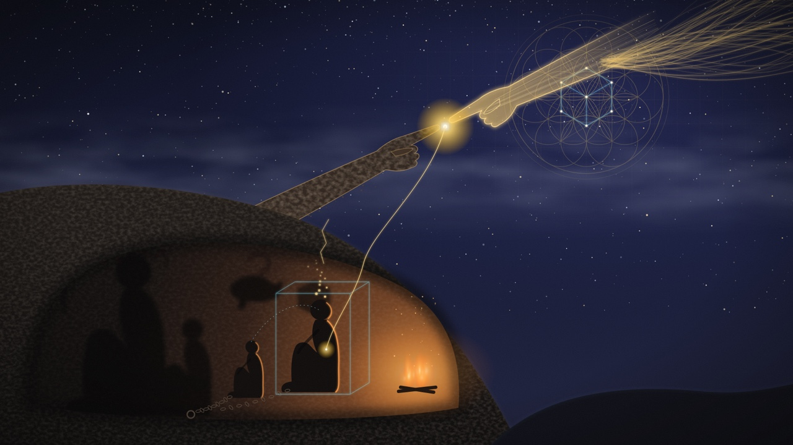

# 1. Era Adâmica

> "No princípio era o Verbo." — João 1:1

## Vivemos a era adâmica

Vivemos a era adâmica. Não é uma época do calendário nem um capítulo distante da história sagrada: é o estado em que quase todos nós nos encontramos agora. Adão não ficou no passado. Ele acorda conosco todos os dias, se veste com o nosso nome e responde quando nos chamam.

Para entender o que isso significa, é preciso começar pelo começo de cada um de nós: o momento em que chegamos aqui.

## O homem encarna

O homem encarna. Encarnar é exatamente o que a palavra diz: entrar na carne. É o **acoplamento do espírito à matéria** — algo que não é físico passa a habitar algo que é.

A imagem mais conhecida desse instante está pintada no teto da Capela Sistina. Na *Criação de Adão*, o dedo de Deus quase toca o dedo do homem. Leia a cena como metáfora, não como crônica. Ela simboliza a encarnação e, ao mesmo tempo, o **início da ignorância espiritual**. No exato momento em que o espírito vira carne, ele esquece de onde veio. O espaço entre os dois dedos é o véu que passamos a vida inteira sem atravessar.

## O primeiro contato é com a matéria

O primeiro mundo que conhecemos depois de encarnar é o material. Antes de qualquer ideia, há o frio, a fome, a luz, o colo, o som de uma voz. Esse é o mundo ao qual chegamos e com o qual temos o primeiro contato — e é por isso que estamos tão acostumados a ele.

O homem nasce acostumado e preso ao mundo físico. No processo primitivo, ele é guiado apenas por **impressões sensoriais**: o que vê, o que ouve, o que cheira, o que prova, o que toca. A visão, a audição, o olfato são as primeiras portas, e por muito tempo são as únicas.

## O mundo óbvio

O mundo dos sentidos é o mundo óbvio. É palpável. Bate-se na mesa e a mesa responde. Ninguém precisa de argumento para acreditar que a parede existe: basta tentar atravessá-la. É o mundo do qual temos certeza.

E para muitos, isso é tudo. Tudo o que pode ser compreendido está no aqui e agora, ao alcance da mão. O que não se vê, não se pesa e não se mede simplesmente não entra na conta — ou entra como superstição, como assunto de criança, como medo.

## O homem se separa do mundo

Preso ao que os sentidos mostram, o homem faz um movimento que parece natural e passa despercebido: **ele se individualiza**. Separa-se do mundo. Aqui estou eu; ali está o resto.

Depois de se separar, ele **objetifica a si e a tudo**. Torna-se uma identidade, uma personalidade: um corpo dotado de características e comportamentos. "Sou alto, sou tímido, sou assim." E faz o mesmo com tudo o que encontra: cada coisa vira um objeto com seus atributos e suas ações, encerrado em si mesmo, separado das demais.

Esse recorte parece descrição da realidade. Não é. É um modo de ler a realidade — e, como veremos ao longo desta obra, é um modo de ler que custa caro.

## Um cisco tomado pelo todo

O homem adâmico é **inconsciente da realidade eterna e da sua origem espiritual**. Enxerga só a matéria. Enxerga um cisco da realidade e toma esse cisco pelo todo.

Platão descreveu essa condição há mais de dois mil anos. Na alegoria da caverna, homens acorrentados desde a infância olham para uma parede onde se projetam sombras. Nunca viram outra coisa. Para eles, as sombras são o real. Se alguém lhes dissesse que há um fogo atrás deles, e um mundo inteiro lá fora, ririam — ou teriam medo.

Somos esses homens. As sombras são o mundo material; o que as projeta está atrás de nós.

## O que só o intelecto alcança

Há estruturas igualmente presentes na realidade, mas invisíveis aos olhos. As religiões as chamam de espirituais; os filósofos, de metafísicas. Elas ordenam tudo o que é, foi e será. A experiência material é produto delas, não o contrário: o que se vê não é o que rege.

Essas estruturas **só se percebem pelo intelecto, não pelos sentidos**. Não se veem como se vê uma mesa. E é justamente por isso que o homem preso aos sentidos não as encontra: procura com os olhos algo que só a razão alcança.

Parece místico, mas não é. O que parece mistério cabe no intelecto. A palavra *metafísica* vem do grego — *meta*, além; *physis*, o físico — e nomeia o que está além do físico. Esse plano não está "em outro lugar". Divide espaço com a matéria. Está aqui, só não é visível.

## O que o homem não compreende

Sem acesso a esse plano, o homem vive uma série de ignorâncias encadeadas:

- **Não compreende a origem das próprias decisões.** Escolhe, reage, deseja — sem saber de onde vem o que o move.
- **Não compreende o sentido da própria existência.** Vive sem saber o que está fazendo aqui.
- **Não compreende a estrutura fundamental da realidade.** Conhece os objetos, mas não aquilo de que o real é feito.
- **Não conhece a metafísica.** Não tem o estudo que daria acesso ao resto.

E é preciso cuidado com a conclusão apressada que costuma vir daqui: não saber explicar Deus não prova que Deus não existe. Prova apenas que ainda não aprendemos a ler.

## A ignorância que se perpetua

A ignorância da realidade fundamental tem uma característica que a torna difícil de curar: ela é **inconsciente**. Ninguém sabe que não sabe. E aquilo que não se percebe não se corrige — se perpetua.

O veículo dessa perpetuação é a crença. **As crenças do homem moldam o seu comportamento.** Agimos conforme o que acreditamos que o mundo é. E as crenças não começam em nós: são herdadas.

A criança recebe um mapa do mundo antes de poder fazer qualquer pergunta. Recebe-o da família, da escola, da religião, da cultura. **As crianças carecem de base lógica** para examinar esse mapa; simplesmente o recebem. O mapa vira comportamento antes de virar pergunta. Quando a criança cresce, entrega o mesmo mapa aos seus filhos. E assim, geração após geração, a ignorância se transmite sem que ninguém a escolha.

O homem não é mau por isso. Ele copia sem perceber.

## Uma linguagem que se contradiz

Para pensar tudo isso, o homem dispõe de uma única ferramenta: a linguagem. E **a linguagem que ele usa é contraditória e mal compreendida**.

A mesma palavra significa coisas diferentes conforme quem fala. Palavras diferentes dizem a mesma coisa sem que se perceba. Fala-se de Deus, de alma, de espírito, de amor, de eternidade — e cada um ouve outra coisa. Discute-se por séculos sem se entender, não por falta de inteligência, mas porque a ferramenta do entendimento está torta.

Uma lente torta entrega uma imagem torta. Se é pela linguagem que pensamos o mundo, uma linguagem deturpada nos entrega uma **visão deturpada da realidade**. E uma visão deturpada da realidade produz um comportamento deturpado.

## A insatisfação

Mas o homem adâmico não está em paz. Algo não fecha. Há uma **insatisfação** de fundo, difícil de nomear, que aparece no silêncio, na perda, na dor, diante da morte de alguém querido, ou numa noite qualquer olhando o céu.

Essa insatisfação é o primeiro sinal de que o cisco não é o todo. Dela nascem as perguntas:

- Do que é constituída a realidade?
- Deus existe?
- Há outra realidade além desta?
- O que há após a morte?
- Há eternidade?
- Há céu ou inferno?
- O que sou?
- Para onde vou?
- Qual é o sentido da vida?
- O que é vida?

São as mesmas perguntas desde que o homem aprendeu a falar. Não envelhecem porque nunca foram respondidas de forma que todos pudessem entender.

## A porta de saída

A era adâmica é o problema; não é uma sentença. O mesmo intelecto que o homem não usa para ler o espírito está disponível a cada um de nós. A centelha que encarnou continua sob o véu.

Quando a insatisfação vira pergunta, o homem começa a se mover. Passa a buscar compreender aquilo que os olhos não podem enxergar. É aqui que começa a busca — e é por ela que seguiremos.
