# Galeria — artes no contexto de Eternos Mutáveis

**Por quê:** ver cada imagem e o **link** com a tese (unidade, eterno-mutável, alfabetização espiritual, crítica à substância, gnose).  
**Visão:** [`../../README.md`](../../README.md) · índice de arquivos: [`README.md`](README.md).  
**Ordem:** arco da obra (queda → busca → ciclo → libertação → alfabeto → superação), não numeração de arquivo.  
**Ficha:** numeração contínua · **Autor** · **Ano** (ou intervalo / c. = circa).

---

## 1. Queda e prisão na matéria (caps. 1 e 7 em espelho)

### 1. Criação de Adão

**Autor:** Michelangelo Buonarroti · **Ano:** c. 1511

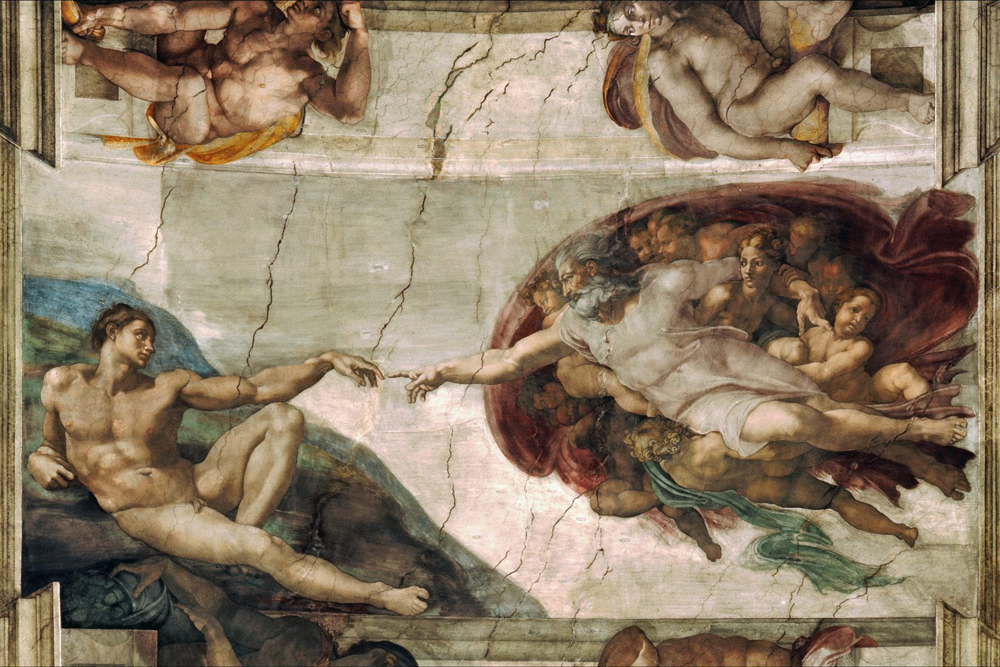

**Link:** a “criação” como metáfora da **encarnação**: espírito se acopla à matéria e esquece a origem. O vão entre os dedos é o véu — o homem adâmico ainda existe em cada um. Na obra, é a imagem-âncora do problema: centelha divina num corpo transitório.

---

### 2. Expulsão do Paraíso

**Autor:** Masaccio (Tommaso di Ser Giovanni) · **Ano:** c. 1425

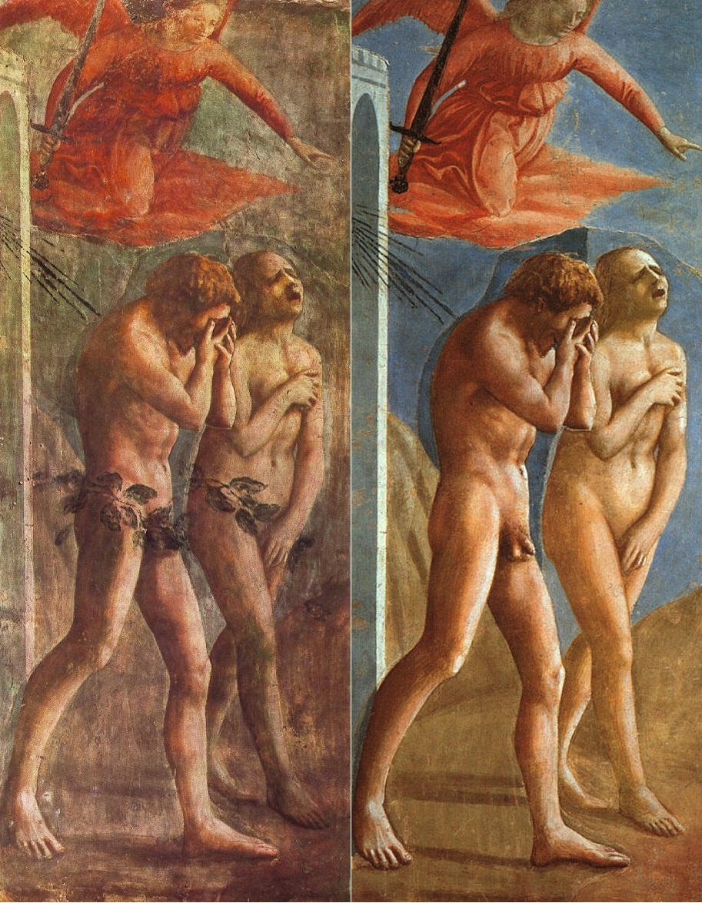

**Link:** a queda vivida no corpo — vergonha, expulsão, perda do Éden. Em Eternos Mutáveis a queda não é só mito moral: é o início do **analfabetismo espiritual**. O cap. 7 inverte a cena: retorno ao Éden interior (ator → autor), sem negar a dor desta imagem.

---

### 3. Alegoria da caverna de Platão

**Autor:** Jan Saenredam (segundo Cornelis van Haarlem) · **Ano:** 1604

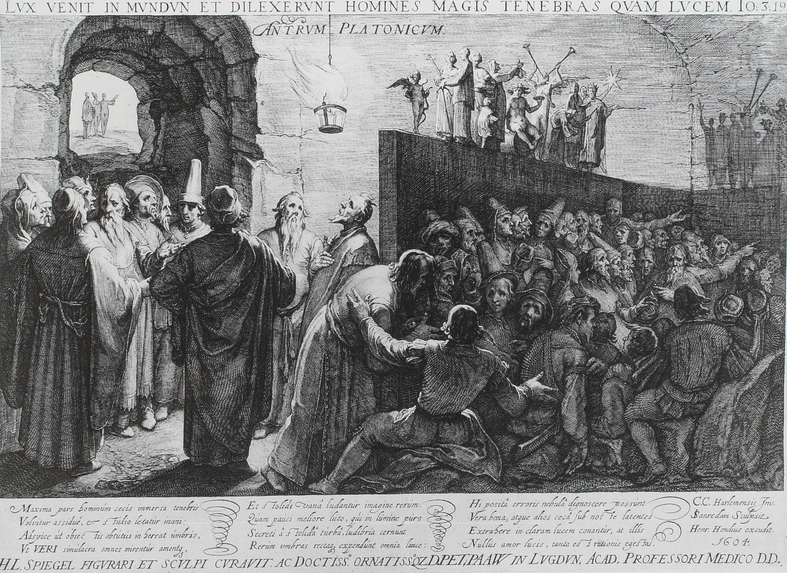

**Link:** prisioneiros das **sombras** = homens presos aos sentidos. O que se vê não é o que rege. A obra chama isso de cisco tomado pelo todo; a saída da caverna é a **alfabetização metafísica** (intelecto, não só olhos).

---

## 2. Dualidade, Verbo e ordem do real (caps. 5–6)

### 4. Separação da luz das trevas

**Autor:** Michelangelo Buonarroti · **Ano:** 1512

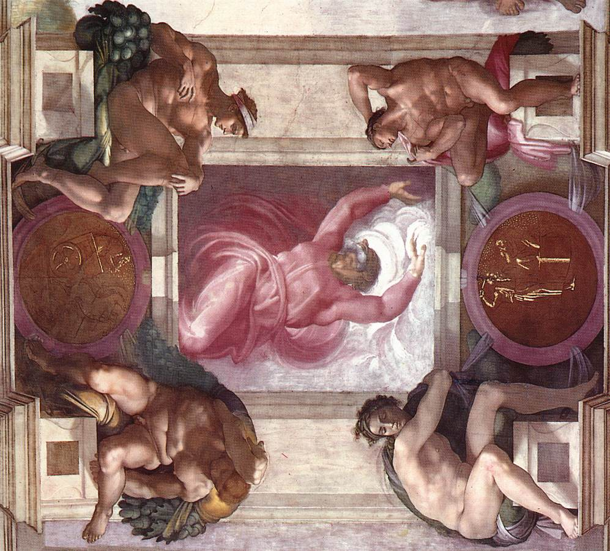

**Link:** existir exige **contraste**. Luz × trevas antecipa o alfabeto da dualidade (ser × devir, verbo × objeto, eterno × temporal). Deus aqui age como Verbo que **ordena** o par — não como substância imóvel.

---

### 5. The Ancient of Days

**Autor:** William Blake · **Ano:** 1794

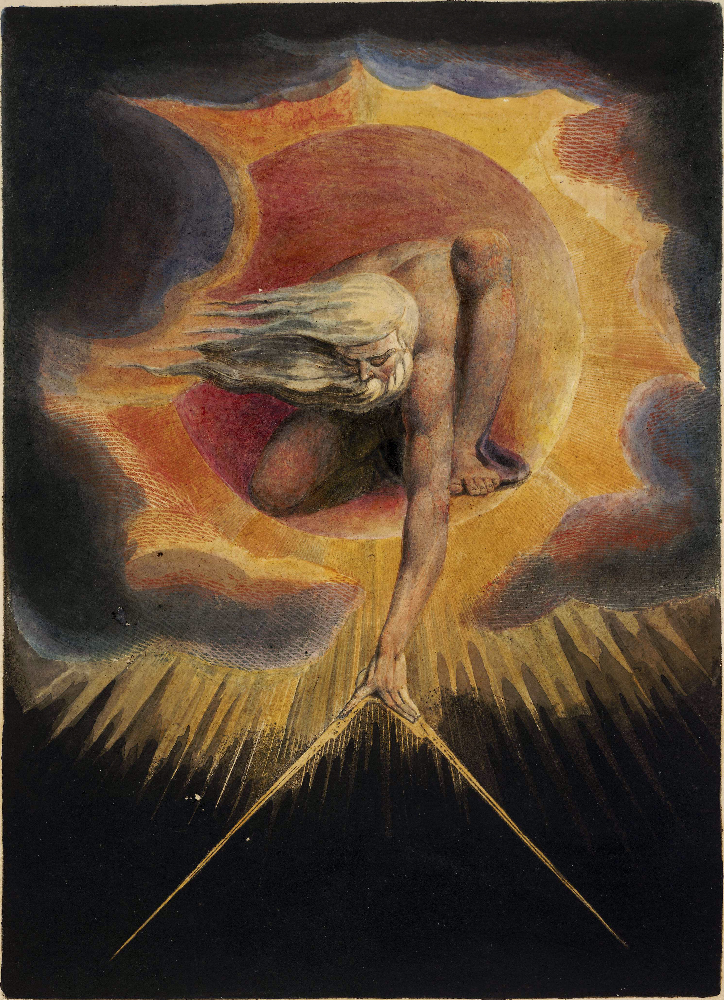

**Link:** o criador com o **compasso** = Logos medindo o mundo. Na tese, Deus é Verbo e mudança; a geometria do gesto ecoa a ideia de que o real tem **estrutura** legível (metafísica), não só mistério opaco.

---

### 6. Ouroboros alquímico

**Autor:** tradição alquímica (anônimo) · **Ano:** c. séc. XV–XVII (gravura de transmissão)

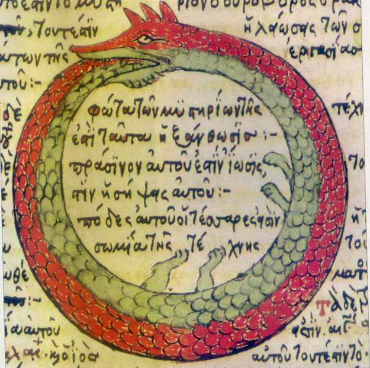

**Link:** ciclo que **permanece sendo um** enquanto se transforma. Nome visual do título: **eterno-mutável** — o eterno não é imóvel; o mutável não desfaz a unidade.

---

### 7. Chrysopoeia — Ouroboros

**Autor:** tradição atribuída a Cleópatra, a Alquimista · **Ano:** c. séc. III–IV (cópia de manuscrito helenístico)

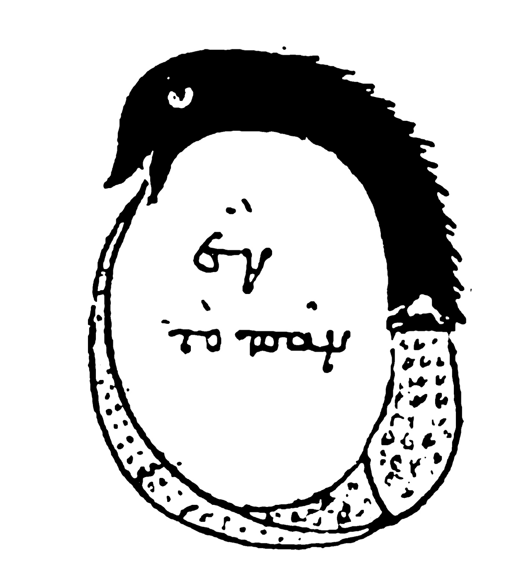

**Link:** a versão canônica hermética do mesmo símbolo. Reforça a linhagem Caibalion / hermetismo citada na busca do autor: unidade sob a mudança, “tudo flui” sem cair no caos.

---

## 3. Unidade: microcosmo, macrocosmo, árvore e mandala (tese “todos somos um”)

### 8. Homem Vitruviano

**Autor:** Leonardo da Vinci · **Ano:** c. 1490

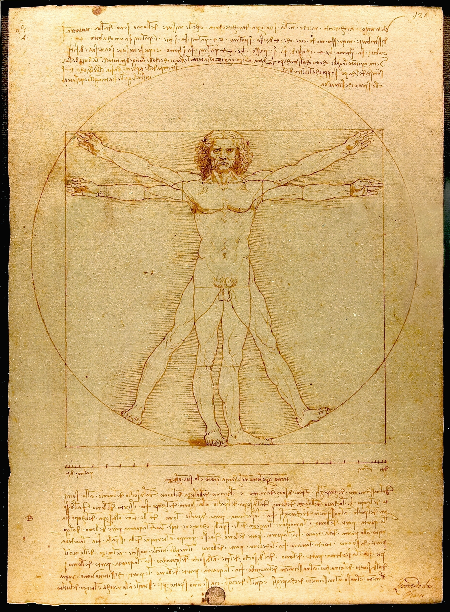

**Link:** o corpo como **mapa do cosmos**. A separação indivíduo × mundo é recorte de leitura, não o fundo do real. Visual da tese: o humano não é substância isolada.

---

### 9. *Utriusque cosmi historia*

**Autor:** Robert Fludd · **Ano:** 1617

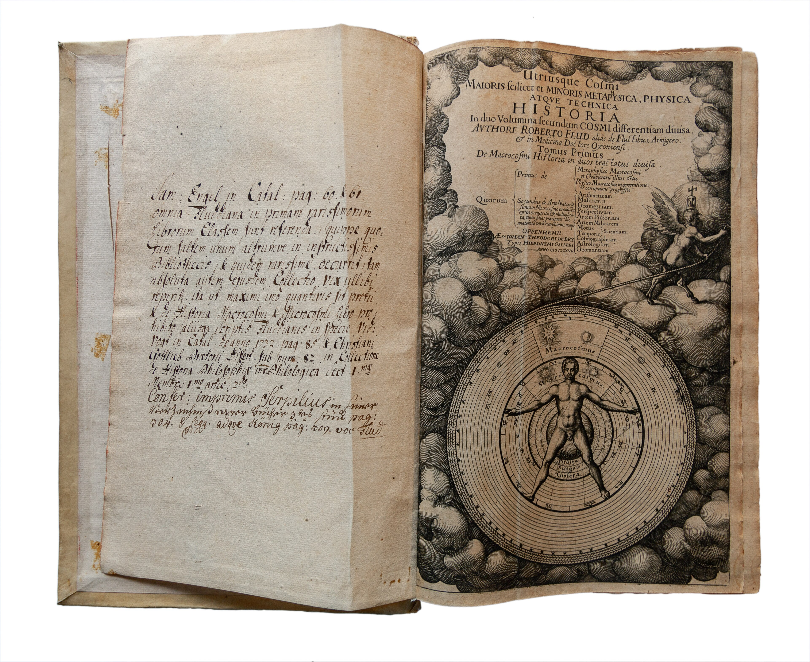

**Link:** diagrama do mundo maior e menor — **estrutura** do real como a obra quer alfabetizar. Ecoa a identidade visual dos banners (geometria sagrada → estrutura).

---

### 10. Gravura *Utriusque cosmi* (Wellcome)

**Autor:** Robert Fludd · **Ano:** 1617–1619

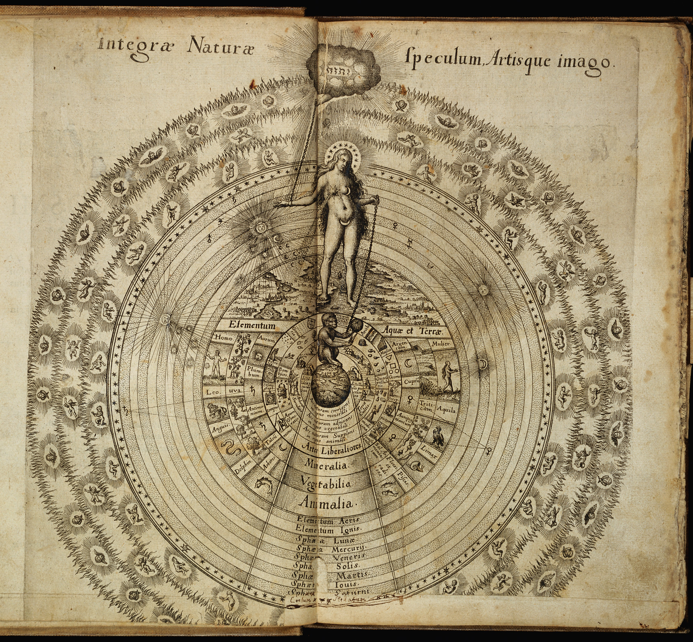

**Link:** outra face do mesmo projeto hermético: o espiritual como **sistema** legível, não só fé. Paralelismo com software como ontologia (regras, camadas, dependências).

---

### 11. Macrocosmo vitruviano

**Autor:** Robert Fludd (tradição / oficina) · **Ano:** c. 1617

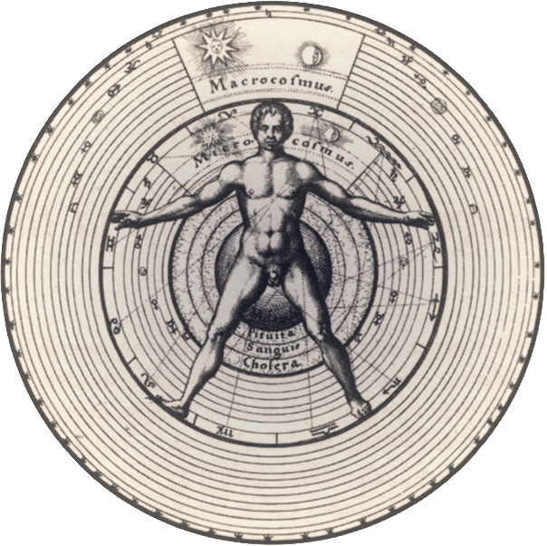

**Link:** homem inscrito no universo — “todos somos um” em desenho. Micro e macro se correspondem (princípio hermético da correspondência), chave da conduta por **correspondência** no fecho da obra.

---

### 12. Árvore da Vida (cabala)

**Autor:** tradição cabalística (diagrama esquemático moderno) · **Ano:** esquema tradicional (sefirot; forma gráfica moderna)

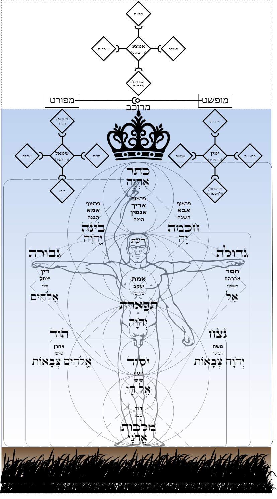

**Link:** cadeia do Uno à matéria; sefirot como **estados e relações**, não objetos soltos. Ecoa Logos como ordem entre os verbos e a “história” (estado + mudança) como unidade mínima do real.

---

### 13. Mandala de Amitayus (nove vezes Amitayus)

**Autor:** tradição tibetana (anônimo) · **Ano:** c. 1170–1189

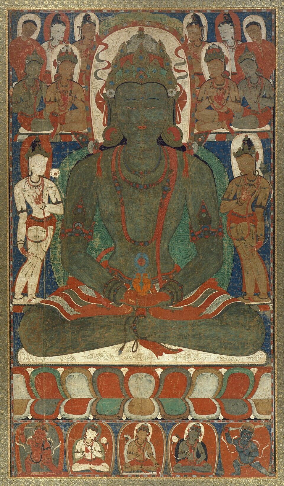

**Link:** ordem simbólica centrada — o caos aparente tem **alfabeto**. Serve de analogia à alfabetização espiritual: padrões, eixos, dualidades organizadas em um só mapa.

---

## 4. A busca histórica e o erro da substância (caps. 2 e 5)

### 14. Escola de Atenas

**Autor:** Rafael Sanzio · **Ano:** 1509–1511

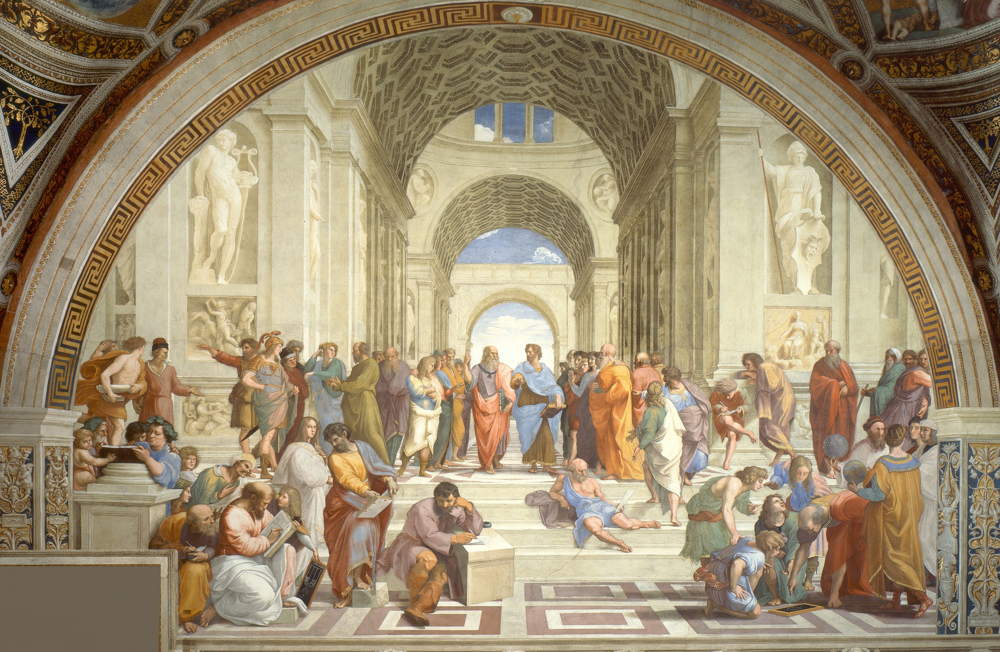

**Link:** inventário da busca humana. Platão aponta o **alto** (formas / eterno); Aristóteles, o **chão** (substância / essência fixa). Eternos Mutáveis escolhe o fio platônico-hermético e **refuta** a ontologia da substância que Aristóteles legou à cultura e ao código.

---

### 15. Newton

**Autor:** William Blake · **Ano:** 1795

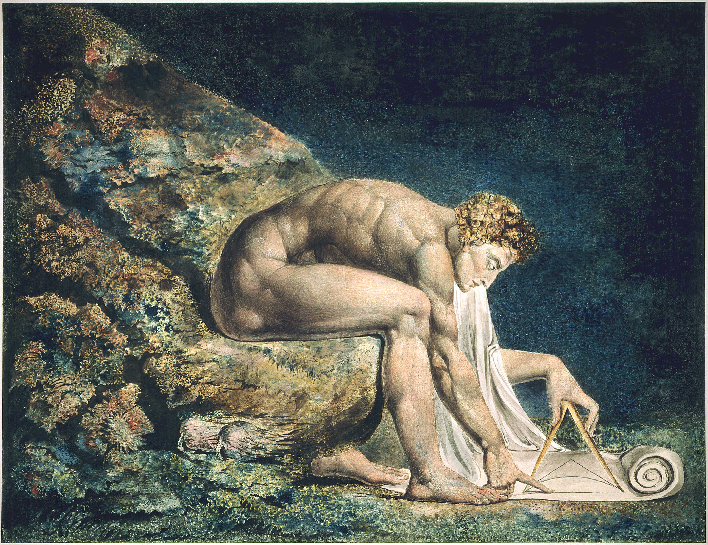

**Link:** a razão que só mede o **sólido** e perde o fluxo. Espelho do “maior erro da programação”: modelar o real como objetos/essências, esquecendo abstratos, verbos e história.

---

## 5. Inferno cíclico e angústia (cap. 3)

### 16. Roda da Fortuna (detalhe) — *Carmina Burana*

**Autor:** miniaturista anônimo (códice *Carmina Burana*) · **Ano:** c. 1230

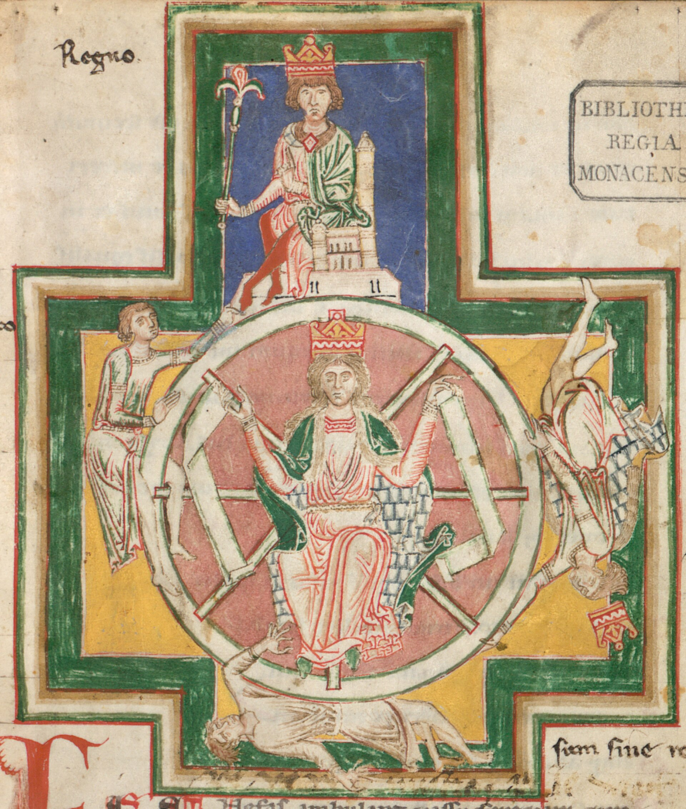

**Link:** subir e cair sem sair do **anel** — desejo do que não se tem, tédio do que se tem. É o inferno cíclico em uma só imagem.

---

### 17. Roda da Fortuna (completa) — *Carmina Burana*

**Autor:** miniaturista anônimo (códice *Carmina Burana*) · **Ano:** c. 1230

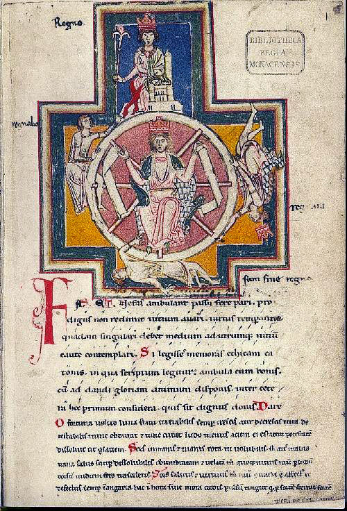

**Link:** a roda inteira mostra o padrão: atores repetem papéis. A obra pede passar de **ator a autor** — ver o ciclo para não ser só personagem dele.

---

### 18. Bhavacakra — Roda da vida

**Autor:** tradição tibetana (thangka; anônimo) · **Ano:** tradição antiga (exemplar típico séc. XIX–XX em museus)

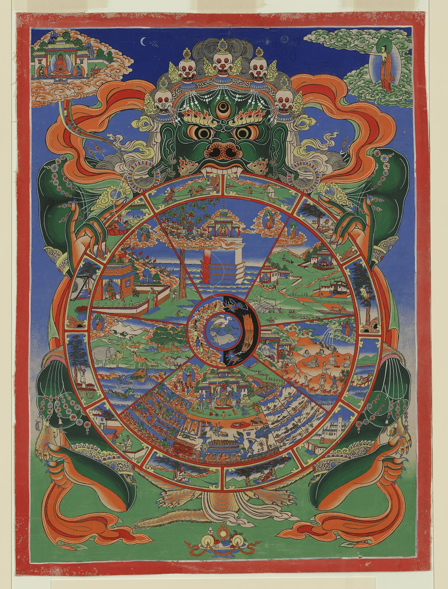

**Link:** samsara: renascimento nas mesmas histórias. Diálogo com o Oriente no cap. 2 e com o inferno cíclico do cap. 3 — sofrimento nascido de **ignorância estrutural**, não só de azar.

---

### 19. O Grito

**Autor:** Edvard Munch · **Ano:** 1893

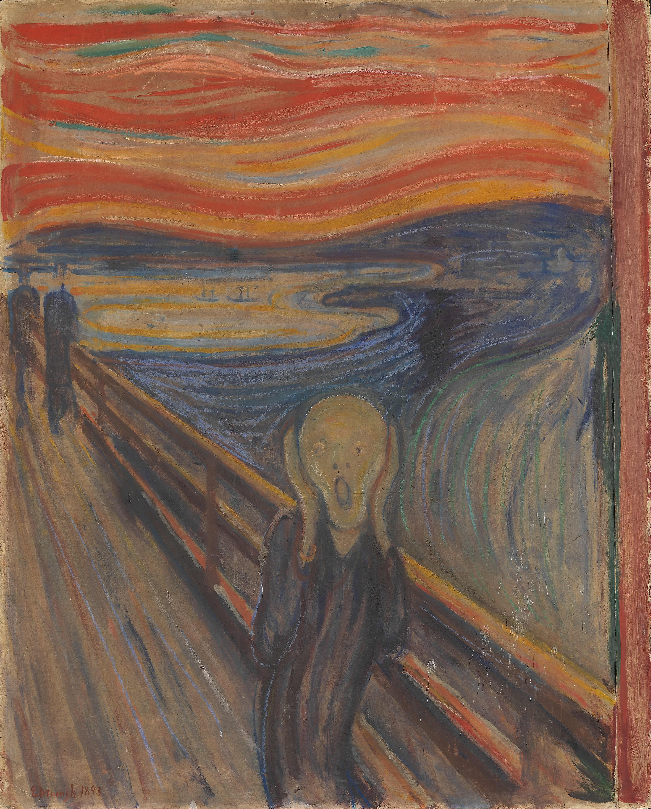

**Link:** sintoma do **analfabetismo espiritual**: ansiedade, vida sem sentido, o preço da ignorância. Não é a tese; é a dor que a tese quer nomear e atravessar.

---

### 20. A Noite Estrelada

**Autor:** Vincent van Gogh · **Ano:** 1889

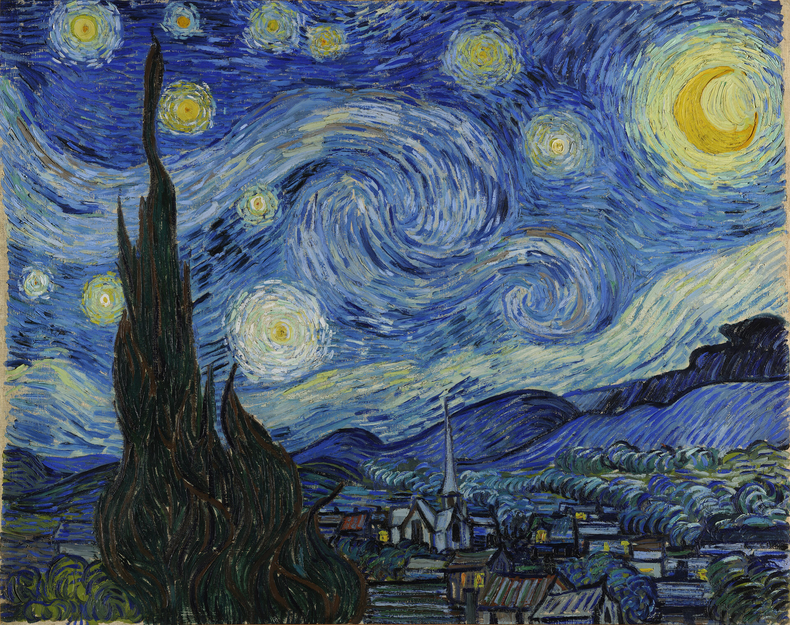

**Link:** o cotidiano (vila) sob um **cosmos vivo**. A matéria é véu; por trás pulsa o que só o intelecto (e a visão desperta) lê. Ponte emocional entre prisão sensorial e eternidade mutável.

---

## 6. Gnose: portal, alfabeto abstrato, elevação (caps. 4 e 7)

### 21. Porta do Paraíso (detalhe)

**Autor:** Lorenzo Ghiberti · **Ano:** 1425–1452

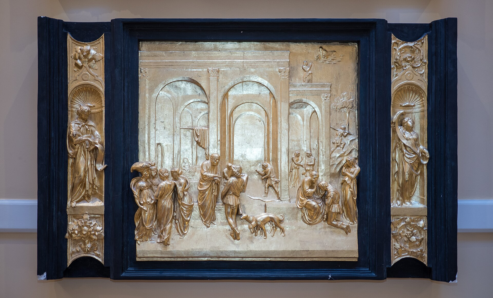

**Link:** a gnose como **abertura** — corrente que se desfaz, portal para a luz. Conhecimento que liberta, não fé cega nem moral de obediência.

---

### 22. Porta do Paraíso (vista)

**Autor:** Lorenzo Ghiberti · **Ano:** 1425–1452

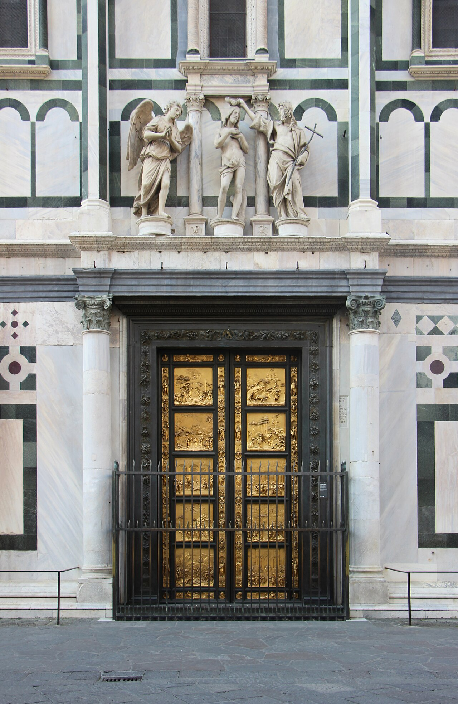

**Link:** a porta como obra total: narrativas ordenadas em um só bronze. Ecoa a promessa da obra — **síntese** das perguntas eternas num alfabeto único.

---

### 23. The Ten Largest, nº 9 (Old Age)

**Autor:** Hilma af Klint · **Ano:** 1907

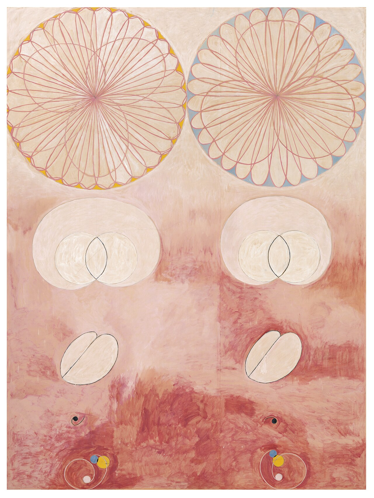

**Link:** espiritualidade pintada como **geometria e dualidade**, sem culto de prateleira. Mood da identidade visual (índigo, dourado, formas) e do alfabeto da dualidade do cap. 6.

---

### 24. Composition VII

**Autor:** Wassily Kandinsky · **Ano:** 1913

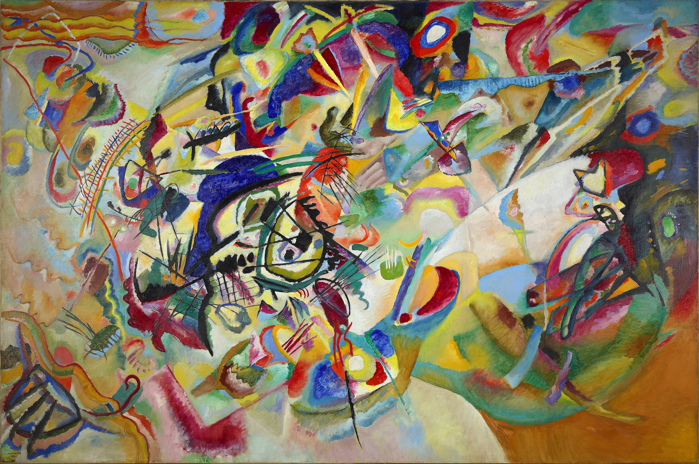

**Link:** o **abstrato** como linguagem do espírito. Na obra: depender de abstrações, não de sólidos (insight SOLID → metafísica). O invisível estruturante torna-se visível pela forma.

---

### 25. Assunção da Virgem

**Autor:** El Greco (Doménikos Theotokópoulos) · **Ano:** 1577–1579

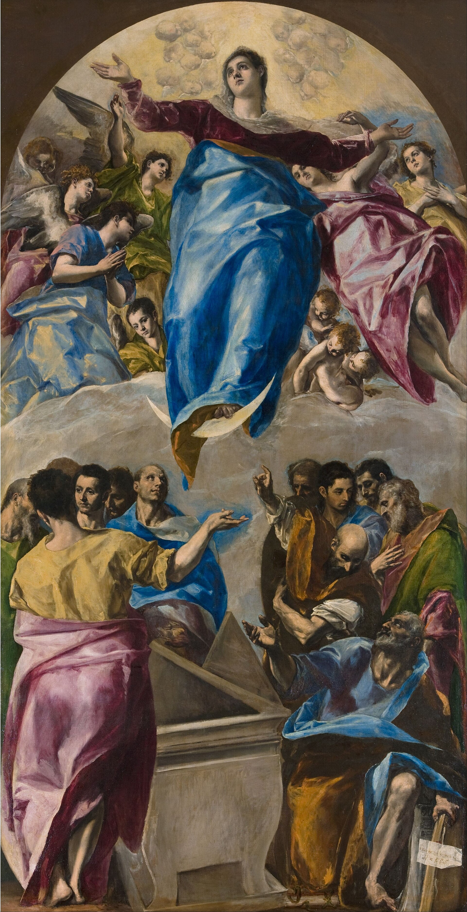

**Link:** elevação, luz no eixo vertical — **superação adâmica**. Espelho do banner do cap. 7: figura que deixa as máscaras e sobe do chão da matéria à estrutura luminosa.

---

### 26. *Jerusalem* (placa)

**Autor:** William Blake · **Ano:** 1804–1820

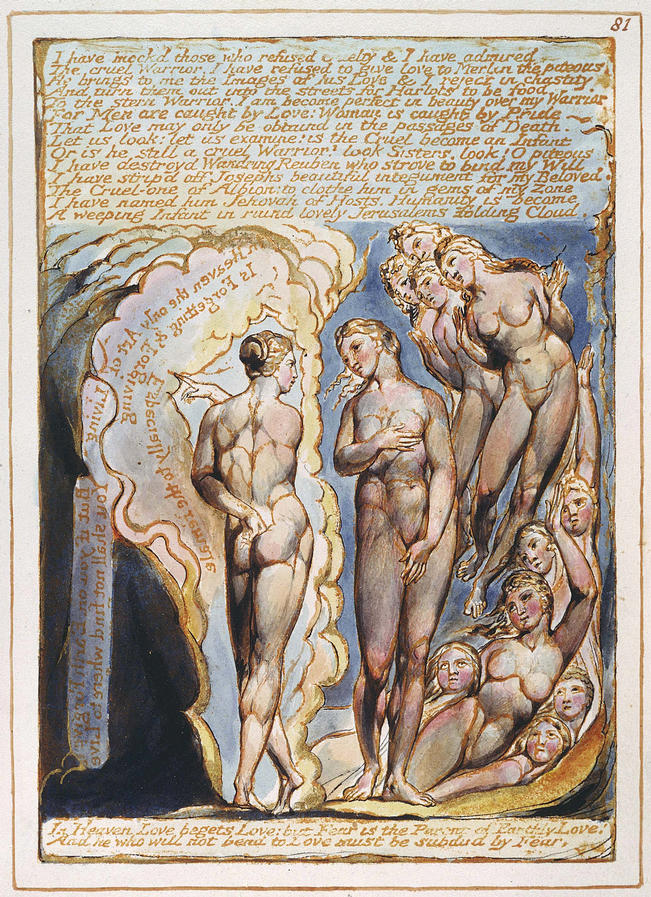

**Link:** prisão espiritual e luta pela visão. Blake trata a libertação como **visão corrigida** — afim à gnose: compreender a estrutura libera, não só “crer”.

---

### 27. *Jerusalem*, frontispício (Albion)

**Autor:** William Blake · **Ano:** 1804–1820

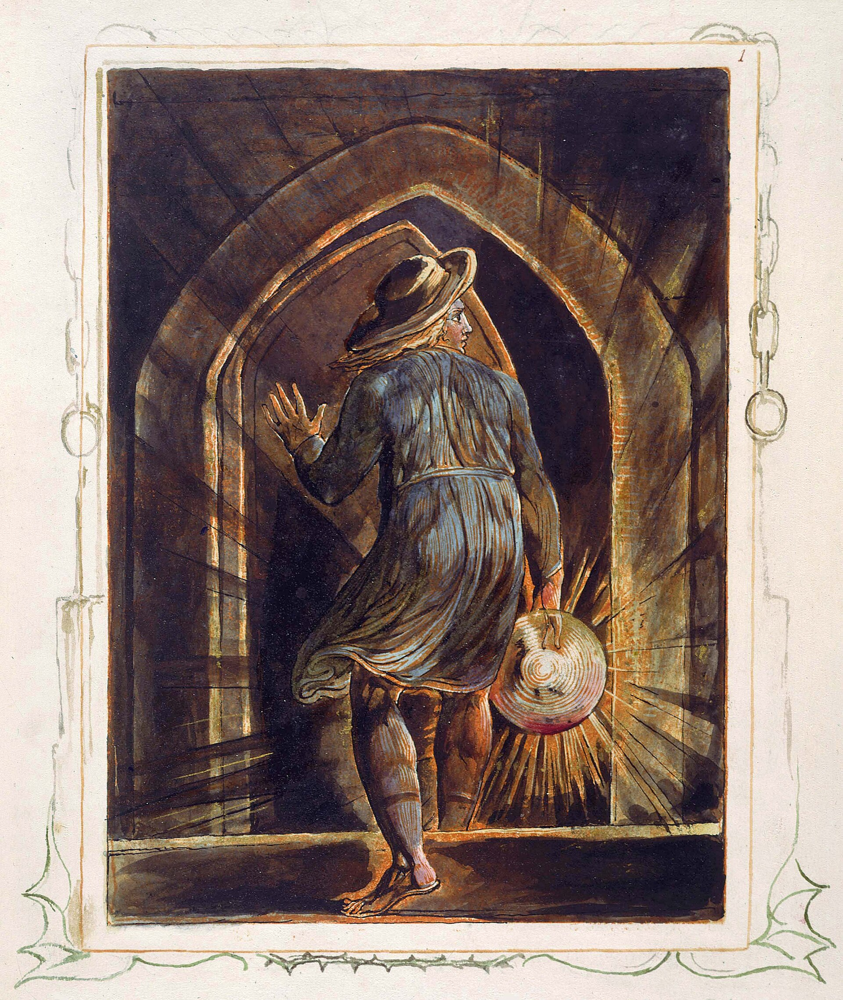

**Link:** Albion adormecido / a despertar — o homem coletivo. Ecoa “todos somos um” e a passagem de personalidade adâmica a consciência que lê o Uno.

---

## Não arquivadas (copyright) — só consulta oficial

Arquivos **não** entram nesta pasta (nem no git): vida do autor + 70 anos. Ver no museu/herdeiros; o vínculo à tese fica abaixo.

### 28. A Persistência da Memória

**Autor:** Salvador Dalí · **Ano:** 1931

Ver: [MoMA — The Persistence of Memory](https://www.moma.org/collection/works/79018)

**Link:** relógios que escorrem = tempo e identidade sem essência fixa. Visual do **mutável** desmentindo a substância rígida (caps. 5–6).

---

### 29. O Filho do Homem

**Autor:** René Magritte · **Ano:** 1964

Ver: [magritte.be](https://www.magritte.be/) (© ADAGP / herdeiros)

**Link:** maçã na face = **máscara** do eu. Eco do baile de máscaras (cap. 3) e das máscaras abandonadas na superação adâmica (cap. 7).

---

### 30. A Condição Humana

**Autor:** René Magritte · **Ano:** 1933 (variante 1935)

Ver: [NGA — The Human Condition](https://www.nga.gov/collection/art-object-page.71269.html) (© herdeiros)

**Link:** tela dentro da paisagem = representação confundida com a coisa. Problema da **linguagem** e da visão deturpada (caps. 1–2 e 5).

---

## Síntese — banner Cap. 1 (Era Adâmica)

### 31. Banner gerado — Era Adâmica

**Autor:** gerado (Cursor) a partir de bullets de [`../../f`](../../f) §1 + refs desta galeria · **Ano:** 2026

**Link:** compõe caverna/sentidos (esq.), encarnação Adão + centelha e vão do véu (centro), prisão na matéria/cidade (dir.), geometria incompleta no céu (metafísica só pelo intelecto). Asset canônico: [`../../assets/banner-cap-1-era-adamica.jpg`](../../assets/banner-cap-1-era-adamica.jpg).

---

## Fio único

Queda (1–3) → dualidade e Verbo (4–7) → unidade (8–13) → crítica da substância (14–15) → ciclo (16–20) → gnose e elevação (21–27) → mutável / máscara / linguagem sob © (28–30) → síntese banner cap. 1 (31).

**Reverter:** apagar este arquivo; as imagens em [`README.md`](README.md) permanecem.
