# 1. Era Adâmica

> "E formou o Senhor Deus o homem do pó da terra, e soprou em suas narinas o fôlego da vida; e o homem foi feito alma vivente."
> — Gênesis 2:7

---

## Um homem de joelhos

No centro da imagem que abre este capítulo há um homem ajoelhado sobre a rocha, nu, com a pele da mesma cor da terra em que se apoia. Do céu, envolto num manto vermelho e cercado de anjos, Deus avança e estende o braço. Do dedo divino nasce uma centelha, e o homem a recebe com as mãos em concha, com cuidado, quase com reverência. Ele ainda olha para quem lhe deu a luz.

O resto da cena conta outra história. À esquerda, dentro de uma caverna, outros homens estão sentados no escuro, olhando para o chão ou para lugar nenhum. Atrás deles, numa abertura da rocha, anjos voam numa luz dourada, e nenhum dos homens se vira para ver. À direita, um jovem já se levantou e caminha de costas para a cena, rumo a uma cidade de pedra com torres e muralhas. No alto, quase apagados no céu rachado do afresco, há círculos e linhas que ninguém na cena observa, uma geometria inacabada que parece sustentar o céu.

Este capítulo é sobre o homem ajoelhado, e ele não pertence a um mito antigo. Somos nós, e quase todos que conhecemos. Ele tem nome, documento, profissão e opiniões; trabalha, deseja, se cansa e dorme. E carrega nas mãos uma luz que, em pouco tempo, já não saberá de onde veio.

---

## Vivemos a era adâmica

Chamo de era adâmica um estado, e não um período do calendário ou uma época remota da história sagrada. É o estado em que o homem se encontra quando conhece o mundo apenas pelo lado de fora. Ele não terminou com Adão; recomeça a cada nascimento.

*Adâmico*, aqui, é o homem que habita a matéria sem compreender o que está além dela. Ele tem intelecto, tem tudo de que precisa para compreender, mas o usa quase inteiramente para lidar com o que vê, toca e possui. É um ser espiritual que se acredita apenas corpo.

Para entender como chegamos a esse estado, vale voltar ao começo de cada um de nós, ao momento em que chegamos.

---

## O vão entre os dedos

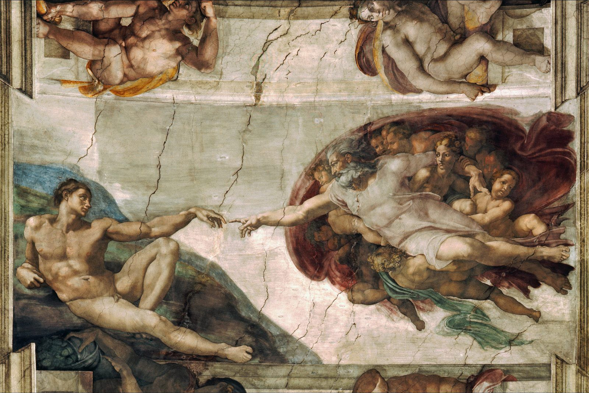

*Michelangelo Buonarroti, Criação de Adão, c. 1511. Teto da Capela Sistina.*

No teto da Capela Sistina, Michelangelo pintou Deus avançando envolto num manto, cercado de figuras, com o braço estendido com força e intenção. Do outro lado, Adão repousa sobre a terra, o corpo perfeito e lânguido, o braço erguido sem esforço e o dedo ainda frouxo. Entre os dois dedos há um espaço de poucos centímetros, e eles não se tocam.

Lida como metáfora, a cena simboliza a encarnação, palavra que significa literalmente entrar na carne: o espírito se acopla à matéria, e algo que não é físico passa a habitar algo que é. Um sopro entra no barro, uma centelha cai numa palma de terra.

A mesma imagem simboliza também o início da ignorância espiritual. Esta é a primeira premissa do livro, e prefiro apresentá-la como premissa, e não como fato demonstrado: quando o espírito se acopla à matéria, ele se esquece da origem.

Por que a matéria produziria esquecimento? A resposta que proponho, e que os próximos capítulos terão de sustentar, é que, ao encarnar, o espírito passa a conhecer pelas portas do corpo. O que não entra por elas não fica registrado, e a origem não entra por nenhuma. A lembrança continua lá, mas o novo instrumento de conhecer não tem como alcançá-la. O vão entre os dedos funciona como um véu: de um lado está a fonte, do outro um corpo que acaba de abrir os olhos e não se lembra de nada.

Toda a nossa história começa nesse vão, e muita gente passa a vida sem perceber que ele existe.

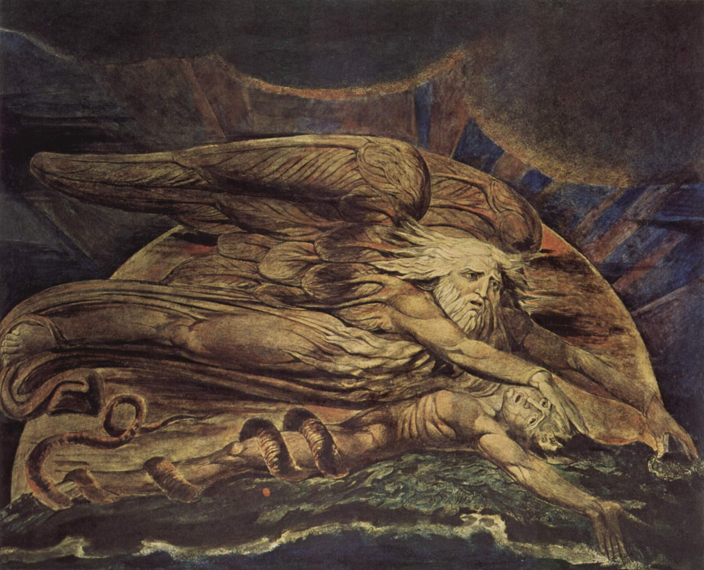

*William Blake, Elohim Creating Adam, 1795.*

Quase três séculos depois de Michelangelo, William Blake pintou a mesma cena sem nenhuma doçura. Um Deus de asas imensas paira rente ao chão e pressiona a cabeça de Adão contra a terra. Adão está estendido, com o rosto contraído de quem acorda de um sonho para um peso, e em volta da sua perna já está enrolada uma serpente.

Blake tornou visível o que a pintura da Sistina deixa implícito: a encarnação é um presente e também um aperto. No mesmo gesto em que recebe um corpo, o espírito fica preso a ele, ao seu peso, à sua fome e ao seu fim. Na pintura de Blake a serpente não espera o jardim; está enrolada na carne desde o primeiro instante, como se o fôlego da vida e o início do esquecimento fossem um só acontecimento.

---

## O primeiro mundo

O primeiro mundo que conhecemos depois de encarnar é o material.

Antes de qualquer pensamento há o frio, a fome, a luz que fere os olhos, o calor de um colo, o som de uma voz. Um recém-nascido não sabe o que é Deus nem o que é ele mesmo; sabe o que sente. O mundo chega pela visão, pela audição, pelo olfato, pelo paladar e pelo tato, e por muito tempo essas são as únicas portas que existem.

Por isso estamos tão acostumados com a matéria. Não a escolhemos; foi o primeiro contato, o mundo em que aprendemos a andar, a falar, a pedir e a temer. O homem nasce acostumado e preso ao mundo físico e, no começo, é guiado só por impressões sensoriais: busca o que agrada e evita o que fere.

É o mundo óbvio, palpável. Quem bate na mesa sente a mesa responder, e ninguém precisa de argumento para acreditar na parede; basta tentar atravessá-la. Desse mundo temos certeza.

Para muitos, ele é tudo. O que pode ser compreendido estaria no aqui e agora, ao alcance da mão, e o que não se vê, não se pesa e não se mede fica de fora da conta, ou entra como superstição, conversa de criança, medo do escuro.

Esse mundo óbvio tem características que raramente notamos, justamente por serem óbvias demais. Ele é imperfeito: nada nele está pronto, tudo falta, quebra, adoece e se desgasta. É transitório: tudo começa e termina, e o corpo que hoje sente já foi outro e será outro. E é o mundo dos que mudam, onde a criança vira adulto, a semente vira árvore, a árvore vira lenha e a lenha vira cinza.

O homem adâmico apoia sua certeza justamente no que menos permanece. Confia no que passa e duvida do que fica.

---

## A expulsão

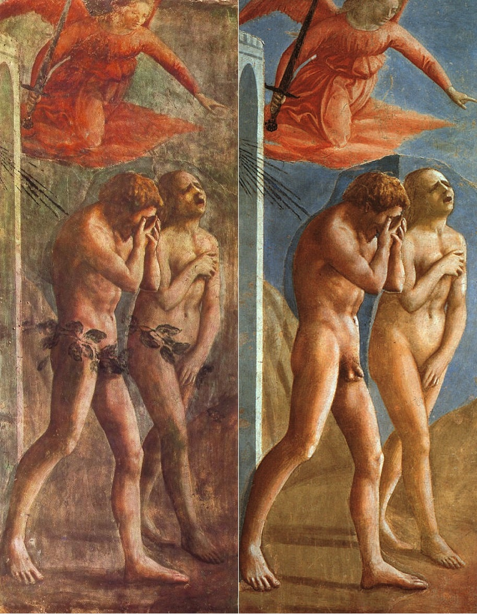

*Masaccio, Expulsão do Paraíso, c. 1425. Capela Brancacci, Florença.*

Quase um século antes de Michelangelo, Masaccio pintou o outro lado da história. Adão e Eva saem do Éden; ele cobre o rosto com as mãos, ela cobre o corpo e grita, e acima deles um anjo aponta para fora. Quase não há paisagem nem cor, só dois corpos que de repente se descobriram corpos.

O relato bíblico diz que, depois da queda, "abriram-se os olhos de ambos, e conheceram que estavam nus". O detalhe é decisivo, porque a queda começa com uma percepção de si, antes de qualquer dor. Adão e Eva passam a se ver como separados de Deus, do jardim e um do outro.

Algo parecido acontece com cada um de nós. Preso ao que os sentidos mostram, o homem faz um movimento que parece natural e passa despercebido: ele se individualiza. Traça uma linha na altura da pele e decide que ali dentro está ele e lá fora está o resto.

Depois de se separar, passa a tratar a si mesmo e a tudo como objeto. Torna-se uma identidade, uma personalidade, um corpo dotado de características e comportamentos: "sou alto, sou tímido, sou brasileiro, sempre fui assim". E faz o mesmo com o que encontra. A árvore vira um objeto com tronco, galhos e folhas; o vizinho, um objeto com nome, defeitos e manias. O mundo inteiro vira um inventário de coisas encerradas em si mesmas, cada uma com seus atributos e separada das demais.

Esse recorte parece uma descrição da realidade, mas é um modo de lê-la, tão antigo e repetido que esquecemos que se trata de uma leitura.

Distinguir as coisas é necessário; sem reconhecer que a árvore não é o vizinho, ninguém pensa coisa alguma. O equívoco está em tomar cada coisa como se existisse sozinha, encerrada nos próprios atributos, esquecendo as relações, os processos e as trocas que a fazem ser o que é. A árvore também é a chuva que a alimenta, a luz que ela converte, a semente que foi e a lenha que será. Reconhecer um indivíduo é legítimo. A leitura adâmica começa quando ele é isolado do resto.

Ao longo do livro vou mostrar que esse modo de ler custa caro, nas nossas relações, no nosso sofrimento e até nas máquinas que hoje organizam a vida.

No banner deste capítulo, essa leitura está no jovem do lado direito. Ele recebeu a mesma luz que o homem ajoelhado, mas já não olha para ela. Deu as costas à mão que o criou e caminha, decidido, para a cidade, onde terá um nome, uma casa, uma função e uma imagem de si.

Masaccio pintou a expulsão como vergonha. Eu a descreveria antes como esquecimento: ninguém nos tirou do jardim, nós é que deixamos de enxergá-lo.

---

## A caverna

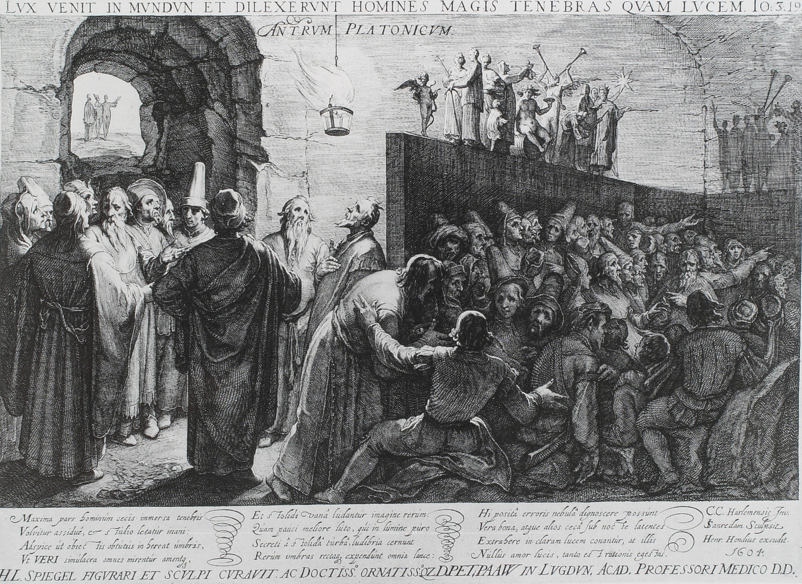

*Jan Saenredam, segundo Cornelis van Haarlem, Alegoria da caverna de Platão, 1604.*

Há mais de dois mil anos, Platão descreveu uma condição parecida.

Imagine homens acorrentados desde a infância no fundo de uma caverna, de costas para a entrada. Atrás deles arde um fogo, e entre o fogo e eles passam figuras carregadas por outros. Os prisioneiros só veem as sombras projetadas na parede à sua frente, porque nunca viram outra coisa. Dão nomes às sombras, discutem sobre elas e premiam quem melhor adivinha qual virá a seguir. Para eles, as sombras são o real, e se alguém lhes dissesse que há um fogo atrás deles e um mundo lá fora iluminado pelo sol, ririam, ou teriam medo.

Na gravura de Saenredam a caverna está cheia. À direita, uma multidão se aperta e gesticula, entretida com as sombras das figuras que desfilam sobre um muro, e ninguém parece infeliz. Essa é a eficiência da prisão: ela é confortável, e as sombras são interessantes. À esquerda, um pequeno grupo se afastou da multidão e conversa perto de uma abertura na rocha, por onde entra a luz de fora.

No alto da gravura, o artista inscreveu em latim um versículo do Evangelho de João: *Lux venit in mundum et dilexerunt homines magis tenebras quam lucem*, "a luz veio ao mundo, e os homens amaram mais as trevas do que a luz" (João 3:19). Ninguém lhes negou a luz. Eles preferiram as sombras, que já conheciam.

Platão usava essa imagem para falar da distância entre opinião e conhecimento, entre as coisas sensíveis e as Formas que elas imitam. A leitura que faço parte da dele, mas é uma apropriação, e não pretendo atribuí-la a ele. Nela, os prisioneiros somos nós, as sombras são o mundo material, e o que as projeta está atrás de nós.

O homem adâmico é inconsciente da realidade eterna e da própria origem espiritual. Enxerga a matéria, que é um cisco da realidade, e toma esse cisco pelo todo. Falta-lhe apenas virar a cabeça; inteligência ele tem.

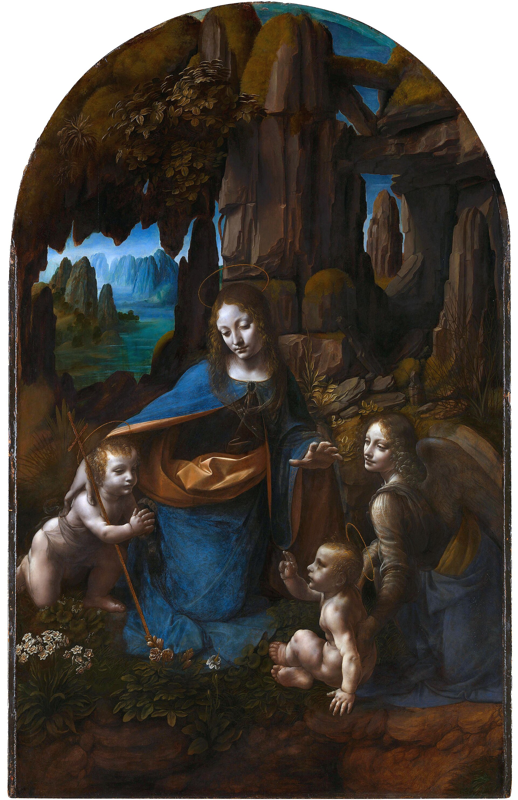

*Leonardo da Vinci, Virgem das Rochas, c. 1491–1508. National Gallery, Londres.*

Leonardo pintou outra caverna. Na *Virgem das Rochas*, Maria, um anjo e duas crianças estão reunidos numa gruta escura, entre pedras e plantas úmidas. A gruta, porém, se abre em fendas, e por elas se vê ao longe uma paisagem azul de água e montanhas. O sagrado está no ponto em que a escuridão se abre para a luz.

A caverna, então, também é o lugar onde a luz pode ser percebida pela primeira vez. Ela tem saídas, que só passam despercebidas a quem continua de frente para a parede.

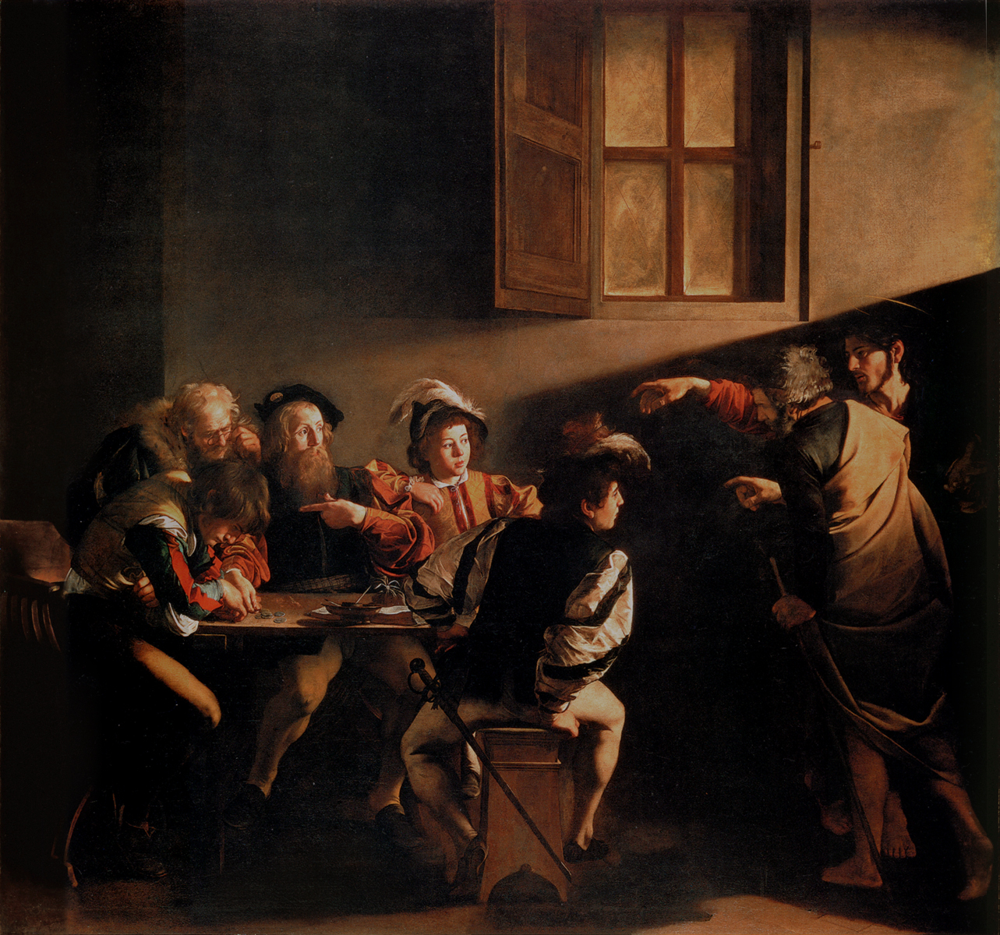

*Caravaggio, Vocação de São Mateus, 1599–1600. Igreja de San Luigi dei Francesi, Roma.*

Caravaggio levou a caverna para uma sala comum. Cinco homens contam moedas sentados a uma mesa, num cômodo escuro. Pela direita entram duas figuras quase engolidas pela sombra; uma delas é Cristo, que aponta com uma mão muito parecida com a de Adão na Capela Sistina. Com ele entra um feixe de luz que corta a parede na diagonal.

Um dos homens à mesa ergue o rosto e leva a mão ao peito, como quem pergunta "eu?". Outros olham desconfiados. Os dois da ponta esquerda nem levantam a cabeça e continuam curvados sobre o dinheiro, com a luz passando a um palmo deles.

Com a maioria de nós é assim. A luz entra pela janela; o difícil é erguer os olhos da mesa.

---

## A cidade de luz fria

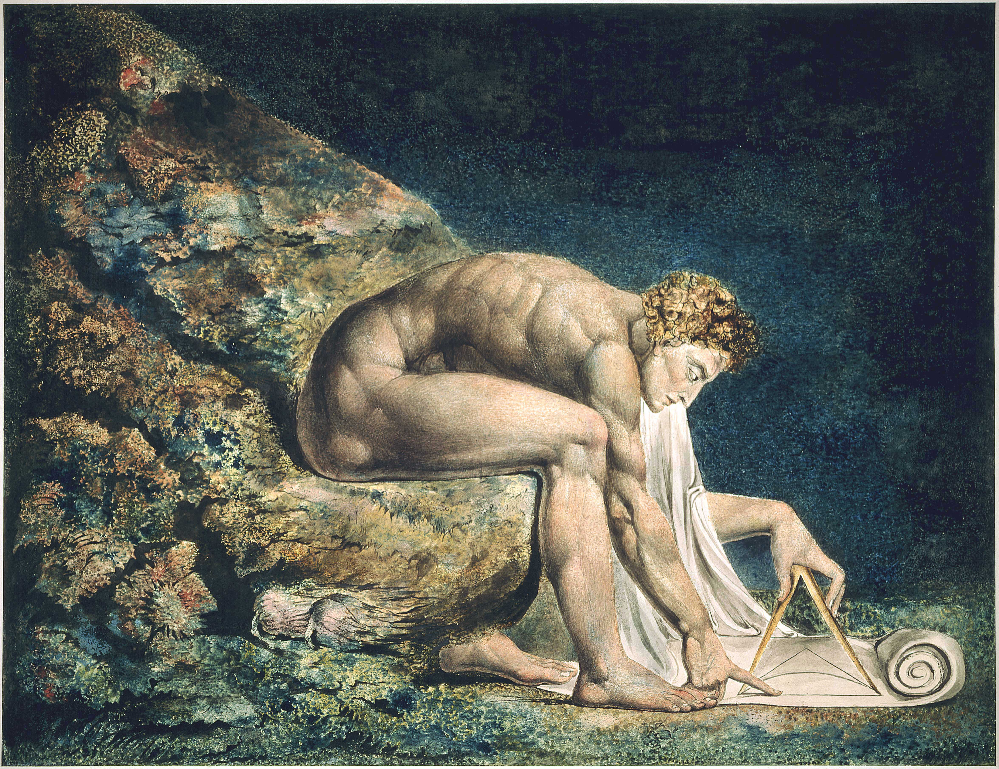

*William Blake, Newton, 1795.*

Seria confortável pensar que a caverna ficou no passado e que a ciência, a técnica e a informação nos libertaram dela. No lado direito do banner, porém, está a cidade para onde o jovem se dirige, com torres, muralhas e casas empilhadas, obra das mãos humanas. A caverna continua lá, agora com torres.

Blake pintou Isaac Newton nu, sentado numa rocha no fundo do mar, curvado sobre um papel, medindo uma figura com um compasso. O corpo é magnífico e a concentração, total, e ele está de costas para tudo o que é vivo ao seu redor. Blake não desprezava a razão; desprezava a razão que só sabe medir o que é sólido e esquece o resto.

Nossa situação é parecida. O homem avançou na ciência e na tecnologia sem avançar na espiritualidade. Sabemos mais sobre o átomo do que qualquer geração anterior, construímos máquinas que falam, calculam e decidem, e continuamos sem responder com clareza perguntas que uma criança faz antes dos dez anos.

Vivemos cada vez mais longe da natureza e cada vez mais perto das criações humanas: telas, prédios, produtos, notificações. As sombras, que antes eram projetadas na rocha, hoje aparecem em vidro iluminado por dentro e cabem no bolso. Nunca tivemos tanto acesso a informação, e é esse excesso que nos mantém de costas para a entrada. Sabemos um pouco de tudo, entendemos pouco do todo e temos muito mais dados do que síntese.

A cidade de luz fria é a caverna com eletricidade.

---

## O que os olhos não alcançam

No alto do banner, à direita, quase confundida com as nuvens e as rachaduras do afresco, há uma geometria de círculos, linhas e proporções para a qual nenhuma figura da cena olha.

Ela representa a tese que este livro vai propor: há estruturas presentes na realidade, mas invisíveis aos olhos, que as religiões chamam de espirituais e os filósofos, de metafísicas. A proposta é que elas ordenam tudo o que é, foi e será, e que a experiência material deriva delas, e não o contrário. Isso ainda não está demonstrado aqui; os capítulos seguintes terão de fazê-lo. Por ora, o passo é mais modesto e mais firme: mostrar que aquilo que os sentidos alcançam não esgota o que se pode conhecer.

Para isso basta um exemplo simples. Ninguém nunca viu o número três. Vemos três maçãs, três pedras, três dedos, mas o três em si, aquilo que as maçãs e as pedras têm em comum, nenhum olho jamais viu. E temos certeza de que ele é sempre o mesmo e de que três mais três dará seis hoje, amanhã e daqui a mil anos, em qualquer lugar do universo. As maçãs apodrecem e o três continua.

O mesmo vale para o movimento. Vemos a bola aqui e, depois, ali; vemos posições sucessivas. O movimento que a levou de um ponto a outro não tem cor, peso nem forma. Nós o deduzimos, o compreendemos.

O três e o movimento não provam, sozinhos, que exista um espírito ou uma eternidade. Provam algo anterior e indispensável: que conhecemos com segurança coisas que nunca vimos, e que as conhecemos pela leitura, não pela vista. Se existem estruturas metafísicas, elas são desse tipo, perceptíveis pelo intelecto e não pelos sentidos. Por isso o homem preso aos sentidos não as encontra: procura com os olhos o que só a razão alcança.

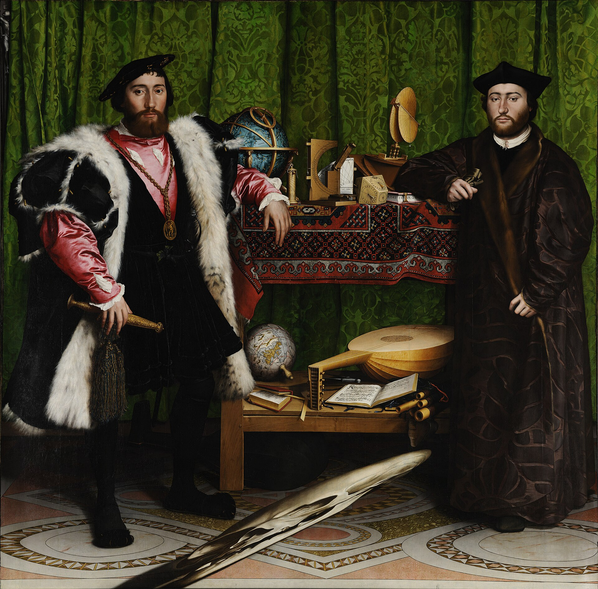

*Hans Holbein, o Jovem, Os Embaixadores, 1533. National Gallery, Londres.*

Hans Holbein pintou essa dificuldade num único quadro. Dois homens jovens, ricos e cultos posam ao lado de uma estante onde está boa parte do que o seu tempo sabia: um globo celeste e um terrestre, relógios de sol, instrumentos de astronomia, um livro de aritmética, um alaúde, um hinário.

No chão, bem na frente deles, há uma mancha alongada que não parece nada. De frente, o quadro mostra só uma forma torta; quem se coloca de lado, quase encostado na parede, vê a mancha se transformar numa caveira. Ela ocupa o centro da cena e só aparece para quem muda o ângulo de visão. No canto superior esquerdo, quase escondido atrás da cortina verde, há ainda um pequeno crucifixo que também costuma passar despercebido.

O quadro funciona como uma lição sobre o mundo adâmico. O primeiro plano, com o luxo, os instrumentos e a ciência, encobre a morte e o sagrado, que estão presentes, mas pintados num ângulo que os olhos acostumados não alcançam. Para vê-los é preciso se deslocar, e na vida esse deslocamento é feito pelo intelecto.

A palavra *metafísica* vem do grego *meta*, além, e *physis*, natureza física: é o estudo do que está além do físico. "Além", aqui, não quer dizer "longe". O plano que este livro investiga não estaria escondido atrás das nuvens; dividiria espaço com a matéria, nesta página e na mão que a segura, sem ser visível.

Se a geometria do banner parece incompleta, a falta está em quem olha, a quem ainda faltam as letras para lê-la.

---

## Quatro ignorâncias

Sem acesso a esse plano, o homem vive uma série de ignorâncias encadeadas, que são consequências de ler só metade do mundo, e não falhas de caráter. Três delas ele sente na própria vida. A quarta ele nem percebe, e é ela que sustenta as outras.

**Ele não compreende a origem das próprias decisões.** Escolhe, reage, deseja, se irrita e se apaixona acreditando que é ele quem decide, e raramente pergunta de onde vem aquilo que o move. Por que desejo o que desejo? Por que reajo sempre da mesma forma ao mesmo tipo de situação? Sem essa pergunta, a liberdade é apenas uma sensação.

**Ele não compreende o sentido da própria existência.** Preenche os dias com tarefas, metas e distrações e, num silêncio inesperado, percebe que não sabe para quê.

**Ele não compreende a estrutura fundamental da realidade.** Conhece os objetos, mas não aquilo de que o real é feito. Sabe o nome de mil coisas e não sabe dizer o que é uma coisa.

**Por baixo das três, ele não conhece a metafísica.** Esta ignorância está em outro nível, porque é o fundamento das demais. As três primeiras são perguntas que a vida lhe faz; a quarta é a falta do estudo que permitiria respondê-las, e enquanto ela durar as outras não têm por onde ser enfrentadas.

Nossa época costuma tirar daqui uma conclusão apressada. Diante da dificuldade de explicar Deus, o espírito ou a eternidade, muitos concluem que essas coisas não existem. A incapacidade de explicar Deus, porém, não prova a sua inexistência. Prova apenas que ainda não aprendemos a ler.

---

## O mapa herdado

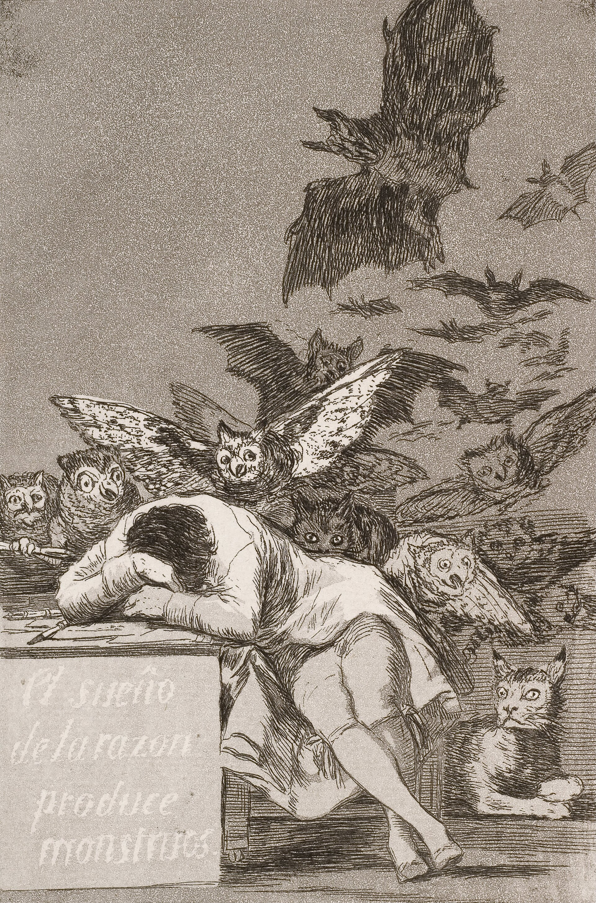

*Francisco de Goya, O sono da razão produz monstros, Caprichos nº 43, 1797–1799.*

Goya gravou um homem dormindo debruçado sobre a mesa de trabalho, com a cabeça escondida entre os braços. Atrás dele, saindo da escuridão, surgem corujas, morcegos e um felino de olhos abertos que o observa. Na lateral da mesa está escrito *El sueño de la razón produce monstruos*, o sono da razão produz monstros.

O homem da gravura não sabe que está cercado. Os monstros nem precisam atacá-lo; basta que ele continue dormindo.

A ignorância da realidade fundamental é difícil de curar porque é inconsciente. Quem não sabe, não sabe que não sabe, e o que não se percebe não se corrige. Perpetua-se.

O veículo dessa perpetuação é a crença. Agimos conforme o que acreditamos que o mundo é. Quem acredita que o mundo é hostil se defende de tudo; quem acredita que só existe o que se possui vive para possuir; quem se acredita apenas um corpo trata o corpo como a única coisa que importa e teme a morte como o fim de tudo.

E as crenças não começam em nós; são herdadas. A criança recebe um mapa do mundo antes de poder fazer qualquer pergunta sobre ele, da família, da escola, da religião, da televisão e da rua. Ainda não tem base lógica para examiná-lo, para perguntar se é verdadeiro, coerente ou útil, e o recebe como recebe a língua materna. O mapa vira comportamento antes de virar pergunta.

Quando cresce, a criança entrega o mesmo mapa aos filhos, e assim, geração após geração, a ignorância se transmite sem que ninguém a tenha escolhido. Nessa corrente há herdeiros, e não culpados.

O homem adâmico não é mau. Ele copia sem perceber.

---

## A tela diante da janela

Em 1933, René Magritte pintou um quadro chamado *A Condição Humana*. Diante de uma janela há um cavalete com uma tela, e a tela pinta exatamente a paisagem que ela mesma esconde: a árvore, o campo, o céu. A pintura se encaixa tão bem na paisagem que não se sabe onde uma termina e a outra começa, nem se estamos vendo o mundo ou a representação dele.

*(A obra está protegida por direitos autorais e não é reproduzida aqui. Pode ser vista na coleção da [National Gallery of Art](https://www.nga.gov/collection/art-object-page.71269.html).)*

O quadro descreve bem o último problema deste capítulo. Para pensar o mundo, o homem dispõe de uma ferramenta, a linguagem, que é a tela diante da janela. Tudo o que pensamos sobre a realidade passa por ela, e de tanto usá-la acabamos confundindo a tela com a paisagem.

A linguagem em si funciona; o problema é que a usamos sem compreender como ela funciona.

A mesma palavra significa coisas diferentes conforme quem fala. "Manga" é fruta e é parte da camisa, e isso não confunde ninguém, porque a feira e a alfaiataria resolvem a dúvida. Com as palavras que mais importam, porém, o contexto já não basta. "Amor" serve para o que a mãe sente pelo filho, para o que um adolescente sente por uma fotografia e para o que alguém sente por uma marca de café. No sentido inverso, palavras diferentes rondam a mesma região sem que se perceba: o que um chama de *alma*, outro chama de *mente*, *consciência* ou *espírito*, e ninguém sabe dizer se fala de uma coisa só, de quatro coisas distintas ou de quatro coisas que se tocam.

A confusão vem de três camadas que se misturam sem que se note: o nome, o conceito que o nome carrega e aquilo que o conceito pretende representar. Quando não há uma definição compartilhada do conceito, cada um preenche o nome com o que tem. E quando se confunde o nome com a coisa, discute-se a palavra acreditando discutir a realidade.

Fala-se de Deus, de eternidade, de céu e de inferno, e cada ouvinte entende outra coisa. Discute-se por séculos sem acordo, e quase sempre o que falta é um entendimento comum sobre aquilo que cada palavra pretende alcançar, mais do que inteligência.

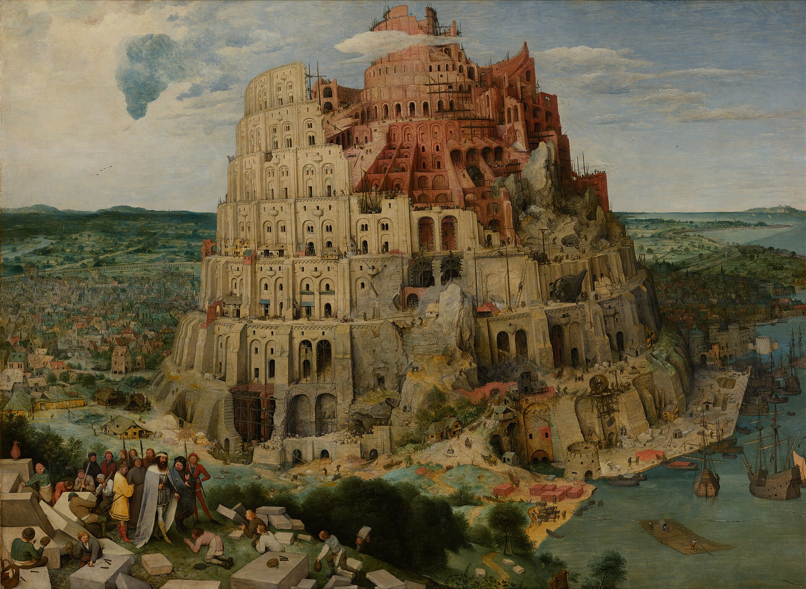

*Pieter Bruegel, o Velho, A Torre de Babel, c. 1563. Kunsthistorisches Museum, Viena.*

O Gênesis conta essa história. Os homens decidiram construir uma torre que chegasse ao céu, e Deus confundiu a língua deles, "para que não entenda um a língua do outro". A obra parou e os homens se espalharam.

Bruegel pintou a torre no meio da construção, gigantesca e cheia de vida, com andaimes, guindastes, operários e navios descarregando pedra no porto. No canto, o rei inspeciona a obra enquanto os pedreiros se ajoelham. De perto, porém, a construção não se sustenta. A torre foi erguida sobre uma rocha que nunca foi removida, e a pedra bruta ainda aparece no meio das paredes. Os andares estão desnivelados e se inclinam uns sobre os outros, como se cada equipe tivesse construído do seu jeito. Enquanto o topo sobe, a base já desmorona; um lado está terminado e branco, o outro ainda é um esqueleto de tijolo vermelho.

Leio Babel como a descrição de um estado, mais do que como um castigo antigo. É o que acontece quando muitos tentam alcançar o céu sem uma linguagem comum: cada um empilha a sua parte, ninguém confere o prumo e a obra nunca termina. Religiões, filosofias e ciências levantaram, cada uma, um andar dessa torre. Todas queriam chegar ao mesmo lugar, e nenhuma fala a língua das outras.

Uma lente torta entrega uma imagem torta. Se pensamos o mundo pela linguagem, uma linguagem cujos conceitos ninguém definiu, e que confundimos com as próprias coisas, nos dá uma visão deturpada da realidade, e essa visão produz um comportamento deturpado.

Considero essa a raiz mais funda da era adâmica, e é também por ela que, mais adiante, começa a saída.

---

## O grito e a noite

Ainda assim, o homem adâmico não está em paz.

Por mais confortável que seja a caverna e por mais luminosa que seja a cidade, algo não fecha. Há uma insatisfação de fundo, difícil de nomear, que aparece no silêncio, na doença, na morte de alguém querido ou no meio de uma conquista que não trouxe o que prometia.

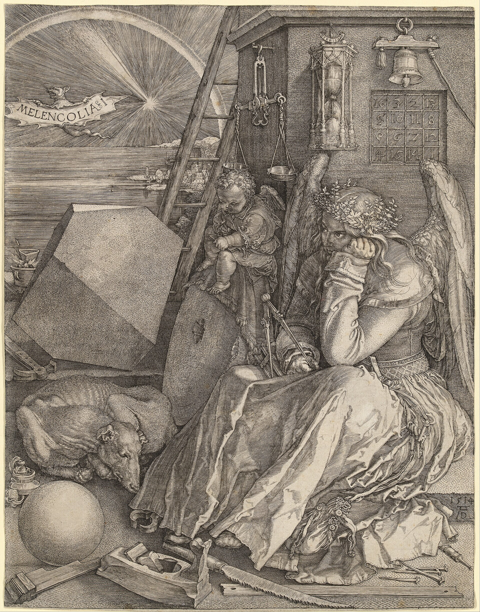

*Albrecht Dürer, Melancolia I, 1514. Gravura em metal.*

Dürer gravou essa insatisfação no rosto de um ser alado sentado à porta de uma construção, com a cabeça apoiada na mão. Na outra, segura um compasso que não usa. Em volta está espalhado o que serve para medir e construir: uma esfera, um poliedro de pedra, uma balança, uma ampulheta, um sino, um quadrado mágico, régua, serrote, pregos. Um cão magro dorme enrolado no chão, e uma escada encostada na parede sobe para fora da imagem, para um lugar que não vemos.

Ele tem todos os instrumentos e sabe medir tudo o que é sólido, mas está parado, com o olhar perdido, porque nenhum desses instrumentos lhe diz para quê. É o retrato do homem adâmico mais inteligente, aquele que domina a matéria e, por isso mesmo, percebe que ela não basta. A escada continua ali, e ele ainda não subiu.

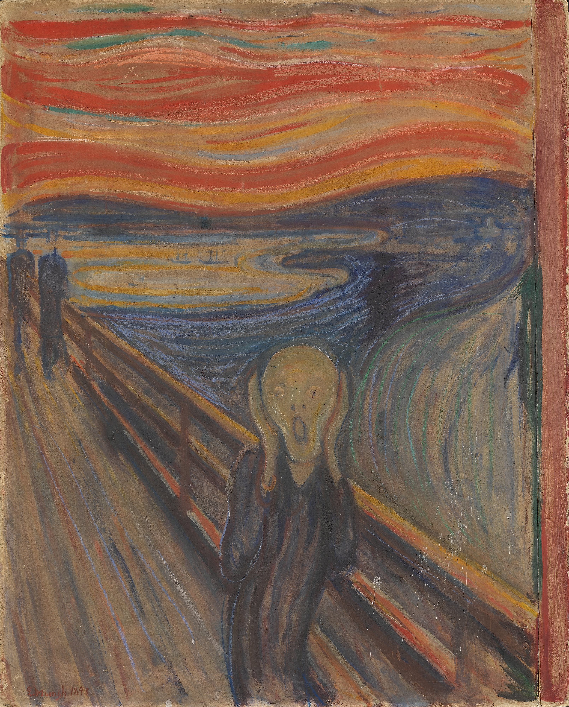

*Edvard Munch, O Grito, 1893.*

Quase quatro séculos depois, Munch pintou essa insatisfação como um grito. Uma figura sem traços, quase sem corpo, segura o rosto sobre uma ponte enquanto o céu parece ondular em vermelho, e ao fundo duas pessoas seguem caminhando, alheias. O grito poderia ser de qualquer um que, num instante, percebeu que a vida que leva não explica a vida que tem.

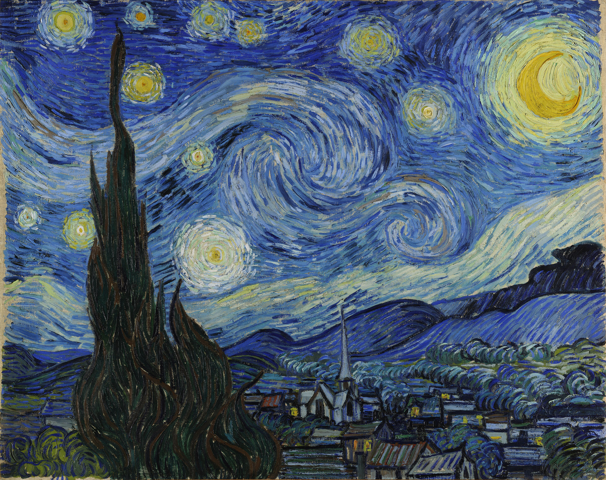

*Vincent van Gogh, A Noite Estrelada, 1889.*

A mesma insatisfação tem outra face. Van Gogh pintou uma pequena vila adormecida, com casas, uma igreja e algumas janelas acesas, sob um céu em movimento, de estrelas que giram e espirais de vento e luz. A vila dorme enquanto o céu parece respirar.

O banner repete essa composição, com a vida ordinária embaixo e, em cima, uma ordem viva que quase ninguém vê. Às vezes, numa noite qualquer, alguém levanta os olhos e sente que há algo ali, sem saber dizer o quê.

Essa insatisfação, seja grito ou espanto, não prova nada sobre o que há além. Ela é um motivo, e não uma demonstração: indica apenas que as explicações recebidas não bastaram a quem a sente. Mesmo assim, é o primeiro sinal de que o cisco talvez não seja o todo, e uma boa razão para ir verificar. Dela nascem as perguntas:

- Do que é constituída a realidade?
- Deus existe?
- Há outra realidade além desta?
- O que há após a morte?
- Há eternidade?
- Há céu ou inferno?
- O que sou?
- Para onde vou?
- Qual é o sentido da vida?
- O que é vida?

São perguntas que o homem faz desde que aprendeu a falar, nas cavernas, nos templos, nas academias, nos mosteiros e nos laboratórios. Continuam atuais porque nunca foram respondidas de um modo que todos pudessem entender.

---

## A centelha na mão

De volta ao banner, a cena é a mesma do início: o homem ajoelhado, a caverna à esquerda, a cidade à direita, a geometria no céu. Há nela, porém, dois detalhes que talvez tenham passado despercebidos.

O primeiro é que a centelha não se apagou. A luz que caiu nas mãos de terra continua acesa, e o véu cobre a origem sem extingui-la. O que encarnou continua presente em cada um de nós, e o intelecto que o homem adâmico usa apenas para lidar com a matéria está disponível, inteiro, para ler o que está além dela.

O segundo é que a caverna tem uma abertura. Atrás dos homens sentados no escuro a rocha se rompe, e por ali entra uma luz dourada onde se movem anjos. Nenhum deles a vê ainda, embora ela esteja a um giro de cabeça.

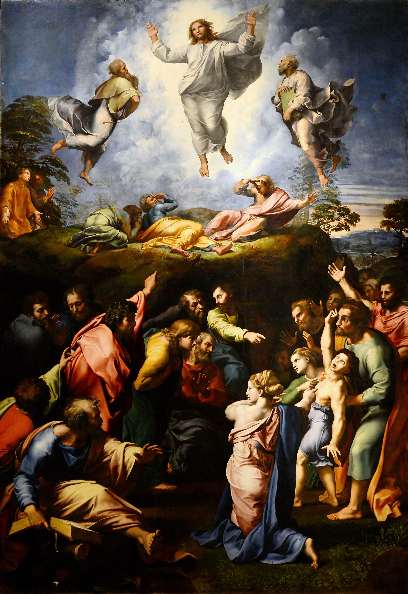

*Rafael Sanzio, Transfiguração, 1516–1520. Pinacoteca Vaticana.*

A última grande obra de Rafael é um quadro dividido ao meio. Na parte de cima, Cristo se eleva numa nuvem de luz, entre Moisés e Elias. Na de baixo, na sombra, há um tumulto: um menino possuído se contorce, a família implora, os discípulos discutem, folheiam um livro e apontam em todas as direções, e ninguém consegue curar o menino. No meio da confusão, alguns apontam para cima.

Rafael pôs no mesmo quadro duas leituras do mundo. Embaixo estão a matéria em desordem, a dor sem explicação e o barulho de muitas vozes; em cima, uma ordem luminosa que quase ninguém, embaixo, vê. Entre as duas não há muro, só a direção do olhar. Levada a sério, a insatisfação se parece com a mão de quem, no meio do tumulto, aponta para o alto.

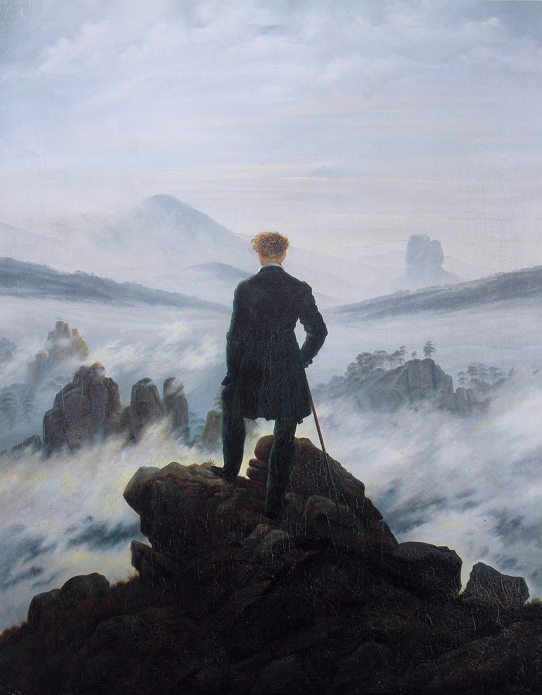

*Caspar David Friedrich, Caminhante sobre o mar de névoa, c. 1818. Kunsthalle, Hamburgo.*

E há quem se levante. Caspar David Friedrich pintou um homem de costas no alto de um rochedo, apoiado numa bengala, diante de um mar de névoa de onde emergem picos de montanhas. Ele não vê o fundo do vale nem o horizonte e não sabe tudo o que há ali, mas saiu da caverna, subiu acima da cidade e está de pé diante do desconhecido, olhando.

Não sabemos para onde ele vai, só que se levantou.

A era adâmica, portanto, é um problema a ser investigado, e não uma condenação.

Quando a insatisfação vira pergunta, o homem começa a se mover. Vira a cabeça na caverna e passa a buscar compreender aquilo que os olhos não podem enxergar. Essa busca é tão antiga quanto as perguntas que a provocam e atravessou religiões, filosofias, ciências e civilizações inteiras.

É ela que seguiremos a partir daqui.
