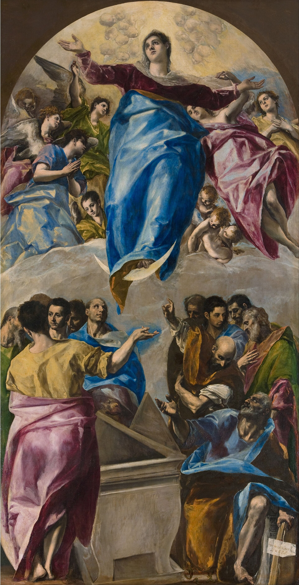

# 7. A Superação Adâmica

> "E conhecereis a verdade, e a verdade vos libertará."
> — João 8:32

> Apegue-se aos eventos, não aos indivíduos.
> Apegue-se aos eternos, não aos mutáveis.
> — Laércio Germano

---

## Um homem de braços abertos

No primeiro capítulo havia um homem ajoelhado que recebia nas mãos uma centelha. No segundo, um homem de pé num rochedo segurava uma lanterna, e o fio de luz que saía dela atravessava os símbolos de muitas civilizações até chegar a um livro aberto que ninguém conseguia ler. A imagem que abre este capítulo volta ao rochedo uma última vez.

É noite de novo. O homem está de pé na pedra, à beira da água, com os braços abertos e o rosto voltado para cima. Não segura mais nada. A luz agora sai do peito dele. Dali parte um fio dourado que sobe, ondula pelo céu e vai até o outro lado da cena, onde há uma figura geométrica acesa, presa numa grade de linhas finas e pontos de luz. É a mesma geometria que flutuava apagada no céu rachado do primeiro banner e escondida nos cantos do segundo. Desta vez ela está inteira, e brilha.

Debaixo dela cresce uma árvore. Os galhos são de luz, as raízes descem para a terra, e a água embaixo reflete tudo de cabeça para baixo, a árvore e a geometria juntas.

Aos pés do homem, no chão, há três máscaras. Estão viradas para o céu, vazias. Ninguém as usa mais.

Este capítulo é sobre o que separa esse homem do homem ajoelhado do começo. Nada mudou no mundo em volta dele: a noite é a mesma, o rochedo é o mesmo, a matéria continua ali. O que mudou foi a leitura. Ele aprendeu as letras. E, ao aprendê-las, descobriu que a luz que procurava lá fora vinha do mesmo lugar de onde sai o fio.

Chamamos essa passagem de superação adâmica. O homem encarnado continua encarnado, mas deixa de ser prisioneiro da carne, porque passa a ler o que antes só sentia.

---

## A mesma chave em quatro portas

Ao longo deste livro, quatro problemas pareceram andar separados.

Havia o problema da existência: por que sofremos, por que repetimos, o que há depois da morte. Havia o problema da filosofia: a metafísica em aberto, o embate entre Parmênides e Heráclito, a substância de Aristóteles. Havia o problema do espírito: um Deus que ou virou senhor de barba nas nuvens ou desapareceu. E havia, num canto onde ninguém o procuraria, o problema do software: sistemas caros, frágeis, difíceis de manter, construídos sobre objetos que não param de se embaraçar uns nos outros.

O capítulo 4 mostrou que os quatro têm a mesma raiz. Todos tropeçam na linguagem. Todos confundem o que muda com o que não muda. Todos colam o verbo ao objeto, como Aristóteles colou a forma à matéria. E, por isso, a mesma chave abre as quatro portas: resolver a linguagem, entender a estrutura do real que ela descreve, e deixar que essa compreensão liberte.

O capítulo 6 entregou essa chave na forma de um alfabeto. Ser e devir, movimento e estado, verbo e objeto, abstrato e sólido, eterno e mutável. A menor unidade da realidade é a história: um estado inicial, um movimento, um estado final. O verbo é eterno; os estados que ele atravessa passam. Deus é o Verbo, a ordem entre os movimentos, o Logos de Heráclito e de João.

Falta agora o que todo alfabeto pede: usar. Uma criança que decorou as letras ainda não sabe ler. Sabe quando começa a juntar as letras e ver, de repente, a palavra que estava ali. Este capítulo é esse momento, aplicado à vida, ao código e à conduta.

---

## Da torre ao rio

O homem adâmico vê o mundo de pé, como uma pilha de coisas. Cada coisa tem nome, contorno e lugar. Em cima delas, outras coisas maiores: a família, a empresa, o país. Em cima de todas, se houver alguma, uma coisa máxima chamada Deus. É uma visão vertical, feita de caixas dentro de caixas, e cada caixa guarda o que ela "é". A cidade do primeiro banner, com suas torres e muralhas, é o retrato dessa leitura.

A superação adâmica deita essa torre. Em vez de perguntar o que cada coisa é, passa a perguntar o que está acontecendo. A mesa deixa de ser uma substância com essência de mesa e passa a ser um estado: madeira que foi árvore, que foi cortada, que foi montada, que um dia vai virar lenha. O vizinho deixa de ser um objeto com nome e defeitos e passa a ser alguém atravessando uma história, que talvez seja a mesma que você atravessou no ano passado. O mundo deixa de ser um inventário e passa a ser um rio.

Heráclito já tinha dito que não se entra duas vezes no mesmo rio. Mas o rio tem leito. A água muda o tempo todo; o curso por onde ela passa obedece a uma ordem. A leitura horizontal não dissolve o mundo em caos. Ela troca o centro de gravidade: o que permanece deixa de ser a coisa e passa a ser o percurso.

Hermann Hesse contou essa passagem num romance curto. Em *Sidarta*, de 1922, um jovem brâmane abandona a casa do pai, vive com ascetas, conhece o Buda, enriquece na cidade, se perde no luxo e, no fim, vai trabalhar como barqueiro à beira de um rio. É o rio que lhe ensina o que nenhum mestre ensinou. A água está em todo lugar ao mesmo tempo, na nascente e na foz, na cachoeira e no mar, e para ela só existe o presente. O rio muda a cada instante e é sempre o rio. Sidarta não sai do mundo para encontrar o eterno. Encontra-o olhando para o que passa.

Na linguagem dos programadores, é a passagem de um mundo orientado a objetos para um mundo orientado a fluxos. Na linguagem deste livro, é a passagem da substância para a história.

---

## O mesmo roteiro, outro elenco

Volto ao painel de Ghiberti que o capítulo 4 mostrou, nas portas que Michelangelo teria chamado de portas do Paraíso.

Neste, várias cenas acontecem ao mesmo tempo, sob as mesmas arcadas. No alto, Rebeca recebe de Deus a notícia de que carrega no ventre dois povos e de que o mais velho servirá ao mais novo. Mais abaixo, Esaú, o primogênito, sai para caçar com o arco ao ombro. Em primeiro plano, à direita, o velho Isaac, já cego, estende a mão e abençoa um filho ajoelhado. Não é Esaú. É Jacó, o mais novo, coberto com peles de cabrito para que o pai, ao tocá-lo, sinta os braços peludos do irmão. A bênção do primogênito vai para quem ocupa o lugar do primogênito.

Quem lê o Gênesis inteiro percebe que essa história não acontece uma vez só. Abel, o mais novo, agrada a Deus mais que Caim. Isaac herda no lugar de Ismael. Jacó recebe a bênção no lugar de Esaú. Anos depois, já velho e quase cego como o pai, Jacó cruza os braços para abençoar os netos e põe a mão direita sobre Efraim, o mais novo, e não sobre Manassés. José, o penúltimo filho, governa os irmãos mais velhos. Davi, o caçula que pastoreava ovelhas, é escolhido rei. É o mesmo roteiro, contado com outros nomes, em outros séculos. Jesus o resumiu numa frase: os últimos serão os primeiros.

É isso que o capítulo 6 chamou de padrão. As histórias, ou seja, os verbos, são eternas. Os personagens são mutáveis. Uma música pode ser tocada no piano, no violão ou assobiada, e continua sendo a mesma música, porque o que a define é a relação entre as notas, não as notas. Um filme pode ser refilmado com outro elenco, outra roupa, outro século, e continua sendo a mesma história.

Os estudiosos das narrativas chegaram a essa conclusão por conta própria. Em 1928, o russo Vladimir Propp analisou uma centena de contos populares e mostrou que, por baixo dos nomes, das bruxas, dos czares e dos animais falantes, todos eram montados com as mesmas trinta e uma funções, numa ordem fixa: a proibição, a transgressão, a partida, o encontro com o doador, a prova, o retorno. Os personagens mudavam de um conto para o outro. As funções, não. Em 1949, o americano Joseph Campbell foi mais longe em *O Herói de Mil Faces*. Comparou mitos do mundo inteiro e encontrou neles uma única jornada, que chamou de monomito: o chamado, a recusa, a travessia do limiar, as provas, a morte simbólica, o retorno com o que foi encontrado. Mil faces, um só herói.

*A Viagem*, o filme de 2012 baseado no romance *Atlas de Nuvens*, de David Mitchell, levou essa ideia para o elenco. Seis histórias, do século XIX a um futuro distante, são vividas pelos mesmos atores, que trocam de rosto, de idade, de sexo e de época, e reencontram em cada vida os mesmos laços e os mesmos conflitos.

Escrevi uma vez, num caderno público, um parágrafo que resume esta seção melhor do que eu conseguiria agora: "Você não possui um espírito. Espíritos são personagens de histórias já escritas. Você é o ator que decide qual personagem irá interpretar. Nenhuma experiência é particular. Escolha bem seus papéis, pois cada um deles já carrega o seu próprio fim. Bem-vindo ao mundo espiritual."

Daí vem uma consequência que, à primeira vista, assusta. Tudo o que aconteceu vai acontecer de novo. O que nunca aconteceu não vai acontecer. Não no detalhe, porque os figurinos mudam, mas na estrutura. A traição, a reconciliação, a ruína pelo excesso, o reerguimento pela persistência, o amor que vira posse e a posse que vira tédio: tudo isso já foi encenado milhões de vezes e será encenado outros milhões.

E daí vem outra, que alivia. Se a identidade está na história e não no personagem, então você não é obrigado a ser quem sempre foi. O personagem é só o elenco da vez. Uma fotografia isolada não revela a história; quem observa por tempo suficiente começa a ver o padrão. E quem vê o padrão antevê o que vem.

---

## O software que não envelhece

Volto aqui ao meu ofício, porque foi por ele que cheguei até aqui.

Durante anos procurei uma pergunta que parecia técnica: existe uma forma de construir software que não precise ser refeita a cada mudança de tecnologia? Os sistemas que eu conhecia envelheciam rápido. Trocava-se o banco de dados, e metade do código precisava ser reescrita. Trocava-se a linguagem, e tudo recomeçava do zero. Uma regra de negócio simples ficava espalhada em dez lugares, misturada com detalhes de tela, de rede, de armazenamento. Estima-se que a maior parte do custo de um software, algo em torno de oitenta por cento, vá para a manutenção. Para mim, isso era sinal de que estávamos modelando a coisa errada.

A resposta que encontrei é a mesma deste livro. É possível construir sistemas sobre regras que não dependem do hardware, do sistema operacional, da linguagem, do paradigma ou do projeto. Basta separar o que é imutável do que é mutável. Aquilo que é eterno, por definição, não sofre mutações. Se o separamos do resto, ele fica protegido de todas as mudanças futuras. O custo cai, o tempo de desenvolvimento cai, a manutenção encurta, e a qualidade sobe.

Na prática, isso começa por reconhecer de que é feito um software. Ele é feito de duas coisas: função e dado. A função é a unidade de mudança de estado, o verbo. O dado é a unidade de informação, o estado. A programação orientada a objetos, como o capítulo 5 mostrou, cola as duas dentro de uma mesma classe, como Aristóteles colou forma e matéria na substância. O cliente "sabe" se cadastrar, o pedido "sabe" se pagar, o barbeiro "sabe" barbear a si mesmo, e o sistema acaba preso nos mesmos paradoxos que a filosofia levou séculos para perceber.

Quando se separam as duas coisas, aparece uma terceira, que estava escondida: o roteiro. A ordem em que os verbos acontecem. O Logos do sistema.

Pense numa entrega. Algo sai de uma origem, passa por um trânsito e chega a um destino. Pode ser uma pizza, uma encomenda, uma mensagem de texto, um arquivo copiado de uma pasta para outra, um valor transferido de uma conta para outra. Os objetos mudam completamente. O roteiro é o mesmo: estado inicial, movimento, estado final, com as mesmas falhas possíveis no meio do caminho. Quem escreve esse roteiro uma vez, separado dos objetos, pode reutilizá-lo em todos os domínios onde a mesma história acontece. Quem o escreve dentro de cada objeto precisa escrevê-lo de novo para a pizza, para a encomenda, para a mensagem, e corrigi-lo em cada lugar quando descobre um erro.

Daí saem algumas regras, que valem para qualquer projeto:

- separar os roteiros dos objetos, porque o fluxo vem antes do objeto;
- fazer os verbos dependerem de espaços abstratos, e não de instâncias concretas, como o insight dos sólidos e abstratos ensinou no capítulo 4;
- montar um catálogo de histórias reutilizáveis, porque o mesmo verbo serve a muitos domínios;
- usar uma linguagem única para nomear as coisas, sem dois nomes para o mesmo conceito nem o mesmo nome para dois conceitos.

Foi isso que chamei de Flow. É um modo de desenvolver que olha a ordem dos eventos antes de olhar os objetos, que torna os componentes homogêneos e as camadas substituíveis, e que elimina conceitos redundantes até sobrar uma forma só de fazer as coisas. Não é a tese deste livro, é uma aplicação dela. O livro do Flow trata disso em detalhe.

Os conceitos do Flow cabem em poucas linhas, e o apêndice B os reúne. Tudo é dado ou função. Cada coisa no sistema tem um endereço: concreto, quando aponta para uma implementação; abstrato, quando aponta para um espaço. Endereços que se conhecem pertencem à mesma camada; os que não se conhecem estão em camadas diferentes. As entradas de uma função formam o seu contexto e funcionam como injeção de dependência: qualquer coisa que caiba no espaço pode ocupá-lo. Uma camada é uma unidade substituível. A execução acontece quando a camada está completa, isto é, quando todos os seus espaços foram preenchidos, como o verbo cair acontece quando há massa, altura e nada que sustente. E uma camada com o contexto completo passa a ser contexto para outra. É o colapso do movimento do capítulo 6 escrito em código.

O arquiteto Christopher Alexander viu algo parecido na construção de casas e cidades. Em *Uma Linguagem de Padrões*, de 1977, descreveu duzentos e cinquenta e três padrões, da escala de uma região à de um banco junto à janela, que se repetem nos lugares onde as pessoas se sentem vivas. Os padrões não são plantas prontas. São problemas que se repetem e a forma das soluções que funcionam, independentes dos tijolos de cada obra. Os programadores leram Alexander, e foi dele que veio a ideia dos padrões de projeto. Mas guardaram os padrões e esqueceram a lição: o que dura é a forma da história, não o material.

No mundo onde tudo é passageiro, quem busca permanência sem se transformar está fadado à ruína. O software que não envelhece não é o que nunca muda. É o que separou o que muda do que não muda.

O que importa aqui é a conclusão a que essa busca me levou. Desenvolver software é a arte de contar histórias. Bons programadores são bons roteiristas, roteiristas de autômatos. E, para ser um bom roteirista, é preciso conhecer as histórias que já existem, saber de que o mundo é feito, ajustar a lente com que se olha para ele. Para construir um bom software, é preciso conhecer filosofia. Isso nunca foi ensinado nas faculdades de computação, e é por isso que a mesma dor se repete em quase todas as empresas.

O programador que entende isso passa a ver no código o que este livro vê na vida. E quem aprendeu a ver na vida começa a entender por que o código dói.

---

## A roda e o papel

Volto à roda da Fortuna do *Carmina Burana*, que apareceu no capítulo 3. No centro, sentada, coroada, está a Fortuna. Ela segura os raios e gira. Em volta da roda, quatro figuras ocupam quatro posições, e cada uma tem uma palavra em latim ao lado. À esquerda, um homem sobe agarrado à borda: *regnabo*, "reinarei". No alto, um rei sentado no trono, com cetro na mão: *regno*, "reino". À direita, o mesmo rei despenca de cabeça para baixo, perdendo a coroa: *regnavi*, "reinei". Embaixo, esmagado sob a roda, um homem caído: *sum sine regno*, "estou sem reino".

As quatro figuras não são quatro pessoas. São quatro momentos do mesmo papel. Quem está embaixo vai subir; quem está no alto vai cair. A roda não para, e os homens trocam de lugar sem jamais sair dela. É o inferno cíclico do capítulo 3 desenhado num só círculo: desejar o que não se tem, possuir, enjoar, perder, desejar de novo.

O que a iluminura não mostra é que existe alguém fora da roda. Não a Fortuna, que também está presa ao eixo, mas quem olha a página. Do lado de cá, o leitor vê as quatro posições ao mesmo tempo. Sabe o que vem depois de *regno*. Não se espanta com a queda, porque conhece o desenho.

Essa é a diferença entre o ator e o autor.

O ator recebe um papel já escrito e o encena. Não sabe que é um papel. Acha que a raiva que sente é sua, que o desejo é seu, que a queda é uma injustiça pessoal. Repete a história como a recebeu, e por isso carrega todas as consequências dela. O capítulo 3 chamou isso de carregar o carma dos personagens. O futuro, para ele, é o passado encenado por outros atores.

O autor conhece as histórias. Reconhece nos atores à sua volta os personagens que eles estão vivendo, e reconhece em si mesmo o personagem que vinha vivendo sem perceber. E, porque conhece o roteiro, pode escolher outro. Escolher o papel interrompe o ciclo.

---

## O autor

Volto uma última vez ao homem de Blake que o capítulo 4 mostrou entrando por uma porta de pedra, na primeira prancha de *Jerusalem*, com um globo de luz na mão.

O homem se chama Los. Na mitologia que Blake inventou, Los é o ferreiro e o poeta, a imaginação criadora, aquele que constrói a cidade da arte enquanto o gigante Albion, que representa a humanidade inteira, dorme o sono da separação. O livro todo conta o esforço de Los para acordar Albion, isto é, para que os homens divididos se reconheçam como um corpo só.

Los não é o personagem de uma história. É quem entra na história com a própria luz para escrevê-la.

Borges contou o caminho inverso num conto de 1940. Em *As ruínas circulares*, um homem chega a um templo em ruínas com um único propósito: sonhar um outro homem, inteiro, e inseri-lo na realidade. Depois de muitas noites, consegue. No fim, quando o fogo toma o templo e não o queima, ele compreende que também é uma aparência, que outro o está sonhando. O conto dá vertigem porque não tem fundo: todo autor é personagem de alguém. Este livro sugere outra leitura. Num certo nível, o sonhador e o sonhado são o mesmo verbo.

O banner deste capítulo mostra a mesma coisa de outro jeito. O homem do rochedo não segura a luz. Ela sai do peito. O que ele carrega não é um objeto que possa perder; é aquilo que ele é.

Você não é o ator. Você também não é a mente que pensa por você o dia inteiro, que comenta, reclama, deseja e se defende. A mente é parte do personagem. Pensamentos vêm e vão como estados. O que permanece enquanto eles passam é quem os observa: uma consciência que não envelhece com o corpo, que assiste ao personagem sem se confundir com ele. Os herméticos chamavam de transmutação mental a capacidade de mudar o estado da mente a partir desse lugar. Os orientais chamavam esse lugar de testemunha. Krishna disse a Arjuna que aquilo que somos de verdade não nasce e não morre.

Uma forma de dizer isso é contar os sentidos de outro modo. Os cinco que todos conhecem recebem o mundo material. A mente seria um sexto: reúne estados, crenças, lembranças e abstrações, e por isso pode ser contaminada, como qualquer sentido pode ser enganado. O observador seria um sétimo, e não se parece com nenhum dos outros. Ele não recebe nada. Apenas vê o que os outros seis trazem. É puro porque não guarda estado, e é por ele que o homem se liga ao que não muda.

É a partir daí que se escreve. Quem observa o personagem pode decidir o que ele vai fazer. Quem só é o personagem, não.

Como imagem e semelhança de Deus, o papel do homem é ordenar. Escrever a própria história começa por coisas pequenas. Uma delas é dizer, com cuidado, o que se é: eu sou amado, eu sou capaz, eu sou próspero, eu sou bondoso. Não por mágica, mas porque o estado em que alguém se define convida os movimentos que combinam com ele. Outra é trocar a voz da mente, que fala em fila, uma palavra depois da outra, por imagens: ver a cena que se quer viver, inteira, de uma vez, como os visitantes de *A Chegada* escrevem. A voz descreve; a imagem mostra o roteiro. Defina-se para que não seja definido.

Isso é o que as tradições chamaram de morte do ego. Não é a destruição de alguém. É o fim de uma confusão: a de achar que o figurino é o corpo, que a máscara é o rosto. As máscaras do banner estão no chão porque o homem descobriu que eram máscaras.

---

## A armadilha da perfeição

Há um risco nesse ponto, e quase todos que chegam até aqui caem nele.

Quem vislumbra pela primeira vez a estrutura eterna se fascina. Tudo parece encaixar. As religiões, os filósofos, o código, a própria vida passam a fazer sentido de uma vez. E, com o fascínio, vem um sentimento discreto, quase imperceptível no começo: o de estar acima. De ter visto o que os outros não viram. De ter saído da caverna enquanto os outros continuam olhando sombras.

Daí ao julgamento é um passo. O que acabou de sair da caverna olha para trás e despreza os que ficaram. Chama-os de adormecidos, de autômatos, de presos na matéria. Corrige, aponta, se irrita com a cegueira alheia. E, sem perceber, cai de novo. É uma nova queda, agora pelo orgulho, e talvez mais funda que a primeira, porque vem disfarçada de iluminação.

As tradições conhecem bem essa história. O anjo mais luminoso cai justamente por se achar luminoso demais. O fariseu da parábola agradece a Deus por não ser como o publicano, e é o publicano que volta para casa justificado. Platão já tinha previsto o problema: no fim da alegoria da caverna, o que volta para libertar os outros é recebido com riso e, se insistir, com violência. Quem se sente superior aos prisioneiros não volta para buscá-los. Volta para humilhá-los.

A perfeição, quando vira posse, é só mais um objeto. E todo objeto, como este livro mostrou, é estado: passa.

Quem quer tudo perfeito para este mundo não foi feito.

---

## O mundo do acoplamento

A saída da armadilha está no próprio alfabeto.

Se o espírito é um só, se o capítulo 6 tem razão em dizer que há uma única consciência isomórfica vivendo em todos os personagens, então não existe "o outro" no sentido em que o homem adâmico o imagina. Aquele que você julga está vivendo uma história que você já viveu, ou vai viver, ou viveria se estivesse no lugar dele, com o mesmo corpo, a mesma infância, a mesma crença herdada. Todos somos um. Ao condenar o próximo, condenamo-nos a nós mesmos.

E todos somos imperfeitos. Não por acidente, mas porque este é o mundo do acoplamento. Encarnar é exatamente acoplar: o espírito ao corpo, o verbo ao objeto, o eterno ao transitório. Enquanto houver carne, haverá fome, cansaço, impulso, medo. Não há como viver neste mundo sem pagar o preço de estar nele.

Platão tem outra imagem para isso, menos famosa que a da caverna. No *Fedro*, ele compara a alma a um cocheiro conduzindo uma carruagem alada puxada por dois cavalos. Um deles é nobre e obedece à rédea. O outro é rebelde, puxa para baixo, quer tudo o que vê. O cocheiro não pode soltar nenhum dos dois, porque precisa de ambos para andar. A arte está em segurar as rédeas.

O cristianismo pôs no centro da sua fé uma imagem ainda mais dura: o Verbo que se fez carne termina pregado numa cruz. Lida como símbolo, a crucificação mostra o custo de o eterno habitar o mutável. Nem mesmo o mais puro passou por aqui sem sangrar.

Daí não se segue a resignação. Segue-se outra postura, mais humilde e mais prática. Já que a imperfeição é o terreno, o trabalho é reduzir danos. Perdoar a imperfeição alheia, porque é a mesma que a nossa. Ter misericórdia. E honrar, sem inveja e sem idolatria, aqueles que conseguem se aproximar da pureza, porque mostram que o caminho é possível.

A perfeição não é um resultado que se alcança e se guarda. É um verbo: o ato de aperfeiçoar. Como todo verbo, ela é eterna. Como todo estado, o que ela produz passa, e precisa ser refeito.

---

## Nem tanto, nem tão pouco

O Homem Vitruviano, que o capítulo 5 mostrou, tem dois corpos sobrepostos. Num deles, os braços estão abertos na horizontal e as pernas juntas; no outro, os braços se erguem um pouco e as pernas se afastam. Na primeira posição, o corpo cabe num quadrado. Na segunda, num círculo, com o umbigo no centro. Acima e abaixo do desenho, Leonardo anotou, com a sua escrita espelhada, as proporções que o arquiteto romano Vitrúvio tinha descrito: a altura de um homem é igual à envergadura dos seus braços, o rosto mede tanto, o pé mede tanto.

Na tradição que Leonardo herdou, o quadrado era a terra e o círculo era o céu. O desenho mostra o mesmo homem inscrito nos dois. Não está só no quadrado, preso à medida da matéria, nem só no círculo, perdido no infinito. Está nos dois ao mesmo tempo, e só muda a posição dos braços.

É uma boa imagem para o equilíbrio que a superação adâmica pede. Entre a armadilha da perfeição e a resignação diante da imperfeição, entre o homem que só conhece a matéria e o que despreza o corpo como fizeram alguns gnósticos, há uma medida. Nem tanto, nem tão pouco. Todo excesso é uma falta: o excesso de comida é falta de fome verdadeira, o excesso de palavras é falta de assunto, o excesso de espiritualidade abstrata é falta de chão.

Nem tanto, nem tão pouco. Entre um e o outro. O equilíbrio é a morte do pêndulo do capítulo 3: a superação do desejo de ter e do tédio de possuir.

Dominar a metafísica não é fugir da matéria. É saber como ela funciona para conduzi-la melhor, como o cocheiro de Platão, como quem conhece a máquina antes de pilotá-la. A transcendência da matéria não a nega. Coloca-a no lugar dela.

Esse domínio muda a relação com o ciclo de desejo e tédio. O capítulo 3 mostrou que o desejo nasce da falta, se realiza na posse, morre no hábito e renasce no tédio. A superação não consiste em parar de desejar, o que seria só mais um desejo. Consiste em acompanhar as fases sabendo que são fases. A alegria vem e vai. A tristeza vem e vai. Quem sabe disso não se agarra a uma nem se afoga na outra. O estado passa; o verbo permanece. A mosca que volta sempre à mesma janela é livre no instante em que lembra.

E o lugar onde isso acontece é sempre o mesmo: agora. O passado é estado que já foi; o futuro é estado que ainda não é. O verbo só acontece no presente. A eternidade não está no fim da linha do tempo, esperando depois da morte. Ela se toca no presente, a cada movimento. O Éden de onde fomos expulsos no capítulo 1 não ficou para trás num jardim perdido. É um estado de leitura, e pode ser reaberto por dentro.

---

## Um só mandamento

Se tudo é um, e se o que está em cima é como o que está embaixo, então a conduta deixa de ser uma lista de proibições e passa a ser uma consequência lógica. O princípio da correspondência, que o capítulo 6 apresentou, vale também para dentro e para fora: assim como dentro, fora.

Por isso, no fundo, há um só mandamento: enxergar o outro como a si mesmo. Os outros mandamentos derivam desse. Jesus, perguntado sobre o maior, respondeu com dois que são um: amar a Deus e amar o próximo como a si mesmo. Hillel, um rabino um pouco mais velho, desafiado a resumir a Torá inteira enquanto o interlocutor se equilibrava num pé só, disse: "O que é odioso para ti, não faças ao teu próximo. Isso é toda a Torá. O resto é comentário."

Escrevi esse mandamento, uma vez, de modo mais seco: reconheça o próximo como a si mesmo. Não se trata só de amar. Trata-se de reconhecer, no sentido de conhecer de novo, de ver no outro o que já se conhece em si.

O filósofo Martin Buber escreveu em 1923 um livro pequeno sobre isso, *Eu e Tu*. Há, segundo ele, duas atitudes possíveis diante de qualquer coisa ou pessoa. Na relação Eu–Isso, o outro é um objeto: algo que se usa, se mede, se classifica. Na relação Eu–Tu, o outro é encontrado por inteiro, sem ser reduzido aos seus atributos. Buber não falava de Aristóteles, mas descreveu com precisão o que a ontologia da substância faz com as pessoas: transforma cada Tu num Isso.

Aplicada ao dia a dia, a correspondência vira algumas regras simples, difíceis de cumprir:

- Nunca agir com raiva. Nunca reagir. Nunca se explicar além do necessário.
- Falar o indispensável. Não falar dos outros: quem fala de alguém para você falará de você para alguém.
- Lidar com situações, e não com pessoas. O homem que o ofende está vivendo uma história de ofensa; responder a ele é entrar na história, responder à situação é sair dela.
- Tratar todos como se estivessem sofrendo, porque quase sempre estão.
- Agir sem estado. Os programadores chamam de *stateless* um componente que responde da mesma forma independentemente do que aconteceu antes. As suas atitudes não devem depender das suas emoções do momento.
- Saber por que se deseja. O desejo é medo do oposto: quem deseja muito ser rico tem medo de ser pobre. Pense também no que você não quer ser.

Os estoicos sabiam disso. Epicteto, que foi escravo antes de ser filósofo, ensinava que não são as coisas que perturbam os homens, e sim os juízos que eles fazem sobre as coisas. A tradição tira daí uma consequência dura: quem se irrita com os outros é escravo deles. Basta que alguém faça uma coisa para que ele reaja da forma prevista. É um autômato, e quem conhece o roteiro sabe exatamente em que botão apertar.

Há também um ciclo a quebrar, talvez o mais silencioso de todos. A forma como você se vê define como você se sente. Como você se sente define como se comporta. Como se comporta define como os outros o veem. Como o veem define como o tratam. E como o tratam confirma a forma como você se vê. O ciclo se fecha e gira sozinho por anos. A única porta de entrada que está ao seu alcance é a primeira. Defina-se antes que o mundo o defina.

Os tradicionalistas chamam algumas dessas atitudes de fraqueza. A lógica de Deus costuma ser inversa à lógica do mundo. O pequeno é grande. O humilde é o primeiro. A renúncia pode ser vitória, e o desconforto pode ser o caminho da felicidade. Olho por olho, diz um ditado, e o mundo acaba cego. A vingança real é perdoar, porque o perdão é a única ação que tira o ofendido da história do ofensor.

A matemática chegou a uma conclusão parecida por outro caminho. No início dos anos 1980, o cientista político Robert Axelrod organizou torneios entre programas de computador que jogavam, centenas de vezes seguidas, um jogo em que cada lado podia cooperar ou trair. Venceu uma estratégia simples, chamada olho por olho: cooperar primeiro e depois repetir o que o outro fez. Mas estudos posteriores mostraram que, num mundo com ruído, onde às vezes um gesto é mal interpretado, o olho por olho estrito prende os jogadores em ciclos intermináveis de retaliação. Vence quem perdoa de vez em quando. É o inferno cíclico do capítulo 3 em forma de tabela. Quem joga só para si ganha uma rodada. Quem joga pelo jogo inteiro, por si e pelos outros, ganha a partida.

Que a tua palavra seja o teu comportamento. Que o teu comportamento seja a tua palavra. Palavra, aqui, quer dizer verbo: o que você faz é o que você diz que é.

---

## Plantio

Nada disso funciona como ideia. Funciona como prática.

Sem essa prática, a vida se parece com uma escada rolante que desce. É preciso subir só para ficar no mesmo lugar, e quem para de subir é levado para baixo sem perceber. A consciência sem ordem vive como numa montanha-russa: sobe por esforço, cai por cansaço, sobe de novo. Com uma ordem, a subida pode ser contínua e lenta, como a de quem planta.

A árvore do banner não nasceu pronta. Para que uma floresta cresça, a natureza lança milhões de sementes, e a maior parte não vinga. Cada ato humano é uma dessas sementes. Jesus contou a parábola de um semeador que espalha grãos: uns caem à beira do caminho e os pássaros comem, outros caem entre pedras e secam, outros entre espinhos e são sufocados, e alguns caem em terra boa e dão fruto. A semente é a mesma. O que muda é o terreno.

Preparar o terreno é o trabalho de todos os dias. Algumas coisas ajudam.

Ter um plano, ver o plano e seguir o plano. Escrever ou desenhar o que se quer, como num diário de fluxo, em que cada dia registra o estado de onde se parte, o movimento que se pretende e o estado aonde se quer chegar. Partir de onde se parou, e não do zero a cada manhã.

Ferramentas simples ajudam. Quatro perguntas que os gerentes de projeto conhecem: quem, o quê, quando e por quê. Um cronograma desenhado numa folha, com o que vem antes e o que vem depois. Quem não sabe para onde vai, qualquer caminho serve.

Configurar o ambiente. O estado define o próximo movimento: quem tem doce em casa come doce, quem dorme com o telefone na mão acorda com ele. Selecionar o que se vê, o que se ouve, o que se fala, o que se pensa e o que se come. Mudar o ambiente é mudar as condições iniciais da história.

Escolher o que pensar. A mente vai oferecer, o dia inteiro, pensamentos que não foram pedidos. Não é preciso aceitar todos. Em tudo aquilo em que se foca, cresce. E todo acoplamento, todo excesso, cedo ou tarde, cobra o seu preço.

A felicidade, aliás, costuma ser mais simples do que o desejo promete. Um banho quente, um café, uma conversa sem pressa, uma história conhecida que devolve o ânimo. Felicidade, muitas vezes, é só não estar preocupado. Infeliz o homem que não enxerga no comum o extraordinário e passa a vida buscando o extraordinário, que logo volta a ser comum.

Reservar tempo para lembrar. Nem que sejam vinte minutos por dia. Lembrar é o que tira a mosca do ciclo. Sem memória, o inferno é eterno; com ela, cada volta da roda é uma chance de sair.

Simone Weil, a filósofa francesa que morreu em 1943, aos trinta e quatro anos, escreveu que a atenção, no seu grau mais alto, é a mesma coisa que a oração. Rezar, nesse sentido, não é pedir. É prestar atenção à boa história e imaginá-la inteira, até que ela fique nítida. E Deus, quando se manifesta, raramente aparece como fenômeno. Aparece como sabedoria, como uma ideia que chega na hora certa, ou como uma alegria sem motivo aparente, que não se explica pelo que está acontecendo.

Entrar em estado de fluxo, eliminando o que não é essencial ao movimento que se quer. Ser, como diziam os antigos, uma esfera polida: sem arestas onde as coisas se prendam.

E pensar como se já fosse. Não por mágica, mas porque o estado convida o movimento correspondente. Quem se pensa atleta caminha diferente de quem se pensa doente. O que você procura, o universo evidencia; o que você é, o universo procura. Funciona como uma consulta numa base de dados: o resultado depende do critério que se usa para buscar.

Por fim, observar a natureza e colher dela as histórias, como quem separa o joio do trigo. A semente que morre para virar árvore. O rio que contorna a pedra em vez de brigar com ela. A estação que passa e volta. Aprendemos por reprodução: quem observa bem as histórias que já existem aprende a contar as próprias. E pode usar o verbo a favor de si e dos outros.

Não culpe a realidade. Há muita inteligência em cada resultado.

---

## Se você vivesse todas as vidas

Faça um experimento.

Imagine um jogo tão perfeito que fosse impossível distingui-lo da realidade. Nele, você controla todos os personagens. Não ao mesmo tempo: um depois do outro. Primeiro vive a vida de quem você é hoje, inteira, até o fim. Depois acorda na pele do seu vizinho e vive a vida dele, inteira. Depois na de quem o ofendeu na semana passada. Depois na do mendigo da esquina, na do rei, na do homem que sobe a roda e na do que está esmagado embaixo dela. Todas as vidas, uma a uma, sem pular nenhuma.

Se fosse assim, o que você faria diferente hoje?

Talvez não roubasse, porque seria você o roubado na próxima partida. Talvez não humilhasse, porque seria você o humilhado. Talvez ajudasse mais, porque seria você o ajudado. Talvez perdoasse com mais facilidade, porque entenderia por dentro a história de quem errou.

Este livro sustenta que esse jogo não é imaginário. Se há uma só consciência vivendo todos os personagens, então o experimento descreve, com uma imagem simples, o que o capítulo 6 descreveu com o alfabeto. O mandamento de ver o outro como a si deixa de ser um conselho moral. Passa a ser a leitura correta das regras do jogo.

Nenhuma experiência é particular. Seja honesto na sua intenção.

---

## As perguntas

*El Greco, Assunção da Virgem, 1577–1579. Art Institute of Chicago.*

No fim do primeiro capítulo havia uma lista de perguntas. Eram as mesmas que o homem faz desde que aprendeu a falar, e que nenhuma tradição conseguiu responder de um jeito que todos pudessem entender. Com o alfabeto em mãos, é possível voltar a elas.

Do que é constituída a realidade? De histórias. Cada história é um estado inicial, um movimento e um estado final. Os estados são mutáveis; os movimentos, eternos. O real é feito de eternos mutáveis.

Deus existe? Deus não existe do jeito que as coisas existem, como uma pedra, um planeta ou um senhor de barba sentado nas nuvens. Deus é. É o Verbo, o Logos, a ordem entre todos os movimentos, a mudança que não muda. Não é por acaso que, quando Moisés perguntou o seu nome, a resposta foi um verbo: eu sou o que sou.

Há outra realidade além desta? Há, mas não em outro lugar. O plano dos verbos divide o espaço com a matéria, como o três divide o espaço com as três maçãs. Ele está aqui, invisível aos olhos e acessível ao intelecto. É isso que as religiões chamam de mundo espiritual.

O que há após a morte? O personagem passa. A história continua. Permanece aquilo que não pode deixar de ser: o verbo, a consciência que observava o personagem e que é a mesma em todos eles.

Há eternidade? Há. Não como um tempo que não acaba, mas como aquilo que não muda enquanto tudo muda. E ela se toca no presente, porque é só no presente que o verbo acontece. As escolhas de agora tendem a se repetir; o presente define a eternidade de quem o vive.

Há céu e inferno? Há, aqui e agora, como estados de consciência. O inferno é o ciclo vivido às cegas, o ator repetindo os mesmos erros sem lembrar que já os cometeu. O céu é a harmonia com a ordem, a vida de quem lê o roteiro e escolhe o próprio papel.

O que sou? Não o corpo, que é estado. Não o personagem, que é elenco. Não a mente, que é parte do personagem. Você também é verbo: a consciência que atravessa os estados sem se confundir com eles. E, nesse nível, é o mesmo que todos os outros.

Para onde vou? Para onde a história que você escolhe leva. O estado define o próximo movimento, e você pode escolher o estado.

Qual é o sentido da vida? Lembrar. Compreender a estrutura e deixar de repetir o ciclo como um autômato. Passar de ator a autor.

O que é vida? É mudança de estado sob uma ordem que não muda. É o mutável dançando sobre o eterno.

E há uma pergunta que não estava na lista, mas que está por trás de todas: por que existe algo, e não o nada? Porque a unanimidade não se percebe. Um ponto branco só existe sobre o preto. Se tudo fosse uma coisa só, sem contraste, nada seria percebido, e o que não é percebido não existe para ninguém. O ser precisa do não ser para aparecer. A existência é o contraste.

E há uma razão mais funda. A realidade depende do eterno, e o eterno não tem a opção de não existir. Por isso a realidade também não tem.

El Greco pintou a resposta que as perguntas pedem sem dizer uma palavra. O quadro está dividido em dois, como a *Transfiguração* de Rafael que fechou o primeiro capítulo. Embaixo, os apóstolos se aglomeram em volta de um túmulo de pedra. Estão agitados, gesticulam, uns olham para dentro, outros para cima. O túmulo está vazio. Em cima, sobre uma lua crescente, cercada de anjos, uma mulher de manto azul sobe de braços abertos, com os olhos no alto.

É a mesma postura do homem do banner. E embaixo, no lugar das máscaras, um túmulo vazio. O que ficou para trás era só o que podia ficar.

---

## A geometria acesa

No banner, a luz sai do peito do homem, sobe, atravessa o céu e chega à geometria. É a figura que estava apagada no primeiro capítulo, que ninguém na cena olhava, e que estava incompleta, como dissemos então, não porque faltasse algo no céu, mas porque faltava algo em quem olhava: as letras para lê-la.

Agora ela está acesa. A luz que a acende vem do próprio homem. O fio liga o que está embaixo ao que está em cima, e a água reflete os dois. Assim em cima como embaixo.

Esse foi o percurso. O espírito encarnou e esqueceu de onde veio. Procurou respostas em todas as tradições e encontrou pedaços da mesma estrutura em cada uma. Sofreu por não entender, girando na roda como um autômato. Descobriu que havia um conhecimento capaz de libertar. Encontrou o erro que tinha colado o verbo ao objeto, na filosofia e no código. Aprendeu o alfabeto da dualidade. E, por fim, aprendeu a ler.

Ler não tira o homem do mundo. Ele continua no rochedo, na noite, à beira da mesma água. Continua com fome, com cansaço, com histórias para viver. Mas deixou as máscaras no chão. Sabe que é o mesmo que os outros. Sabe que o que muda passa e que o que não muda permanece. Sabe que é as duas coisas ao mesmo tempo.

Goethe escreveu, já velho, um poema sobre a mariposa que se lança na chama. Ele termina com versos que se traduzem mal: enquanto não tiveres isto, morre e torna-te, serás só um hóspede sombrio na terra escura. *Stirb und werde*. Morrer e tornar-se é o movimento de todo estado: deixar de ser o que se era para vir a ser o que se é. E T. S. Eliot, nos *Quatro Quartetos*, deixou os versos que talvez descrevam melhor o fim de um livro como este: não deixaremos de explorar, e o fim de toda a nossa exploração será chegar aonde começamos e conhecer o lugar pela primeira vez.

O homem do banner está no mesmo rochedo do primeiro capítulo. Conhece-o pela primeira vez.

Os antigos chamaram isso de gnose. Este livro chamou de alfabetização. João escreveu que a verdade liberta. Não como slogan: como estrutura.

Apaixone-se pelo que o tempo não pode tocar. Apaixone-se pelo que permanece mesmo quando tudo muda. No fim, tudo é espírito.

Somos eternos mutáveis.
