# 1. A Era Adâmica

*Thomas Cole, Expulsão do Jardim do Éden, 1828. Museum of Fine Arts, Boston.*

> "E formou o Senhor Deus o homem do pó da terra, e soprou em suas narinas o fôlego da vida; e o homem foi feito alma vivente."
> — Gênesis 2:7

---

## O portão de luz

No centro da imagem que abre este capítulo há uma muralha de rocha, e na rocha um portão por onde a luz sai como uma enchente. Do lado de lá, à direita, está o jardim, com palmeiras, árvores carregadas, um lago parado e montanhas azuladas sob um céu dourado de fim de tarde. Do lado de cá, à esquerda, começa o mundo, com um vulcão em erupção, nuvens de tempestade, cachoeiras que caem no escuro, uma árvore morta torcida pelo vento e, sobre as pedras, um lobo debruçado sobre uma presa. Thomas Cole pintou a cena em 1828 e lhe deu o nome de *Expulsão do Jardim do Éden*.

É preciso procurar para encontrar os personagens. São dois corpos nus, pequenos, quase perdidos na paisagem, que acabam de cruzar o portão e caminham de costas para a luz, rumo à tempestade. A luz que sai do jardim ainda os alcança pelas costas e desenha a sombra deles no chão. Nenhum dos dois se vira. Entre os dois mundos há um abismo, com água caindo no escuro. E ao fundo, à direita, o jardim continua aceso. Ninguém o apagou; apenas deixaram de olhar para ele.

Este capítulo é sobre esse homem. Mais do que personagem de um mito antigo, esse homem somos nós e quase todos que conhecemos. Ele tem nome, documento, profissão, preferências e opiniões. Acorda, trabalha, deseja, se cansa, dorme. E traz nas costas uma luz que, em pouco tempo, não saberá mais de onde veio.

---

## Vivemos a era adâmica

A era adâmica tem pouco a ver com um período do calendário ou com uma época remota da história sagrada. Ela é um estado, aquele em que o homem se encontra quando conhece o mundo apenas pelo lado de fora. Esse estado não terminou com Adão e recomeça a cada nascimento.

Chamamos de *adâmico* o homem que habita a matéria sem compreender o que está além dela. Ele tem intelecto, tem tudo de que precisa para compreender, mas o usa quase inteiramente para lidar com o que vê, toca e possui. É um ser espiritual que se acredita apenas corpo.

Para entender como chegamos aqui, precisamos voltar ao começo de cada um de nós, ao momento em que chegamos.

---

## O vão entre os dedos

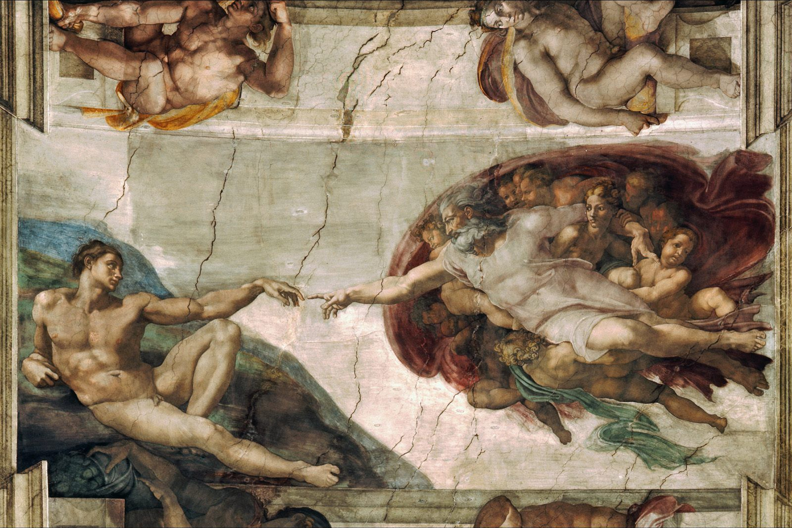

*Michelangelo Buonarroti, Criação de Adão, c. 1511. Teto da Capela Sistina.*

No teto da Capela Sistina, Michelangelo pintou Deus avançando envolto num manto, cercado de figuras, com o braço estendido com força e intenção. Do outro lado, Adão repousa sobre a terra, o corpo perfeito e lânguido, o braço erguido sem esforço, o dedo ainda frouxo. Entre os dois dedos há um espaço de poucos centímetros. Eles não se tocam.

Lida como metáfora, e não como crônica, a *Criação de Adão* simboliza a encarnação. Encarnar é entrar na carne, como diz a própria palavra. É o acoplamento do espírito à matéria, quando algo que não é físico passa a habitar algo que é. Um sopro entra no barro. Uma centelha cai numa palma de terra.

A mesma imagem simboliza também algo menos celebrado, o início da ignorância espiritual. No instante em que o espírito se acopla à matéria, ele se esquece da origem. O vão entre os dedos é o véu. Do lado de lá está a fonte; do lado de cá, um corpo que acaba de abrir os olhos e não se lembra de nada.

Toda a nossa história começa nesse vão. E muitos passam a vida inteira sem perceber que ele existe.

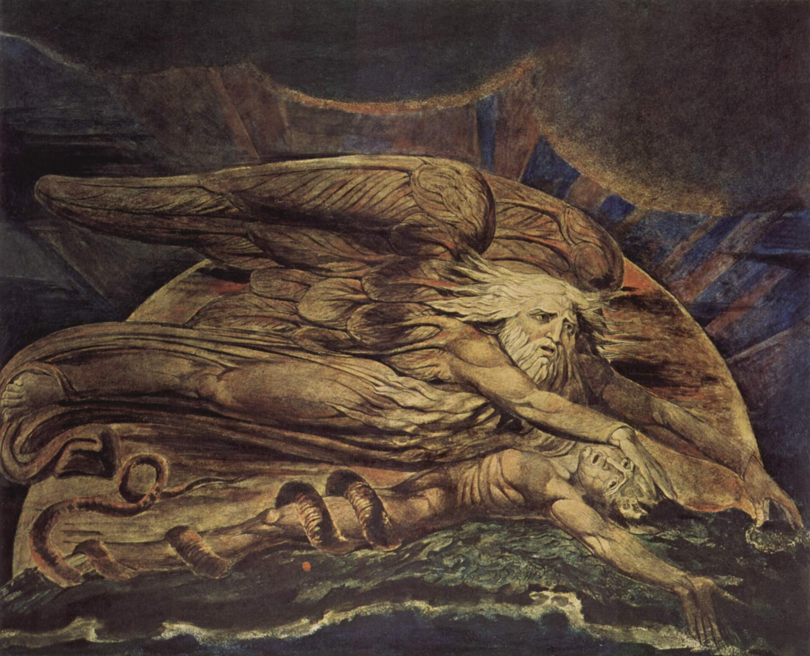

*William Blake, Elohim Creating Adam, 1795.*

Três séculos depois de Michelangelo, William Blake pintou a mesma cena sem nenhuma doçura. Um Deus de asas imensas paira rente ao chão e pressiona a cabeça de Adão contra a terra. Adão está estendido, o rosto contraído, como quem acorda de um sonho para um peso. E em volta da sua perna já está enrolada uma serpente.

Blake viu o que a pintura da Sistina deixa implícito. A encarnação é um presente e, ao mesmo tempo, um aperto. No mesmo gesto em que o espírito recebe um corpo, ele fica preso a esse corpo, ao seu peso, à sua fome, ao seu fim. A serpente está ali desde o primeiro instante, enrolada na carne, antes mesmo do jardim. O fôlego da vida e o início do esquecimento são o mesmo acontecimento.

---

## O primeiro mundo

O primeiro mundo que conhecemos depois de encarnar é o material.

Antes de qualquer pensamento, há o frio, a fome, a luz que fere os olhos, o calor de um colo, o som de uma voz. Um recém-nascido não sabe o que é Deus, nem o que é eternidade, nem o que é ele mesmo. Sabe apenas o que sente. O mundo chega pelas portas da visão, da audição, do olfato, do paladar e do tato. Por muito tempo, essas são as únicas portas que existem.

É por isso que estamos tão acostumados com a matéria. Ninguém a escolheu. Ela foi simplesmente o primeiro contato. É o mundo ao qual chegamos, o mundo em que aprendemos a andar, a falar, a pedir, a temer. O homem nasce acostumado e preso ao mundo físico. No processo primitivo, ele é guiado apenas por impressões sensoriais, buscando o que agrada e evitando o que fere.

Esse é o mundo óbvio. É palpável. Bate-se na mesa e a mesa responde. Ninguém precisa de argumento para acreditar que a parede existe; basta tentar atravessá-la. É o mundo do qual temos certeza.

E para muitos, isso é tudo. Tudo o que pode ser compreendido está no aqui e agora, ao alcance da mão. O que não se vê, não se pesa e não se mede simplesmente não entra na conta, ou entra como superstição, como conversa de criança, como medo do escuro.

Mas o mundo óbvio tem características que raramente notamos, justamente porque são óbvias demais. É um mundo imperfeito, em que nada está pronto e tudo falta, quebra, adoece e se desgasta. É um mundo transitório, em que tudo começa e termina, e o corpo que hoje sente já foi outro e será outro. É o mundo dos que mudam. A criança vira adulto, a semente vira árvore, a árvore vira lenha, a lenha vira cinza.

O homem adâmico apoia toda a sua certeza justamente no que menos permanece. Confia no que passa e duvida do que fica.

---

## A expulsão

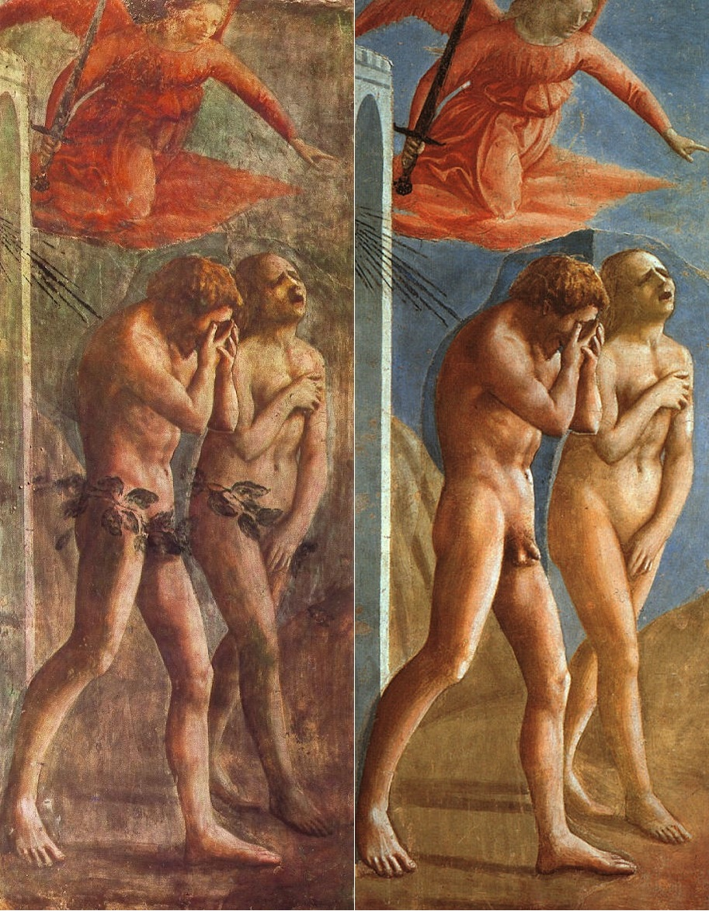

*Masaccio, Expulsão do Paraíso, c. 1425. Capela Brancacci, Florença.*

Um século antes de Michelangelo, Masaccio pintou o outro lado da história. Adão e Eva saem do Éden. Ele cobre o rosto com as mãos. Ela cobre o corpo e grita. Acima deles, um anjo aponta para fora. Não há paisagem nem paraíso visível, e quase não há cor. Ficaram apenas dois corpos que, de repente, se descobriram corpos.

O relato bíblico diz que, depois da queda, "abriram-se os olhos de ambos, e conheceram que estavam nus". Esse é o detalhe decisivo. Antes de qualquer dor, a queda começa com uma percepção de si. Eles passam a se ver como coisas separadas de Deus, do jardim e um do outro.

É o que acontece com cada um de nós.

Preso ao que os sentidos mostram, o homem faz um movimento que parece natural e passa despercebido. Ele se individualiza, separa-se do mundo, traça uma linha na altura da pele e decide que ali dentro está ele e lá fora está o resto.

Depois de se separar, ele objetifica a si e a tudo. Torna-se uma identidade, uma personalidade, um corpo dotado de características e comportamentos. "Sou alto. Sou tímido. Sou brasileiro. Sou assim e sempre fui assim." E faz o mesmo com tudo o que encontra. A árvore vira um objeto com tronco, galhos e folhas. O vizinho vira um objeto com nome, defeitos e manias. O mundo inteiro vira um inventário de coisas encerradas em si mesmas, cada uma com seus atributos, cada uma separada das demais.

Esse recorte parece uma descrição da realidade, mas é um modo de ler a realidade, tão antigo e tão repetido que esquecemos que é uma leitura. E é um modo de ler que custa caro na forma como nos relacionamos, na forma como sofremos e até na forma como construímos as máquinas que hoje organizam a vida.

No quadro de Cole, são as duas figuras pequenas na saída do portão. Receberam a mesma luz que ainda brilha atrás delas, mas já não olham para ela. Deram as costas ao jardim e caminham, decididas, em direção ao mundo, onde terão um nome, uma casa, uma função e uma imagem de si.

Masaccio pintou a expulsão como vergonha. Talvez a palavra mais exata seja esquecimento, porque ninguém nos tirou do jardim. Fomos nós que deixamos de enxergá-lo.

---

## A caverna

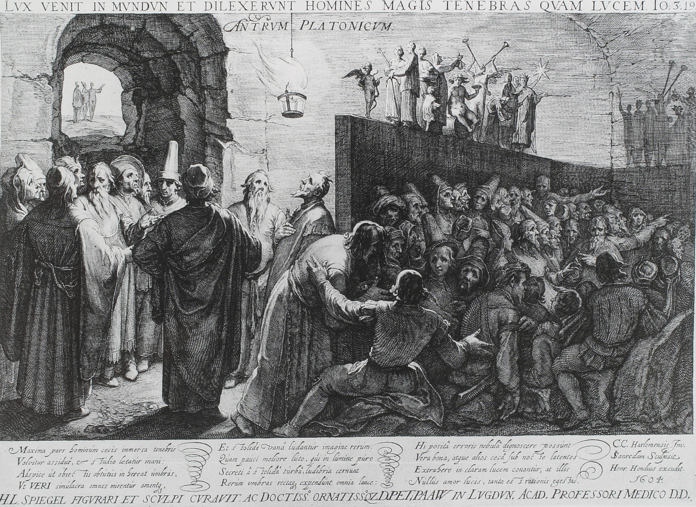

*Jan Saenredam, segundo Cornelis van Haarlem, Alegoria da caverna de Platão, 1604.*

Há mais de dois mil anos, Platão descreveu essa condição numa imagem que ainda fala.

Imagine homens acorrentados desde a infância no fundo de uma caverna, de costas para a entrada. Atrás deles arde um fogo; entre o fogo e eles, passam figuras carregadas por outros. Os prisioneiros só veem as sombras projetadas na parede à sua frente. Nunca viram outra coisa. Dão nomes às sombras, discutem sobre elas, premiam quem melhor adivinha qual virá a seguir. Para eles, as sombras são o real.

Se alguém lhes dissesse que há um fogo atrás deles, e um mundo inteiro lá fora iluminado por um sol, ririam. Ou teriam medo.

Na gravura de Saenredam, a caverna está cheia. À direita, uma multidão se aperta, aponta, gesticula, discute, entretida com as sombras das figuras que desfilam sobre um muro. Ninguém parece infeliz. A prisão é eficiente justamente porque é confortável. As sombras são interessantes. À esquerda, um pequeno grupo se afastou da multidão e conversa perto de uma abertura na rocha, por onde entra a luz de fora. São poucos.

No alto da gravura, o artista gravou em latim um versículo do Evangelho de João: *Lux venit in mundum et dilexerunt homines magis tenebras quam lucem*, "A luz veio ao mundo, e os homens amaram mais as trevas do que a luz" (João 3:19). A luz estava ao alcance, mas as sombras eram familiares.

Somos esses homens. As sombras são o mundo material; o que as projeta está atrás de nós.

O homem adâmico é inconsciente da realidade eterna e da sua origem espiritual. Ele enxerga apenas a matéria. Enxerga um cisco da realidade e toma esse cisco pelo todo. Faz isso porque nunca virou a cabeça.

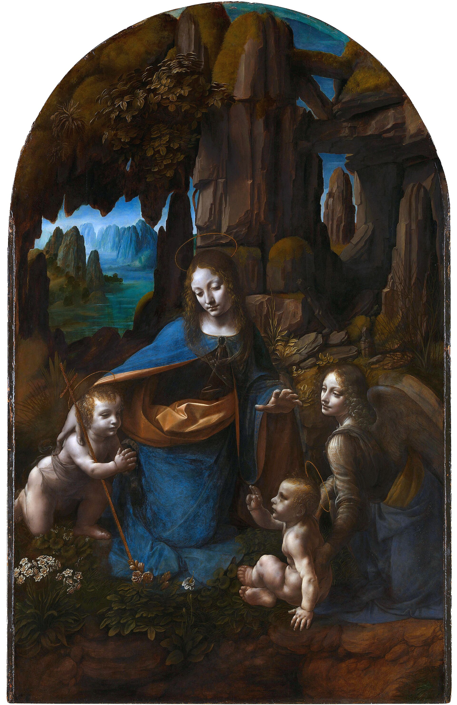

*Leonardo da Vinci, Virgem das Rochas, c. 1491–1508. National Gallery, Londres.*

Leonardo pintou outra caverna. Na *Virgem das Rochas*, Maria, um anjo e duas crianças estão reunidos dentro de uma gruta escura, entre pedras e plantas úmidas. Mas a gruta se abre em fendas, por onde se vê, ao longe, uma paisagem azul de água e montanhas. Leonardo pôs o sagrado nesse limite, onde a escuridão começa a se abrir para a luz.

A caverna, portanto, além de prisão, é também o lugar onde a luz pode ser percebida pela primeira vez. Ela tem saídas, que só não vê quem nunca vira a cabeça.

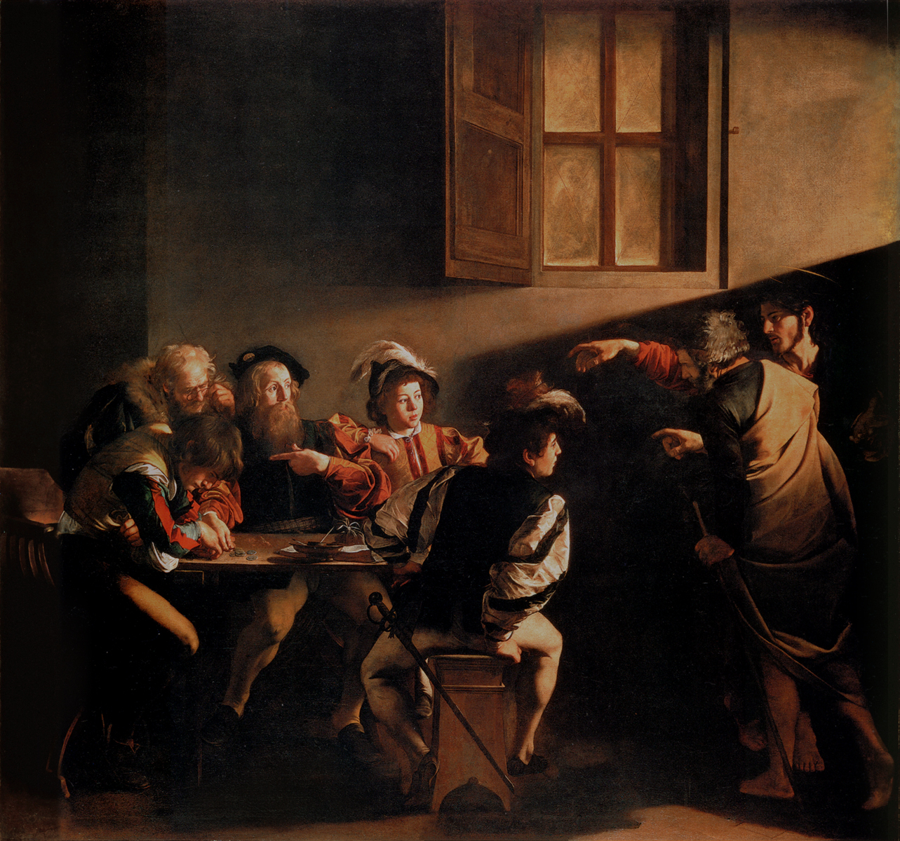

*Caravaggio, Vocação de São Mateus, 1599–1600. Igreja de San Luigi dei Francesi, Roma.*

Caravaggio levou a caverna para dentro de uma sala comum. Cinco homens estão sentados a uma mesa, num cômodo escuro, contando moedas. Pela direita entram duas figuras quase engolidas pela sombra. Uma delas é Cristo, e ele aponta. Sua mão é quase uma cópia da mão de Adão na Capela Sistina. Junto com ele, entra um feixe de luz que corta a parede na diagonal.

Um dos homens à mesa ergue o rosto e leva a mão ao peito, como quem pergunta: *eu?* Outros olham, desconfiados. Mas os dois da ponta esquerda nem levantam a cabeça. Continuam curvados sobre o dinheiro, contando. A luz passou a um palmo deles.

Assim é com quase todos nós. A luz entra pela janela, e o que nos falta é erguer os olhos da mesa.

---

## A cidade de luz fria

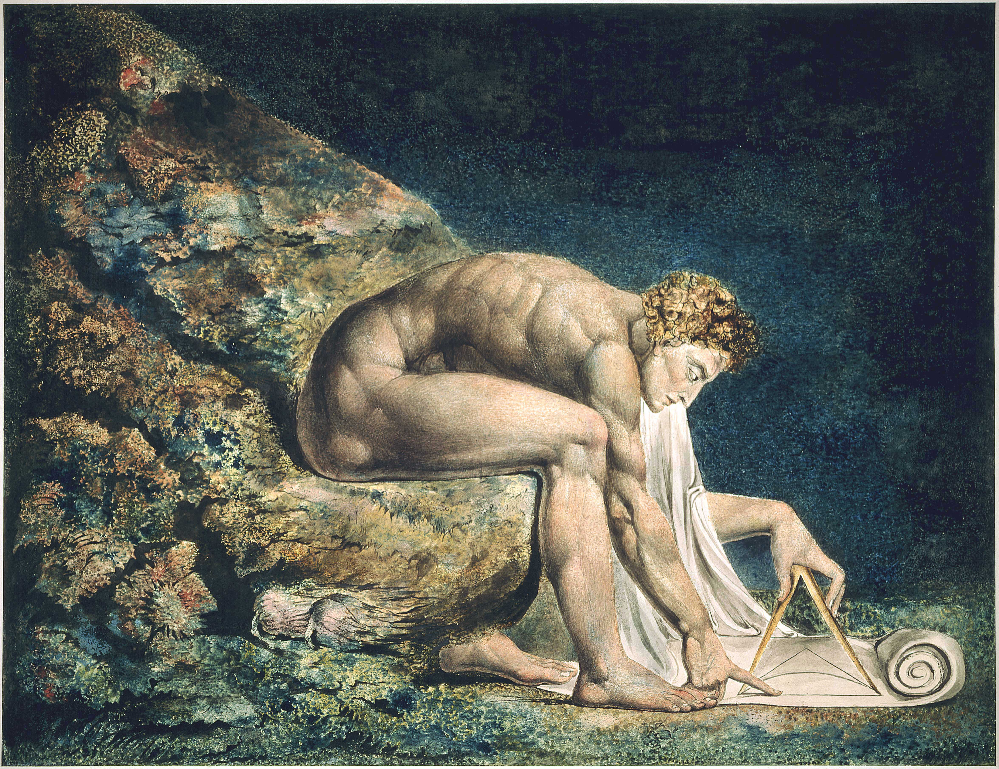

*William Blake, Newton, 1795.*

Seria confortável pensar que a caverna ficou no passado, que a ciência, a técnica e a informação nos libertaram dela. No quadro de Cole, o mundo para onde os dois caminham ainda é selvagem, com vulcão, tempestade e lobo. Bastaram alguns milênios para que o homem o cobrisse de torres, muralhas, casas empilhadas, a obra das próprias mãos. A caverna continua lá, agora com torres.

William Blake pintou Isaac Newton nu, sentado numa rocha no fundo do mar, curvado sobre um papel, medindo uma figura com um compasso. O corpo é magnífico, a concentração é total. E ele está de costas para tudo o que é vivo ao seu redor. Blake não desprezava a razão em si, e sim aquela que só sabe medir o que é sólido e esquece todo o resto.

Essa é a nossa situação. O homem evoluiu na ciência e na tecnologia, mas não evoluiu na espiritualidade. Sabemos mais sobre o átomo do que qualquer geração anterior. Construímos máquinas que falam, calculam e decidem. E continuamos sem saber responder, com clareza, a perguntas que uma criança faz antes dos dez anos.

Vivemos cada vez mais longe da natureza e cada vez mais perto das criações humanas, como telas, prédios, produtos e notificações. Antes as sombras eram projetadas na rocha; hoje são projetadas em vidro, iluminadas por dentro, e cabem no bolso. Nunca tivemos tanto acesso a informação. E é justamente esse excesso de informação que nos mantém de costas para a entrada. Sabemos um pouco de tudo e não entendemos o todo. Temos dados demais e síntese de menos.

A cidade de luz fria é a caverna com eletricidade.

---

## O que os olhos não alcançam

No quadro de Cole, ao fundo, à direita, quase confundido com a bruma dourada, o jardim continua, com árvores, água, montanhas e uma luz de fim de tarde que não acaba. Ele está lá o tempo todo. Nenhuma das duas figuras olha para ele.

Há estruturas igualmente presentes na realidade, mas invisíveis aos olhos. As religiões as chamam de espirituais. Os filósofos as chamam de metafísicas. Elas ordenam tudo o que é, foi e será. A experiência material é produto delas, e o que se vê depende do que não se vê.

Pense no número três. Você nunca o viu. Viu três maçãs, três pedras, três dedos. Mas o *três*, aquilo que as três maçãs e as três pedras têm em comum, nenhum olho jamais viu. Ainda assim, você tem absoluta certeza de que ele existe, de que é sempre o mesmo, de que três mais três será seis hoje, amanhã e daqui a mil anos, em qualquer lugar do universo. As maçãs apodrecem; o três permanece.

Pense no movimento. Você vê a bola aqui e, depois, a bola ali. Vê posições, vê estados. Mas o movimento em si, aquilo que levou a bola de um ponto a outro, não tem cor, não tem peso, não tem forma. Você o deduz. Você o *compreende*.

Essas são pequenas amostras de um mundo inteiro que não se vê, mas se lê. As estruturas metafísicas só se percebem pelo intelecto, não pelos sentidos. É por isso que o homem preso aos sentidos não as encontra, pois procura com os olhos o que só a razão alcança.

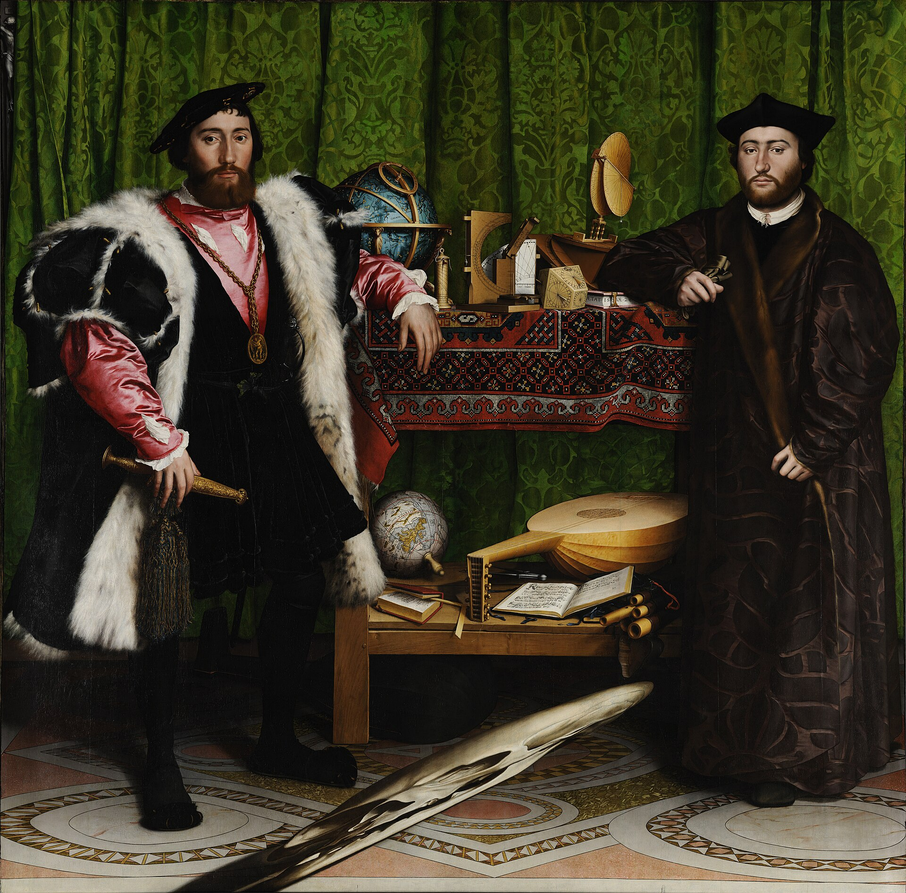

*Hans Holbein, o Jovem, Os Embaixadores, 1533. National Gallery, Londres.*

Hans Holbein pintou essa dificuldade num único quadro. Dois homens jovens, ricos e cultos posam ao lado de uma estante. Entre eles estão um globo celeste, um globo terrestre, relógios de sol, instrumentos de astronomia, um livro de aritmética, um alaúde e um hinário, tudo o que o seu tempo sabia. É o retrato do conhecimento humano no seu auge.

E no chão, bem na frente deles, há uma mancha estranha, alongada, que não parece nada. Quem olha o quadro de frente vê apenas uma forma torta. Mas quem se coloca de lado, quase encostado na parede, vê a mancha se transformar numa caveira. Ela esteve ali o tempo todo, no centro da cena, e só aparece para quem muda o ângulo de visão. No canto superior esquerdo, quase escondido atrás da cortina verde, há ainda um pequeno crucifixo. Também passa despercebido.

O quadro inteiro é uma lição sobre o mundo adâmico. O que está em primeiro plano, o luxo, os instrumentos e a ciência, esconde o essencial, a morte e o sagrado, que estão pintados num ângulo que os olhos acostumados não alcançam. Para vê-lo, é preciso se deslocar. Na vida, esse deslocamento é feito pelo intelecto.

A palavra *metafísica* vem do grego *meta*, além, e *physis*, natureza física. É o estudo do que está além do físico. Esse "além", porém, não quer dizer longe nem escondido atrás das nuvens. Esse plano divide espaço com a matéria e está aqui, agora, nesta página e na mão que a segura, apenas sem ser visto.

Carlos Drummond de Andrade escreveu um poema sobre o instante em que esse plano se oferece por inteiro. Em *A máquina do mundo*, de 1951, o poeta caminha no fim da tarde por "uma estrada de Minas, pedregosa", cansado, sem esperar nada. E a máquina do mundo se abre diante dele com a explicação total, a ordem de todas as coisas, tudo o que ele havia procurado. Ele baixa os olhos. Recusa o presente e segue andando, "de mãos pensas". O poema não diz se a recusa foi sabedoria ou cansaço. Diz que é possível estar diante da estrutura do real e continuar pela estrada como se nada tivesse acontecido. O homem adâmico é aquele a quem a ordem do mundo falta e, muitas vezes, também aquele que, quando ela se abre, está cansado demais para olhar.

O jardim de Cole continua na paisagem. Quem caminha é que não tem ainda as letras para lê-lo. Comemos o fruto e ganhamos a terra. Mas, neste fruto, nesta terra, ainda somos analfabetos espirituais.

---

## Quatro ignorâncias

Sem acesso a esse plano, o homem vive uma série de ignorâncias encadeadas. Mais do que falhas de caráter, são consequências de ler só metade do mundo.

Ele não compreende a origem das próprias decisões. Escolhe, reage, deseja, se irrita, se apaixona, e acredita que é ele quem decide. Raramente pergunta de onde vem aquilo que o move. Por que desejo o que desejo? Por que reajo sempre da mesma forma ao mesmo tipo de situação? Sem essa pergunta, a liberdade é apenas uma sensação.

Ele não compreende o sentido da própria existência. Vive sem saber o que está fazendo aqui. Preenche os dias com tarefas, metas e distrações, e às vezes, num silêncio inesperado, percebe que não sabe *para quê*.

Ele não compreende a estrutura fundamental da realidade. Conhece os objetos, mas não aquilo de que o real é feito. Sabe o nome de mil coisas e não sabe o que é uma coisa.

Ele não conhece a metafísica. E é essa a ignorância que sustenta as outras três, porque a metafísica é justamente o estudo que daria acesso ao resto.

Diante da dificuldade de explicar Deus, o espírito ou a eternidade, muitos concluem que essas coisas não existem. A incapacidade de explicar Deus não prova a inexistência de Deus. Prova apenas que ainda não aprendemos a ler.

---

## O mapa herdado

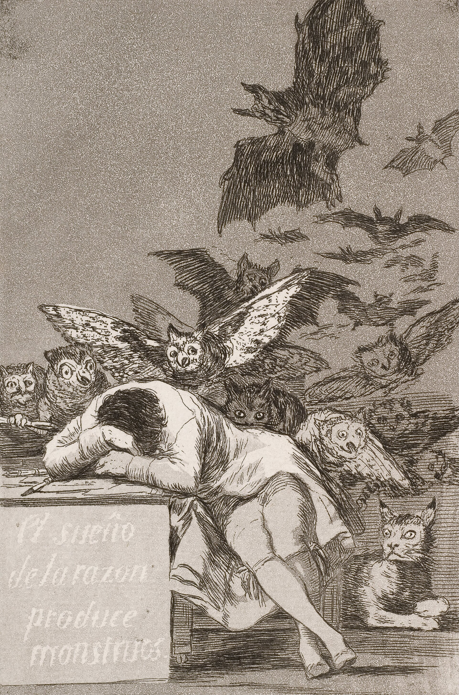

*Francisco de Goya, O sono da razão produz monstros, Caprichos nº 43, 1797–1799.*

Goya gravou um homem dormindo debruçado sobre a mesa de trabalho, a cabeça escondida entre os braços. Atrás dele, saindo da escuridão, surgem corujas, morcegos e um felino de olhos abertos que o observa. Na lateral da mesa está escrito: *El sueño de la razón produce monstruos*, o sono da razão produz monstros.

O homem da gravura não sabe que está cercado. Está dormindo. Os monstros nem precisam atacá-lo; basta que ele continue sem acordar.

A ignorância da realidade fundamental tem uma característica que a torna difícil de curar, que é ser inconsciente. Ninguém sabe que não sabe, e aquilo que não se percebe não se corrige e acaba se perpetuando.

O veículo dessa perpetuação é a crença.

As crenças do homem moldam o seu comportamento. Agimos conforme o que acreditamos que o mundo é. Quem acredita que o mundo é hostil se defende de tudo. Quem acredita que só existe o que se possui vive para possuir. Quem acredita que é apenas um corpo trata o corpo como a única coisa que importa, e teme a morte como o fim de tudo.

E as crenças não começam em nós. São herdadas.

A criança recebe um mapa do mundo antes de poder fazer qualquer pergunta sobre ele. Recebe-o da família, da escola, da religião, da televisão, da rua. As crianças carecem de base lógica para examinar esse mapa, pois ainda não têm as ferramentas para perguntar se ele é verdadeiro, se é coerente, se serve. Simplesmente o recebem, como recebem a língua materna. O mapa vira comportamento antes de virar pergunta.

Quando a criança cresce, entrega o mesmo mapa aos próprios filhos. E assim, geração após geração, a ignorância se transmite sem que ninguém a tenha escolhido. Nessa corrente há herdeiros, e não culpados.

O mapa não vem solto. Vem amarrado a um grupo. Toda família, toda igreja, toda profissão, todo bairro tem a sua tabela de crenças, que diz o que se pode desejar, o que dá vergonha, como se trata um estranho e o que se faz com a raiva. A tradição esotérica chama de egrégora essa mente coletiva, e o capítulo 3 voltará a ela. Aqui basta notar o seu efeito. Quem cresce dentro de uma egrégora recebe, junto com as crenças, as habilidades e os medos que combinam com elas, e passa a chamar o conjunto de personalidade. Por isso mudar de crença raramente é só mudar de ideia e se parece mais com uma cirurgia.

Diante de Deus, o mapa herdado produz posturas que qualquer um reconhece. Há quem permaneça na fé em que nasceu e a pratique sem perguntar. Há quem tente seguir e não consiga, porque as respostas não fecham, e fique com culpa. Há quem nem tente e diga que tanto faz. Há quem creia e não frequente, e guarde Deus numa gaveta para as horas difíceis. Há quem tenha abandonado tudo com raiva. São posturas diferentes diante do mesmo mapa. Nenhuma delas foi escolhida com todas as letras na mão. O que nos ensinaram sobre Deus e o mundo espiritual está incompleto. Não está errado em tudo, mas está incompleto.

O homem adâmico copia sem perceber, o que é bem diferente de ser mau.

---

## A tela diante da janela

René Magritte pintou, em 1933, um quadro chamado *A Condição Humana*. Diante de uma janela, há um cavalete com uma tela. A tela pinta exatamente a paisagem que ela mesma esconde, com a árvore, o campo e o céu. A pintura se encaixa tão perfeitamente na paisagem que não se sabe onde termina uma e começa a outra. Olhamos e não conseguimos dizer se estamos vendo o mundo ou a representação do mundo.

*(A obra está protegida por direitos autorais e não é reproduzida aqui. Pode ser vista na coleção da [National Gallery of Art](https://www.nga.gov/collection/art-object-page.71269.html).)*

Esse quadro descreve com precisão o nosso último problema. Para pensar o mundo, o homem dispõe de uma única ferramenta, que é a linguagem. Ela é a tela diante da janela. Tudo o que pensamos sobre a realidade, pensamos através dela. E, de tanto usá-la, confundimos a tela com a paisagem.

Quatro anos antes, Magritte tinha pintado um cachimbo grande e nítido sobre um fundo liso e escrito embaixo, com letra de caderno escolar: *Ceci n'est pas une pipe*, isto não é um cachimbo. O quadro se chama *A traição das imagens*. Muita gente ri na primeira vez. Depois percebe que a frase está certa, porque ninguém consegue encher aquele cachimbo de fumo. É a imagem de um cachimbo. Com as palavras acontece o mesmo. A palavra "Deus" não é Deus, e quem discute a palavra pensando que discute a coisa nunca chega a um acordo.

O problema é que a linguagem que usamos é contraditória e mal compreendida.

A mesma palavra significa coisas diferentes conforme quem fala. "Manga" é fruta e é parte da camisa. "Amor" é o que sente a mãe pelo filho, o que sente um adolescente por uma fotografia e o que alguém sente por uma marca de café. E, ao contrário, palavras diferentes dizem a mesma coisa sem que se perceba: o que um chama de *alma*, outro chama de *mente*, outro de *consciência*, outro de *espírito*, e cada um jura que está falando de algo distinto.

Fala-se de Deus, de eternidade, de céu e de inferno, e cada ouvinte ouve outra coisa. Discute-se por séculos sem se entender, e o problema raramente é a inteligência. A ferramenta do entendimento está torta.

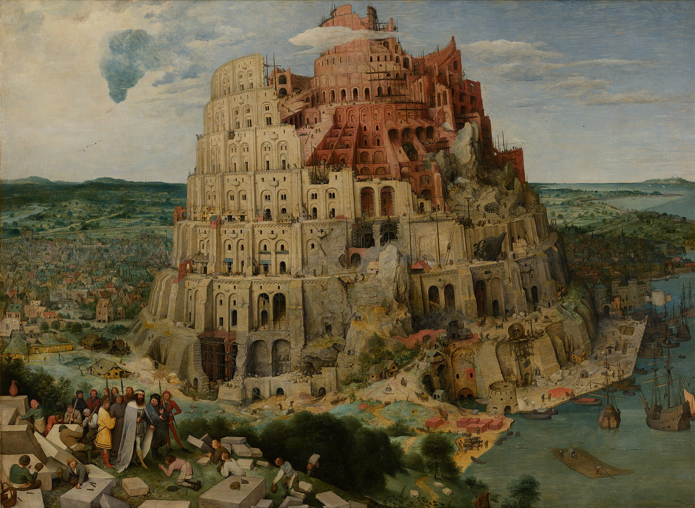

*Pieter Bruegel, o Velho, A Torre de Babel, c. 1563. Kunsthistorisches Museum, Viena.*

O Gênesis conta essa história. Os homens decidiram construir uma torre que chegasse ao céu, e Deus confundiu a sua língua, "para que não entenda um a língua do outro". A obra parou. Os homens se espalharam.

Bruegel pintou a torre no meio da construção. Ela é gigantesca e cheia de vida, com andaimes, guindastes, operários e navios descarregando pedra no porto. No canto, o rei inspeciona a obra enquanto os pedreiros se ajoelham. Mas a torre foi erguida sobre uma rocha que nunca foi removida, e a pedra bruta ainda aparece no meio das paredes. Os andares não estão nivelados: inclinam-se, cada um sobre o anterior, como se cada equipe tivesse construído do seu jeito. Enquanto o topo sobe, a base já desmorona. Um lado está terminado e branco; o outro, em tijolo vermelho, ainda é esqueleto.

Mais do que um castigo antigo, Babel descreve um estado, o que acontece quando muitos tentam alcançar o céu sem uma linguagem comum. Cada um empilha sua parte, ninguém confere o prumo, e a obra nunca termina. Religiões, filosofias e ciências levantaram, cada uma, um andar dessa torre. Todas queriam chegar ao mesmo lugar. Nenhuma fala a língua da outra.

Uma lente torta entrega uma imagem torta. Se é pela linguagem que pensamos o mundo, uma linguagem deturpada nos entrega uma visão deturpada da realidade. E uma visão deturpada da realidade produz, inevitavelmente, um comportamento deturpado.

Essa é, talvez, a raiz mais profunda da era adâmica, e também por onde começa a saída.

---

## O grito e a noite

Mas o homem adâmico não está em paz.

Por mais confortável que seja a caverna, por mais luminosa que seja a cidade, algo não fecha. Há uma insatisfação de fundo, difícil de nomear. Ela aparece no silêncio, na perda, na doença, diante da morte de alguém querido, no meio de uma conquista que não trouxe o que prometia.

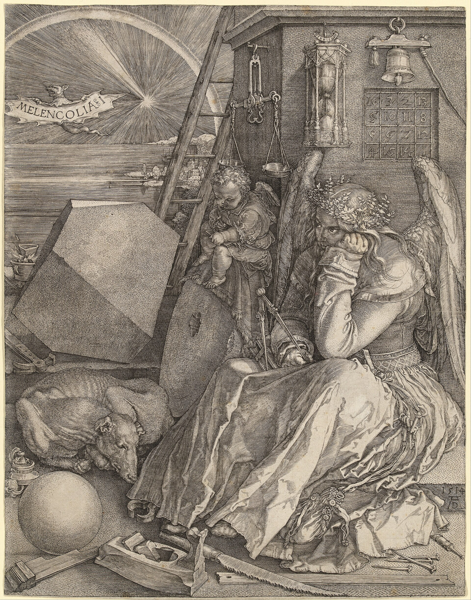

*Albrecht Dürer, Melancolia I, 1514. Gravura em metal.*

Albrecht Dürer gravou essa insatisfação no rosto de um ser alado sentado à porta de uma construção. Ele apoia a cabeça na mão. Na outra, segura um compasso que não usa. Em volta dele estão espalhados uma esfera, um poliedro de pedra, uma balança, uma ampulheta, um sino, um quadrado mágico de números, régua, serrote e pregos, tudo o que serve para medir e construir. Um cão magro dorme enrolado no chão. Uma escada se apoia na parede e sobe para fora da imagem, para um lugar que não vemos.

Ele tem todos os instrumentos. Sabe medir tudo o que é sólido. E, ainda assim, está parado, com o olhar perdido, porque nenhum desses instrumentos lhe diz *para quê*. É o retrato do homem adâmico mais inteligente, aquele que domina a matéria e, justamente por isso, percebe que ela não basta. A escada está ali. Ele ainda não subiu.

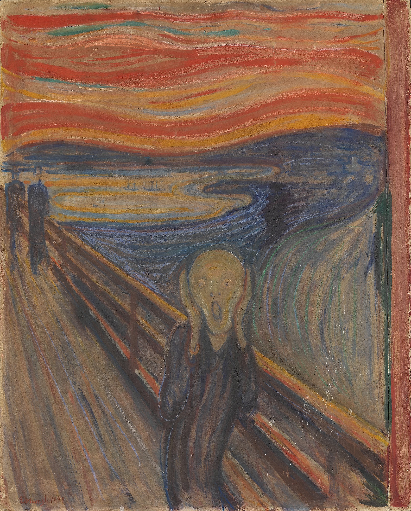

*Edvard Munch, O Grito, 1893.*

Quatro séculos depois, Munch pintou essa insatisfação como um grito. Uma figura sem traços, quase sem corpo, segura o rosto sobre uma ponte enquanto o céu inteiro parece ondular em vermelho. Ao fundo, duas pessoas seguem caminhando, alheias. O grito pode ser de qualquer um que, num instante, percebeu que a vida que leva não explica a vida que tem.

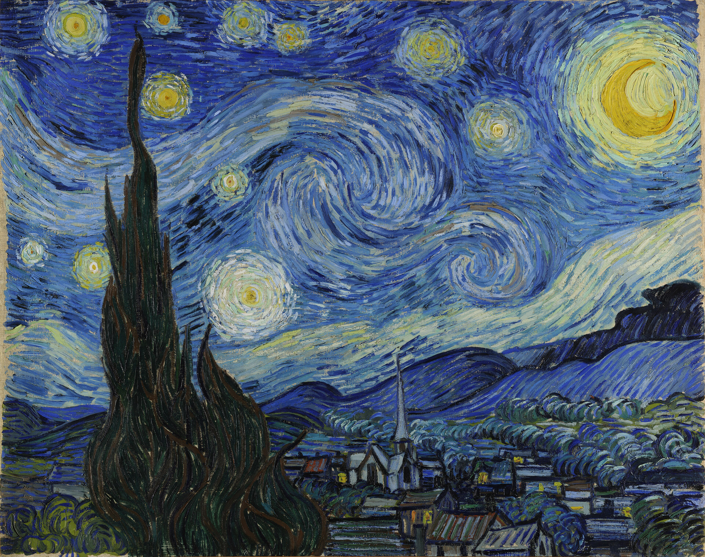

*Vincent van Gogh, A Noite Estrelada, 1889.*

E há a outra face da mesma insatisfação. Van Gogh pintou uma pequena vila adormecida, com casas, uma igreja e janelas acesas. Sobre ela, um céu que não está parado. Estrelas que giram, espirais de vento e luz, um cosmos que parece respirar. A vila dorme. O céu está acordado.

É a mesma divisão do quadro de Cole, que põe de um lado a vida ordinária, com as suas tempestades, e do outro uma ordem viva que quase ninguém vê. Às vezes, numa noite qualquer, o homem levanta os olhos e sente que há algo ali. Não sabe o quê. Mas sente.

Clarice Lispector escreveu um romance inteiro sobre um desses instantes. Em *A paixão segundo G.H.*, de 1964, uma mulher de vida arrumada entra no quarto da empregada que acabou de ir embora, vê uma barata saindo do armário e a esmaga na porta. Depois olha para ela. Durante horas, diante daquela vida mínima, perde a montagem com que se apresentava ao mundo, o nome, as iniciais gravadas no couro das malas, o apartamento, a pessoa que achava ser. O livro começa assim: "estou procurando, estou procurando. Estou tentando entender." É o grito de Munch sem barulho. Alguém descobre, num quarto vazio, que o eu que carregava era uma construção, e que por baixo dele há algo mais vasto, que ainda não sabe nomear.

Essa insatisfação, seja grito, seja espanto, é o primeiro sinal de que o cisco não é o todo. E dela nascem as perguntas:

- Do que é constituída a realidade?
- Deus existe?
- Há outra realidade além desta?
- O que há após a morte?
- Há eternidade?
- Há céu ou inferno?
- O que sou?
- Para onde vou?
- Qual é o sentido da vida?
- O que é vida?

São as mesmas perguntas desde que o homem aprendeu a falar. Foram feitas nas cavernas, nos templos, nas academias, nos mosteiros, nos laboratórios. Não envelhecem porque nunca foram respondidas de uma forma que todos pudessem entender.

---

## A luz que acompanha

No quadro, as duas figuras continuam andando. A tempestade continua à esquerda; o vulcão, ao fundo; o abismo, entre os dois mundos. Nada mudou na cena. Ainda assim, ela guarda dois detalhes que passam fácil.

O primeiro é que a luz não se apagou. Ela atravessa o portão e acompanha os dois pelas costas até a beira do caminho. O véu cobre a origem, mas não a extingue. Aquilo que encarnou continua presente em cada um de nós, e o mesmo intelecto que o homem adâmico usa apenas para lidar com a matéria está disponível, inteiro, para ler o que está além dela.

O segundo é que o portão ficou aberto. O Gênesis põe na entrada do jardim querubins com uma espada de fogo. Cole não pintou guarda nenhum, apenas a luz saindo. Nenhuma das duas figuras a vê ainda. Mas ela está ali, a um giro de cabeça.

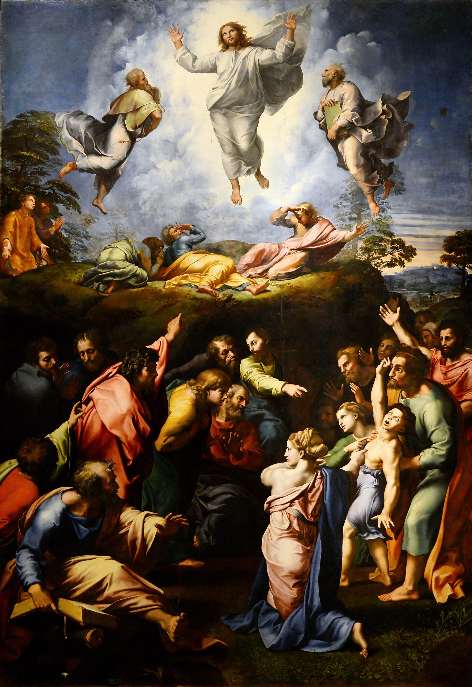

*Rafael Sanzio, Transfiguração, 1516–1520. Pinacoteca Vaticana.*

A última grande obra de Rafael é um quadro partido ao meio. Na parte de cima, Cristo se eleva numa nuvem de luz, entre Moisés e Elias. Na parte de baixo, na sombra, há um tumulto: um menino possuído se contorce, a família implora, os discípulos discutem, gesticulam, folheiam um livro, apontam em todas as direções. Ninguém consegue curar o menino. Embaixo, ninguém sabe o que fazer.

Mas alguns, no meio da confusão, apontam para cima.

É o mesmo mundo em duas leituras. Embaixo, a matéria em desordem, a dor sem explicação, o barulho de muitas vozes. Em cima, a ordem luminosa que estava lá o tempo todo. Entre as duas há apenas a direção do olhar. Levada a sério, a insatisfação é a mão de alguém que, no meio do tumulto, aponta para o alto.

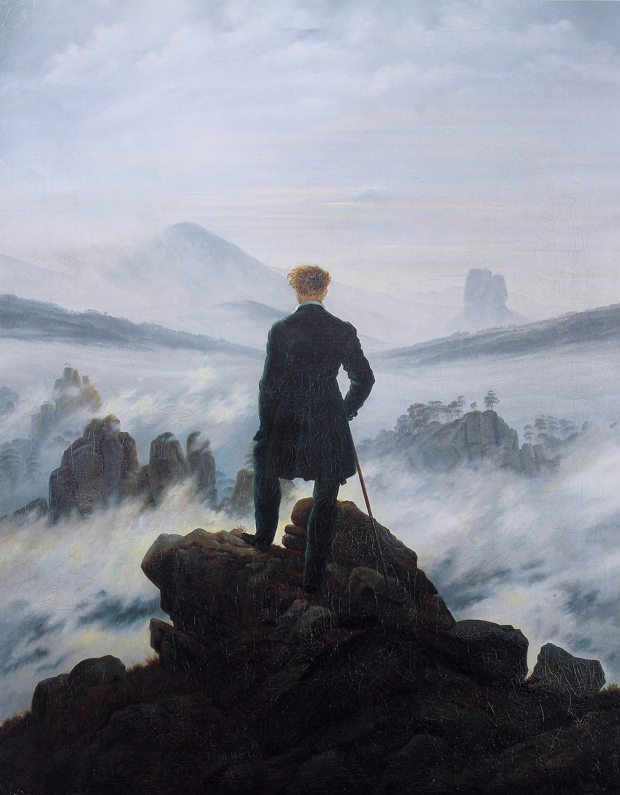

*Caspar David Friedrich, Caminhante sobre o mar de névoa, c. 1818. Kunsthalle, Hamburgo.*

E há quem se levante. Caspar David Friedrich pintou um homem de costas, no alto de um rochedo, apoiado numa bengala. À sua frente estende-se um mar de névoa, de onde emergem picos de montanhas. Ele não vê o fundo do vale nem o horizonte final. Não sabe tudo o que há ali. Mas saiu da caverna, subiu acima da cidade e está de pé, diante do desconhecido, olhando.

Não sabemos para onde ele vai. Sabemos apenas que se levantou.

A era adâmica é um problema, e problemas têm saída.

Quando a insatisfação vira pergunta, o homem começa a se mover. Vira a cabeça na caverna. Passa a buscar compreender aquilo que os olhos não podem enxergar. Essa busca é tão antiga quanto as perguntas que a provocam, e atravessou religiões, filosofias, ciências e civilizações inteiras.

É por ela que seguiremos.
