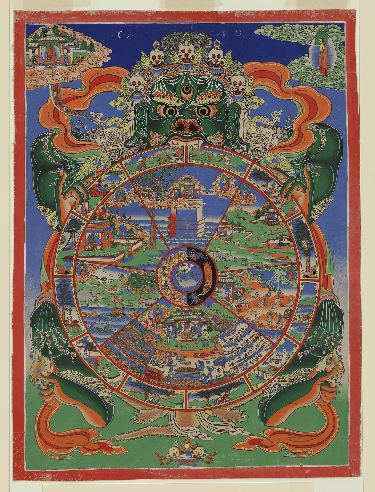
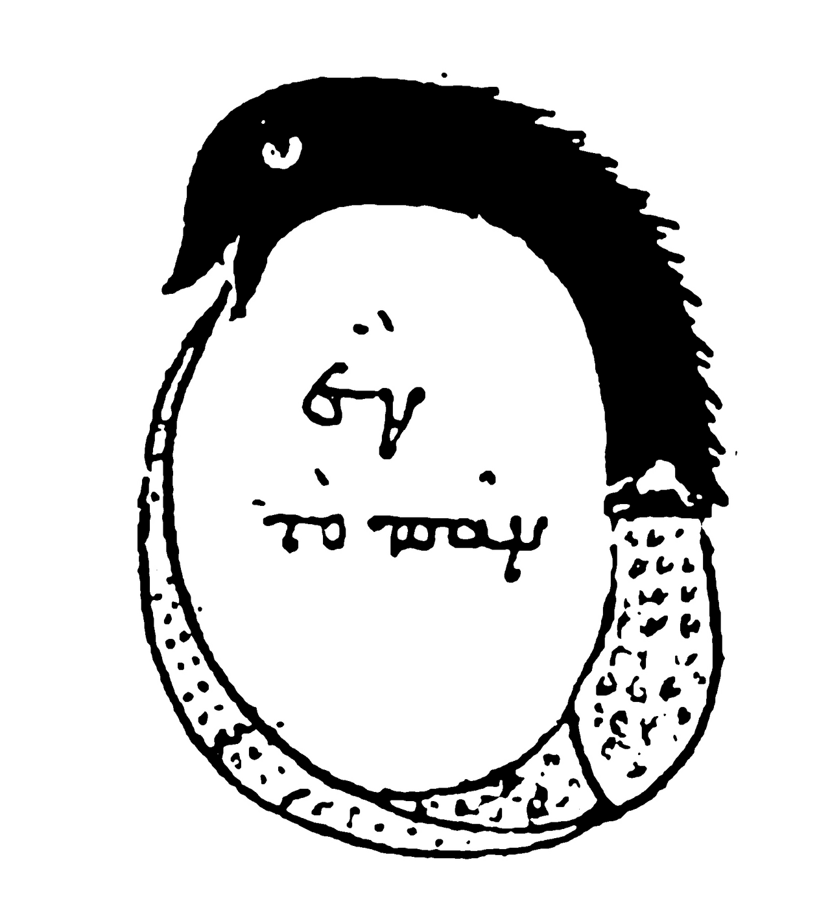
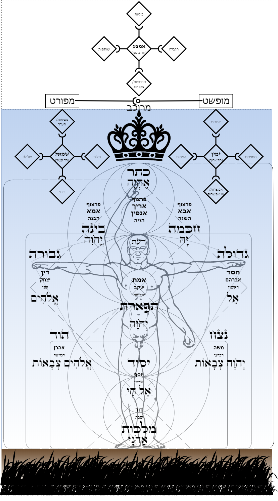
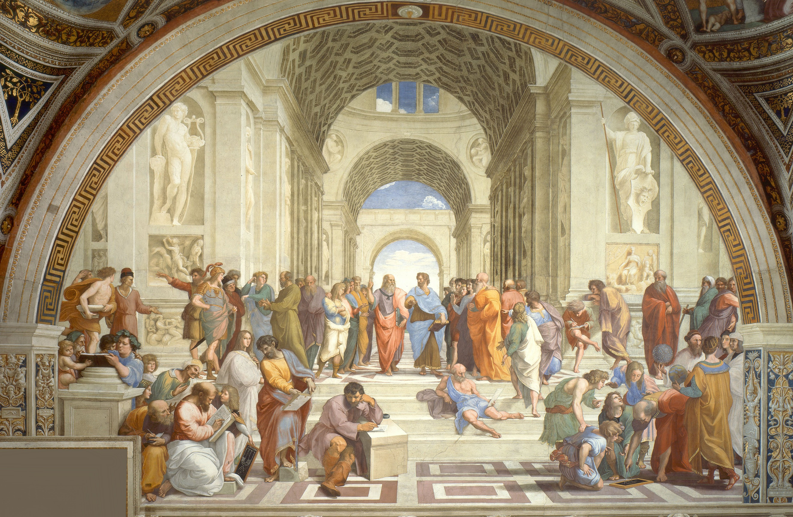
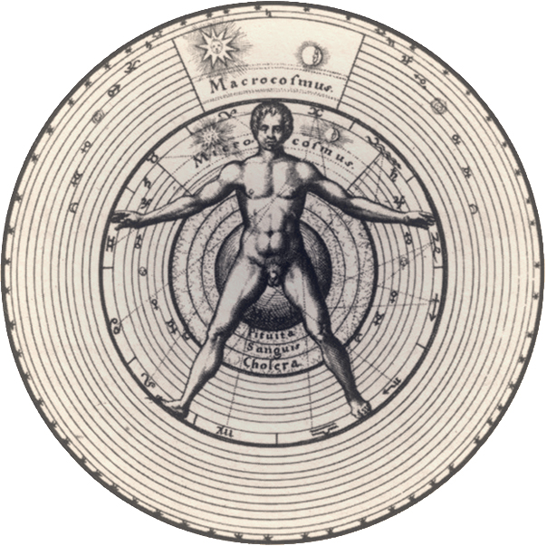
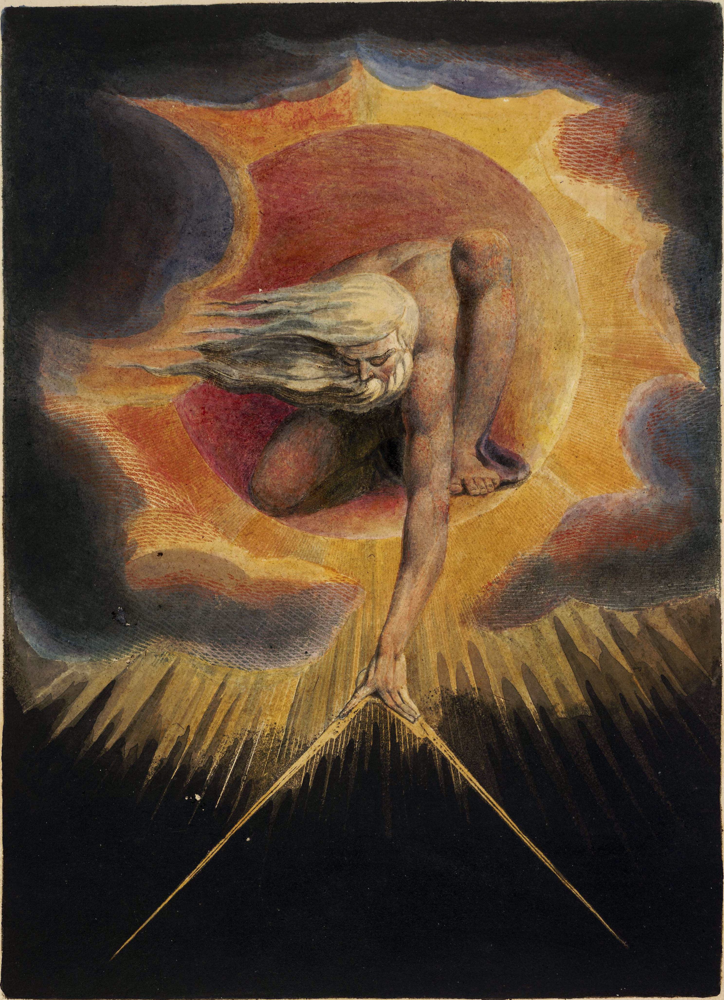

# 2. A Busca

*Joseph Wright of Derby, Um filósofo dando aquela palestra sobre o planetário em que se põe uma lâmpada no lugar do Sol, 1766. Derby Museum and Art Gallery.*

> "Ouvindo não a mim, mas ao Logos, é sábio concordar que todas as coisas são um."
> — Heráclito, fragmento 50

---

## Uma lâmpada no lugar do Sol

O capítulo anterior terminou com um homem de pé no alto de um rochedo, de costas para nós, diante de um mar de névoa. A imagem que abre este capítulo leva a pergunta para dentro de casa. É noite, numa sala escura da Inglaterra do século XVIII. Em volta de uma mesa, um grupo olha para um planetário mecânico, feito de anéis de metal que se cruzam como um céu de arame e de pequenas esferas que giram em volta de um centro. Joseph Wright of Derby pintou a cena em 1766 e lhe deu um título comprido: *Um filósofo dando aquela palestra sobre o planetário em que se põe uma lâmpada no lugar do Sol*.

A lâmpada não aparece. Está escondida atrás de um menino sentado de costas, em primeiro plano, que vemos só como silhueta. Mas tudo na sala é iluminado por ela. Duas crianças se debruçam sobre os anéis, com o rosto aceso de espanto. Um homem toma notas. Um jovem apoia a cabeça na mão e pensa. Ao fundo, o filósofo de cabelos brancos explica. Cada um recebe a luz no próprio rosto, e cada um a recebe de um ângulo diferente. Ninguém olha diretamente para a fonte.

Os anéis do planetário formam uma geometria de círculos, eixos e órbitas que se cruzam. São o modelo de uma ordem que ninguém na sala consegue ver no céu de verdade. Ali ela cabe sobre uma mesa, e ainda assim cada um a entende pela metade.

Este capítulo é uma volta em torno dessa mesa. Durante milênios, civilizações que nunca se conheceram sentaram-se diante da mesma luz escondida e a descreveram, cada uma do seu ângulo. Deixaram símbolos, entre eles uma chama, o yin-yang, uma roda de oito raios, um olho egípcio, um bastão com duas serpentes e asas, uma coluna grega, um triângulo, um cubo, uma serpente que morde a própria cauda, uma cruz, um esquadro cruzado com um compasso e um livro aberto. Cada símbolo é uma tentativa de resposta às perguntas que fecharam o capítulo 1, sobre do que é feita a realidade, se Deus existe, o que há depois da morte e o que somos. O percurso é rápido e não pretende ser um tratado de história das religiões. Serve como mapa, para mostrar que essas civilizações tocaram, cada uma com as próprias mãos, partes da mesma estrutura.

---

## Quando os sentidos não bastam

Durante a maior parte da existência humana, as perguntas não tinham palavras. Havia o medo do escuro, o espanto diante do raio, a dor diante do corpo imóvel de alguém que ontem falava. Há dezenas de milhares de anos, homens já enterravam seus mortos com flores, ferramentas e ornamentos, como quem prepara uma viagem. Há cerca de dezessete mil anos, em Lascaux, pintaram cavalos, touros e cervos no fundo de cavernas escuras, à luz de lamparinas de gordura. Há nisso uma ironia bonita, porque as primeiras imagens que a humanidade deixou foram feitas dentro de uma caverna, por gente que já desconfiava de que havia algo além das sombras.

A experiência sensorial resolve muita coisa. Ensina que o fogo queima, que a água mata a sede, que o inverno volta. Mas ela não responde por que existe fogo, nem para onde vai o que animava o corpo que agora esfria. Quando o homem ganhou a linguagem, ganhou também a capacidade de transformar o espanto em pergunta. E a pergunta, uma vez formulada, não se cala mais.

A filosofia nasce aí, no ponto em que os sentidos deixam de bastar. A religião também. E, muito mais tarde, a ciência. As três tentam responder às mesmas perguntas, com ferramentas diferentes. Nenhuma chegou a um consenso que todos pudessem entender. Mas todas deixaram pistas.

---

## O fogo e a escolha

O primeiro símbolo da travessia é uma chama.

Na antiga Pérsia, um profeta chamado Zaratustra, que os gregos chamaram de Zoroastro, ensinou que o mundo é atravessado por dois princípios em tensão. De um lado, *asha*, a verdade, a ordem, aquilo que está de acordo com o modo como as coisas devem ser. Do outro, *druj*, a mentira, a desordem, a deformação. O fogo, sempre aceso nos templos zoroastrianos, era o símbolo visível de *asha*, isto é, da luz, da pureza e da ordem.

Não se sabe com certeza quando Zaratustra viveu; as estimativas variam em quase mil anos. Mas o que ele disse atravessou a história. O homem, para ele, não é espectador dessa tensão. Cada pensamento, cada palavra e cada ação escolhe um lado. E a alma, que não morre com o corpo, atravessa depois da morte uma ponte que se alarga para quem viveu na verdade e se estreita para quem viveu na mentira.

Já estão aqui, no começo do fio, três ideias que voltarão muitas vezes. O real é feito de pares em tensão, a conduta humana participa dessa tensão, e há algo em nós que permanece quando o corpo passa.

---

## O caminho que não se pode dizer

O segundo símbolo é o mais conhecido de todos, um círculo dividido por uma curva, metade claro, metade escuro, e em cada metade um ponto da cor oposta.

O yin-yang vem da China e diz, num desenho, o que os persas disseram numa guerra. Só que aqui os opostos não lutam até que um vença. Eles se contêm. No coração da luz há um ponto de sombra; no coração da sombra, um ponto de luz. O dia carrega a semente da noite, e a noite a do dia. Cada um só existe em relação ao outro, e cada um se transforma continuamente no outro.

O livro mais antigo dessa tradição tem um nome que parece escrito para esta obra, o *I Ching*, o *Livro das Mutações*. Ele descreve o mundo como uma combinação de linhas inteiras e partidas, agrupadas em sessenta e quatro hexagramas, cada um representando um estado de passagem. O que permanece, ali, é a própria mutação e a ordem com que ela acontece.

Séculos depois, o *Tao Te Ching*, atribuído a Lao-Tsé, abre com uma frase que todo leitor deste livro deveria guardar: "O Tao que pode ser dito não é o Tao eterno; o nome que pode ser nomeado não é o nome eterno." Antes de explicar o que quer que seja, o texto confessa um limite da linguagem. Há algo que sustenta tudo e que as palavras comuns não alcançam. O Tao é chamado de caminho, de curso, de fluxo. Move sem ser movido e dá forma sem ter forma.

Lao-Tsé não sabia, mas estava descrevendo dois problemas que este livro enfrentará até o fim. A estrutura do real é feita de opostos que se transformam, e a linguagem que usamos para falar dela é insuficiente.

---

## A roda e o centro

*Bhavacakra, a Roda da Vida. Thangka tibetano, pintura sobre tecido.*

O terceiro símbolo é uma roda de oito raios, a roda do dharma, que representa o ensinamento do Buda. Mas há outra roda, menos serena, que mostra o problema que esse ensinamento veio resolver.

No Tibete, ela é pintada à entrada dos mosteiros. Uma criatura de olhos esbugalhados e coroa de caveiras segura entre as garras e os dentes um grande disco. É Yama, o senhor da morte, e o que ele segura é o mundo inteiro. Dentro da roda, em seis fatias, estão os reinos onde os seres renascem: deuses, semideuses, homens, animais, espíritos famintos e os que sofrem nos infernos. Na borda, doze pequenas cenas mostram a cadeia de causas que mantém a roda girando. A primeira delas é sempre a mesma, uma figura cega que caminha sem ver para onde vai.

E no centro, no eixo de tudo, há três animais que perseguem uns aos outros, cada um mordendo a cauda do seguinte, um galo, uma serpente e um porco. O galo é o desejo. A serpente é a aversão. O porco é a ignorância. São eles que fazem a roda girar.

Por volta do século V antes de Cristo, Sidarta Gautama, um príncipe que abandonou o palácio depois de ver pela primeira vez a velhice, a doença e a morte, chegou a uma compreensão que os budistas chamam de despertar. *Buda* quer dizer o desperto. O que ele viu foi que tudo é impermanente, que o apego ao impermanente gera sofrimento, e que o eu ao qual nos agarramos não tem a solidez que imaginamos. Debaixo da experiência, em vez de uma substância fixa chamada "eu", há um fluxo de estados que se encadeiam.

O nome desse giro sem fim é *samsara*. O sofrimento que ele produz vem de uma leitura errada do real, e não de castigo ou acaso. O homem cego da borda da roda é o homem adâmico do capítulo anterior, visto do Oriente.

No canto superior da pintura, fora da roda, de pé sobre as nuvens, o Buda aponta para longe. A saída existe. Ela começa por enxergar.

---

## O campo de batalha

Na Índia, outra tradição chegou a uma ideia que é, talvez, a formulação mais antiga da tese deste livro.

Os *Upanishads*, textos que comentam e aprofundam os Vedas, distinguem *Atman*, o si mesmo mais profundo de cada ser, e *Brahman*, a realidade última, o fundo de tudo o que existe. E concluem que os dois são o mesmo. Num desses textos, um pai ensina o filho apontando para cada coisa do mundo e repetindo a mesma frase: *tat tvam asi*, "tu és isso". O sal dissolvido na água, a semente da figueira, o rio que se perde no mar, tudo recebe a mesma resposta, tu és isso.

A *Bhagavad Gita*, o "Canto do Senhor", leva essa ideia ao lugar menos espiritual que se possa imaginar, um campo de batalha. O guerreiro Arjuna, diante de dois exércitos prestes a se enfrentar, larga o arco e se recusa a lutar contra parentes e mestres. Quem lhe responde é Krishna, seu cocheiro, que se revela uma manifestação do divino. A resposta é longa e tem duas partes. Na primeira, Krishna diz que aquilo que somos de verdade "não nasce e nunca morre", porque os corpos passam e o que os habita permanece. Na segunda, ensina que o homem deve cumprir o seu dever, o seu *dharma*, sem apego aos frutos da ação.

É uma resposta curiosa. Não manda fugir do mundo. Manda agir dentro dele sabendo o que se é.

---

## Hermes, três vezes grande

*Ouroboros da Chrysopoeia de Cleópatra, a Alquimista. Cópia medieval de manuscrito greco-egípcio, c. séculos III–IV.*

O quarto símbolo da travessia é o olho de Hórus. O quinto, o caduceu, um bastão alado com duas serpentes entrelaçadas. Os dois levam ao Egito.

Os egípcios escreviam com imagens. Os hieróglifos eram ao mesmo tempo letras, sons e símbolos, e durante quase mil e quinhentos anos ninguém soube lê-los. A chave apareceu em 1799, quando soldados franceses encontraram no delta do Nilo uma pedra com o mesmo decreto escrito três vezes: em hieróglifos, em escrita demótica e em grego. Comparando o texto conhecido com o desconhecido, Jean-François Champollion decifrou os hieróglifos em 1822. A Pedra de Roseta é, por isso, uma boa imagem para o que este livro tenta fazer, que é encontrar, entre várias escritas que dizem a mesma coisa, a tradução que permite ler todas.

No Egito helenístico, nos primeiros séculos da nossa era, surgiu um conjunto de textos atribuídos a Hermes Trismegisto, o "três vezes grande", figura em que os gregos fundiram o seu Hermes, mensageiro dos deuses, com Thoth, o deus egípcio da escrita e da sabedoria. Esse *Corpus Hermeticum* ensina que tudo procede de uma única mente divina, que o homem traz em si uma centelha dessa mente e que conhecer a si mesmo é o caminho para conhecer o Todo. A frase mais famosa da tradição está num texto curto, a *Tábua de Esmeralda*: "O que está embaixo é como o que está em cima, e o que está em cima é como o que está embaixo."

No início do século XX, em 1908, um livro publicado nos Estados Unidos sob a assinatura de "Três Iniciados", o *Caibalion*, organizou essa herança em sete princípios. O primeiro diz que o Todo é mente. Os demais descrevem como esse Todo opera, por correspondência, entre o que está em cima e o que está embaixo; por vibração, porque nada está parado; por polaridade, porque tudo tem dois polos que são graus da mesma coisa; por ritmo, porque tudo tem fluxo e refluxo; por causa e efeito, porque nada acontece por acaso; e por gênero, porque tudo carrega um princípio ativo e um receptivo. É uma leitura moderna de uma tradição antiga, e convém dizê-lo com clareza, embora, como todo bom resumo, deixe ver o desenho por baixo.

A imagem acima vem de um manuscrito alquímico greco-egípcio. É um dos mais antigos ouroboros que se conhecem, uma serpente metade escura e metade clara, que morde a própria cauda e forma um círculo. Dentro do círculo estão escritas, em grego, três palavras, *hen to pan*, o Todo é Um.

A serpente se devora e se gera ao mesmo tempo. Nunca para de mudar e nunca deixa de ser ela mesma. É difícil encontrar desenho mais exato para o título deste livro.

As religiões que vieram depois, o judaísmo, o cristianismo e o islamismo, carregam muito dessa linhagem sem sempre saber de onde ela veio. São herdeiras que perderam a certidão.

---

## Eu sou o que sou

*A Árvore da Vida da Cabala, com as dez sefirot dispostas sobre o corpo humano. Diagrama moderno da tradição.*

No livro do Êxodo, Moisés está diante de uma sarça que arde sem se consumir e pergunta a Deus o seu nome. A resposta, em hebraico, é *Ehyeh asher ehyeh*: "Eu sou o que sou", ou, numa tradução igualmente possível, "Serei o que serei".

Vale prestar atenção à forma dessa resposta. Deus não se apresenta com um substantivo, como quem diz "sou a pedra" ou "sou o rei". Apresenta-se com um verbo, e com um verbo que se abre no tempo. O nome do eterno, na tradição que deu origem a três religiões, é uma ação de ser.

A Bíblia hebraica está cheia de homens que leem símbolos. José, vendido como escravo pelos irmãos, chega a governar o Egito porque sabe interpretar os sonhos do faraó, em que sete vacas gordas e sete vacas magras são sete anos de fartura e sete de fome. Salomão pede a Deus um coração capaz de discernir, em vez de riqueza ou vitória, e a tradição o lembra como o rei mais sábio de Israel.

Dentro do judaísmo cresceu também uma corrente mística chamada Cabala. Um de seus textos mais antigos, o *Sefer Yetzirah*, o "Livro da Formação", diz que Deus criou o mundo por meio de trinta e dois caminhos, as vinte e duas letras do alfabeto hebraico e dez números primordiais, as *sefirot*. Nessa leitura, a criação é feita de letras, e o mundo é um texto.

A imagem acima é um diagrama moderno da Árvore da Vida. As dez sefirot estão dispostas sobre um corpo humano de braços abertos, com a Coroa acima da cabeça, a Sabedoria e o Entendimento de um lado e de outro, a Beleza no peito, o Reino nos pés, onde a figura toca o chão. Cada esfera se liga às outras por caminhos. Nenhuma delas é uma coisa isolada, e cada sefirá só tem sentido pela posição que ocupa e pelas relações que mantém. E o homem inteiro é um mapa do divino, do que está em cima ao que está embaixo.

Esse fio do Verbo atravessa o judaísmo e chega, séculos depois, à primeira frase do Evangelho de João. Mas antes ele passa pela Grécia.

---

## Do mito ao logos

O sexto símbolo é uma coluna grega.

Os gregos tinham mitos, como todos os povos. Zeus, Atena, Prometeu roubando o fogo, Orfeu descendo ao mundo dos mortos. Um mito está longe de ser uma mentira. É uma forma de guardar uma estrutura numa história que todos conseguem lembrar. Os mitos funcionam como arquétipos, moldes que se repetem.

Mas, por volta do século VI antes de Cristo, na costa da Ásia Menor, alguns gregos começaram a fazer as mesmas perguntas de outro jeito. Em vez de contar uma história, procuraram um princípio. Chamaram-no de *arché*, aquilo de que tudo vem e a que tudo volta. Tales de Mileto disse que era a água. Anaximandro disse que era o *ápeiron*, o ilimitado, algo sem forma de onde nascem todas as formas. Estavam errados nas respostas e certos na pergunta. Procuravam o que permanece por baixo do que aparece.

O sétimo símbolo, o triângulo, pertence a Pitágoras. Ele viajou, segundo a tradição, pelo Egito e pela Babilônia, e fundou no sul da Itália uma comunidade que era ao mesmo tempo escola, seita e laboratório. Seus discípulos faziam votos, guardavam segredos e estudavam números. Pitágoras percebeu que a harmonia musical obedece a proporções exatas. Uma corda dividida ao meio soa uma oitava acima; dividida em três partes, uma quinta. Se o som, que parece tão etéreo, obedece aos números, talvez tudo obedeça. "Tudo é número", diziam os pitagóricos. Para eles, a matemática era a língua em que o cosmos foi escrito, e estudá-la era uma forma de oração.

Os gregos também tinham os seus mistérios. Em Elêusis, perto de Atenas, durante quase dois mil anos, iniciados passavam por ritos sobre os quais juravam silêncio. Sabe-se pouco do que acontecia ali. Sabe-se que muitos saíam dizendo ter perdido o medo da morte.

O conhecimento sobre a estrutura do real, desde o início, circulou em dois níveis, o público, contado em mitos, e o reservado, transmitido a poucos.

---

## O rio e a esfera

No século V antes de Cristo, dois pensadores gregos disseram coisas opostas sobre a mesma pergunta, e a filosofia ocidental nunca se recuperou do choque.

Parmênides, de Eleia, escreveu um poema em que uma deusa lhe revela que o ser é, e o não ser não é. Se algo é, não pode deixar de ser; se não é, não pode começar a ser. Logo, nada nasce, nada morre, nada muda. A mudança que os sentidos mostram é ilusão. O real verdadeiro é uno, imóvel, completo, como uma esfera perfeita.

Heráclito, de Éfeso, disse o contrário. "Não se pode entrar duas vezes no mesmo rio." Tudo flui. O mundo é um fogo sempre vivo, que se acende e se apaga segundo medida. Os opostos dependem uns dos outros, em vez de se anularem. "O caminho para cima e o caminho para baixo são um e o mesmo." "A guerra é pai de todas as coisas." O que permanece é a própria mudança e a ordem que a rege, e não alguma coisa. A essa ordem Heráclito deu o nome de *Logos*, que quer dizer razão, palavra, proporção e medida.

Heráclito escrevia por aforismos obscuros, e os antigos o chamavam de "o Obscuro". Mas algumas de suas frases são claríssimas. Uma delas abre este capítulo: ouvindo o Logos, e não a ele, é sábio concordar que todas as coisas são um. Outra separa os homens em dois tipos: "Os despertos têm um mundo único e comum; os que dormem se voltam, cada um, para um mundo particular."

É a mesma distinção do capítulo anterior, entre o homem que olha a parede da caverna e o que vira a cabeça. Heráclito chamou o primeiro de adormecido.

O embate entre os dois é o embate entre o eterno e o mutável. Parmênides viu o eterno e negou a mudança. Heráclito viu a mudança e encontrou nela uma ordem eterna. Este livro se chama *Eternos Mutáveis* porque recusa escolher um lado dessa briga. Os dois estavam vendo partes da mesma coisa.

---

## Um dedo para cima, uma mão para baixo

*Rafael Sanzio, Escola de Atenas, 1509–1511. Stanza della Segnatura, Palácio Apostólico, Vaticano.*

Rafael reuniu a filosofia grega inteira num único salão. Sob abóbadas altas, entre estátuas de Apolo e Atena, dezenas de pensadores conversam, escrevem, ensinam, discutem. No canto inferior esquerdo, Pitágoras escreve num livro, e um menino segura diante dele uma pequena lousa com um diagrama de proporções musicais. À direita, Euclides se curva sobre outra lousa e traça uma figura com um compasso, cercado de alunos. Nos degraus, Diógenes está esparramado, indiferente a todos. Em primeiro plano, sozinho, apoiado num bloco de pedra, um homem de botas escreve de cabeça baixa, absorto. É Heráclito. Segundo a tradição, Rafael lhe deu o rosto de Michelangelo, que pintava naquele momento o teto da Capela Sistina a poucos metros dali.

No centro, emoldurados pelo arco mais distante, caminham dois homens.

O da esquerda, velho, de barba branca, veste vermelho e carrega um livro chamado *Timeu*. Com a outra mão, aponta para o alto. É Platão. O da direita, mais jovem, veste azul e carrega a *Ética*. Estende a mão aberta, com a palma voltada para baixo, para a terra. É Aristóteles.

Antes deles houve Sócrates, que não deixou nada escrito e que aparece no afresco à esquerda, contando argumentos nos dedos. Sócrates fez da razão uma virtude. Dizia que ninguém faz o mal sabendo que é mal, e que, portanto, a ignorância é a raiz do erro. Foi condenado à morte por Atenas, acusado de corromper a juventude e desrespeitar os deuses. Bebeu a cicuta conversando com os amigos sobre a imortalidade da alma.

Platão, seu discípulo, encontrou uma forma de unir Parmênides e Heráclito. Existem, para ele, dois planos. O mundo dos sentidos, onde tudo muda, nasce e morre, é o mundo de Heráclito. O mundo das ideias, ou formas, onde estão os modelos perfeitos e eternos de tudo, é o de Parmênides. Uma cadeira concreta quebra e apodrece; a ideia de cadeira não. Um triângulo desenhado na areia é sempre imperfeito; o triângulo que ele imita é exato. Conhecer é lembrar essas formas, que a alma já contemplou antes de encarnar. A caverna do capítulo anterior é de Platão, e as sombras na parede são o mundo dos sentidos.

No *Timeu*, o livro que ele carrega no afresco, Platão descreve a origem do cosmos. Um artesão divino, o Demiurgo, contempla as formas eternas e organiza a matéria segundo elas. Dá aos elementos figuras geométricas, e assim o fogo é feito de pequenos tetraedros, o ar de octaedros, a água de icosaedros, a terra de cubos. O cubo da lista de símbolos vem daí. Entre o que não muda e o que muda, Platão colocou um ordenador.

Aristóteles foi aluno de Platão por vinte anos e discordou dele em quase tudo. Não aceitou que as formas vivessem num mundo separado. Para ele, a forma está dentro de cada coisa, unida à matéria. Esta mesa é madeira com forma de mesa; este homem é carne com forma de homem. A essa união deu o nome de *substância*, o que existe por si mesmo e serve de suporte a todas as qualidades. A mesa é marrom, pesada, está na sala, mas antes de ser qualquer dessas coisas ela é uma mesa, uma coisa com essência própria. Aristóteles organizou tudo o que se pode dizer de uma substância em categorias, como quantidade, qualidade, relação, lugar, tempo e outras. E, no topo do edifício, colocou uma causa primeira, um motor imóvel que move tudo sem ser movido.

Os livros em que ele tratou desses temas foram chamados mais tarde de *Metafísica*. A palavra tem a sua origem aí.

O gesto de Rafael resume dois mil anos de pensamento. Um aponta para o céu, onde está o eterno. O outro aponta para o chão, onde estão as coisas. A cultura ocidental, a ciência e, muito depois, a programação seguiram em grande parte a mão espalmada de Aristóteles. Este livro discorda dessa escolha, e o capítulo 5 dirá por quê. Por enquanto, basta registrar a cena de dois homens caminhando lado a lado, cada um apontando para uma direção.

---

## O Verbo se fez carne

O décimo símbolo da travessia é uma cruz.

"No princípio era o Verbo, e o Verbo estava com Deus, e o Verbo era Deus." É a primeira frase do Evangelho de João. No original grego, a palavra traduzida por "Verbo" é *Logos*, a mesma de Heráclito. O evangelista escrevia para um mundo que falava grego e sabia o que a palavra carregava, a razão que ordena o cosmos a palavra que dá forma ao que existe. Catorze versículos adiante, ele diz que esse Logos "se fez carne e habitou entre nós". É a encarnação do capítulo anterior contada de outro modo, o que não é físico entrando no físico.

O cristianismo está cheio de ecos dessa herança. Na oração que Jesus ensinou, pede-se que a vontade de Deus seja feita "assim na terra como no céu", e é difícil não ouvir ali a Tábua de Esmeralda. O apóstolo Paulo, falando aos filósofos de Atenas, diz que em Deus "vivemos, nos movemos e existimos", citando um poeta grego. Não há, nessa frase, separação entre o homem e o fundo do real.

No século III, em Roma, um filósofo nascido no Egito chamado Plotino deu ao platonismo a sua forma mais mística. Tudo procede do Uno, que transborda de si mesmo como a luz transborda do sol, sem se diminuir. Do Uno emana a Inteligência; da Inteligência, a Alma; da Alma, o mundo material. O caminho de volta é o mesmo, em sentido inverso, e o homem sobe de grau em grau até se reconhecer no Uno de onde veio.

Plotino era pagão, mas as suas ideias entraram no cristianismo pela porta da frente. Agostinho de Hipona conta, nas *Confissões*, que foi a leitura dos "livros dos platônicos" que o preparou para a fé. Oito séculos depois, Tomás de Aquino fez o mesmo com Aristóteles, a quem chamava simplesmente de "o Filósofo". A primeira das cinco vias com que Tomás procura demonstrar a existência de Deus é o motor imóvel aristotélico com outro nome.

A teologia cristã nasceu, assim, de Platão e de Aristóteles colocados a serviço da fé. E carregou dentro de si, sem resolver, o desacordo entre o dedo que aponta para cima e a mão que aponta para baixo.

---

## Os que buscavam a gnose

O nono símbolo, antes da cruz, é de novo a serpente que morde a própria cauda. Aqui, ela representa outra corrente que cresceu ao lado do cristianismo e foi quase apagada por ele.

Nos primeiros séculos da nossa era, grupos que os adversários chamaram de gnósticos afirmavam que o espírito humano se salva pela *gnose*, o conhecimento direto da sua origem divina, mais do que pela fé ou pela obediência. Para muitos deles, o mundo material foi criado por uma divindade menor e ignorante, o demiurgo, que aprisionou centelhas de luz em corpos de carne. O homem seria uma dessas centelhas, adormecida, esquecida de onde veio. A salvação consiste em lembrar.

Por muito tempo, quase tudo o que se sabia sobre os gnósticos vinha dos livros escritos contra eles, como o *Contra as Heresias* de Irineu de Lyon, do século II. Isso mudou em 1945. Perto da aldeia de Nag Hammadi, no Alto Egito, um camponês encontrou um jarro de barro enterrado com treze códices de papiro encadernados em couro. Eram textos gnósticos em copta, escondidos provavelmente no século IV, quando livros desse tipo passaram a ser condenados.

Um deles, o *Apócrifo de João*, descreve uma cosmologia vertiginosa. No princípio está a Mônada, o Uno invisível, perfeito, sem nome. Dela emanam os *Aions*, potências eternas que vivem em pares. Um desses Aions, Sophia, a Sabedoria, quis gerar sozinha, sem o seu par, e de seu desejo nasceu um ser imperfeito, o demiurgo, que ignora a própria origem e se proclama o único deus. É ele quem molda o corpo humano. Mas, sem saber, sopra nele a centelha que tinha recebido da mãe.

Em outro texto encontrado no mesmo jarro, o *Evangelho de Tomé*, Jesus aparece menos como operador de milagres e mais como mestre de um conhecimento interior. "Quando vos conhecerdes, sereis conhecidos, e sabereis que sois filhos do Pai vivo." E, numa das frases mais bonitas da coleção: "Rachai a lenha, e eu estou ali; levantai a pedra, e ali me encontrareis."

A gnose antiga tinha os seus exageros, sobretudo o desprezo pela matéria. Mas acertou numa coisa que este livro retoma, a de que a libertação do espírito vem pela compreensão.

---

## Da fogueira à razão

*Robert Fludd, o macrocosmo e o microcosmo, gravura de Utriusque cosmi historia, 1617.*

O que aconteceu depois foi, em boa parte, uma história de fogo.

Em 415, em Alexandria, a filósofa e matemática Hipátia, que ensinava Platão e Plotino, foi assassinada por uma multidão cristã. Em 529, o imperador Justiniano proibiu os pagãos de ensinar, e a escola platônica de Atenas, herdeira de quase mil anos de tradição, fechou as portas. Os textos gnósticos foram condenados e queimados, e por isso alguém os enterrou num jarro no deserto. No século XIII, os cátaros do sul da França, que tinham ideias próximas das gnósticas, foram alvo de uma cruzada; em Montségur, em 1244, cerca de duzentos deles foram queimados de uma só vez.

A Idade Média não destruiu todo o saber antigo, e é preciso ser justo com ela. Monges copiaram manuscritos por séculos, e muito de Aristóteles chegou à Europa pelas mãos de tradutores árabes, como Averróis. Mas o que sobreviveu foi guardado e controlado. O conhecimento tornou-se monopólio de poucos, e as perguntas que não cabiam na doutrina passaram a ser perigosas. Há nisso um paradoxo, porque a mesma instituição que perseguia herdeiros de Hermes, de Platão e dos gnósticos guardava, dentro da própria Bíblia, o Logos de Heráclito, a correspondência hermética e a encarnação da centelha.

Também não calou todos os que buscavam por dentro. Na Espanha muçulmana do século XII nasceu Ibn Arabi, um místico que passou a vida entre Múrcia, Sevilha, Fez, Meca e Damasco. No *Fusus al-Hikam*, os "engastes da sabedoria", escreveu que só há um ser verdadeiro e que todas as coisas são as suas manifestações, como um mesmo rosto refletido em muitos espelhos. Os seus comentadores deram a essa doutrina o nome de unidade do ser. Um século depois, na Alemanha, o dominicano Mestre Eckhart pregava em língua comum, para monjas e leigos, que Deus não se deixa ver de fora, como um objeto, e que "o olho com que vejo Deus é o mesmo olho com que Deus me vê". Pouco depois da sua morte, o papa condenou vinte e oito proposições tiradas dos seus sermões. Os dois falavam línguas diferentes, em religiões diferentes, e diziam o que os *Upanishads* tinham dito, tu és isso.

No século XV, em Florença, a herança voltou à luz. Cosme de Médici recebeu um manuscrito do *Corpus Hermeticum* e pediu ao seu tradutor, Marsílio Ficino, que interrompesse a tradução de Platão para traduzir primeiro Hermes, que todos então julgavam mais antigo que Moisés. Pico della Mirandola, aos vinte e três anos, propôs debater em Roma novecentas teses que reuniam Platão, Aristóteles, a Cabala e o hermetismo, e escreveu um discurso sobre a dignidade do homem, um ser que pode subir ou descer na escala do ser conforme a própria escolha. O debate foi proibido pelo papa.

Os pintores do Renascimento esconderam essas ideias em plena vista. A Escola de Atenas está no Vaticano. A geometria sagrada, as proporções do corpo, os símbolos alquímicos aparecem em afrescos, retábulos e gravuras para quem soubesse ler. Quem não sabia via apenas uma bela pintura.

Em 1600, no Campo de' Fiori, em Roma, Giordano Bruno foi queimado vivo. Defendia um universo infinito, cheio de mundos, animado por uma única alma divina presente em todas as coisas.

Em 1614, um erudito chamado Isaac Casaubon demonstrou que o *Corpus Hermeticum* tinha sido escrito nos primeiros séculos da era cristã, e não na época de Moisés. O prestígio de Hermes como o mais antigo dos sábios desabou. Mas a ideia de que o real tem uma estrutura legível sobreviveu à data dos manuscritos. No mesmo ano, apareceram na Alemanha os manifestos de uma suposta fraternidade secreta, a Rosa-Cruz, que prometia uma reforma universal do saber. O médico inglês Robert Fludd saiu em sua defesa e publicou, a partir de 1617, uma enorme obra sobre a história dos dois mundos, o maior e o menor.

Na gravura acima, um homem nu, de braços e pernas abertos, está inscrito num grande círculo. Ao seu redor giram as esferas celestes, os signos do zodíaco, o sol e a lua. Acima, as palavras *Macrocosmus* e *Microcosmus*, o universo e o homem. No centro do corpo estão os humores que a medicina da época julgava governar a saúde. O desenho diz, com régua e compasso, o que a Tábua de Esmeralda disse em palavras, que o que está embaixo é como o que está em cima. O homem está no universo de um modo diferente de uma pedra numa caixa, porque ele é o universo em pequena escala.

*William Blake, The Ancient of Days, 1794. Frontispício de Europe a Prophecy.*

O penúltimo símbolo da travessia é um esquadro cruzado com um compasso. Em 1717, quatro lojas de pedreiros de Londres se reuniram e fundaram a primeira Grande Loja da maçonaria moderna. Os maçons chamaram Deus de Grande Arquiteto do Universo e adotaram os instrumentos de construção como símbolos morais. Lojas maçônicas e círculos rosa-cruzes guardaram, durante séculos, o estudo de princípios que consideravam eternos e imutáveis.

William Blake pintou esse Deus geômetra. Um ancião de cabelos e barba brancos, soprados por um vento que vem de dentro da cena, ajoelha-se num disco de fogo entre nuvens escuras. Estende o braço para baixo, para o abismo, e abre um compasso de ouro. A imagem lembra um versículo dos Provérbios, em que a Sabedoria diz que estava presente quando Deus traçou um círculo sobre a face do abismo. Blake tinha com essa figura uma relação ambígua, porque para ele aquele ancião era também Urizen, a razão que mede e limita, e que pode tornar-se uma prisão. Mas o gesto permanece, e nele alguém, antes de tudo, mediu.

Para muitos matemáticos e cientistas, a matemática era a língua em que Deus escreveu o mundo. Galileu disse que o livro da natureza está escrito em caracteres matemáticos. Isaac Newton, o mesmo que Blake pintou curvado sobre um compasso no fundo do mar, passou boa parte da vida estudando alquimia e textos herméticos, e chegou a traduzir a Tábua de Esmeralda. Quando seus papéis privados foram leiloados, no século XX, o economista John Maynard Keynes, que os comprou, escreveu que Newton não foi o primeiro da idade da razão, mas o último dos mágicos.

Depois veio o Iluminismo, que quis iluminar tudo com a luz da razão. Descartes duvidou de tudo até encontrar uma certeza que não podia negar. Os empiristas ingleses disseram que todo conhecimento vem da experiência. David Hume terminou um de seus livros recomendando que, se um volume não contém raciocínio matemático nem raciocínio experimental sobre fatos, que seja lançado às chamas, porque só pode conter sofismas e ilusão.

O fogo, que antes queimava hereges, passava a ser proposto para os livros de metafísica.

---

## O Deus de barba e a alma de lençol

Enquanto filósofos e teólogos discutiam, o homem comum ficou com o que sobrou, explicações simplificadas, quase infantis.

Deus virou um senhor de barba branca sentado nas nuvens, observando tudo de cima, anotando pecados. A alma virou um fantasma, uma espécie de lençol transparente que sai do corpo na hora da morte. Anjos ganharam asas de pombo e demônios ganharam chifres e rabo. O céu virou um lugar com portões, e o inferno, um porão com fogo.

Essas imagens nasceram da boa vontade de explicar o invisível com o que é visível. Mas o resultado foi o contrário do pretendido. Ao materializar o espiritual, elas o tornaram ridículo para quem pensa com um pouco de rigor. O homem inteligente olha para o senhor de barba nas nuvens, percebe que ele não pode existir, e conclui que Deus não existe. Descarta a pergunta junto com a caricatura.

Há um motivo para isso. O desconhecido dá espaço para a imaginação. Quando ninguém sabe ao certo o que é a espiritualidade, a conversa sobre ela escorrega para um de dois lados, o lúdico, de anjinhos, cristais e mensagens do universo, ou o sombrio, de possessões, maldições e filmes de terror. Os dois lados preenchem o mesmo vazio. E os dois perdem a força pelo mesmo motivo, porque enxergar as coisas como elas são dissolve a fantasia que a imaginação tinha posto no lugar delas.

Outras tentativas quiseram ligar os dois planos diretamente. Em 1857, na França, Allan Kardec publicou *O Livro dos Espíritos*, base do espiritismo, que afirma a sobrevivência da alma, a reencarnação e a comunicação com os mortos. No Brasil, essa doutrina encontrou mais adeptos do que em qualquer outro lugar do mundo. O espiritismo insistiu, com razão, que há mais do que carne. Mas, para muitos, a ponte entre os planos continuou a ser imaginada como algo quase físico, feito de vozes, aparições, mensagens e contato.

Sem uma estrutura lógica, o espiritual oscila entre o medo e o entretenimento. E o homem que só aceita o que faz sentido fica sem lugar onde apoiar a sua busca.

---

## A ciência no trono

Ao longo dos últimos quatro séculos, a ciência ocupou o lugar que antes pertencia à metafísica. Para a maioria das pessoas, hoje, perguntar o que é real é perguntar o que a ciência diz.

A ciência fez coisas extraordinárias. Mas é preciso entender o que ela faz e o que ela não faz.

A ciência trabalha com o particular. Observa estados, como a temperatura desta água, a posição deste planeta, a reação deste composto. Formula hipóteses e as submete a testes. E avança, sobretudo, eliminando o que é falso. O filósofo Karl Popper mostrou isso com clareza. Nenhuma quantidade de cisnes brancos prova que todos os cisnes são brancos, mas um único cisne negro prova que não são. A ciência experimental, no fundo, prova o que *não é*.

A matemática faz outra coisa. Quando um teorema é demonstrado, ele vale para todos os casos, sempre. Ninguém precisa medir todos os triângulos retângulos do universo para saber que, em cada um deles, o quadrado da hipotenusa é igual à soma dos quadrados dos catetos. A matemática prova o que *é*. E o faz sem laboratório, apenas pelo intelecto.

A metafísica está mais perto da matemática do que da ciência experimental. Ela estuda o geral, o movimento em vez deste movimento, o que é ser uma coisa em vez desta coisa. Seu instrumento é o intelecto, que o capítulo anterior apontou como a única via para o que os olhos não alcançam.

Deus não pode ser posto num tubo de ensaio. Isso o tira do alcance do microscópio, mas não do alcance da razão. O erro está em concluir que só existe o que se pode medir. É o mesmo erro do homem adâmico, agora com diploma.

Enquanto a ciência avançou sobre o particular, a metafísica ficou parada. Até hoje, os filósofos se dividem entre realistas, para quem a estrutura do mundo existe independentemente de nós, e idealistas, para quem ela depende da mente que a conhece. Sem consenso, sem método aceito por todos, a metafísica perdeu prestígio. E a evolução espiritual da humanidade ficou para trás da evolução técnica, como o capítulo 1 já tinha constatado.

O cinema deu a esse trono uma imagem que quase todos conhecem. Em *Matrix*, de 1999, o protagonista precisa escolher entre duas pílulas. A azul o devolve ao mundo confortável de antes; a vermelha mostra a verdade, que se revela um deserto de máquinas e de corpos ligados a fios. O público saiu do cinema convencido de que a pílula vermelha é a escolha corajosa. Há uma leitura platônica que inverte o filme. A pílula vermelha leva mais fundo na matéria, entre canos, carne e sobrevivência, e o que o filme chama de verdade é o mundo físico sem disfarce. A saída da caverna de Platão daria em outro lugar, no plano das formas, que nenhuma pílula mostra e que só o intelecto alcança.

---

## Os que mataram e os que lembraram

Alguns pensadores modernos atacaram a metafísica de frente.

Immanuel Kant, em 1781, na *Crítica da Razão Pura*, examinou os limites da própria razão e concluiu que só podemos conhecer as coisas como elas nos aparecem, nunca como são em si mesmas. Deus, a alma e o mundo como totalidade estão além do que a razão pode conhecer com certeza. Kant não negava Deus; dizia apenas que não se pode prová-lo pela razão teórica. Para muitos, foi o golpe que matou a metafísica como ciência.

Arthur Schopenhauer, herdeiro de Kant, viu por trás das aparências uma vontade cega e sem propósito, que se agita em tudo e produz sofrimento. Curiosamente, foi um dos primeiros filósofos europeus a ler os *Upanishads*, e dizia que eram o consolo da sua vida. Friedrich Nietzsche anunciou que Deus está morto e que fomos nós que o matamos. Chamou o mundo das ideias de Platão de fábula e acusou toda a metafísica de ser uma fuga da vida.

No século XX, Martin Heidegger deu um diagnóstico mais sutil. A filosofia ocidental, desde os gregos, teria se ocupado tanto dos entes, das coisas que existem, que esqueceu de perguntar pelo próprio ser. Chamou isso de esquecimento do ser. É uma boa descrição do problema deste livro, um mundo que sabe o nome de tudo e não sabe o que é ser.

Ao mesmo tempo, outro caminho se abria.

O psiquiatra suíço Carl Gustav Jung, tratando pacientes, percebeu que nos sonhos e delírios de pessoas comuns apareciam símbolos que elas nunca tinham estudado, como mandalas, serpentes, sóis, cruzes, árvores, o velho sábio, a mãe, a sombra. Os mesmos símbolos estavam nos mitos da Grécia, nas pinturas tibetanas, nos tratados de alquimia que ele passou anos estudando. Jung chamou essas formas de *arquétipos* e propôs que elas habitam um *inconsciente coletivo*, uma camada da psique comum a toda a humanidade.

Se os mesmos símbolos aparecem em povos que nunca tiveram contato entre si, eles são anteriores a qualquer cultura, talvez ao próprio homem. A travessia deste capítulo passa pela China, pela Índia, pelo Egito, pela Grécia e pela Europa, e encontra sempre os mesmos desenhos, pares em tensão, círculos que se fecham, árvores que ligam o alto ao baixo, o Uno no centro. Jung mostrou que isso não é coincidência.

Em 1945, o escritor inglês Aldous Huxley reuniu num livro trechos de místicos do Oriente e do Ocidente, de Lao-Tsé a Eckhart, dos *Upanishads* aos sufis, e chamou o conjunto de *A Filosofia Perene*. A tese cabia numa linha. Por baixo das religiões há uma mesma metafísica, que reconhece uma realidade divina no fundo das coisas, das vidas e das mentes. Huxley não explicou essa metafísica. Mostrou que ela se repete.

No Brasil, poucos anos depois, um filósofo paulista que construiu a obra fora da universidade tentou o caminho oposto ao dos que mataram a metafísica. Mário Ferreira dos Santos publicou em 1957 a *Filosofia Concreta*, em que procurou demonstrar, tese após tese, como se faz em geometria, verdades que valeriam sempre e em qualquer lugar. O ponto de partida é uma frase simples, alguma coisa há, e o nada absoluto não há. A academia quase o ignorou. É, até hoje, a tentativa brasileira mais ambiciosa de escrever uma metafísica sistemática.

---

## Um nome, muitos sentidos

No início do século XX, alguns filósofos chegaram à raiz do impasse por um caminho inesperado. Perceberam que boa parte dos problemas da filosofia eram, na verdade, problemas sobre as palavras que usamos para falar do mundo.

O capítulo 1 já mostrou os dois defeitos da linguagem comum. Um mesmo nome tem vários sentidos, como "manga", "amor" e "Deus", e vários nomes dizem a mesma coisa, como alma, mente, consciência e espírito. Na linguagem dos programadores, o primeiro defeito tem um nome técnico, polimorfismo; o segundo se chama redundância. Uma linguagem com esses dois defeitos produz discussões infinitas, em que cada um defende uma coisa diferente usando as mesmas palavras.

O linguista suíço Ferdinand de Saussure, em aulas publicadas depois de sua morte, em 1916, mostrou que cada signo tem duas faces, o significante, que é o som ou a marca, e o significado, que é o conceito. E mostrou algo mais profundo. Um signo vale pela diferença em relação aos outros. "Na língua só existem diferenças." A palavra "quente" só significa algo porque existe "frio". Uma coisa só é porque não é outra. É, de novo, o yin-yang, agora no laboratório da linguística.

Antes dele, em 1892, o matemático alemão Gottlob Frege tinha notado um problema vizinho. "A estrela da manhã" e "a estrela da tarde" são dois nomes, e por muito tempo se pensou que nomeavam dois astros. Nomeiam o mesmo planeta, Vênus. Frege separou o sentido de uma expressão daquilo a que ela se refere, e mostrou que muitas confusões nascem de tomar sentidos diferentes por coisas diferentes, ou a mesma palavra pela mesma coisa. Na Inglaterra, George Edward Moore insistia que a filosofia devia começar pelo que o senso comum já sabe, e só depois perguntar o que exatamente queremos dizer quando dizemos o que sabemos.

Bertrand Russell, na Inglaterra, mostrou que a linguagem carrega uma ontologia escondida. Em 1905, analisou a frase "o atual rei da França é calvo". A França não tinha rei. A frase é verdadeira ou falsa? Para que um predicado, "é calvo", seja dito de alguma coisa, essa coisa precisa existir antes. A gramática obriga a supor um sujeito com propriedades, uma substância com qualidades, mesmo quando o sujeito não existe. Aristóteles está escondido na estrutura da frase.

Russell e seu professor Alfred North Whitehead passaram dez anos escrevendo os *Principia Mathematica*, uma tentativa de fundar toda a matemática numa linguagem lógica perfeita, sem ambiguidades. Mais tarde, Whitehead foi além. Em *Processo e Realidade*, de 1929, propôs que o real é feito de acontecimentos, processos e relações, mais do que de substâncias, coisas fixas que recebem qualidades. Chamou de "falácia da concretude deslocada" o hábito de tomar abstrações por coisas sólidas. Poucos filósofos do século XX chegaram tão perto da tese deste livro.

Um aluno de Russell, o austríaco Ludwig Wittgenstein, tentou escrever essa linguagem perfeita. O *Tractatus Logico-Philosophicus*, de 1921, descreve o mundo em proposições numeradas, como um código. "Os limites da minha linguagem significam os limites do meu mundo." E termina com uma frase célebre: "Sobre aquilo de que não se pode falar, deve-se calar." Wittgenstein achou que tinha resolvido a filosofia e foi ser professor primário no interior da Áustria.

Anos depois, voltou atrás. Nas *Investigações Filosóficas*, publicadas depois de sua morte, abandonou a ideia de uma linguagem única que espelhasse o mundo. Disse que as palavras têm usos, e não um sentido fixo, e que cada uso pertence a um *jogo de linguagem*, com regras próprias, ligado a uma forma de vida. A palavra vale o que vale no jogo em que é usada.

Este livro toma partido nessa discussão. O segundo Wittgenstein descreveu bem como a linguagem comum funciona, mas desistiu cedo demais. Olhou com atenção para os estados, as palavras e os seus usos, e esqueceu o verbo, aquilo que se repete em todos os jogos e permite traduzir um jogo no outro. Russell e Whitehead estavam no caminho certo. Existe uma linguagem capaz de descrever a estrutura do real sem redundância, porque o universo é estruturado como linguagem, e os símbolos que se repetem em todas as tradições, como Jung mostrou, são as letras dessa linguagem. Ela precisa ser isomórfica, isto é, ter a mesma forma daquilo que descreve. Resolver a linguagem é o primeiro passo para resolver a filosofia.

---

## Do código à ontologia

O fio da linguagem perfeita tem um ramo que quase ninguém associa à filosofia. Ele leva aos computadores.

No final do século XVII, o filósofo e matemático alemão Gottfried Leibniz sonhou com uma *characteristica universalis*, uma língua de símbolos em que todo pensamento pudesse ser escrito como cálculo. Quando dois homens discordassem, bastaria sentar e dizer *calculemus*, calculemos. O mesmo Leibniz desenvolveu a aritmética binária, em que todos os números se escrevem com apenas dois algarismos, o zero e o um. Em 1703, ao publicar o seu sistema, comparou-o aos hexagramas do *I Ching*, feitos apenas de linhas inteiras e partidas, e ficou maravilhado ao ver que os chineses, milênios antes, tinham chegado ao mesmo desenho. O Livro das Mutações e a matemática binária se encontraram na mesa de um filósofo.

Em 1854, George Boole publicou *As Leis do Pensamento*, em que reduziu o raciocínio lógico a operações com dois valores, verdadeiro e falso. Em 1936, Alan Turing descreveu uma máquina abstrata capaz de executar qualquer cálculo que possa ser descrito por regras. O computador nasceu do sonho de Leibniz.

E aqui a travessia chega a mim.

Sou programador. Durante muito tempo fui ateu e não via em nada disso uma ligação com Deus. Minha busca era entender qual é a estrutura perfeita de um software. Persegui essa pergunta por mais de uma década, e ela me levou, sem que eu planejasse, de volta à filosofia. Porque construir um sistema é decidir o que existe dentro dele, o que se separa, o que se une, o que depende de quê. Os próprios programadores chamam de *ontologia* a especificação das entidades e relações de um sistema. Usam a palavra que Aristóteles teria reconhecido.

Quanto mais eu aprofundava a arquitetura de software, mais encontrava os mesmos problemas que os filósofos discutiam havia milênios, o sólido e o abstrato, o objeto e o fluxo, o nome e o sentido, a identidade e a mudança. E encontrei, também, o mesmo erro. A maior parte da programação moderna modela o mundo como uma coleção de objetos, cada um com sua classe, seus atributos e sua identidade. É a mão espalmada de Aristóteles, compilada. O capítulo 5 tratará disso em detalhe.

Foi por esse caminho, pela porta dos fundos da engenharia, que voltei às perguntas que tinha abandonado. Não cheguei a elas pela fé. Cheguei pela lógica de um sistema que precisava funcionar.

---

## Um livro aberto

Na sala de Wright, a lâmpada continua escondida. Todos os rostos estão acesos por ela, e ninguém a vê. O último símbolo desta travessia é parecido, um livro aberto cujas páginas brilham, mas onde não se pode ler o que está escrito.

Cada símbolo desta travessia deixou uma contribuição. Os persas viram os pares em tensão e a responsabilidade de quem escolhe. Os chineses viram os opostos que se contêm e o limite das palavras. Os budistas viram a ignorância no centro da roda e a ilusão do eu fixo. Os hindus disseram que o si mesmo e o fundo do real são um só. Os herméticos viram a correspondência entre o alto e o baixo e escreveram, dentro de uma serpente, que o Todo é Um. Os judeus deram a Deus o nome de um verbo e disseram que o mundo foi feito de letras. Heráclito chamou de Logos a ordem da mudança. Platão separou o eterno do mutável e pôs entre os dois um ordenador. Aristóteles fundiu forma e matéria e inventou a substância. João chamou o Logos de Deus. Plotino viu o Uno transbordar. Os gnósticos disseram que a libertação vem pelo conhecimento. Os renascentistas e as ordens guardaram os símbolos. Jung mostrou que eles se repetem em todos os povos. Russell e Whitehead mostraram que o problema está na linguagem, e Whitehead suspeitou que a substância era um erro.

Todos avançaram. Nenhum fechou o livro. O apêndice C reúne essa travessia numa linha do tempo.

Não existe, até hoje, um manual lógico da existência, que qualquer pessoa possa ler e que responda, de forma coerente, do que é feita a realidade, o que é Deus, o que somos e por que sofremos. A metafísica continua em aberto. As religiões continuam falando cada uma a sua língua, como os construtores de Babel. A ciência continua medindo o particular e silenciando sobre o geral. E o homem comum continua com o senhor de barba nas nuvens ou com nada.

Essa ausência tem um preço. O homem que não encontra as respostas não para de viver por isso. Continua desejando, escolhendo, sofrendo, repetindo. Sem um mapa da estrutura do real, ele gira, como os seres da roda que Yama segura entre os dentes.

O próximo capítulo trata desse giro.
