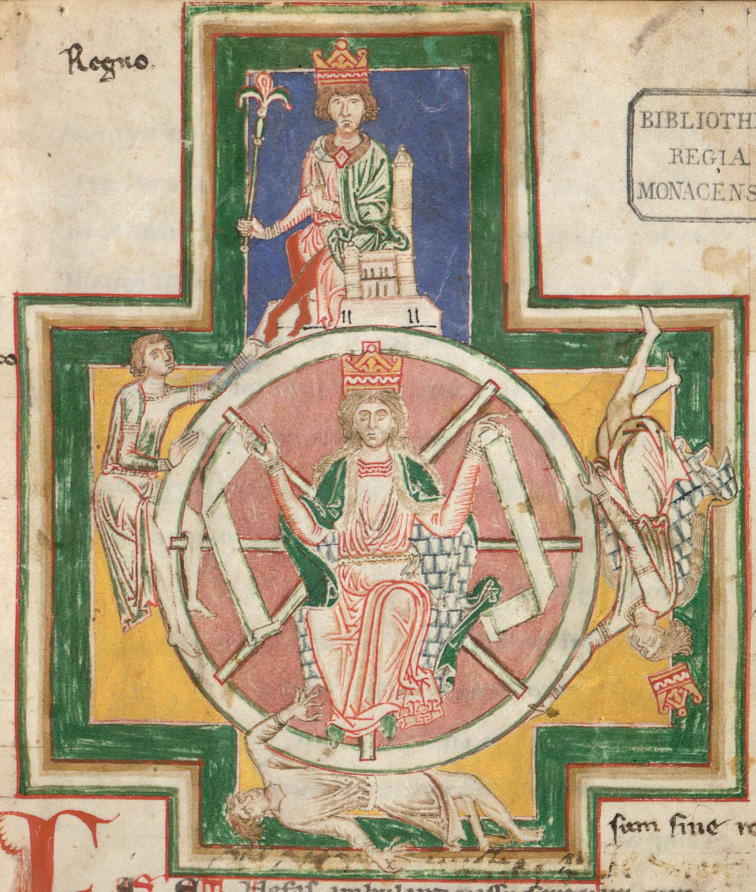

# 3. O Inferno Cíclico

*Vincent van Gogh, A Ronda dos Prisioneiros (segundo Gustave Doré), 1890. Museu Pushkin, Moscou.*

> "O que foi, isso é o que há de ser; e o que se fez, isso se fará; de modo que nada há de novo debaixo do sol."
> — Eclesiastes 1:9

---

## Uma roda de passos

O capítulo anterior terminou com o homem que não encontra as respostas e, mesmo assim, continua a viver, desejando, escolhendo, sofrendo e repetindo. A imagem que abre este capítulo mostra esse homem multiplicado.

Há dezenas deles. Num pátio de prisão fechado por muros altos de tijolo, homens de uniforme andam em fila, um atrás do outro, em círculo, todos no mesmo passo, quase todos de cabeça baixa, alguns com as mãos atrás das costas. Nenhum vai a lugar nenhum. O caminho se fecha e, se continuar andando, cada um passará de novo pelo mesmo ponto onde está agora. A roda não tem começo nem fim. Por isso cada um acredita que está indo para algum lugar.

Van Gogh pintou esta cena em 1890, internado num asilo em Saint-Rémy, copiando uma gravura de Gustave Doré sobre o pátio da prisão de Newgate, em Londres. Deu ao homem do centro, o único sem boné, cabelos claros como os seus. Ao lado, três homens de cartola observam a roda com as mãos para trás. Também eles estão dentro do pátio.

Lá em cima, perto de onde o muro termina, voam duas pequenas borboletas brancas, do tamanho de uma pincelada. Ninguém no pátio levanta os olhos para elas. As janelas são altas e gradeadas, o chão é de pedra fria, e não há fogo nem demônio. O inferno desta imagem é feito só de muro e de repetição.

Este capítulo é sobre o que acontece com o homem adâmico quando ele vive sem o mapa que o capítulo 2 mostrou estar faltando. O que ele encontra são as consequências de uma leitura errada do real, mais do que um castigo vindo de fora, que se acumulam no indivíduo, na família, na sociedade e até no código que escrevemos. A esse conjunto de consequências este livro dá o nome de inferno cíclico.

---

## Da ideia ao sofrimento

Toda ação nasce de uma leitura. Antes de agir, o homem já decidiu, quase sempre sem perceber, o que é real, o que tem valor, o que é ele mesmo e o que é o outro. Se a leitura está torta, a ação já nasce torta, por mais boa vontade que haja nela.

O capítulo 1 deu nome ao problema, o analfabetismo espiritual, que é a incapacidade de ler o que está além da matéria. Este capítulo acrescenta que esse analfabetismo desce do plano das ideias para a vida.

Desce primeiro para o indivíduo, como vida sem sentido. Um homem que não sabe o que é, de onde veio nem para onde vai organiza a existência em torno do que consegue ver, como dinheiro, aparência, aprovação e conforto. Quando consegue essas coisas, descobre que elas não respondem à pergunta que o movia. Quando não consegue, culpa a falta delas. Nos dois casos, a angústia permanece. O grito de Munch, que apareceu no capítulo 1, é o som que esse homem faz por dentro.

Esse sofrimento tem nomes que todos conhecem e que raramente ligamos a uma leitura do real. A ansiedade de quem vive no estado seguinte, sempre antecipando o que pode dar errado. A depressão de quem não vê para onde ir. A briga de família que se repete em todo almoço de domingo. O trabalho que esgota sem sentido. O relacionamento em que os dois se tratam como posses. A dívida de quem compra para preencher um espaço que nenhum objeto preenche. Nada disso se resolve só com leitura, e seria leviano dizer o contrário. Mas quase tudo isso piora quando se lê errado o que se é e o que é o outro.

Desce depois para a família. Pais que não sabem o que são ensinam aos filhos aquilo que receberam dos próprios pais, e o que receberam foi, muitas vezes, medo. Medo de faltar, medo de perder, medo de ser menos. A crença herdada, de que falou o capítulo 1, vai além de uma crença sobre Deus e inclui um jeito de brigar, de calar, de amar com condições, que passa de uma geração à outra com a mesma fidelidade com que passa a cor dos olhos.

E desce, por fim, para a sociedade. A violência, a desigualdade, a corrupção e a guerra costumam ser explicadas como problemas de política, de economia ou de segurança. São também, e antes disso, problemas de leitura. Quem se vê como um indivíduo isolado num mundo de coisas separadas trata o outro como coisa separada, seja obstáculo, recurso ou ameaça. Ninguém nasce violento. Uma criança pequena ri para estranhos. A violência é aprendida, e é aprendida a partir de uma ideia errada sobre o que somos.

Uma sociedade inteira pode ser construída sobre essa ideia. E quando isso acontece, as pessoas se perguntam por que o mundo é tão difícil sem perceber que a dificuldade começa no modo como olham para ele.

---

## Baile de máscaras

Se faltam respostas, alguém sempre aparece para oferecê-las.

O homem de hoje não sofre de falta de explicações. Sofre de excesso. Há centenas de religiões, milhares de igrejas, escolas filosóficas, linhas de terapia, tradições esotéricas, sistemas de autoajuda, teorias sobre energia, sobre o universo, sobre o sucesso, sobre a alma. Cada uma garante ter encontrado o caminho. Poucas mostram por que o caminho é aquele. Quase nenhuma oferece uma razão que se sustente fora do próprio círculo.

Diante de tantas portas sem placa, o homem escolhe pela porta mais próxima, pela mais barulhenta ou pela que a família já atravessava. E, como não tem uma bússola lógica, não tem também como saber se escolheu bem.

Nesse cenário floresce o que chamo de baile de máscaras. Muitas pessoas fingem saber. Falam com segurança do que não entendem, repetem o que ouviram como se tivessem descoberto, vestem a fantasia de mestre, de especialista, de iluminado. Algumas fazem isso por má-fé. A maioria faz por medo de parecer ignorante, e acaba enganando também a si mesma.

As relações são interpretativas. Não basta ser, há de parecer. Fernando Pessoa fez dessa condição uma obra. Inventou poetas inteiros, com biografia, data de nascimento, estilo e filosofia próprios, como Alberto Caeiro, o mestre que só acreditava no que via; Ricardo Reis, o clássico sereno; Álvaro de Campos, o engenheiro inquieto. E deixou, em 1932, quatro versos que muita gente sabe de cor: "O poeta é um fingidor. / Finge tão completamente / Que chega a fingir que é dor / A dor que deveras sente." Pessoa sabia que fingia, e por isso a sua obra funciona como uma aula sobre o baile. O baile de máscaras começa quando o fingidor esquece que finge.

Os psicólogos David Dunning e Justin Kruger publicaram em 1999 um estudo que ficou famoso, segundo o qual pessoas com pouca habilidade numa área tendem a superestimar o próprio desempenho, justamente porque lhes falta a habilidade necessária para perceber o que não sabem. A ignorância raramente vem acompanhada de humildade e quase sempre vem acompanhada de confiança.

E a confiança convence. Em 1951, Solomon Asch pediu a estudantes que comparassem o comprimento de algumas linhas desenhadas num cartão. A resposta certa era óbvia. Mas, na sala, os outros participantes eram atores combinados com o pesquisador e davam, em voz alta, a resposta errada. Uma parte considerável dos estudantes passou a concordar com o grupo, contra o que os próprios olhos viam. A massa confunde certeza com verdade. Basta que muitos digam a mesma coisa com convicção para que ela pareça real.

O baile tem as suas regras. Quem tira a máscara chama atenção, e a atenção incomoda. O autêntico gera contraste, e o contraste expõe os outros. Por isso há tanta pressão para que todos dancem do mesmo jeito. Quem tem personalidade frágil entra na manada; quem resiste a ela costuma pagar o preço.

Assim o fingimento se torna coletivo, uma espécie de mentira compartilhada que ninguém inventou sozinho e que todos ajudam a manter. A tradição esotérica chama isso de egrégora, a força de um pensamento que muitos alimentam ao mesmo tempo. A egrégora do fingimento é uma das forças mais poderosas do mundo. Ela confunde as mentes que chegam com perguntas sinceras e as devolve ao mesmo lugar de onde saíram, agora com algumas palavras novas.

Machado de Assis encontrou um jeito irônico de tirar a máscara, que foi matar o narrador antes de começar. Brás Cubas escreve as suas memórias depois de morto e as dedica ao verme que primeiro roeu as frias carnes do seu cadáver. Só um defunto, explica ele, pode enfim sacudir a capa e jogar fora as lantejoulas, confessar o que foi e o que deixou de ser, porque já não tem opinião alheia a temer. O livro é de 1881 e continua atual, porque descreve uma vida inteira gasta em parecer, na política, no amor, na família, na filosofia de ocasião. A máscara só caiu quando já não havia rosto embaixo dela.

---

## O autômato

Há uma pergunta que quase ninguém faz. Você escolheu aquilo em que acredita?

Tente lembrar o momento em que decidiu acreditar em Deus, ou deixar de acreditar. O momento em que decidiu que o trabalho é sofrimento, que dinheiro é sujo ou sagrado, que o amor acaba, que as pessoas não prestam, que você não é capaz. Na maior parte dos casos, esse momento não existe. As crenças chegaram antes da escolha. Vieram da família, da escola, do bairro, das primeiras dores, do corpo que recebemos.

E a crença empurra a ação. Quem acredita que o mundo é hostil anda de punhos fechados. Quem acredita que não merece sabota o que conquista. Quem acredita que a vida acaba no túmulo vive como quem tem pressa de consumir. Crença deturpada gera comportamento deturpado, com a mesma regularidade com que uma pedra solta cai.

Visto de perto, o homem é o resultado de três forças que ele não escolheu, que são as crenças que herdou, o DNA que recebeu e o ambiente em que cresceu. Ele sente que escolhe, e sente isso o tempo todo. Mas no século XVII o filósofo Baruch Spinoza já tinha observado que os homens se julgam livres porque têm consciência das próprias ações e ignoram as causas que as determinam. Uma pedra lançada no ar, dizia ele, se pudesse pensar, acharia que voa porque quer.

Para um programador, esse padrão tem nome, máquina de estados, ou autômato. Um autômato é um sistema que, a cada instante, está num estado determinado. Cada estado admite certos movimentos e não outros, e cada movimento leva a um novo estado. Um semáforo é um autômato simples. Do verde só se vai ao amarelo, do amarelo ao vermelho e do vermelho ao verde, sem escolha, seguindo uma tabela.

O homem é um autômato muito mais complexo, mas o princípio é o mesmo. O estado em que ele se encontra, por dentro e por fora, define o que ele percebe, o que sente e o que faz. Com fome, o mundo inteiro parece comida. Com raiva, cada gesto alheio parece provocação. Apaixonado, cada música parece escrita para ele. O sentimento vem do estado, e não de uma escolha. E a mesma pessoa, diante da mesma cena, em estados diferentes, faz coisas diferentes e jura, em cada uma delas, que estava decidindo livremente.

O universo inteiro opera assim. Dado um estado, um movimento; dado um movimento, um novo estado. As regras não mudam. O que muda são os estados que elas atravessam.

Isso pode soar como uma prisão, e de certo modo é. Mas há uma diferença decisiva entre o autômato que não sabe que é autômato e o que sabe. O primeiro é levado pela tabela. O segundo pode estudá-la. Este livro chama de era adâmica, entre outras coisas, o período em que o homem já tem intelecto mas ainda não descobriu a própria condição de autômato. Enquanto não descobre, ele não é autor de nada e funciona apenas como o próximo estado de uma sequência.

---

## A moeda de duas faces

A pergunta que o autômato provoca é velha. Então não há livre-arbítrio?

Este livro não precisa fechar essa questão para seguir adiante, e é mais honesto dizer isso do que fingir uma certeza. Mas pode mostrar onde ela fica.

Einstein escreveu numa carta, em 1926, que Deus não joga dados. Falava de física, mas a frase serve aqui com um acréscimo: Deus não joga dados, nós jogamos. O universo não conhece o "se". Cada estado leva ao próximo segundo uma regra. O "se" é uma condição humana e aparece sempre que alguém não sabe qual será o próximo estado. A ignorância é a variável imprevisível do sistema. Quem não conhece a tabela vive cercado de possibilidades e chama de escolha a sensação de estar diante delas.

Faça um teste. Imagine uma máquina que conhecesse toda a sua história, as suas crenças, o seu corpo e os seus medos, e respondesse no seu lugar a um questionário sobre o que você faria em cem situações. Se ela acertasse quase todas, onde estaria a escolha? E, se errasse, o erro seria liberdade ou apenas falta de dados?

A existência do livre-arbítrio é uma moeda de duas faces iguais, e qualquer que seja o lado o resultado é o mesmo. Se a liberdade existe, ela só se exerce por quem conhece as regras do próprio autômato. Se não existe, conhecer essas regras é, ainda assim, o novo estado que muda os movimentos seguintes. Nos dois casos o trabalho é o mesmo, estudar a tabela. É o caminho que os próximos capítulos seguem.

---

## Quem anda na roda

Se o homem é levado por estados, então quem é ele?

Todos temos uma resposta pronta. Eu sou fulano, filho de tal, nascido em tal lugar, com tal profissão e tal temperamento. Sempre fui assim e sempre serei. Imaginamos a nossa identidade como uma linha reta que atravessa a vida inteira sem se quebrar, do berço ao túmulo, carregando o mesmo nome e a mesma essência.

Essa linha não resiste a um exame honesto.

As células do corpo se renovam continuamente. As opiniões que você defendia aos quinze anos talvez hoje lhe causem vergonha. O que você sente pela manhã não é o que sente à noite. Com uma pessoa você é calmo; com outra, impaciente. Num lugar é tímido; em outro, expansivo. Se aquilo que fazemos e sentimos diz o que somos, e se o que fazemos e sentimos muda a cada instante, então não somos um. Somos muitos, um depois do outro, sob o mesmo nome.

A identidade fixa é uma ilusão de continuidade, e há boas razões para que o cérebro a produza.

Em vez de registrar o mundo como uma câmera que grava tudo, o cérebro trabalha em pulsos, como uma máquina que se reinicia a cada instante, e economiza energia ignorando o que não muda. Você não sente a roupa na pele enquanto não pensa nela. Não ouve o ruído da geladeira até que ele pare. Depois de alguns minutos num ambiente, deixa de sentir o cheiro dele. O que se torna comum desaparece da percepção, e a atenção vai inteira para o que é novo. É um recurso de sobrevivência, porque um animal que prestasse atenção a tudo ao mesmo tempo não perceberia o predador.

O mesmo mecanismo que apaga a roupa e o ruído apaga também as mudanças lentas em nós mesmos. Como não percebemos a transformação contínua, supomos que somos sempre o mesmo. A linha reta da identidade é feita de tudo aquilo que o cérebro decidiu não notar.

E o tempo trabalha nesse silêncio. Age como um cupim, que não faz barulho, não avisa e corrói tudo o que é estado, o corpo, as relações, os bairros, as famílias, a esperança e a inocência. Ninguém vê o cupim trabalhando. Vê-se, um dia, a viga que cede. O nosso erro é viver como se o hoje fosse durar para sempre.

A separação começa cedo. Um bebê recém-nascido não distingue o próprio corpo do corpo da mãe, nem a mãe do resto do mundo. Tudo é uma coisa só. Nos meses seguintes, ele descobre que a mão que se move é sua, que a mãe vai embora e volta, que existe um dentro e um fora. Por volta de um ano e meio, a maioria das crianças passa a reconhecer a própria imagem no espelho. Pouco depois aparecem as palavras *eu* e *meu*.

É um passo necessário para viver no mundo material. Mas é também o nascimento do ego, o momento em que a criança se separa do todo e começa a se experimentar como uma coisa isolada, com fronteiras, que precisa ser defendida. A partir daí, o outro é outro, o mundo é de fora, e a vida passa a ser uma disputa entre o meu e o seu.

O ego é o primeiro objeto que aprendemos a construir. E a individualidade isolada, que a nossa cultura celebra como conquista, é talvez a raiz da maior parte dos males humanos. Uma sociedade que cultiva o indivíduo separado vive de medo, medo de perder o que é seu, medo do que o outro pode fazer, medo de não ser alguém. E vive, para compensar, de aparência de segurança.

No quadro, cada prisioneiro caminha sozinho, embora estejam todos no mesmo círculo, no mesmo passo, a poucos centímetros uns dos outros. Cada um se sente único. Vistos do alto, como os vê o pintor, são todos o mesmo.

---

## O pêndulo

Dentro de cada um que anda na roda há ainda um segundo movimento, que a pintura não mostra, um pêndulo que oscila entre dois polos, sem parar em nenhum.

Heráclito, como mostrou o capítulo anterior, disse que a guerra dos opostos é pai de todas as coisas. O yin-yang diz que cada polo carrega a semente do outro. Muitos séculos depois, a filosofia alemã descreveu o mesmo movimento numa fórmula que costuma ser atribuída a Hegel. Uma tese provoca a sua antítese, e o choque das duas produz uma síntese, que se torna uma nova tese, e assim por diante, sem fim. É a dialética. Quase todos os que escreveram sobre ela descreveram como o ciclo gira. Poucos explicaram por que ele gira.

A explicação que este livro propõe é simples. A dialética é perda de memória.

Pense num corte de cabelo. Você o usa comprido há anos e, um dia, corta curto. Gosta. Sente-se outro. Depois de algumas semanas, já não se vê com o cabelo novo; vê apenas o seu cabelo. Começa a notar defeitos, a lembrar como era bom o comprido, e deixa crescer. Quando cresce, gosta de novo. Por algum tempo. Depois o comprido também vira o de sempre, os defeitos aparecem, e a tesoura volta.

Nada mudou no cabelo. O que mudou foi a percepção. O novo, ao ser possuído, deixa de ser novo, e o cérebro, que ignora o comum, apaga o seu valor. O que falta, ao contrário, brilha. O pêndulo oscila porque esquecemos, a cada passagem, o que já sabíamos sobre o outro polo.

O mesmo vale para quase tudo. A casa nova vira a casa. O carro novo vira o carro. A pessoa por quem se esperou anos vira a pessoa que está sempre ali. O corpo emagrecido com esforço vira o corpo de sempre, e o olhar já procura o próximo defeito.

Arthur Schopenhauer, o filósofo que lia os *Upanishads*, descreveu esse movimento em 1819, em *O Mundo como Vontade e Representação*. A vida, escreveu, oscila como um pêndulo, para lá e para cá, entre a dor e o tédio. Quando nos falta algo, sofremos pelo desejo. Quando conseguimos, o desejo morre e no seu lugar aparece o tédio, que logo produz um novo desejo. É o que este livro chama de guerra entre o desejo de ter e o tédio de possuir.

Sem o tédio não haveria desejo, porque já estaríamos completos. Todo espaço preenchido abre um espaço novo. Por isso o desejo é um saco sem fundo, e quanto mais se tem, mais se quer.

E há uma camada mais funda. Observado com atenção, o desejo é medo do oposto. Quem teme a pobreza deseja a riqueza. Quem teme a solidão deseja companhia. Quem teme o anonimato deseja ser visto. O pêndulo não começa no polo que desejamos. Começa no polo de que fugimos. É do círculo azul, frio, que o pêndulo tira o impulso para alcançar o dourado.

Seria natural imaginar que a saída é chegar enfim ao polo desejado e ficar ali. Mas a completude também é um inferno. Quem não deseja mais nada sente-se parado, sem direção, sem razão para levantar da cama. O Jardim do Éden, lido assim, é ao mesmo tempo o sonho e o problema, porque um lugar onde não falta nada é um lugar onde não há para onde ir. Quisestes o Jardim, tivestes o Jardim. E no Jardim, sem desejo, a vida parece não andar.

O pêndulo não se resolve escolhendo um lado. Ele só se resolve quando se entende o que o faz oscilar.

---

## O conto da mosca

Observe uma mosca.

Ela pousa na borda de um copo, na comida sobre a mesa, no braço de alguém. Uma mão a espanta. Ela levanta voo, faz uma curva no ar, dá duas ou três voltas pela sala, e pousa no mesmo lugar de onde foi espantada. A mão a espanta de novo. Ela voa, faz a curva, e volta.

A mosca simplesmente esqueceu, o que é diferente de teimosia. A memória de uma mosca é curta, e no tempo que leva para dar a volta pela sala ela já perdeu o registro do perigo. Para ela, cada pouso é o primeiro.

O tamanho de um ciclo é proporcional ao tamanho da memória de quem o percorre. A mosca repete o seu em segundos. O homem repete o dele em meses, em anos, numa vida inteira. Escolhe de novo o mesmo tipo de pessoa que o feriu, aceita de novo o mesmo tipo de trabalho que o esgotou, comete de novo o mesmo erro com os filhos que os pais cometeram com ele. Entre uma volta e outra, passou tempo suficiente para esquecer, e a situação chega com outra roupa, outro rosto, outro nome. Parece nova. Não é.

O homem é uma mosca com uma memória um pouco maior.

Por isso lembrar é poder. Quem lembra reconhece o padrão quando ele volta, e quem reconhece o padrão pode fazer, uma vez, algo diferente. Para toda decisão, um ciclo; e basta uma decisão diferente no ponto certo do ciclo para que ele se rompa. A mosca não tem como fazer isso. O homem tem, desde que se lembre.

Há duas coisas que tornam o esquecimento ainda mais forte. A primeira é o desejo de se sentir especial. Cada um de nós acredita que a própria história é única, que o próprio amor é diferente de todos, que o próprio sofrimento ninguém jamais sentiu. Esse desejo é compreensível, e é cego. Quem acha que está vivendo algo inédito não procura o padrão, e por isso não o encontra, mesmo quando ele está escrito em mil livros, em mil canções, na vida dos próprios pais.

A segunda é o tempo. Quase todo mundo percebe que os anos passam mais depressa à medida que envelhecemos. Uma das explicações para isso é a mesma que move o pêndulo. O cérebro registra o novo e ignora o comum. Na infância, quase tudo é novo, e cada dia deixa muitas marcas. Na vida adulta, os dias se parecem, e a memória guarda poucos deles. Um ano de repetição, visto de trás, parece ter durado um mês. Quanto mais o ciclo se repete, menos dele se percebe, e menos se percebe que é um ciclo.

---

## A roda da Fortuna

*Roda da Fortuna, iluminura do códice Carmina Burana, c. 1230. Biblioteca Estatal da Baviera, Munique.*

No início do século XIII, num mosteiro da Baviera, alguém copiou num grande livro de pergaminho cerca de duzentos e cinquenta poemas e canções. Eram textos em latim, muitos escritos por estudantes e clérigos errantes, com canções de bebida, de amor, de primavera, e também sátiras amargas sobre a cobiça e a vaidade do mundo. O livro ficou conhecido como *Carmina Burana*, as canções de Benediktbeuern, e foi redescoberto no início do século XIX. Em 1937, o compositor Carl Orff musicou parte desses poemas, e a abertura da sua cantata, *O Fortuna*, tornou-se uma das peças mais conhecidas da música do século XX.

Na primeira página do códice há uma iluminura. É uma roda.

No centro, sentada, está a deusa Fortuna, coroada, com os braços abertos, segurando os raios da roda como quem a faz girar. Em volta da borda há quatro figuras humanas. À esquerda, um homem agarrado à roda tenta subir; ao seu lado, escrito à mão, *regnabo*, reinarei. No alto, acima da roda, um rei está sentado no trono, com cetro e coroa, *regno*, reino. À direita, outro homem despenca de cabeça para baixo, e a coroa lhe escapa da cabeça e cai no ar, *regnavi*, reinei. Embaixo, sob a roda, um homem está estendido no chão, esmagado, *sum sine regno*, estou sem reino.

Quatro palavras, quatro tempos do mesmo verbo, quatro posições do mesmo ciclo. O homem que sobe deseja. O rei possui. O que cai perde. O que está no chão espera, e, porque espera, deseja de novo, e volta a agarrar-se à roda.

Logo abaixo da imagem, no mesmo pergaminho, está o poema que Orff tornaria famoso: "Ó Fortuna, como a lua, sempre variável, sempre cresces ou decresces." Os estudantes que o escreveram sabiam do que falavam. Não precisaram de filosofia para ver que a roda nunca para.

Sete séculos antes, um homem tinha escrito sobre essa roda numa prisão. Boécio, filósofo e alto funcionário de Roma, foi acusado de traição e encarcerado em Pavia à espera da execução, por volta de 524. Ali escreveu *A Consolação da Filosofia*. No livro, a Filosofia aparece como uma mulher e empresta a voz à Fortuna, que se defende dizendo que girar é a sua natureza e quem aceita subir na roda não pode chamar de injustiça a descida. A consolação de Boécio está em saber que o que a roda dá e tira nunca foi dele. O que é seu de verdade, diz a Filosofia, ninguém pode tomar.

Mas há um detalhe que eles não escreveram. Os quatro homens da borda são a mesma pessoa em quatro momentos e, mais do que isso, quatro papéis que qualquer um pode ocupar, porque a roda não tem lugares reservados. Quem hoje está no trono amanhã está caindo, e o que está caindo hoje já esteve embaixo. Os atores mudam, e as posições continuam as mesmas.

---

## Atores em loop

Junte o autômato, a identidade ilusória, o pêndulo e a mosca, e o quadro se completa.

Somos atores vivendo personagens em histórias que se repetem. O ciúme, a traição, a ambição que destrói, o filho que se afasta do pai, o poder que corrompe, o amor que vira hábito, a guerra entre irmãos, nada disso foi inventado por nós. São enredos antigos, que já estavam nos mitos gregos, nos livros da Bíblia, nas tragédias de Shakespeare. A cada geração, novos atores sobem ao palco e encenam as mesmas cenas, convencidos de que estão improvisando.

O Eclesiastes, que abre este capítulo, disse isso há mais de dois mil anos, que o que foi é o que será e não há nada de novo debaixo do sol. O futuro é o passado com novos atores, e o cenário se repete com outro elenco.

Cada indivíduo é único, mas os eventos foram, são e serão, para sempre, os mesmos. O historiador das religiões Mircea Eliade mostrou, em *O Mito do Eterno Retorno*, de 1949, que os povos antigos sabiam disso e faziam da repetição um rito. O que o homem arcaico considerava real era o gesto que repetia um gesto primordial, como plantar como os deuses plantaram e casar como os heróis casaram. Fora desses gestos, o tempo era só desgaste. Para eles, a repetição era o modo de tocar o que não passa. O homem moderno repete do mesmo jeito, mas sem saber o que repete, e por isso vive a repetição como tédio.

E o ator carrega o carma dos personagens que interpreta. Quem entra no papel do traído sofre a dor do traído. Quem entra no papel do avarento vive o medo do avarento. Não é preciso acreditar em vidas passadas para entender isso. Basta notar que quem vive uma história recebe, junto com ela, as consequências que essa história sempre produz. A história tem as suas leis, e elas valem para qualquer um que a encene.

Em 1882, em *A Gaia Ciência*, Friedrich Nietzsche propôs um exercício. Imagine que um demônio se aproxima de você na sua solidão mais solitária e diz: esta vida, assim como você a vive agora e a viveu até aqui, você terá de vivê-la mais uma vez, e ainda inúmeras vezes, sem nada de novo, cada dor e cada prazer, cada pensamento e cada suspiro, na mesma ordem. Nietzsche chamou essa ideia de eterno retorno e perguntou: você se atiraria ao chão e amaldiçoaria o demônio, ou o chamaria de divino?

Para a maioria das pessoas, a ideia é aterrorizante. Ainda assim, é bem próxima do que já fazemos, só que sem perceber.

O homem grego tinha uma imagem para isso. Na *Odisseia*, quando Ulisses desce ao mundo dos mortos, vê Sísifo, condenado a empurrar uma pedra enorme até o alto de uma montanha. Sempre que está quase no topo, a pedra lhe escapa das mãos e rola de volta ao vale, e ele precisa recomeçar. Para sempre. Ticiano pintou-o em meados do século XVI, curvado sob a rocha, os músculos tensos, o rosto escondido pelo peso.

Sísifo é o trabalhador que trabalha o mês inteiro para pagar as contas do mês, que no mês seguinte voltam. É quem busca excessos para preencher faltas que os excessos não preenchem. É o desejo de ter que vira tédio de possuir e volta a ser desejo. A pedra sobe; a pedra desce. Em 1942, Albert Camus escreveu um ensaio sobre ele e concluiu que é preciso imaginar Sísifo feliz, porque a própria luta para chegar ao topo bastaria para encher um coração humano. É uma resposta corajosa. Mas é a resposta de quem já desistiu de entender por que a pedra rola.

O cinema contou a mesma história com outro final. Em *Feitiço do Tempo*, de 1993, um repórter de televisão arrogante acorda todos os dias no mesmo 2 de fevereiro, numa cidadezinha da Pensilvânia, com a mesma música no rádio. Primeiro aproveita, depois se desespera, depois tenta morrer e acorda de novo na mesma cama. O dia só termina quando ele para de usar a repetição para si e passa a conhecer cada pessoa da cidade, cada acidente que vai acontecer, cada história que se repete, e a agir dentro delas. O anel não se rompe pelo esforço. Rompe-se quando ele aprende o roteiro.

Isso é o inferno cíclico. Uma condição em que as mesmas cenas se repetem, os mesmos erros são cometidos, as mesmas dores voltam, e o homem nunca vê o padrão porque, a cada volta, esqueceu a anterior.

---

## O inferno é aqui

O homem comum, como mostrou o capítulo 2, recebeu do inferno uma imagem quase infantil, a de um porão com fogo, demônios de chifre e tridente, um lugar para onde se vai depois da morte, como castigo.

O inferno cíclico é uma condição em que já se está, e não um lugar para onde se vai. O pátio de Van Gogh não fica debaixo da terra, num mundo futuro. Fica logo ali, atrás de um muro de tijolos, no caminho de todos os dias.

Em 1667, John Milton publicou *O Paraíso Perdido*, um longo poema sobre a queda dos anjos e do homem. No primeiro canto, Satanás, recém-expulso do céu e jogado num lago de fogo, olha ao redor e diz: "A mente é o seu próprio lugar, e em si mesma pode fazer do inferno um céu, e do céu um inferno." Milton pôs a frase na boca do demônio, que a usa para se consolar. Mas ela é verdadeira em outro sentido, que o próprio Satanás não percebe, porque ele leva o inferno consigo para onde vai, porque o inferno está na forma como ele lê o mundo.

A mesma figura pode ser lida mais de perto. Satanás, na tradição, é o adversário e o pai da mentira. Lido com as letras deste livro, ele é o nome da individualidade separada, a voz da mente que diz eu, meu, contra, primeiro. A mentira original é a crença de que somos coisas isoladas. E o Éden continua aqui; já vivemos nele e não o vemos, porque olhamos com os olhos dessa voz. A nossa penitência é encontrar em todas as presenças apenas a nossa ausência.

Céu e inferno são estados, e são vividos aqui e agora. Duas pessoas podem estar na mesma sala, na mesma tarde, com a mesma luz entrando pela janela, e uma viver o céu enquanto a outra vive o inferno. O mundo, nos dois casos, é o mesmo. O que muda é a mente que o recebe.

José Saramago imaginou uma cidade inteira caindo nesse estado. Em *Ensaio sobre a Cegueira*, de 1995, uma epidemia de cegueira branca atinge todos, menos uma mulher, que passa a ver o que os outros fazem quando acham que ninguém os vê. Em poucos dias, sem olhos e sem máscaras, as pessoas se tornam capazes do pior. No fim, quando a visão volta, ouve-se a frase que resume o livro: "Penso que não cegámos, penso que estamos cegos, Cegos que vêem, Cegos que, vendo, não vêem." O inferno do romance estava em cada um, à espera de que as luzes se apagassem.

Isso quer dizer que o mal está na mente desordenada, mais do que no mundo, na leitura torta, na crença deturpada que gera o comportamento deturpado. A natureza é inocente. Um leão que caça não comete um crime, e um terremoto não odeia ninguém. O mal humano, aquele que fere de propósito, que explora, que mente, que mata, nasce sempre de uma ideia errada sobre o que é o eu e o que é o outro. Violência, desigualdade e conflito são frutos da mesma ignorância. Por isso não se resolvem só com leis, polícia ou dinheiro, embora essas coisas sejam necessárias. Resolvem-se, no fundo, com uma leitura melhor do real.

O capítulo 6 mostrará o fundamento dessa afirmação. Por enquanto, basta registrar que, se o inferno é feito de leitura errada, ele pode ser desfeito por leitura certa.

---

## A dor que ensina

Diante de tudo isso, é natural perguntar por que existe a dor. Se o inferno cíclico é feito de sofrimento, não seria melhor um mundo sem ele?

Um mundo sem dor seria um mundo sem valor. Só sabemos o que é a saúde porque existe a doença. Só valorizamos a companhia porque conhecemos a solidão. Uma criança que nunca se queimou não respeita o fogo. A dor é o contraste que dá peso às coisas.

E ela é justa. A dor não chega por acaso nem por capricho de um deus irritado. Ela tem causa. A mão que toca a brasa arde porque tocou a brasa. O corpo que come mal adoece porque comeu mal. A relação construída sobre mentira desaba porque foi construída sobre mentira. A dor é a justiceira da natureza, que devolve a cada movimento a consequência que ele carrega, sem ódio e sem favor.

A natureza é o manual de Deus. Tudo o que precisamos saber sobre as regras do jogo está escrito nela, para quem souber ler. E, nesse manual, para cada dor existe uma causa e, para cada causa, um antídoto. O veneno da serpente é usado para produzir o soro que salva quem foi picado por ela. Quem conhece a causa conhece também o caminho de saída.

O problema nunca foi a existência da dor. O problema é sofrer sem ler o que ela diz, e por isso repetir indefinidamente o movimento que a provoca. É a mosca outra vez, pousando na mesma borda.

Há uma forma de começar a sair do ciclo que o Oriente conhece há muito tempo. Lao-Tsé, no capítulo anterior, chamou o Tao de curso, de fluxo. Quem nada contra a correnteza se cansa e não sai do lugar. Quem entende a correnteza usa a força dela. Vencer o ciclo começa por compreender que tudo passa e tudo retorna, que o desejo virará tédio e o tédio virará desejo, que o trono levará à queda e a queda poderá levar de volta ao trono. Quem sabe disso não deixa de viver os ciclos. Deixa de ser surpreendido por eles.

---

## A mesma roda no código

Agora vou falar da parte que conheço de perto.

Durante mais de quinze anos trabalhei construindo software, e posso dizer com segurança que, no software, o inferno cíclico aparece nas estatísticas.

Todo sistema começa rápido. Nas primeiras semanas, uma equipe pequena entrega funcionalidades novas quase todos os dias. Tudo parece simples. Depois, à medida que o sistema cresce, alguma coisa começa a emperrar. Cada mudança quebra algo que estava funcionando em outro lugar. Cada correção pede outra correção. A velocidade cai. Estudos sobre o ciclo de vida do software estimam, desde os anos 1970 e 1980, que a manutenção consome a maior parte do esforço total de um sistema, algo em torno de oitenta por cento. Criar é fácil. Manter é que é difícil.

Nos anos 1970, o engenheiro Meir Lehman formulou um conjunto de leis sobre a evolução dos programas. Uma delas diz que a complexidade de um sistema que está em uso cresce continuamente, a menos que se trabalhe ativamente para reduzi-la. A desordem é a tendência natural.

A resposta mais comum a esse problema é colocar mais gente no projeto. Não funciona. Em 1975, Fred Brooks, que tinha dirigido o desenvolvimento de um dos maiores sistemas operacionais da IBM, escreveu num livro chamado *O Mítico Homem-Mês* que acrescentar pessoas a um projeto de software atrasado o atrasa ainda mais. Cada pessoa nova precisa aprender o sistema, e cada pessoa a mais multiplica as conversas necessárias para que todos se entendam. Mais gente, menos entrega.

É a pedra de Sísifo com um crachá.

Há também o excesso de opções, o mesmo do baile de máscaras. Existem dezenas de paradigmas, centenas de linguagens de programação, milhares de frameworks, e a cada ano surge uma nova maneira de fazer a mesma coisa, anunciada como a solução definitiva. A curva de aprendizado nunca acaba, porque o chão se move o tempo todo. E cada nova tecnologia traz consigo a sua própria tribo, com os seus especialistas, os seus dogmas e as suas máscaras.

O software também é pouco intuitivo. Robert C. Martin, em *Arquitetura Limpa*, lembra que a analogia com a construção civil engana. Um prédio tem uma estrutura física visível, que obedece à gravidade, e um sistema não tem nada disso. Ele é feito de símbolos, e o código, escrito linha após linha, como um texto, esconde a visão do todo. Quem lê um programa vê as árvores e raramente vê a floresta.

E os conceitos mais básicos do ofício são confusos até para quem trabalha com eles há anos. Pergunte a dez programadores o que é polimorfismo, abstração, encapsulamento, acoplamento e coesão, e você ouvirá dez respostas diferentes, várias delas contraditórias. É o mesmo problema que o capítulo 2 encontrou na filosofia, um mesmo nome com vários sentidos e vários nomes para a mesma coisa. Os programadores, que vivem de linguagem, sofrem do mesmo mal que os filósofos.

No centro de tudo isso há um sintoma que vale nomear desde já. A forma dominante de programar, a orientação a objetos, organiza o software em torno de objetos, coisas com uma classe, atributos e uma identidade própria, que guardam dentro de si o próprio estado e o próprio comportamento. O mundo do sistema passa a ser uma coleção de coisas separadas que se chamam umas às outras. E, como cada coisa carrega dentro de si um pedaço do comportamento, mudar um comportamento obriga a mexer em muitas coisas. O acoplamento é o maior cupim da orientação a objetos, que corrói o sistema por dentro, sem fazer barulho, até que uma mudança pequena derrube uma parede inteira.

Para tratar esses sintomas, a indústria criou boas práticas, catálogos de padrões, metodologias, certificações. Algumas ajudam. Nenhuma cura. Porque a doença está na forma de olhar, e não na técnica.

O catálogo mais famoso é de 1994. Quatro engenheiros, que ficaram conhecidos como a Gangue dos Quatro, reuniram em *Padrões de Projeto* vinte e três soluções que se repetiam nos bons sistemas orientados a objetos. O livro é excelente, e o curioso é o que ele revela. Os bons programadores já intuíam que o valor estava no que se repete, nas estruturas que servem a muitos casos, mais do que nos objetos de cada caso. Mas os padrões foram ensinados como receitas, sem a base filosófica que explicaria por que funcionam. E receita sem princípio vira mais uma camada de jargão.

Modelamos o software do mesmo jeito que enxergamos a realidade. Quem enxerga o mundo como uma coleção de coisas isoladas, cada uma com a sua essência e a sua identidade fixa, constrói sistemas como coleções de objetos isolados, cada um com a sua classe. A orientação a objetos é a identidade ilusória do ego, transposta para o código. Uma visão deturpada do real gera um software deturpado. O erro do software ecoa o erro existencial.

O capítulo 5 mostrará de onde vem esse erro e por que ele tem o nome de um filósofo grego. O que importa aqui é perceber a coincidência. A espiritualidade, a filosofia, a linguagem e o software sofrem da mesma dor, e ela tem a mesma origem, em palavras sem sentido fixo, conceitos mal definidos, jogos de linguagem que cada um joga com as próprias regras. O problema comum é a linguagem.

---

## As borboletas sobre o muro

No quadro, os prisioneiros continuam andando. Os homens de cartola continuam olhando. O muro continua alto.

Mas a imagem guarda, como as dos capítulos anteriores, um detalhe que passa fácil. As duas borboletas no alto do muro vêm de fora do pátio, de onde a roda não alcança, e se movem como nada lá embaixo se move, livres, sem fila e sem volta marcada. Não há posição no círculo de onde não possam ser vistas.

Aos homens do pátio falta apenas levantar os olhos.

A roda da Fortuna gira há oito séculos naquele pergaminho, e os quatro homens continuam subindo, reinando, caindo e esperando. Mas quem olha a iluminura de fora, como nós agora, vê o que nenhum deles vê, a roda inteira. Vê que *regnabo*, *regno*, *regnavi* e *sum sine regno* são o mesmo verbo. Quem vê a roda inteira já não está apenas preso a ela.

Este capítulo descreveu o inferno. Ele é feito de leitura errada, de esquecimento, de identidade ilusória, de crenças que ninguém escolheu e de máscaras que todos usam. Nada disso é sentença. Tudo isso é consequência. E o que é consequência tem causa, e o que tem causa tem antídoto.

Os gnósticos, no capítulo 2, disseram que a libertação vem pelo conhecimento. A mosca ensinou que lembrar é poder. Falta dizer qual é o conhecimento capaz de romper a roda.

O próximo capítulo trata dele.
