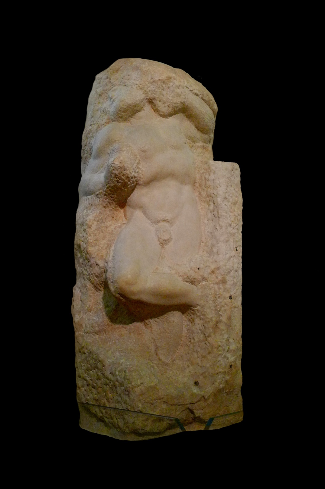
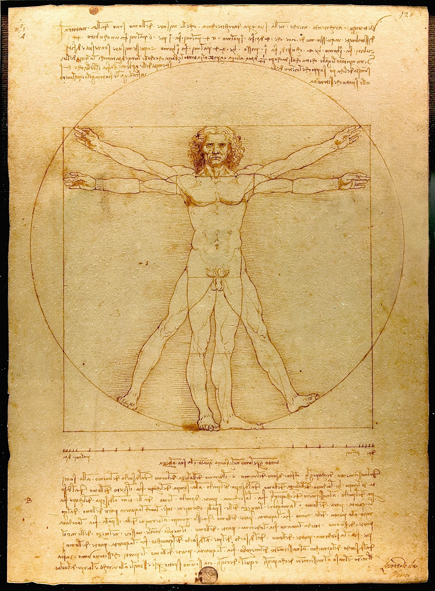

# 5. O Erro



*Michelangelo Buonarroti, um dos Prisioneiros para o túmulo de Júlio II, c. 1520–1534. Galleria dell'Accademia, Florença. Foto: Jörg Bittner Unna, CC BY-SA 3.0.*

> "O ser se diz de muitos modos."
> — Aristóteles, Metafísica, livro IV

---

## O corpo na pedra

A imagem que abre este capítulo é um bloco de mármore que não chegou a ser estátua. De dentro dele sai um corpo de homem, com o peito, a barriga, uma coxa dobrada e um braço erguido que esconde o rosto. O resto ainda é pedra bruta, com as marcas do cinzel à vista, e nem a cabeça nem as pernas chegaram a sair. O homem parece querer se soltar, e o bloco não deixa.

Michelangelo começou uma série dessas figuras para o túmulo do papa Júlio II e as deixou inacabadas. Hoje elas estão em Florença, na Galleria dell'Accademia, ao longo do corredor que leva ao *Davi*. São chamadas de *Prisioneiros*, ou *Escravos*. Os visitantes passam por elas a caminho da estátua perfeita, e muitos saem achando os blocos mais fortes do que ela. No *Davi*, a forma venceu a pedra. Nos *Prisioneiros*, vê-se a luta.

Atribui-se a Michelangelo uma ideia sobre o seu ofício, a de que a figura já está dentro do bloco e o trabalho do escultor é só tirar o que sobra. A frase é provavelmente lendária, mas resume com exatidão uma filosofia. Ela diz que a forma mora dentro da matéria, presa nela, à espera de ser libertada pelo cinzel.

O capítulo 2 deixou dois homens caminhando lado a lado no centro da *Escola de Atenas*, um apontando para o alto e outro com a mão espalmada para o chão, e prometeu dizer por que este livro discorda da mão espalmada. O prisioneiro de Michelangelo mostra, em mármore, o que aquela mão ensinou, uma forma trancada dentro de uma das coisas em vez de estar acima delas.

Os programadores repetem a mesma operação, dois mil e trezentos anos depois, cada vez que fecham um comportamento dentro de um objeto.

Este capítulo trata desse gesto, das razões pelas quais ele é um erro e do lugar onde esse erro continua vivo, na nossa filosofia, na nossa gramática, no nosso modo de olhar uns para os outros e no código que hoje organiza boa parte da vida.

---

## O primeiro gesto da criação

No mesmo teto em que pintou a *Criação de Adão*, Michelangelo pintou, perto do altar, a primeira cena do Gênesis. Não há homem, não há jardim, não há animais. Há só Deus, sozinho, num céu revolto, torcendo o corpo para cima com os dois braços erguidos. Com uma mão ele empurra uma massa escura; com a outra, abre espaço para a claridade. O corpo inteiro está em movimento. A cena não mostra uma coisa sendo feita. Mostra uma separação acontecendo.

No relato bíblico, antes de qualquer criatura, Deus separa. Separa a luz das trevas, as águas de cima das águas de baixo, o dia da noite. Só depois de separar ele nomeia, e só depois de nomear aparecem as coisas.

Platão fez na filosofia um gesto parecido. O capítulo 2 mostrou como ele resolveu o embate entre Parmênides e Heráclito. Há o mundo que muda, onde tudo nasce, se desgasta e morre, e há o mundo que não muda, onde estão os modelos perfeitos e eternos de tudo. Uma cadeira quebra; a ideia de cadeira continua. Um triângulo desenhado na areia se apaga com o vento; o triângulo que ele imita continua exato. Platão chamou o primeiro de mundo sensível e o segundo de mundo inteligível, porque só se chega a ele pelo intelecto.

Este livro discorda de Platão em muitos detalhes, e vai discordar de mais alguns até o fim. Mas no essencial ele acertou. Há, de fato, dois planos. Um deles se vê, se pesa, se mede, e está sempre mudando. O outro não se vê, não muda, e é ele que rege as mudanças do primeiro. O dedo que aponta para o alto, na *Escola de Atenas*, aponta para o lugar certo.

O que faltou a Platão foi dizer com precisão o que mora em cada um dos dois planos. Ele pôs lá em cima as ideias das coisas, a ideia de cavalo, a ideia de mesa, a ideia de homem. Este livro vai propor que o que está lá em cima são as ideias dos movimentos. Mas, antes de chegar aí, é preciso entender o que aconteceu com a separação que Platão fez. O discípulo dele a desfez.

---

## A mão que fecha

Aristóteles estudou na Academia de Platão por vinte anos, dos dezessete aos trinta e sete. Era o aluno mais brilhante da escola, e saiu dela discordando do mestre no ponto central.

Para ele, as formas vivem nas próprias coisas, e não existe, em lugar nenhum, uma ideia de cavalo flutuando separada dos cavalos. A forma está dentro de cada cavalo, unida à carne de que ele é feito. O exemplo preferido de Aristóteles era uma estátua de bronze. O bronze é a matéria. A figura que o escultor deu ao bronze é a forma. A estátua é os dois juntos, numa coisa só. A essa união de forma e matéria os comentadores deram depois o nome de hilemorfismo, das palavras gregas para matéria, *hyle*, e forma, *morphé*. E à coisa que resulta dessa união, que existe por si mesma e serve de suporte a todas as suas qualidades, Aristóteles deu o nome de *ousía*, que os latinos traduziram por *substância*.

O prisioneiro de Michelangelo é, por isso, uma imagem exata do que Aristóteles pensava, uma estátua, forma presa numa matéria, o exemplo que ele próprio preferia. Por estar inacabada, é também honesta e deixa ver o esforço de uma forma que não cabe no bloco.

Há uma contradição curiosa nesse movimento. Aristóteles rompe com Platão, mas não abandona a forma. A forma eterna, que não nasce nem morre, que é a mesma em todos os cavalos, é uma ideia platônica. Aristóteles não destruiu o outro mundo. Ele o trouxe para baixo e o trancou dentro das coisas. A luz que vinha do alto entrou no bloco, e as correntes foram fechadas por fora.

Isso teria ficado restrito a uma discussão entre filósofos se não fosse por um detalhe. Junto com a forma, Aristóteles trancou dentro da coisa também o movimento.

---

## A pedra que quer cair

Para Aristóteles, uma pedra cai porque é da natureza dela cair. Cada um dos elementos tinha, na física dele, um lugar natural. A terra pertence ao centro do mundo, e por isso a pedra, que é feita sobretudo de terra, tende para baixo. O fogo pertence à periferia, e por isso a chama sobe. A queda seria algo que a pedra faz, e não algo que acontece com ela, porque está na sua essência buscar o seu lugar.

O mesmo vale para os seres vivos. A semente tem em si, em potência, a árvore que vai ser. Crescer é a passagem dessa potência para o ato. O movimento, para Aristóteles, é a realização daquilo que a coisa já trazia dentro de si como possibilidade. Cada movimento pertence a alguém. Há sempre uma substância que se move, e o movimento é um atributo dela, como a cor e o peso.

É aqui que está o erro que dá nome a este capítulo. Aristóteles colou o verbo ao objeto. Prendeu o movimento ao elemento que se move. Fez do movimento uma propriedade da coisa, quando a coisa é que é tomada pelo movimento.

A correção pode ser dita de modo seco. A matéria apenas responde a instruções estruturais da realidade, e o movimento nasce da lógica que processa o objeto, e não do próprio objeto.

Numa leitura dura, mas que este livro sustenta, ele cumpriu na filosofia o papel que os gnósticos atribuíam ao demiurgo. O capítulo 2 contou como, no *Apócrifo de João*, um ser imperfeito molda o corpo humano e aprisiona nele uma centelha que não lhe pertence. Aristóteles fez algo parecido com o mundo inteiro. Pegou o que Platão tinha posto no alto, o eterno, o que não muda, o que rege, e o fundiu com o carnal numa unidade só, chamada substância. Carnificou o espírito.

E essa substância sustentou uma parte enorme do que veio depois. No topo da física de Aristóteles há um motor imóvel, ato puro, que move tudo sem ser movido. Oito séculos depois de Agostinho ter lido os platônicos, Tomás de Aquino transformou esse motor na primeira das suas cinco provas da existência de Deus. As universidades medievais ensinaram as categorias de Aristóteles por quatrocentos anos. A gramática escolar ainda as ensina, com outros nomes. E, no século XX, os programadores as reinventaram sem saber.

Mudar de lugar um único conceito, o do movimento, parece pouca coisa. Mas é a coluna em que se apoia boa parte do edifício.

---

## A maçã e a Lua

Há um episódio da história da ciência que mostra o erro sem que ninguém precise falar dele.

A física de Aristóteles durou quase dois mil anos. Quem a derrubou não foi um filósofo, foram os que mediram. Galileu mostrou que corpos de pesos diferentes caem juntos quando se descontam as resistências do ar. Newton, no fim do século XVII, deu o passo decisivo. A tradição conta que ele viu uma maçã cair no jardim e se perguntou se a mesma força que a puxava para o chão não seria a que mantinha a Lua girando em torno da Terra. Concluiu que sim. A força que faz a maçã cair e a que segura a Lua na sua órbita são a mesma, e obedecem à mesma regra.

Essa regra não pertence à maçã, à Lua ou a qualquer pedra, como se fosse uma inclinação natural guardada dentro delas. Ela vale para qualquer coisa que tenha massa, em qualquer lugar do universo, e não se importa com o que essa coisa é. Maçã, Lua, pedra, um homem caindo de uma escada, para a gravitação todos são apenas massas a uma certa distância umas das outras.

O mesmo vale para as três leis que levam o nome de Newton. Um corpo mantém o seu estado de movimento até que algo o altere; a alteração é proporcional à força que a causa; e toda força vem acompanhada de outra, igual e contrária. Lidas juntas, as três dizem quase uma coisa só, que o movimento é uma relação entre estados, mais do que uma propriedade guardada dentro de um corpo. E toda ordem desse tipo tem uma consequência prática que os físicos conhecem bem. Quanto mais padrões se conhecem, mais se prevê o que vai acontecer. Isso acontece porque as regras não mudam de um dia para o outro, sem que o futuro precise estar escrito numa pedra.

O Newton de Blake, no capítulo 1, estava curvado sobre um compasso, medindo o que é sólido. Mas a lei que ele encontrou não é sólida. Não tem cor, nem peso, nem lugar. É um movimento escrito sem nenhum objeto dentro, que serve para todos.

Sem perceber, a física moderna desacoplou o verbo do objeto. Tirou a queda de dentro da pedra e a pôs num plano à parte, onde ela vale para tudo. A filosofia, a gramática e, mais tarde, a programação não acompanharam.

---

## Verbos possuem objetos

A correção que este livro propõe cabe numa frase. Objetos não possuem verbos; verbos possuem objetos.

Em vez de um ser dotado de características e de mudanças, um pacote que guarda dentro de si o que é e o que faz, há duas coisas distintas. De um lado, o que permanece, o movimento, o verbo, a regra pela qual algo passa de um estado a outro. De outro, o que muda, os estados, as características, aquilo que pode ser medido e visto num instante. O estado se vê; o movimento não se vê. O estado muda a todo momento; o movimento é sempre o mesmo. O objeto é o que é transformado; o verbo é o que transforma.

O verbo "cair" não quer saber se o que cai é uma laranja, um skate ou um homem. Quer saber se há massa e se há altura. Ele se relaciona com características, não com objetos. A laranja só entra na história da queda porque tem as características que a queda exige; o mesmo vale para o skate e para o homem. Qualquer coisa que preencha essas condições entra. Nenhuma delas é dona da queda.

Vista assim, a ordem habitual das coisas se inverte. Pensamos que primeiro existem os objetos e que depois eles fazem coisas. Mas é a queda que dá sentido a "algo que cai". É a escrita que dá sentido a "quem escreve". Os objetos são acúmulos de características reunidas sob um nome, uma comodidade que a mente usa para não ter de enumerar tudo de novo a cada vez. O que provoca a mudança é a relação, o encontro de certos estados com uma regra que os transforma, mais do que o sujeito. O quê e o quando pesam mais do que o quem.

É por isso que o verbo antecede o sujeito. Antes de haver alguém que caia, há a queda. Antes de haver um pai, há a paternidade, a história em que alguém gera e alguém é gerado. É preciso atribuir o ser ao comportamento, e não o comportamento ao ser.

Se Aristóteles tivesse seguido Platão nesse ponto, teria deixado as coisas apenas com as suas características e colocado os verbos no plano que não muda. Os verbos seriam, então, o próprio mundo das ideias. Heráclito tinha um nome para isso. Chamou de *Logos* a medida segundo a qual o fogo se acende e se apaga, a ordem que permanece enquanto tudo flui. O Logos é a ordem dos verbos.

As histórias possuem objetos, e não o contrário. Os capítulos seguintes vão mostrar que é essa a menor unidade do real, e o que se ganha quando se aprende a vê-la.

---

## O corpo em duas posições



*Leonardo da Vinci, Homem Vitruviano, c. 1490. Gallerie dell'Accademia, Veneza.*

Leonardo desenhou a pena um homem nu inscrito ao mesmo tempo num círculo e num quadrado. É uma das imagens mais reproduzidas do mundo, e quase sempre é lida como um estudo de proporções, o que de fato é. Mas há nela um detalhe que costuma passar.

O homem tem quatro braços e quatro pernas. Leonardo o desenhou em duas posições sobrepostas. Numa, os braços estão abertos na horizontal e as pernas juntas, e o corpo cabe no quadrado. Na outra, os braços estão erguidos e as pernas afastadas, e o corpo toca o círculo. O rosto é um só. O tronco é um só. O que se multiplica são os membros, as partes que se movem.

Leonardo conseguiu, num desenho parado, mostrar dois estados de um mesmo corpo e, entre eles, o gesto que leva de um ao outro. O gesto não está desenhado em lugar nenhum. Não tem linha própria. Está no intervalo entre as duas posições, e é ele que dá sentido às duas. Sem o gesto, haveria apenas dois homens rígidos colados um no outro.

É uma boa imagem para o que se perdeu. A substância de Aristóteles vê o homem em cada posição e diz que ali está uma coisa, com braços, pernas e proporções. Esquece o gesto. Ou, quando se lembra dele, o guarda dentro da coisa, como mais uma das suas propriedades, ao lado da altura e da cor dos olhos. Leonardo, que era engenheiro, estava interessado sobretudo no movimento.

---

## A mesma palavra para o ato e para o resto

Há uma razão para que esse erro tenha durado tanto. A linguagem o protege.

O capítulo 2 mostrou que a linguagem comum tem dois defeitos. Um mesmo nome serve para várias coisas, o que os programadores chamam de polimorfismo, e várias palavras servem para uma só coisa, o que eles chamam de redundância. Um tipo particular de polimorfismo sustenta a substância de Aristóteles. Usamos a mesma palavra para o verbo e para o estado que ele deixa.

"A queda" é o ato de cair e é também a situação de quem caiu. "A construção" é o trabalho de construir e é o prédio pronto. "A pintura" é o gesto do pintor e é o quadro na parede. "A criação" é o ato de criar e é tudo o que foi criado. Em cada caso, um movimento e um objeto dividem o mesmo símbolo. Quem fala não percebe que está falando de duas coisas, e a fusão que Aristóteles fez na filosofia volta a acontecer, sem esforço, a cada frase.

A epígrafe deste capítulo é do próprio Aristóteles, "o ser se diz de muitos modos". Ele sabia que a palavra "ser" era ambígua e passou boa parte da *Metafísica* tentando organizar os seus sentidos. Mas os organizou todos em torno da substância, como se ela fosse o sentido principal, do qual os outros dependem. Fez do polimorfismo uma hierarquia, quando o caminho era separar.

A gramática que aprendemos na escola é herdeira direta dessa escolha. Toda frase completa, dizem os manuais, tem sujeito e predicado. O sujeito é aquilo de que se fala; o predicado é o que se diz dele. É a substância e os seus atributos, com outros nomes. O capítulo 2 contou como Bertrand Russell percebeu, em 1905, que a frase "o atual rei da França é calvo" obriga a supor que existe um rei, só porque a gramática exige um sujeito para receber o predicado. Aristóteles está escondido na estrutura da frase.

---

## Quem caiu

Na frase "João caiu", João é o sujeito. A gramática o coloca no lugar de quem age, como na frase "João correu" ou "João escreveu". Mas João não fez nada. Escorregou, perdeu o equilíbrio, e a gravidade fez o resto. A queda aconteceu com ele. João é o objeto que o verbo transformou, aquilo que preencheu, naquela história, o lugar de quem cai.

Se a frase fosse escrita respeitando o que de fato aconteceu, o verbo viria primeiro e João entraria nele como aquilo que o movimento toma:

```
caiu(João)
```

Para um programador, essa forma é familiar, a de uma função aplicada a um valor. Para quem não programa, basta ler que houve uma queda, e quem estava nela era João.

A própria língua portuguesa ainda guarda vestígios dessa ordem. Dizemos "chove", "venta", "amanhece", "faz frio". São verbos sem sujeito, e a gramática os chama, um pouco envergonhada, de impessoais. Ninguém chove, e a chuva não pratica a ação de chover. Há apenas o movimento da água descendo. O inglês, que exige um sujeito em toda frase, precisou inventar um para a mesma situação, *it rains*. Esse *it* não se refere a nada e funciona como um lugar vazio que a gramática da substância obriga a preencher.

O modo imperativo leva a mesma estrutura para a ação humana. "Faça", "vá", "pare", "obedeça". O comando supõe um sujeito que carrega o verbo dentro de si e que pode ser obrigado a executá-lo. O mundo imperativo, o das ordens, do controle, do sujeito que manda e do objeto que obedece, é a substância aplicada às relações. Nele, o espírito fica acorrentado à carne, e o movimento, preso a quem o executa.

Tudo o que se apoia na ontologia de Aristóteles precisa ser revisto. A língua também.

---

## O barbeiro da vila

Em 1918, numa série de conferências em Londres, Russell contou uma pequena história para ilustrar um problema que tinha encontrado anos antes nos fundamentos da matemática. Numa vila, há um barbeiro que barbeia todos os homens da vila que não se barbeiam a si mesmos, e somente esses. A pergunta é simples. Quem barbeia o barbeiro?

Se ele se barbeia, então é um dos homens que se barbeiam a si mesmos, e o barbeiro não deveria barbeá-lo. Se ele não se barbeia, então é um dos homens que não se barbeiam, e o barbeiro, que é ele, deveria barbeá-lo. Qualquer resposta contradiz a outra.

A solução que Russell deu é técnica e pertence à teoria dos conjuntos. Este livro propõe uma leitura do mesmo enigma a partir da correção ontológica. A contradição nasce porque "barbeiro" foi colado em João como uma propriedade da substância, ao lado de "homem" e "morador da vila". Em linguagem de programação, a frase ficaria assim:

```
João.barbeiaASi()   // se barbeia, não deveria; se não se barbeia, deveria
```

O comportamento está dentro do ser, e o ser não tem como sair dele. João é barbeiro o tempo todo, inclusive quando está do outro lado da navalha.

Agora separe o verbo do objeto. Existe a história do barbear, e nela há dois lugares, o de quem barbeia e o de quem é barbeado. João é apenas alguém que pode ocupar esses lugares.

```
barbear(barbeiro: João, cliente: João)
```

"Barbeiro" e "cliente" são papéis dentro da história, e não atributos de João. João pode ocupar um, o outro ou os dois, como um ator que faz dois personagens numa mesma peça. Quando se barbeia, ocupa os dois lugares, e não há contradição nenhuma, porque quem barbeia é o barbeiro e quem é barbeado é o cliente, e acontece de os dois lugares estarem preenchidos pela mesma pessoa. O papel pertence ao verbo, e o indivíduo apenas o preenche.

O enigma permanece um bom problema de lógica. Mas, lido assim, mostra que boa parte das contradições que encontramos está numa ontologia que colou o verbo à pessoa.

Há um enigma mais antigo, do mesmo tipo, que os gregos contavam sobre o navio de Teseu. Os atenienses guardaram por séculos o barco em que o herói tinha voltado de Creta e, à medida que as tábuas apodreciam, as substituíam por novas. Chegou o dia em que nenhuma tábua original restava. Era o mesmo navio? Para quem acredita que a identidade mora na matéria, a pergunta não tem saída. O capítulo seguinte dará as letras para respondê-la.

---

## O maior erro da programação

Em 1967, dois pesquisadores noruegueses, Ole-Johan Dahl e Kristen Nygaard, apresentaram uma linguagem chamada Simula. Ela tinha sido criada para fazer simulações de filas de banco, tráfego de navios, processos industriais. Para simular o mundo, Dahl e Nygaard decidiram que o programa deveria ser feito das mesmas coisas que o mundo, tal como o viam. Inventaram as classes e os objetos. Nasceu ali a programação orientada a objetos, que hoje é a forma dominante de escrever software.

A ideia parecia óbvia. O mundo é feito de coisas; o programa também será. Cada coisa tem características e comportamentos; cada objeto também terá. Num sistema típico, um cliente é escrito mais ou menos assim:

```
class Cliente {
  nome
  email
  saldo

  comprar(produto)
  pagar(valor)
  enviarEmail(mensagem)
}
```

A classe é a forma. Cada cliente concreto, criado a partir dela, é uma instância, a mesma forma preenchida com outra matéria. Os atributos, nome, e-mail, saldo, são as qualidades da substância. Os métodos, comprar, pagar, enviar e-mail, são os seus movimentos, guardados dentro dela, ao lado das qualidades. É a substância de Aristóteles, linha por linha. A orientação a objetos prometia imitar o mundo real e acabou imitando o mundo real visto pelas lentes de Aristóteles.

O modelo entidade-relacionamento, usado para desenhar bancos de dados, parte do mesmo inventário. O mundo é dividido em entidades com atributos, e as regras do negócio acabam penduradas nelas. O estilo imperativo de programação, em que o programa é uma sequência de ordens dadas a objetos, repete o modo imperativo da gramática, com um sujeito que executa e um controle que manda.

Na prática, isso cobra um preço que todo programador conhece. Quando o comportamento mora dentro do objeto, mudar uma regra exige abrir o objeto, e tudo o que depende dele treme junto. A mesma regra aparece copiada em várias classes, porque cada uma precisa "ter" a sua versão do verbo. As classes crescem, se acoplam umas às outras, e o sistema endurece. Estimativas repetidas há décadas na engenharia de software falam em algo entre sessenta e oitenta por cento do esforço total gasto em manutenção, e não em construção. Contratar mais programadores raramente resolve, porque o problema está na forma de ver, e não na quantidade de mãos.

Há um sintoma técnico que mostra o erro em pequena escala. Em muitas linguagens, quando se passa um objeto para uma função, passa-se o próprio objeto, e não uma cópia do seu estado. A função recebe as chaves da casa. Se mudar alguma coisa lá dentro, a mudança aparece em todo lugar onde aquele objeto estiver sendo usado, sem que ninguém tenha pedido. Os programadores chamam isso de efeito colateral, e boa parte dos erros mais difíceis de encontrar nasce dele. É a substância de novo, uma coisa com identidade que todos compartilham e que qualquer um pode alterar.

Alguns programadores já disseram isso com todas as letras. Rich Hickey, criador da linguagem Clojure, fez em 2009 uma palestra sobre identidade e tempo. Disse que a orientação a objetos confunde duas coisas que deveriam estar separadas, o valor, que nunca muda, e a identidade, que é só o nome que damos a uma sequência de valores ao longo do tempo. É o rio de Heráclito dito por um engenheiro. Dois anos depois, numa palestra chamada *Simple Made Easy*, Hickey resgatou um verbo antigo do inglês, *complect*, entrelaçar, para descrever o vício de trançar num só lugar coisas que deveriam estar separadas. Nunca citou Aristóteles, nem precisava.

Bem antes, em 1985, um livro usado por décadas no MIT, *Estrutura e Interpretação de Programas de Computador*, de Harold Abelson e Gerald Sussman, já tinha observado que os problemas começam no momento em que se permite que um objeto mude por dentro. A partir daí o programa precisa se preocupar com o tempo, com o antes e o depois de cada mudança, e raciocinar sobre ele fica muito mais difícil.

O prisioneiro de mármore tem um parente no código. Cada objeto de um programa é um bloco com o seu cadeado, que os programadores chamam de encapsulamento. E o comportamento que deveria correr livre entre eles é obrigado a entrar e sair de cada caixa, passando pelos cadeados, para chegar a qualquer lugar.

O maior erro da programação está longe de ser uma linguagem ruim, um framework mal escolhido ou a falta de boas práticas. É um erro ontológico, o de repetir no código a substância aristotélica.

---

## Separar o que não muda

A saída, no software, é a mesma da filosofia. Separar a unidade de ação da unidade de estado.

De um lado ficam as funções, os verbos. Uma função bem escrita não guarda nada dentro de si. Recebe estados, devolve estados, e, dada a mesma entrada, devolve sempre a mesma saída, hoje, amanhã e daqui a dez anos. Ela é, dentro do sistema, o que a lei da gravidade é no universo, uma regra que não pertence a ninguém e serve a todos que tenham as características que ela pede. De outro lado ficam os dados, os estados, valores que entram nas histórias, são transformados por elas e saem diferentes.

```
pagar(cliente, valor)
cair(objeto)
barbear(barbeiro, cliente)
```

Quando o que não muda é separado do que muda, o que não muda deixa de sofrer mutações. Pode ser reutilizado em qualquer contexto, como uma melodia tocada com outras notas. Fica protegido das mudanças futuras, porque o que muda está do lado de fora. O custo cai, o tempo cai, a qualidade sobe. É o que a metodologia Flow, que nasceu desse caminho, faz quando separa função e dado e organiza o software como fluxos de verbos que atravessam estados.

Este livro não é um manual de programação, e a cura do software vai voltar no último capítulo. O que importa aqui é ver que a dor do programador e a dor do homem adâmico têm a mesma raiz. Os dois olham para os estados e ficam cegos ao fluxo.

---

## Ladrão e quem roubou

O erro de Aristóteles não ficou nos livros nem nos computadores. Está no modo como falamos uns dos outros.

Há uma diferença enorme entre dizer "ele roubou" e dizer "ele é ladrão". Na primeira frase, há uma história, um ato, num momento, com causas e circunstâncias, que alguém ocupou. Na segunda, o verbo foi transformado em essência e colado no homem. O roubo deixa de ser algo que aconteceu e passa a ser o que ele é. A partir daí, tudo o que ele fizer será lido através desse rótulo, e ele próprio tende a se ler assim. A língua fabricou uma substância e a prendeu à pessoa.

O mesmo vale para os rótulos que pomos em nós mesmos. O capítulo 1 mostrou o homem que, depois de se separar do mundo, diz "sou alto, sou tímido, sou assim e sempre fui assim". Cada uma dessas frases cola um comportamento no ser. A criança que, num dia, teve medo de falar em público vira "a tímida". O homem que errou uma vez vira "o fracassado". O processo de individualização que começa na infância é, em boa parte, a construção de um objeto chamado eu, com atributos e comportamentos fixos, a partir de histórias que foram apenas vividas.

Mário de Andrade escreveu, em 1928, um romance cujo subtítulo é uma provocação a essa ontologia: *Macunaíma, o herói sem nenhum caráter*. Macunaíma nasce preto, fica branco depois de se banhar numa água encantada, vira um príncipe lindo quando quer, muda conforme a história em que entra, e o livro inteiro se recusa a lhe dar uma essência. Muitos leram nele um retrato do Brasil, e com razão, mas ele é também a figura de um sólido sem substância fixa, alguém que é o que a situação faz dele.

Kafka contou o avesso dessa história. Em *A Metamorfose*, de 1915, Gregor Samsa, o caixeiro-viajante que sustenta a família, acorda transformado num inseto. O horror do livro está no corpo novo e, mais ainda, no que a família faz com ele quando Gregor já não pode ocupar o lugar de quem sustenta a casa. A identidade que todos lhe davam era um papel numa história. Quando o papel se esvazia, ninguém sabe mais quem ele é, nem ele mesmo.

Há quem diga que não existem defeitos, só ambientes errados. A frase exagera de propósito, mas aponta para o lugar certo, porque o que chamamos de defeito numa história pode ser virtude em outra. A teimosia que atrapalha numa reunião salva numa travessia. Se é qualidade ou defeito, quem define é o contexto.

E então esse eu passa a carregar tudo. O capítulo 3 falou do ator que carrega o carma dos personagens que interpreta. Agora se vê por que ele não consegue largá-los. A ontologia da substância não distingue o ator do papel, e o personagem é tomado como parte de quem o vive, em vez de um lugar na peça que qualquer um poderia ocupar. Os acoplamentos se multiplicam e, com eles, as contradições. O homem toma decisões pelo estado em que se encontra, pelo que tem, pelo que acha que é, e repete os mesmos erros, porque não vê a história que se repete por trás dos estados.

Olhamos para os objetos e esquecemos os verbos. Vemos as posses, os corpos, as fortunas, os títulos, os defeitos dos outros, e não vemos as histórias em que todos nós entramos e saímos. A desinformação produz confusão, a confusão produz ignorância, e a ignorância produz sofrimento. Os conflitos de família, as brigas entre vizinhos, as guerras entre povos que se acreditam substâncias distintas, cada um com a sua essência, são a ontologia da substância aplicada à vida.

O capítulo 3 chamou de inferno cíclico esse giro em que os mesmos papéis são repetidos sem que os atores percebam. Agora ele tem uma causa nomeada. Não se pode carnificar o espírito. Matéria e movimento são distintos, e confundir os dois tem consequências que vão muito além da filosofia.

---

## Quatro frases

Antes de passar ao alfabeto, vale deixar escrita, em forma de quadro, a pequena gramática que este capítulo usou sem dizer o nome.

| Frase | O que quer dizer |
|---|---|
| A forma é o produto dos critérios. | A história pergunta: tem massa? está no alto? O conjunto dessas perguntas é a forma. |
| A qualidade é a capacidade de ocupar um critério. | Ter massa, estar no alto: cada resposta é uma qualidade. |
| A substância é o produto das qualidades. | Juntam-se as respostas sob um nome, e o resultado é chamado de coisa. |
| O produto das qualidades cria o particular. | Esta laranja, este João: um conjunto de respostas num lugar e num tempo. |

Lida de cima para baixo, a tabela vai do que permanece ao que passa. A forma não pertence a nenhuma coisa, porque é a pergunta. A coisa é só a soma das respostas que algo deu, num instante, às perguntas das histórias em que entrou. Não confunda critério com qualidade. O critério não muda; a qualidade, sim. Aristóteles inverteu a tabela e pôs a substância no topo.

---

## O que o cinzel tira

Diante do prisioneiro, a primeira impressão é de derrota, como se a pedra tivesse vencido e o corpo ficado preso. Olhando de novo, vê-se que o que sai do bloco é movimento, o braço que se ergue, o tronco que gira, a perna que dobra. A figura está no mármore como um gesto que ainda não terminou, e o cinzel apenas tira o que a escondia. A forma não pertence à matéria; passa por ela.

Aristóteles fundiu os dois mundos e, com eles, o verbo e o objeto, o movimento e o estado, o espírito e a carne. Essa fusão atravessou a teologia, a gramática, o modo como julgamos as pessoas e o modo como escrevemos programas. A correção não pede que se jogue fora a matéria, que se despreze o corpo ou que se volte a acreditar num céu de ideias flutuantes. Pede apenas que se refaça a linha que Platão traçou, agora no lugar certo, com os verbos, que são eternos, de um lado, e os estados, que mudam, do outro.

Quando a linha é refeita, a forma que parecia presa no bloco não some. Ela continua passando pelos objetos, tocando cada um deles, transformando-os. Só deixa de estar trancada dentro deles. Os cadeados se tornam desnecessários. O homem deixa de ser a soma dos seus rótulos e passa a ser alguém que atravessa histórias. E as histórias passam a poder ser lidas.

Mas, para separar bem, é preciso saber o que separar. Não basta dizer que há verbos e objetos. É preciso conhecer os pares em que o real se divide, a ordem em que eles se combinam e as regras pelas quais um estado passa a outro. É preciso conhecer as letras.

O próximo capítulo é o alfabeto.
