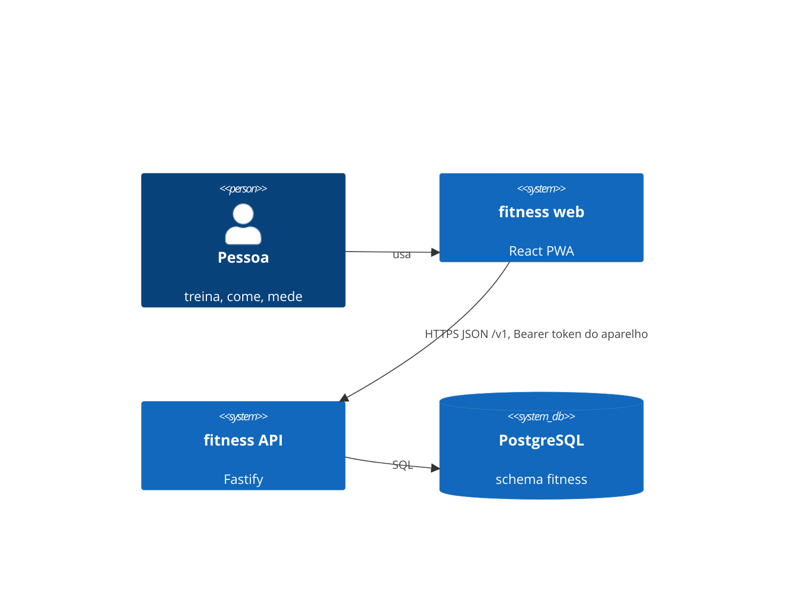

# Arquitetura — fitness (lean C4)

## 1. Contexto
Pessoa no celular (PWA) → **fitness web** → **fitness API** → PostgreSQL. Sem provedores externos no v1: nada de login social, tiles de mapa ou CDN de fontes (fonte self-hosted). GPS e câmera são do próprio aparelho.

## 2. Containers
| Container | Responsabilidade | Estado |
|---|---|---|
| web | telas F-01…F-62, cálculo otimista com o domínio, cache persistido (offline), fotos em IndexedDB | localStorage (token, cache, tema), IndexedDB (fotos) |
| api | validação Zod, casos de uso, privacidade da vitrine, snapshot público | sem estado (Twelve-Factor VI) |
| db | fonte de verdade de perfil, registros, personagens, vitrine, academias | Postgres |

## 3. Componentes da API (módulos)
`identity` (aparelho/token, /me, apagar) · `profile` (perfil metabólico, RN-16) · `diet` (estoque, prefs, marcações, extras, fechamento) · `training` (séries, carga, PR, conclusão) · `body` (medidas, recálculo RN-07) · `progress` (projeção, streak, desafios, insights) · `social` (personagem, privacidade, feed, busca, kudos, snapshot público) · `gyms` (proximidade e detalhe).

Dependência permitida: `routes → service → repo`; módulos conversam por funções exportadas do service/repo de outro módulo, nunca por tabelas alheias em SQL ad-hoc fora do repo dono (exceções documentadas: consultas de agregação de `progress`).

## 4. Fluxos-chave
- **Primeiro uso**: web cria aparelho (`POST /v1/devices`) → `/v1/me` sem perfil → onboarding local → `PUT /v1/profile` (semeia estoque).
- **Marcar refeição**: web recalcula consumido/status com `@fitness/domain` na hora → `PUT …/meals/:id` → substitui pelo retorno do servidor.
- **Concluir treino**: `POST …/complete {publish}` → `workout_days` → se personagem + opt-in + `share.treinos` → post → `refreshPublicStats`.

## 5. Qualidade
| Atributo | Como |
|---|---|
| Privacidade (RNF-01, RN-18) | snapshot `public_stats` já filtrado; fotos nunca sobem; token só como hash; redact no log |
| Offline (RNF-04) | cache TanStack persistido + SW do shell; mutações pausam sem rede |
| Instantâneo (RNF-06) | atualização otimista com o mesmo domínio do servidor |
| Operação | `/health/live`, `/health/ready`, SIGTERM gracioso, config só por env, logs JSON |

## 6. Decisões
Ver [`adr/`](adr/).

## 7. Riscos e próximos passos
- Fila/outbox para side-effects não é necessária no v1 (tudo síncrono e local ao banco); reabrir ADR se entrar e-mail/push.
- Sincronizar mutações pausadas após recarregar a página offline (hoje só retomam com a aba aberta).
- Code-splitting por rota quando o bundle passar de ~150 kB gzip.
