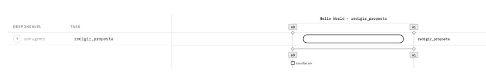

# Flow Language — Requisitos

**Por quê:** fonte canônica dos casos de uso e regras da linguagem visual; base para Flow IDE, Plans e exportação de código.  
**Como cresce:** cada caso de uso e imagem enviados no chat entram aqui no mesmo turno.  
**Visão:** [`../README.md`](../README.md) · Épicos: [`../epics.md`](../epics.md) · Editor/protótipo: [`../editor/README.md`](../editor/README.md) · Fundamentos: [`linguagem` no flow-dev](../../flow-dev/docs/linguagem-flow.md)

Imagens: [`requisitos/img/`](requisitos/img/).

**Vocabulário UI:** coluna **Source** (antes Responsável) · coluna **Function** (antes Task).

---

## Como usar

1. Novo caso de uso / regra / tela → seção `UC-NN` abaixo, com data.
2. Imagens → `requisitos/img/uc-NN-…` e referência no UC.
3. Comportamento visual → amarrar ao [`../editor/`](../editor/README.md) (ou `prototype.html` da esteira quando existir).
4. Regra muda → atualizar o item; não apagar histórico sem marcar *revogado*.

---

## Índice

| ID | Título | Status |
|----|--------|--------|
| [UC-01](#uc-01--criar-novo-fluxo-estado-inicial) | Criar novo fluxo — estado inicial | No editor |

---

## Casos de uso

### UC-01 — Criar novo fluxo: estado inicial

**Data:** 2026-11-19  
**Quando:** o usuário cria um **novo fluxo**.  
**Então** a tela Flow deve mostrar:

| Elemento | Regra |
|----------|--------|
| Fluxo | Exibido **com nome** (identificação do fluxo na vista) |
| Function | **Exatamente uma** function, representada por **uma barra** no canvas; nome sempre **`main`** |
| Source | Tipo **arquivo**, nome sempre **`main`** |
| Edição do nome | **Clicar no nome** abre alteração (renomear / editar inline) |

#### Referência visual

Wireframe de referência (layout; nomes de exemplo no desenho ≠ default obrigatório):

- Colunas **Source** · **Function**
- Uma barra com estados `s0` / `s1`
- Título do fluxo acima da barra
- **Default obrigatório ao criar:** source arquivo = `main` · function = `main`

#### Aceite

- [x] Novo fluxo → nome visível
- [x] Uma única barra de function chamada **`main`**
- [x] Source = tipo arquivo chamado **`main`**
- [x] Clicar no nome → abre para alteração

#### Protótipo

| Artefato | Nota |
|----------|------|
| [`../editor/`](../editor/README.md) | `createUc01Flow` / `new-flow`: source `main` + function `main`; clique no nome renomeia; colunas Source · Function |

---

## Protótipo

| Artefato | Caminho | Papel |
|----------|---------|-------|
| Editor visual (código ao vivo) | [`../editor/`](../editor/README.md) | Manipulação visual ↔ código JS |
| Protótipo esteira | `prototype.html` | A produzir (esteira em [`README.md`](README.md)) |

---

## Próximos passos

1. Próximo UC / imagens no chat → acrescentar `UC-02…`
2. Propagar para `functionalities.md` / `user-stories.md` quando a esteira for pedida
