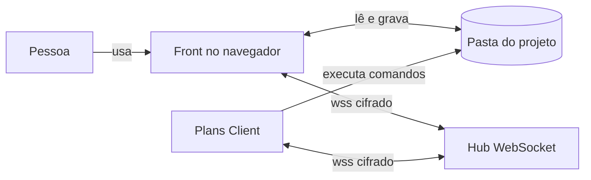
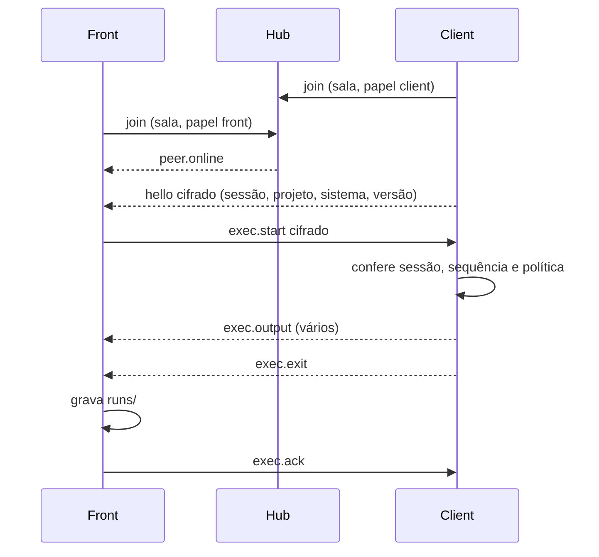

# Plans — Plano de implementação

**Status:** aprovado em 2026-11-27 (“implemente e rode”), com as recomendações da seção 13. Fases 0 a 4 implementadas em [`../app/`](../app/README.md); o que falta está no README de lá.
**Por quê:** definir tecnologias, arquitetura, persistência em arquivos, conexão por WebSocket e instaladores.
**No fluxo:** [visão](../README.md) → [épicos](../epics/README.md) → **plano de implementação** → código em `plans/app/`.
**Base:** [`core/definir-projeto-moderno`](../../core/definir-projeto-moderno/README.md). Data: 2026-11-27.

**O que mudou da v1:** o client não serve nada e não é dono da pasta. O **front** lê e grava a pasta; o **client** só se conecta a um WebSocket, recebe comandos e os executa. Entram instaladores para Windows, macOS e Linux.
**O que mudou da v2:** o client passa de Node empacotado para **Go**, por causa do tamanho do download.

---

## 1. Objetivo e escopo

| Entra na primeira entrega | Fica para depois |
|---------------------------|------------------|
| Front abrindo uma pasta local e gravando tudo em arquivos | EP-02 a EP-10 |
| [EP-01](../epics/EP-01-arvore-de-execucao.md): F01 criar nó, F02 remover nó, F03 atribuir responsável, F04 atribuir descrição | Execução automática de etapas por IA (EP-06) e programação de máquina (EP-08) |
| Client que conecta, executa comandos e devolve a saída | Comandos interativos (que pedem digitação) |
| Instalador do client para Windows, macOS e Linux | Atualização automática do client |
| Um usuário, um client por pasta | Contas, equipes e vários clients por pasta |

Metas verificáveis:

- Fechar tudo e abrir de novo mostra a mesma árvore, lida só dos arquivos.
- Nenhum dado do projeto fica no navegador nem no servidor.
- O mesmo comando de teste instala, pareia, executa e desinstala nos três sistemas.
- Nem o servidor nem quem só conheça o endereço da sala consegue mandar um comando.

## 2. Arquitetura

### 2.1 Contexto



Navegador e client só **abrem** conexões. Alguém precisa recebê-las: o **hub**, um repassador pequeno no servidor.

### 2.2 Containers

| Container | Onde roda | Faz | Não faz |
|-----------|-----------|-----|---------|
| **Front** (`apps/web`) | Navegador; arquivos estáticos no servidor | Telas, leitura e gravação da pasta, pedido de comandos, registro das execuções | Não executa nada na máquina |
| **Hub** (`apps/hub`) | Servidor (mesmo host de `plans.laerciogermano.com`) | Junta front e client numa sala e repassa mensagens cifradas | Não lê o conteúdo e não grava nada |
| **Client** (`apps/client`) | Máquina da pessoa, em segundo plano | Conecta ao hub, confere a política, executa, devolve saída e código de término | Não serve páginas, não abre porta, não grava dados do Plans |
| **Pasta** | Disco da máquina | Fonte da verdade | — |

Em desenvolvimento, o hub roda em `ws://localhost:4780` e o front no servidor do Vite.

### 2.3 Módulos

```text
plans/app/                      npm workspaces
  packages/
    protocol/                   mensagens (Zod), cifra e sequência (web e hub); vetores de teste para o client
    domain/                     árvore e formato dos arquivos (funções puras, sem I/O)
  apps/
    web/src/
      folder/                   escolher pasta, permissão, ler, gravar, observar
      connection/               socket, pareamento, reconexão
      store/                    estado em memória (useSyncExternalStore)
      features/tree/            T-40 e T-41
      features/runs/            comandos e saída
    hub/src/                    salas, limites, saúde
    client/                     módulo Go
      cmd/plans-client/         pair, run, start, stop, status, allow, unpair
      internal/protocol/        mensagens, cifra e sequência
      internal/connection/      socket de saída e reconexão
      internal/policy/          o que pode ser executado
      internal/exec/            processos, saída, cancelamento (por sistema)
      internal/service/         inicialização no login (por sistema)
  installers/                   windows/ macos/ linux/
```

Regra de dependência: `web` e `hub` usam os pacotes; um app nunca importa outro. O client não importa TypeScript: segue o mesmo contrato (há um JSON Schema gerado como referência) e passa nos mesmos vetores de teste. Só `web/folder` toca nos arquivos do Plans; só `client/internal/exec` cria processos.

## 3. Tecnologias

| Camada | Escolha | Motivo |
|--------|---------|--------|
| Linguagem do front e do hub | TypeScript `strict` | Padrão do core |
| Linguagem do client | Go | Binário único e pequeno, compilado para todos os sistemas, sem runtime para instalar |
| Front | React + Vite | Mesma base de `plans/frontend` |
| Acesso à pasta | File System Access API | O front acessa a pasta sem programa intermediário |
| Estado no front | `useSyncExternalStore` | Sem biblioteca de cache HTTP: não há API de dados |
| Formato | Markdown com cabeçalho YAML (`yaml`) e JSON | Legível e versionável |
| Validação | Zod | Toda entrada validada: mensagens, arquivos e configuração |
| Cifra | HKDF-SHA-256 e AES-256-GCM: Web Crypto no front, biblioteca padrão no Go (1.24 ou superior) | Mesmos algoritmos, sem biblioteca de terceiros |
| Hub | Node 26 + `ws` | Pequeno e sem estado em disco |
| WebSocket do client | `github.com/coder/websocket` | Biblioteca pequena e mantida |
| Logs | JSON no console do hub, `log/slog` no client | Sem segredo, sem saída de comando no hub |
| Testes e lint | Vitest, Playwright e oxlint; `go test` e `go vet` no client | Padrão de cada linguagem |
| Build e release | GitHub Actions com Windows, macOS e Linux | Cada instalador é gerado no próprio sistema |

## 4. Decisões

Cada linha vira um ADR (formato Nygard) em `docs/adr/` na fase 0.

| # | Decisão | Alternativa descartada | Consequência |
|---|---------|------------------------|--------------|
| 1 | O **front** grava a pasta | Client gravando a pasta | Client fica mínimo; o front funciona só em **Chrome e Edge de computador** |
| 2 | **Hub** no servidor entre front e client | Client escutando na máquina | Nada aberto na máquina e sem permissão de rede local; exige servidor e internet para executar comandos |
| 3 | **Cifra ponta a ponta** com chave de pareamento | Confiar no hub | Hub comprometido não lê nem forja comandos |
| 4 | **Política local** decide o que executa | Executar tudo que chega | Um passo a mais para liberar comando novo; é a última barreira |
| 5 | **Arquivos** como única persistência | PostgreSQL (padrão do core) | Consultas em memória; sem banco para instalar |
| 6 | **Um Markdown por atividade**, nome = UUID | JSON único ou pastas espelhando a árvore | Diffs pequenos; o nome do arquivo não é legível |
| 7 | Client em **Go** | Node SEA (cerca de 140 a 150 MB) ou Bun compilado (cerca de 60 a 80 MB) | Download estimado em 5 a 15 MB; o protocolo e a cifra são escritos duas vezes, e os vetores de teste no CI impedem que divirjam |
| 8 | Código e chaves em **inglês**, tela em português | Tudo em português | Alinhado aos outros projetos do workspace |

## 5. Persistência em arquivos (front)

### 5.1 Abrir a pasta

1. A pessoa clica em **Abrir pasta** (`showDirectoryPicker`, com escrita).
2. O navegador guarda o **atalho da pasta** (IndexedDB) para reabrir. A partir do Chrome 122 há a opção “permitir em todas as visitas”; sem ela, o front pede a permissão de novo com um clique.
3. Em pasta sem `.plans/`, o front pede confirmação e cria a estrutura.

No navegador ficam só o atalho da pasta e a chave de pareamento. **Nenhum dado do projeto.**

### 5.2 Layout

```text
meu-projeto/
  .plans/
    project.json          schemaVersion, id e nome
    ui.json               atividade selecionada
    trash/<data-hora>/    removidos, com manifest.json
  activities/
    <uuid>.md             uma atividade
  runs/
    <uuid>.json           comando, nó, início, término, código de saída
    <uuid>.log            saída (até 5 MB)
  assignees.json          responsáveis disponíveis
  system-prompt.md        instruções padrão de todas as atividades (criado ao salvar)
```

### 5.3 Formatos

```markdown
---
id: 7c1f0c9e-4b7a-4a1e-9a41-2f6c0d1b8e22
title: Comprar celular
parent: null
assignee: ana
status: doing          # todo, doing ou done; sem ele vale todo
createdAt: 2026-11-27T12:00:00Z
order: 1500            # só depois de arrastado; sem ele vale a ordem de criação
---
Até R$ 3.000, câmera boa, 256 GB.
```

O corpo é a descrição (F04). Chaves desconhecidas são preservadas. Gravação em UTF-8 com fim de linha `LF`; leitura aceita `CRLF`.

```json
{ "version": 1, "items": [{ "id": "ana", "name": "Ana Silva", "type": "person" }] }
```

`.plans/` e `runs/` levam um `.gitignore` próprio; o da pessoa não é tocado. `assignees.json` é editado à mão nesta entrega (o catálogo com tela é o EP-05). `type`: `person`, `ai` ou `machine`.

### 5.4 Regras de gravação

| Situação | Comportamento |
|----------|---------------|
| Gravar | `createWritable()` e `close()`: a mudança só aparece no fechamento (em geral via arquivo temporário) |
| Remover subárvore (F02) | Copia tudo para a lixeira com manifesto e só então apaga **das folhas para o nó**; interrupção nunca deixa filho sem pai |
| Duas abas | Web Locks serializa as gravações; `BroadcastChannel` avisa as outras |
| Edição externa (editor, git, comando) | Cada nó tem `rev` (hash); antes de gravar, o front relê e recusa se mudou |
| Atualizar a tela | `FileSystemObserver` quando houver (experimental, fora do padrão); sempre reler ao voltar o foco |
| Arquivo inválido | Fica intacto e aparece numa lista de problemas |
| Pai inexistente ou ciclo | O nó aparece como raiz, com aviso; nada é reescrito sozinho |
| Formato novo | `schemaVersion` maior que o suportado abre somente leitura |

## 6. Conexão e execução de comandos

### 6.1 Pareamento

1. O front gera uma chave aleatória de 32 bytes e mostra o comando pronto:
   `plans-client pair <código> --dir <pasta>`
2. A pessoa roda o comando informando o caminho da pasta (o navegador não revela o caminho).
3. Da mesma chave saem o **id da sala** e as **chaves de cifra**, uma por sentido. O hub conhece só o id da sala.
4. O client lê `.plans/project.json` e informa o id do projeto. Se for diferente do aberto no front, a execução fica bloqueada.

### 6.2 Sequência



### 6.3 Protocolo (versão 1)

```ts
// com o hub (visível a ele)
{ type: "join", protocol: 1, room: string, role: "front" | "client" }
{ type: "peer", online: boolean, role: "front" | "client" }
{ type: "relay", iv: string, body: string }        // conteúdo cifrado
{ type: "error", code: string }

// dentro de body (só front e client leem)
{ sender: string, session: string, seq: number, msg: Message }
```

| Mensagem | Sentido | Conteúdo |
|----------|---------|----------|
| `hello` | client → front | sessão, id do projeto, sistema, shells, versão |
| `exec.start` | front → client | `runId`, `program` e `args`, ou `script` e `shell`; subpasta relativa; tempo limite |
| `exec.output` | client → front | `runId`, `stdout` ou `stderr`, número do trecho, dados |
| `exec.exit` | client → front | `runId`, código, sinal, duração |
| `exec.rejected` | client → front | motivo e o comando para liberar |
| `exec.cancel` | front → client | `runId` |
| `exec.list` / `exec.resume` | front → client | recuperar execuções após reconectar |
| `exec.ack` | front → client | saída gravada; o client pode descartar |

- **Repetição:** o client cria uma sessão a cada conexão; mensagem de outra sessão ou com `seq` não crescente é descartada.
- **Queda:** os dois reconectam com espera crescente. O client continua a execução e guarda até 5 MB de saída por execução até o `ack`. O mesmo `runId` nunca é executado duas vezes.
- **Limites do hub:** 256 KB por mensagem, um client e até cinco abas por sala, limite de taxa por IP.

### 6.4 Política de execução

- Fica na configuração do client, **fora do projeto**.
- Padrão: nada é executado até ser liberado. `plans-client allow -- npm test` libera um comando exato; `--any-args` libera o programa com quaisquer argumentos.
- Rodando no terminal (`plans-client run`), o client pergunta: uma vez, sempre ou negar. Em segundo plano, recusa e a tela mostra o comando para liberar.
- Sem shell por padrão (`program` + `args`). Modo `script` com shell exige liberação própria.
- Subpasta confinada à pasta pareada. O comando roda com as permissões da pessoa e **não há sandbox**: um programa liberado alcança tudo que a pessoa alcança.
- O client se recusa a rodar como root ou Administrador.

## 7. Instaladores e plataformas

| Sistema | Arquitetura | Pacote | Inicia no login por | Assinatura |
|---------|-------------|--------|---------------------|------------|
| Windows 10 e 11 | x64, arm64 | `.exe` (Inno Setup), por usuário, sem administrador | Agendador de Tarefas | Certificado de assinatura de código |
| macOS | arm64, x64 | `.pkg` | LaunchAgent | Apple Developer ID e notarização |
| Linux | x64, arm64 | `.deb`, `.rpm` (nFPM) e `.tar.gz` com `install.sh` | `systemd --user` | Somas SHA-256 assinadas |

- O instalador coloca `plans-client` no PATH. O serviço só começa depois do pareamento.
- Desinstalar remove programa e serviço; apagar a configuração é opção.
- Download numa página do Plans, com somas SHA-256. O client informa a versão e o front avisa quando está antigo.
- **Sem assinatura**, Windows e macOS mostram alerta ou bloqueiam a instalação. Os certificados são pagos.
- Compilação com `CGO_ENABLED=0`: no Linux, o binário não depende da versão da glibc.
- Configuração: `~/Library/Application Support/Plans` (macOS), `%APPDATA%\Plans` (Windows), `~/.config/plans` (Linux).

Diferenças entre sistemas, isoladas em `client/internal/exec`: cancelar mata o grupo de processos (POSIX) ou a árvore com `taskkill` (Windows); `.cmd` e `.bat` no Windows precisam do `cmd.exe`, com escape testado; a saída é convertida para UTF-8.

## 8. Segurança

Ameaça principal: alguém conseguir **executar comandos** na máquina.

| Ameaça | Controle |
|--------|----------|
| Alguém entra na sala | Sem a chave não lê nem forja: tudo cifrado e autenticado |
| Hub comprometido | Só vê sala, tamanhos, horários e IP; pode derrubar a conexão |
| Repetição de um comando antigo | Sessão e sequência |
| Script malicioso no front | CSP restrita, sem scripts de terceiros, saída exibida como texto |
| **Servidor do front comprometido** (poderia servir código que rouba a chave) | A **política local** limita o estrago; deploy com acesso restrito |
| Chave vazada | `plans-client unpair` e novo pareamento |
| Argumento injetado | Sem shell por padrão; argumentos em lista |
| Abuso do hub | Limites de tamanho, sala e taxa; `Origin` conferido para o papel `front` |
| Comando preso ou saída infinita | Tempo limite, cancelamento e teto de saída |

A chave não vai para a pasta do projeto, que pode ser sincronizada ou versionada.

## 9. Front

- Telas desta entrega: abrir pasta, **árvore** (T-40) com criação no nó (T-41), painel do nó e **execuções** (comando, saída ao vivo, cancelar, histórico).
- Painel do nó: título, responsável e descrição, com indicador de “salvando” e “salvo”. Remover nó com filhos pede confirmação com a quantidade.
- Estados obrigatórios: navegador sem suporte, sem permissão, pasta vazia, arquivo com problema, conflito, client desconectado, comando recusado.
- Sem client conectado, a árvore funciona por completo; só a execução fica indisponível.
- Acessibilidade: `role="tree"`, teclado e foco visível. Marca e protótipo do Plans têm prioridade sobre o design padrão do core.
- `plans/frontend` e `plans/prototipo` ficam intactos, como referência.

## 10. Testes

| Nível | O que cobre |
|-------|-------------|
| `domain` | Árvore, remoção, ciclos, órfãos, ida e volta do formato |
| `protocol` | Cifra, chave errada, mensagem alterada, repetição; **os mesmos vetores em TypeScript e em Go** |
| `web/folder` | Mesma interface sobre o armazenamento privado do navegador (OPFS), já que o seletor de pasta não é automatizável |
| Hub | Limites, salas, desconexão |
| Client | Política, cancelamento, saída grande, queda de rede — **nos três sistemas** |
| Ponta a ponta | Front → hub → client, conferindo `runs/` |
| Instaladores | Instalar, versão, parear, executar, reiniciar, desinstalar — em máquinas limpas |

## 11. Fases

| Fase | Entrega | Pronto quando |
|------|---------|---------------|
| **0 · Base** | Workspaces, módulo Go, ADRs, `AGENTS.md`, CI, vetores de teste; client mínimo | Front e client decifram um ao outro e o binário roda nos três sistemas, com o tamanho medido |
| **1 · Pasta** | Abrir pasta, formato, gravação, observação, problemas | Editar um `.md` fora atualiza a tela |
| **2 · EP-01** | F01 a F04 com T-40 e T-41 | Os quatro fluxos persistem após fechar o navegador |
| **3 · Conexão** | Hub, pareamento, cifra, reconexão | Front e client se veem; testes de recusa passam |
| **4 · Execução** | Política, processos, saída ao vivo, `runs/` | Um comando liberado roda e fica registrado nos três sistemas |
| **5 · Instaladores** | Pacotes, serviço no login, assinatura, página de download | Instalação limpa funciona nos três sistemas |
| **6 · Acabamento** | Acessibilidade, estados de erro, deploy do hub, README | Uma pessoa instala e usa só com o README |

Depois, um épico por vez, começando pelo EP-02.

## 12. Riscos

| Risco | Mitigação |
|-------|-----------|
| Quem usa Safari ou Firefox não consegue abrir a pasta | Avisar na entrada; aceitar a limitação ou, no futuro, mover o acesso à pasta para o client |
| Protocolo divergir entre TypeScript e Go | Esquema gerado e vetores obrigatórios no CI; versão conferida na conexão |
| Custo e prazo dos certificados | Pedir antes da fase 5 |
| Hub fora do ar | Edição segue normal; execução volta sozinha |
| Pasta sincronizada cria cópias em conflito | Aparecem como problema; ID repetido nunca é resolvido sozinho |
| Muitas atividades deixam a abertura lenta | Medir com 5 mil na fase 1 |

## 13. A confirmar antes da fase 0

1. **Hub no servidor** entre front e client (decisão 2).
2. Front só em **Chrome e Edge** de computador (decisão 1).
3. **Nada executa sem liberação local** (decisão 4).
4. Comprar os **certificados** (Apple Developer e assinatura Windows) ou distribuir sem assinatura no começo.
5. Código novo em **`plans/app/`**.

## Fontes

- [MDN, `createWritable`](https://developer.mozilla.org/en-US/docs/Web/API/FileSystemFileHandle/createWritable) · [MDN, `FileSystemObserver`](https://developer.mozilla.org/en-US/docs/Web/API/FileSystemObserver)
- [Chrome, permissões persistentes](https://developer.chrome.com/blog/persistent-permissions-for-the-file-system-access-api)
- Tamanhos de binário (decisão 7): estimativas ainda não medidas; a fase 0 mede
- Suporte do seletor de pasta por navegador (terceiros): [guia](https://www.testmuai.com/learning-hub/file-system-access-api-browser-support/)

**Voltar atrás:** este plano é só documentação; para desfazer, apagar este arquivo e a linha dele em [`README.md`](README.md).

## Próximos passos

→ Aprovar a seção 13 · escrever os ADRs · fase 0.
