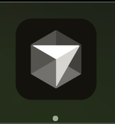

# Plans / Flow IDE — Especificação da logo

**Escopo:** mark do **Plans** (orquestrador) e reutilizável no **Flow IDE** / FOP (mesmo vocabulário visual: verbo · dado · fluxo).  
**Estado:** brief + referências — ainda sem SVG master aprovado.  
**Pacote canônico de produção:** [`core/definir-projeto-moderno/04-logos/LOGO.md`](../../../core/definir-projeto-moderno/04-logos/LOGO.md)

---

## 1. Intenção

A marca identifica o produto como **lugar onde tudo flui**: intenções e roteiros viram trabalho (Plans) e software (Flow). Não ilustra board/Gantt/código — aponta a dualidade **material ↔ infinito** e a dualidade **verbo ↔ dado**.

> “Everything flows, except flow.” — espírito FOP / eternos mutáveis

**Uma frase:** a logo é um **continente material** (caixa / quadrado) que guarda o **infinito** (bola / círculo), com traço de **fluxo**.

---

## 2. Conceitos obrigatórios

| Conceito | Significado | Como aparece na marca |
|---|---|---|
| **Eternos mutáveis** | Mudança permanente; o fluxo permanece | Forma estável; interior ou traço sugere movimento |
| **Verbo** | Função / procedimento / ação | Azul (FOP `--fn`); barra / seta / direção |
| **Dado** | Unidade de informação / estado | Vermelho (FOP `--dado`); quadrado / cubo / ponto cheio |
| **Material** | Contido, concreto, finito | **Quadrado / caixa / cubo** |
| **Infinito** | Aberto, eterno, sem aresta | **Círculo / bola** dentro do material |
| **Fluxo** | Sequência, onda, passagem de estado | Traço, onda, faixa — opcional na família |

### Dualidades (usar com parcimônia)

| Par | Uso |
|---|---|
| **Azul / vermelho** | Verbo / dado (tema *eternos*); nunca os dois competindo no mesmo peso em 16 px |
| **Preto / branco** | Fundos e monocromático primeiro (app icon, favicon) |
| **Redondo / quadrado** | Infinito dentro do material — núcleo da metáfora |

Não é obrigatório pintar azul+vermelho em toda variante. Em monocromático a dualidade vira **forma** (círculo × caixa). Cor entra depois que a silhueta funciona.

---

## 3. Metáfora visual preferida

**Caixa com bola dentro**

- **Caixa / cubo / quadrado** = material, estado, continente (Plans · Explorar · dado)
- **Bola / círculo** = infinito, mutável eterno, o que não cabe em aresta
- Relação: o infinito **habita** o material — não flutua solto fora do continente

**Alternativa / complemento na família**

- Traços de **fluxo** ou **onda** (1–2 curvas) — versão “movimento” para splash, motion, loading
- Não substituir o núcleo caixa+bola em favicon; a onda é variante, não o master mínimo

---

## 4. Referências

### 4.1 Referência visual local (partida)

Arquivo: [`referencias/ref-cubo-seta.png`](referencias/ref-cubo-seta.png)

| O que aproveitar | O que evoluir |
|---|---|
| Contenção 3D / cubo como continente | Trocar a **seta/triângulo** por **bola/círculo** (infinito) |
| Leitura em squircle / app icon | Manter legível em 16 px sem depender de facetas 3D finas |
| Escala de cinza forte | Família: mono → depois azul/vermelho pontual |
| Geometria seca, tech | Evitar gloss, glow, roxo genérico |

A seta interna do ref sugere **verbo/ação**; na direção escolhida o **círculo** carrega o infinito; o verbo pode aparecer como traço de fluxo ou faceta azul numa variante — não como segundo símbolo competindo no centro.

### 4.2 Referências de produto / vocabulário

| Fonte | O que puxar |
|---|---|
| [`plans/README.md`](../../README.md) | Plans = orquestrador; Explorar: **círculo = plano**, **cubo = estado/dado** |
| Flow / FOP (`flow-component`, tema *eternos*) | Função **azul** `#2563eb` · dado **vermelho** `#dc2626` |
| FOP conceitos | Fluxo = dados + funções; nome = referência; camadas substituíveis |
| [`04-logos/LOGO.md`](../../../core/definir-projeto-moderno/04-logos/LOGO.md) | Identificar ≠ ilustrar; mono e 16 px antes da cor |

### 4.3 Clichês a evitar

- Cérebro + engrenagem, checklist, kanban em miniatura  
- Purple glow / gradiente “AI SaaS”  
- Onda genérica sozinha sem continente  
- Cubo isométrico hiperdetalhado ilegível em favicon  

---

## 5. Direções a explorar (checkpoint — 3 conceitos)

Antes do kit SVG completo, apresentar **3 rotas** distintas:

| # | Tipo | Ideia |
|---|---|---|
| **A** | Pictorial / abstract | Caixa (wire ou face) + círculo sólido no centro |
| **B** | Abstract geométrico | Quadrado e círculo interpenetrados (yin de formas), sem 3D |
| **C** | Combination + fluxo | Mark A ou B + traço de onda/fluxo; lockup com wordmark **Plans** (e variante **Flow**) |

Cada rota deve passar no teste de silhueta (blur) e no teste monocromático.

---

## 6. Requisitos de produção

| Requisito | Critério |
|---|---|
| Master | SVG com `viewBox`; sem raster embutido |
| Tamanhos | Legível a **16 px**; app icon 512 / maskable |
| Mono | Preto no claro · branco no escuro · cinza do ref só como estudo |
| Cor (depois do mono) | Azul verbo e/ou vermelho dado — um acento por variante pequena |
| Respiro | Margem ≥ 1/8 da altura do símbolo |
| Wordmark | **Plans** (produto); **Flow** / **FOP** como lockup irmão, mesmo mark |
| Fundos | Squircle app (como o ref); full-bleed para lojas se preciso |

### Tokens de cor alinhados ao FOP (quando colorir)

| Token | Hex | Papel |
|---|---|---|
| Verbo / função | `#2563eb` | Acento azul |
| Dado | `#dc2626` | Acento vermelho |
| Ink / paper | `#0b0b0b` / `#ffffff` | Mono e tipografia |

---

## 7. Uso compartilhado Plans ↔ Flow IDE

| Contexto | Mark | Lockup |
|---|---|---|
| Plans (produto, site, app) | Caixa + bola | **Plans** |
| Flow IDE / editor FOP | O **mesmo** mark | **Flow** ou **FOP** |
| Favicon / PWA | Mark só | — |

Um símbolo, dois wordmarks. Não criar mark separado para Flow sem decisão explícita — a linguagem já é compartilhada (círculo/cubo no Explorar; azul/vermelho no plano).

---

## 8. Entregáveis (quando for a produção)

- `icon.svg` · `mono-black.svg` · `mono-white.svg`
- Lockups horizontal / stacked: Plans e Flow
- Favicon + app icons (claro / escuro)
- Opcional: variante “onda/fluxo” só para motion / splash

Checklist: [`04-logos/sintese/checklist-producao.md`](../../../core/definir-projeto-moderno/04-logos/sintese/checklist-producao.md)

---

## 9. Caminho inverso

| Ação | Como |
|---|---|
| Só brief (agora) | Este arquivo + [`referencias/`](referencias/) |
| Produzir SVG | Seguir §5–8 + pacote `04-logos` |
| Identidade completa (tipo, voz, motion) | [`05-identidade-visual`](../../../core/definir-projeto-moderno/05-identidade-visual/IDENTIDADE-VISUAL.md) → `BRAND.md` |
| Descartar direção | Manter o ref; marcar §5 com a rota rejeitada |
