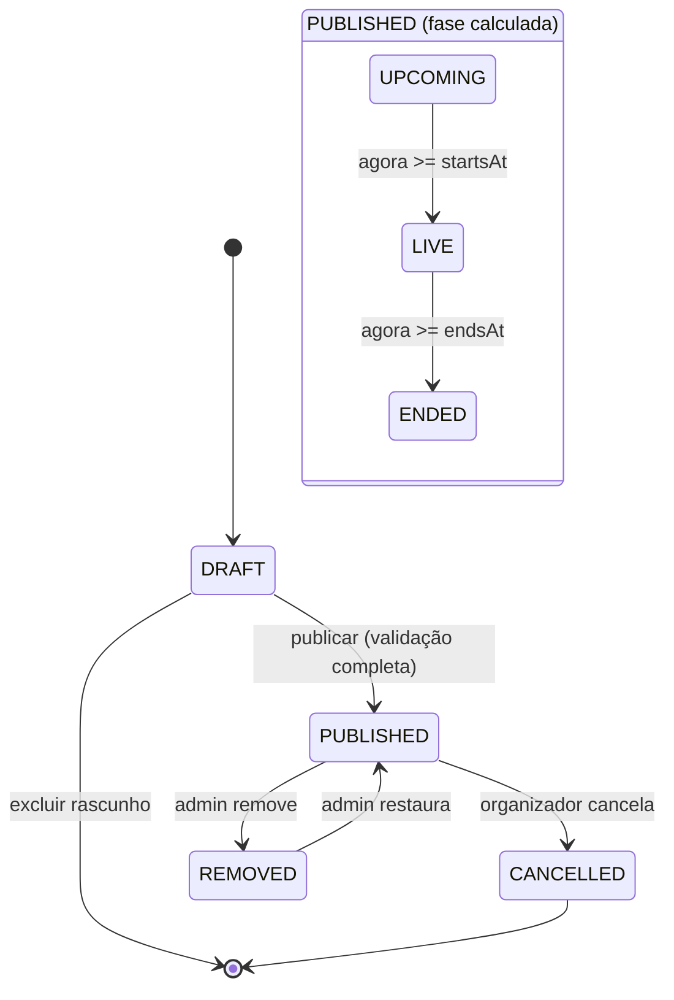
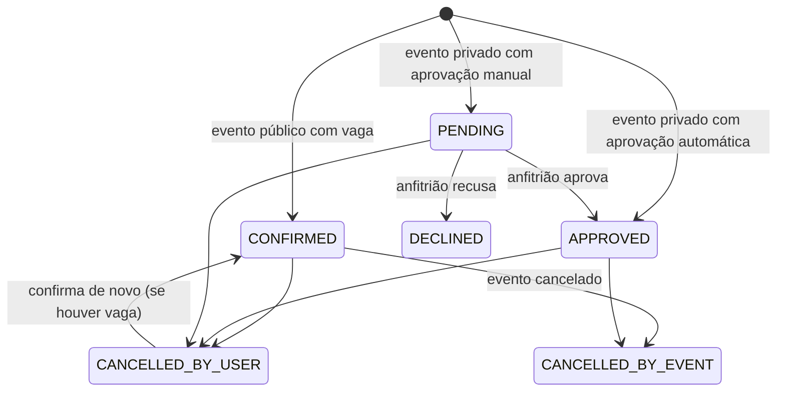

# E03 — Ciclo de vida do evento

Objetivo: dar ao usuário informação suficiente para **decidir, confirmar e lembrar** do rolê, e ao organizador o controle do evento da promoção ao pós-evento.

| ID | História | RF | Prio | Pts | Telas |
|---|---|---|---|---|---|
| US-03.01 | Ver página do evento | RF-E03-01 | M | 5 | T-20 |
| US-03.02 | Ver interessados e confirmados | RF-E03-02 | M | 3 | T-21 |
| US-03.03 | Marcar interesse | RF-E03-03 | M | 1 | T-20 |
| US-03.04 | Confirmar presença em evento público | RF-E03-04 | M | 3 | T-20, T-22 |
| US-03.05 | Pedir para entrar em evento privado | RF-E03-04, RF-E02-05 | M | 5 | T-23 |
| US-03.06 | Aprovar/recusar pedidos (organizador) | RF-E03-14, RF-E02-06 | M | 3 | T-48 |
| US-03.07 | Compartilhar/promover evento | RF-E03-07 | M | 3 | T-24 |
| US-03.08 | Evento ao vivo | RF-E03-05/08 | S | 2 | T-20 |
| US-03.09 | Cancelar evento | RF-E03-06 | M | 3 | T-49 |
| US-03.10 | Avaliar evento | RF-E03-09 | M | 3 | T-25 |
| US-03.11 | Ver avaliações | RF-E03-10 | M | 2 | T-20 |
| US-03.12 | Fotos de edições anteriores | RF-E03-11 | S | 2 | T-20 |
| US-03.13 | Página do organizador | RF-E03-12 | S | 3 | T-26 |
| US-03.14 | Denunciar | RF-E03-13 | M | 2 | T-27 |

---

## Máquina de estados



`status` é persistido (DRAFT, PUBLISHED, CANCELLED, REMOVED). `phase` é **calculada** (UPCOMING, LIVE, ENDED), então não há job para virar estado.

## Estados do RSVP



"Vai" = `CONFIRMED` ou `APPROVED`. Só esses contam para a capacidade e dão direito a avaliar.

---

## US-03.01 — Página do evento
**Como** explorador, **quero** ver tudo sobre o evento numa página **para** decidir se vou.

Conteúdo: capa (4:5) com o selo do tipo; título; organizador (avatar, nome, nota); data/hora com "começa em 2 h"; local + distância; botão "Como chegar" (abre Google Maps/Waze, **só** se o endereço estiver liberado); descrição; valores; classificação etária; link externo; interessados/confirmados; avaliações (se ENDED); galeria e edições anteriores; ações fixas no rodapé: **♥ Interesse** e **Confirmar presença**.

```gherkin
  Cenário: Evento público futuro
    Quando abro "/e/neon-pulse-festival-x7k2"
    Então vejo título, data "Sáb, 15 nov · 22:00–06:00", "Club Central · 2,3 km"
    E os valores "Pista R$ 89 · VIP R$ 189"
    E o rodapé com "♥" e "Confirmar presença"

  Cenário: Visitante sem login
    Dado que não estou logado
    Quando abro o link de um evento público
    Então vejo a página em modo leitura (sem lista de avatares)
    E ao tocar em "Confirmar presença" vou para "Criar conta" e volto ao evento depois

  Cenário: Evento removido
    Quando abro o link de um evento REMOVED
    Então vejo "Este evento não está mais disponível."
```

## US-03.02 — Interessados e confirmados
```gherkin
  Cenário: Prova social
    Dado um evento com 34 interessados e 12 confirmados, 3 deles com presença oculta
    Quando abro a página
    Então vejo "12 vão · 34 têm interesse" e até 8 avatares de confirmados visíveis
    Quando toco em "Ver todos"
    Então vejo a lista de 9 confirmados visíveis com foto e primeiro nome
    E vejo "+3 pessoas com presença privada"
```

## US-03.03 — Marcar interesse
Toggle ♥ (otimista na UI, idempotente na API: `PUT`/`DELETE`). É o mesmo dado do swipe.

## US-03.04 — Confirmar presença (público)
```gherkin
  Cenário: Confirmar
    Dado um evento público com vagas
    Quando toco em "Confirmar presença"
    Então vejo "Você vai! 🎉" com "Adicionar ao calendário" (.ics) e "Chamar a galera" (compartilhar)
    E o botão vira "✓ Vou · cancelar"
    E recebo um e-mail de confirmação com data, local e link

  Cenário: Lotado
    Dado que o evento atingiu a capacidade
    Então o botão aparece como "Lotado" desabilitado

  Cenário: Concorrência na última vaga
    Dado que resta 1 vaga
    Quando dois usuários confirmam ao mesmo tempo
    Então exatamente um recebe CONFIRMED e o outro vê "Lotado"

  Cenário: Evento 18+
    Dado que não declarei 18+ (conta antiga via Google sem etapa)
    Então preciso confirmar "Tenho 18 anos ou mais" antes de confirmar
```

## US-03.05 — Evento privado
```gherkin
  Cenário: Acesso por link
    Dado que recebi "rolego.com.br/e/social-do-laercio-a1b2?c=RG7K2Q"
    Quando abro o link logado
    Então vejo título, anfitrião, data, bairro "Batel" e "~3 km"
    E não vejo rua, número nem coordenadas (nem na resposta da API)
    E vejo o botão "Pedir para entrar"

  Cenário: Acesso por código
    Quando digito o código "RG7K2Q" em "Tenho um código"
    Então abro a página do evento privado

  Cenário: Pedido com aprovação manual
    Quando toco em "Pedir para entrar"
    Então meu RSVP fica PENDING e vejo "Pedido enviado. O anfitrião vai responder."

  Cenário: Aprovado
    Dado que o anfitrião aprovou meu pedido
    Então recebo e-mail "Você está na lista! 🎉"
    E a página passa a mostrar o endereço completo e "Como chegar"

  Cenário: Código errado
    Quando digito um código inexistente 5 vezes em 10 minutos
    Então fico bloqueado por 10 minutos para novas tentativas (anti força bruta)
```

## US-03.06 — Aprovar/recusar pedidos
```gherkin
  Cenário: Aprovação
    Dado que tenho 5 pedidos pendentes
    Quando abro "Lista" do evento
    Então vejo cada pedido com foto, nome, cidade e "x rolês na RoleGo"
    Quando aprovo "Ana"
    Então o RSVP dela vira APPROVED e ela recebe e-mail

  Cenário: Aprovar todos
    Quando toco em "Aprovar todos" e confirmo
    Então todos são aprovados até o limite da capacidade
    E os que excedem continuam PENDING com aviso "Capacidade atingida"
```

## US-03.07 — Compartilhar / promover
**Regras:** `/e/{slug}` é servido pela API com HTML mínimo de Open Graph (`og:title`, `og:description` "Sáb 15/11 · 22h · Club Central", `og:image` = capa 1200×630 gerada na publicação) e redireciona o navegador para a SPA. Em eventos privados, o OG mostra só título, data e "Evento privado no RoleGo". O compartilhamento tem UTM (`?s=wa|ig|copy`) e conta cliques.
```gherkin
  Cenário: Preview no WhatsApp
    Quando colo o link no WhatsApp
    Então aparece capa, título e "Sáb 15/11 · 22h · Club Central"
```

## US-03.08 — Ao vivo (S)
Durante `LIVE`: o selo "AO VIVO" pulsa (verde neon) no card e na página; o botão vira "Estou aqui" (marca presença, se confirmado), que alimenta o "Rolês que fui".

## US-03.09 — Cancelar evento
```gherkin
  Cenário: Cancelamento
    Dado um evento publicado com 12 confirmados
    Quando toco em "Cancelar evento", escolho o motivo "Chuva" e confirmo
    Então o status vira CANCELLED, os RSVPs viram CANCELLED_BY_EVENT
    E os 12 recebem e-mail com o motivo
    E a página mostra a faixa "Cancelado — Chuva"
    E o evento sai da descoberta
```

## US-03.10 — Avaliar evento
```gherkin
  Cenário: Convite para avaliar
    Dado que confirmei presença e o evento terminou há 3 horas
    Quando abro o feed
    Então vejo no topo o card "Como foi o Neon Pulse Festival?"

  Cenário: Avaliação
    Quando dou 5 estrelas e escrevo "Som absurdo!"
    E toco em "Enviar"
    Então a avaliação é salva e vejo "Valeu! Sua avaliação ajuda a galera."

  Cenário: Sem direito
    Dado que não confirmei presença
    Então não vejo a opção de avaliar

  Cenário: Fora da janela
    Dado que o evento terminou há 8 dias
    Então a avaliação não é mais aceita (HTTP 422)

  Cenário: Comentário
    Então o comentário tem até 500 caracteres e passa por um filtro básico de palavrões e links
```

## US-03.11 — Ver avaliações
Média com 1 casa decimal + contagem ("4,6 ★ · 38 avaliações") e os comentários mais recentes. A nota do organizador é a média ponderada dos eventos dele (só aparece com ≥ 3 avaliações).

## US-03.12 — Edições anteriores (S)
Se o evento faz parte de uma série, mostra "Edições anteriores" com a nota de cada uma e um carrossel de fotos da galeria delas.

## US-03.13 — Página do organizador (S)
`/o/{slug}`: avatar, nome, tipo, bio, Instagram, nota, próximos eventos, passados.

## US-03.14 — Denunciar
```gherkin
  Cenário: Denúncia
    Quando toco em "⋯ > Denunciar" num evento ou comentário
    E escolho o motivo ("Conteúdo impróprio", "Golpe/falso", "Assédio", "Outro") e envio
    Então a denúncia entra na fila do admin
    E vejo "Obrigado. Vamos analisar."
    E não consigo denunciar o mesmo item duas vezes
```
