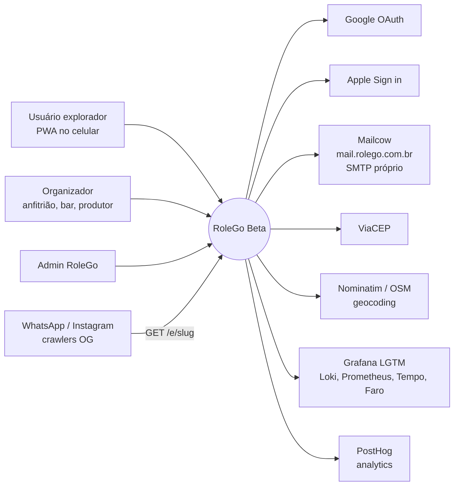
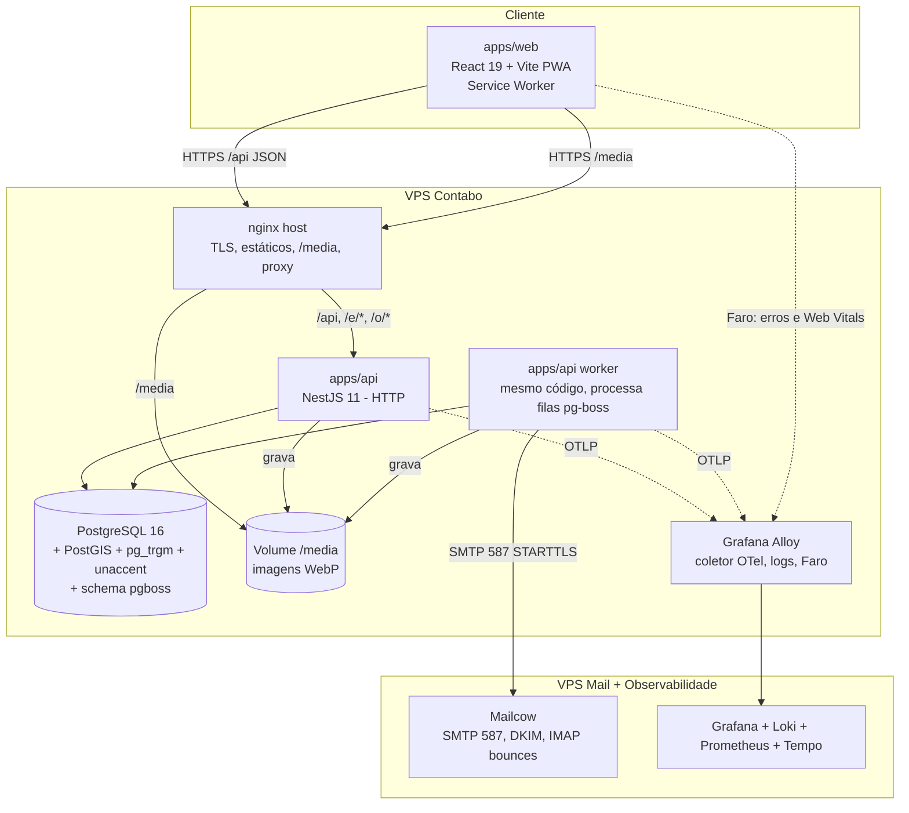
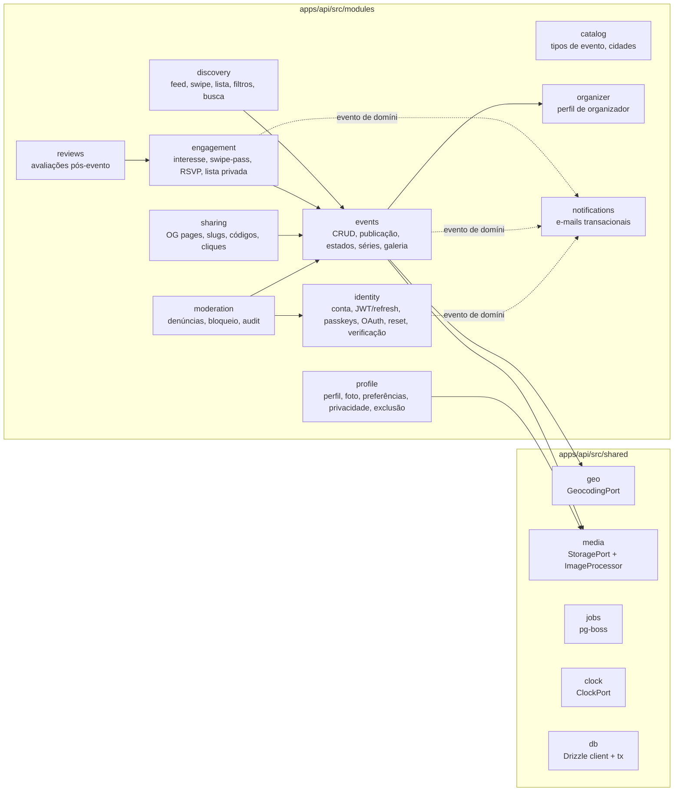

# RoleGo Beta — Arquitetura

> Projeto novo, construído do zero. O código do v0.1 (`../app`) serve só como referência de regras já validadas do E01 (reset de senha, upload, login social). Nada é portado sem passar por este documento.

## 1. Drivers de arquitetura

| Driver | Consequência |
|---|---|
| Time pequeno + desenvolvimento assistido por IA | **Monólito modular** em TypeScript ponta a ponta, contratos tipados compartilhados, convenções rígidas ([08](08-boas-praticas-codigo.md)) |
| Consulta geográfica é o coração (raio 1–100 km) | **PostgreSQL + PostGIS** com índice GiST |
| Privacidade do endereço de evento privado | Serialização por **perfil de acesso** num único ponto (Presenter) + testes de contrato |
| Beta numa VPS (Contabo) com custo baixo | Docker Compose, fila no próprio Postgres (**pg-boss**), sem Redis/Kubernetes |
| Próximas releases (social, ingressos, push) | Módulos com fronteiras claras e eventos de domínio internos; pontos de extensão documentados |
| Mobile-first sem loja de apps | **PWA** (React + Vite) |

## 2. Visão C4

### 2.1 Contexto (C1)



### 2.2 Containers (C2)



- **API** e **Worker** são o **mesmo build** com dois entrypoints (`main.ts` e `worker.ts`), então o deploy e o código são compartilhados.
- O nginx serve `apps/web/dist` (SPA com fallback) e `/media` com `Cache-Control: immutable`.

### 2.3 Componentes da API (C3) — módulos



**Regras de dependência entre módulos**
1. Um módulo só importa de outro pela sua **API pública** (`index.ts` exporta services/ports). Importar `infra/` de outro módulo é proibido, e o lint garante isso ([08 §3](08-boas-praticas-codigo.md#3-arquitetura-de-pastas)).
2. Efeitos colaterais entre módulos (e-mail, contadores) passam por **eventos de domínio** (`EventBus` interno, síncrono após o commit → enfileira job).
3. `shared/` não conhece nenhum módulo.

## 3. Stack

| Camada | Escolha | ADR |
|---|---|---|
| Linguagem | TypeScript 5.x `strict` ponta a ponta | — |
| Monorepo | pnpm workspaces + Turborepo | [ADR-002](04-adrs.md#adr-002) |
| Front | React 19, Vite 7, React Router 7 (modo SPA), TanStack Query 5, react-hook-form + Zod, `motion` (gestos do swipe), vite-plugin-pwa | [ADR-001](04-adrs.md#adr-001) |
| Estilo | CSS Modules + design tokens em CSS custom properties (`packages/tokens`) | [ADR-009](04-adrs.md#adr-009) |
| Back | NestJS 11 (Express), Zod via `nestjs-zod`, OpenAPI gerado | [ADR-003](04-adrs.md#adr-003) |
| Banco | PostgreSQL 16 + PostGIS 3.4 + `pg_trgm` + `unaccent` | [ADR-004](04-adrs.md#adr-004) |
| ORM / migrations | Drizzle ORM + drizzle-kit (SQL versionado) | [ADR-005](04-adrs.md#adr-005) |
| Filas/jobs | pg-boss (no Postgres) | [ADR-007](04-adrs.md#adr-007) |
| Autenticação | JWT EdDSA de 10 min + refresh token rotativo (detecção de reuso) + passkeys WebAuthn | [ADR-008](04-adrs.md#adr-008) |
| Imagens | `sharp` → WebP; StoragePort (disco local no beta, S3 compatível depois) | [ADR-010](04-adrs.md#adr-010) |
| Geocoding | ViaCEP (CEP→endereço) + Nominatim (endereço→coord.) atrás de GeocodingPort | [ADR-006](04-adrs.md#adr-006) |
| E-mail | Mailcow (SMTP próprio, VPS dedicada) + Nodemailer + templates React Email; Mailpit em staging | [ADR-011](04-adrs.md#adr-011) |
| Observabilidade | OpenTelemetry + pino → Grafana Alloy → Loki/Prometheus/Tempo + Grafana Faro (front) + Grafana Alerting | [ADR-012](04-adrs.md#adr-012) |
| Analytics de produto | PostHog Cloud (EU), ID pseudônimo, sem PII | [ADR-013](04-adrs.md#adr-013) |
| Testes | Vitest (unit), Testcontainers PostGIS (integração), Playwright (e2e) | [09](09-estrategia-de-testes.md) |
| CI/CD | GitHub Actions → imagem no GHCR → deploy por SSH com docker compose | [14](14-operacao-deploy.md) |

## 4. Estrutura do monorepo

```
rolego/
├── apps/
│   ├── api/                      # NestJS (HTTP + worker)
│   │   ├── src/
│   │   │   ├── main.ts           # HTTP
│   │   │   ├── worker.ts         # pg-boss consumers
│   │   │   ├── app.module.ts
│   │   │   ├── modules/<modulo>/
│   │   │   │   ├── domain/       # entidades, value objects, regras puras (sem Nest/Drizzle)
│   │   │   │   ├── application/  # casos de uso (services), ports (interfaces)
│   │   │   │   ├── infra/        # repositórios Drizzle, adapters externos
│   │   │   │   ├── http/         # controllers, presenters
│   │   │   │   ├── <modulo>.module.ts
│   │   │   │   └── index.ts      # API pública do módulo
│   │   │   └── shared/           # db, geo, media, jobs, clock, errors, auth guards
│   │   ├── drizzle/              # migrations SQL
│   │   └── test/                 # integração + contrato
│   └── web/                      # React PWA
│       └── src/
│           ├── app/              # router, providers, layout
│           ├── features/<feature>/   # auth, onboarding, discovery, event, organizer, review, admin
│           │   ├── components/
│           │   ├── hooks/        # useFeed, useRsvp (TanStack Query)
│           │   ├── pages/
│           │   └── api.ts        # chamadas tipadas a partir de @rolego/contracts
│           ├── ui/               # design system: Button, Chip, Card, Sheet, Slider, EventCard...
│           └── lib/              # http client, formatação de data/distância, analytics
├── packages/
│   ├── contracts/                # Schemas Zod de request/response + enums + erros (fonte única)
│   ├── tokens/                   # design tokens (CSS vars + TS)
│   └── config/                   # tsconfig, eslint, prettier compartilhados
├── e2e/                          # Playwright (cenários Gherkin)
├── infra/                        # docker-compose.*.yml, nginx, scripts de backup
├── docs/                         # cópia viva destes documentos + ADRs novos
└── CLAUDE.md                     # contexto para agentes de IA (ver ia/CLAUDE.md)
```

## 5. Decisões transversais

### 5.1 Contratos (contract-first)
- `packages/contracts` define **todos** os schemas Zod de entrada e saída por endpoint (`events.create.body`, `discovery.feed.query`, `EventCardDto`...).
- A API valida com `nestjs-zod` (`ZodValidationPipe`) e gera OpenAPI em `/api/docs` (só em dev/staging).
- O front importa os **mesmos** schemas para formulários (react-hook-form + zodResolver) e para tipar respostas.
- Quebrar um contrato exige mudar o schema e as duas pontas no **mesmo PR**.

### 5.2 Formato de erro (RFC 9457 Problem Details)
```json
{ "type": "https://rolego.com.br/errors/event-full", "title": "Evento lotado",
  "status": 409, "code": "EVENT_FULL", "detail": "Este rolê atingiu a capacidade.",
  "requestId": "01JC…", "errors": [{ "path": "capacity", "message": "…" }] }
```
`code` vem de um enum em `contracts/errors.ts`; o front mapeia `code → mensagem/ação`.

### 5.3 Autenticação e autorização
- **Access token JWT** (EdDSA/Ed25519, 10 min) no cookie `rg_at` (httpOnly, Secure, SameSite=Lax, `Path=/api`) ou em `Authorization: Bearer` (nativo/serviços). O guard global valida assinatura, `iss`, `aud` e `exp` localmente (chave pública em memória, JWKS em `/.well-known/jwks.json`), **sem consultar o banco**.
- **Refresh token** opaco no cookie `rg_rt` (SameSite=Strict, `Path=/api/v1/auth/refresh`, 30 dias), rotacionado a cada uso; reuso de um token antigo revoga a família inteira.
- **Refresh silencioso no front:** o http client recebe `401 TOKEN_EXPIRED` → uma única chamada `POST /auth/refresh` (single-flight, outras requisições aguardam) → repete a requisição original. Falhou → `/login`.
- **Revogação imediata:** bloqueio/exclusão/reset revogam as famílias e publicam o `sub` numa denylist em memória (TTL = vida do access token), sincronizada entre instâncias via `LISTEN/NOTIFY`.
- **Passkeys (WebAuthn):** registro depois do onboarding ("Entrar mais rápido com Face ID/digital") e login com conditional UI; o `amr=passkey` fica no token.
- CSRF: SameSite (Lax/Strict) + exigência do header `X-Requested-With: rolego` em métodos mutáveis + checagem de `Origin`.
- Guards: `@Public()`, `@Auth()` (padrão global), `@Roles('admin')`, `@OrganizerOf(':eventId')` (policy que confere a posse).
- **Policies** em `application/policies/*.ts` são funções puras testáveis (`canSeeExactAddress(viewer, event, rsvp)`).

### 5.4 Privacidade por perfil de acesso (crítico)
Toda resposta de evento passa pelo **`EventPresenter`**, que recebe `ViewerContext { userId?, isAdmin, isOrganizer, rsvpStatus }`:

| Campo | Público | Privado sem aprovação | Privado aprovado / organizador / admin |
|---|---|---|---|
| `venue.name` | ✓ | ✓ | ✓ |
| `venue.neighborhood`, `city` | ✓ | ✓ | ✓ |
| `venue.street`, `number`, `complement`, `cep` | ✓ | **omitido** | ✓ |
| `venue.location {lat,lng}` | ✓ | **omitido** | ✓ |
| `distanceKm` | 0,1 km | **arredondado a 1 km** | 0,1 km |
| `accessCode` | — | — | só organizador/admin |

A descoberta calcula a distância no SQL, mas **nunca** devolve coordenadas de evento privado. Há teste de contrato específico ([09 §4](09-estrategia-de-testes.md)).

### 5.5 Consulta geográfica (descoberta)
- `events.location geography(Point,4326)` + índice `GIST`; `starts_at`/`ends_at` indexados; índice parcial `WHERE status='PUBLISHED'`.
- Feed = `ST_DWithin(location, origin, radius_m)` + `ends_at > now()` + filtros → `ORDER BY starts_at, distance` com **cursor** `(starts_at, id)`.
- Swipe = mesma base `LEFT JOIN swipe_passes/interests` excluindo os já avaliados, `LIMIT 10` (prefetch).
- A distância vem de `ST_Distance(location, origin)/1000` calculada na query (o front só formata).
- Detalhes do SQL em [05-modelo-de-dados §4](05-modelo-de-dados.md#4-consultas-críticas).

### 5.6 Tempo
- Tudo em UTC (`timestamptz`). Exibição em `America/Sao_Paulo` (o evento guarda `timezone`, pensando em outras cidades).
- `ClockPort` injetável, para que testes congelem "agora".
- `phase` (UPCOMING/LIVE/ENDED) é sempre calculada a partir do Clock.

### 5.7 Jobs assíncronos (pg-boss)
| Fila | Disparo | Ação |
|---|---|---|
| `email.send` | eventos de domínio | Renderiza o template React Email e envia por SMTP (Mailcow), com retry exponencial 5x; 4xx do SMTP = retry, 5xx = falha definitiva |
| `media.process` | upload | Gera variantes WebP (capa 1080×1350, thumb 360×450, OG 1200×630) |
| `event.changed.notify` | `EventScheduleChanged` | Enfileira e-mails para os confirmados (lotes de 50) |
| `event.cancelled.notify` | `EventCancelled` | Idem |
| `review.invite` | cron 30 min | Encontra eventos encerrados nas últimas 2 h → e-mail "Como foi?" |
| `account.purge` | `AccountDeletionRequested` | Anonimiza e apaga a mídia |
| `email.bounces` | cron 15 min | Lê a caixa de bounce do Mailcow (IMAP) e marca `users.email_bounced_at` |
| `maintenance.*` | cron diário | Limpa refresh tokens expirados/revogados, tokens de e-mail e mídia órfã |

Jobs são **idempotentes** (`singletonKey` = chave de negócio).

### 5.8 Mídia
Upload `multipart` → validação por magic bytes → original em `/media/tmp` → job `media.process` → variantes `/media/{kind}/{uuid}-{variant}.webp` → `media_assets` atualizado. O front mostra a prévia local enquanto processa (`status=PROCESSING`).

### 5.9 Páginas de compartilhamento (OG)
`GET /e/:slug` e `GET /o/:slug` são atendidos pela **API**: devolvem HTML mínimo com as meta tags OG/Twitter e `<script>location.replace('/app/e/:slug')</script>`. Crawlers leem as meta tags; humanos são redirecionados para a SPA. Os cliques com `?s=` são contados (sem PII).

### 5.10 Cache
- HTTP: `/media` immutable 1 ano; `/api/catalog` 1 h; o feed não é cacheado (é personalizado).
- Front: TanStack Query (`staleTime` 30 s no feed, 5 min no catálogo); o Service Worker faz cache do shell e de imagens (stale-while-revalidate).

### 5.11 Rate limiting
`@nestjs/throttler` em memória (instância única no beta): auth 10/min/IP; forgot-password 5/15 min; código de evento privado 5/10 min por usuário+IP; uploads 20/h por usuário; denúncias 20/dia.

## 6. Pontos de extensão (próximas releases)

| Release | Onde encaixa |
|---|---|
| 1.1 Social (amigos, match, chat) | novos módulos `social` e `chat`. `engagement.interests` já é a base do "match" (todos do grupo com interesse no mesmo evento). Chat via WebSocket (gateway Nest) ou um serviço gerenciado |
| 1.2 Ingressos (E04) | módulo `ticketing` + `payments` (PaymentPort). `ticket_types` substituem `price_items`, o RSVP vira pedido/ingresso, `capacity` passa a ser por lote |
| 1.3 Push (E10) | `notifications` ganha um canal `WebPush` (VAPID) + preferências; o evento de domínio `EventPublishedNearby` usa a mesma query geo |
| Mapa / Ads (E08/E09) | `discovery` ganha `mapBbox` (`ST_MakeEnvelope`) + `promotion` com boost no ranking |
| App nativo | os contratos já são REST + Zod; o mesmo JWT via `Authorization: Bearer` + refresh no secure storage do aparelho; passkeys funcionam nativamente |

## 7. Qualidades e táticas

| Qualidade | Tática |
|---|---|
| Desempenho | Índices GiST/BTree, cursor pagination, prefetch do swipe, imagens WebP responsivas (`srcset`) |
| Segurança | ver [10](10-seguranca-privacidade-lgpd.md) |
| Testabilidade | Ports (Clock, Geocoding, Storage, Email) com fakes; domínio puro; Testcontainers |
| Evolutividade | Monólito modular com fronteiras verificadas por lint; eventos de domínio |
| Operabilidade | OpenTelemetry (logs, métricas e traces correlacionados por `traceId`) no Grafana, alertas, health checks, migrations automáticas no deploy, backup diário |
