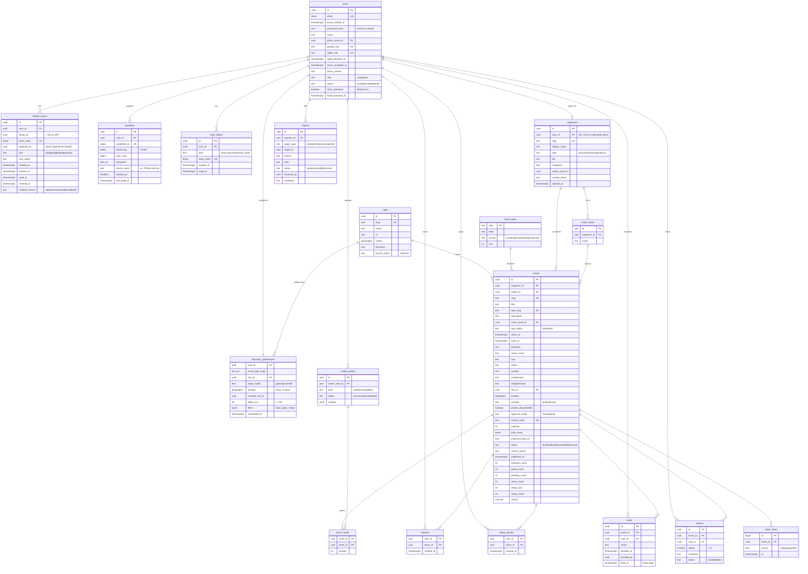

# RoleGo Beta — Modelo de dados

PostgreSQL 16 + PostGIS. Convenções: tabelas no plural em `snake_case`; PK `uuid` (v7, ordenável) gerada na aplicação; `created_at`/`updated_at timestamptz`; enums como `text` + `CHECK` (são mais fáceis de migrar do que `CREATE TYPE`); dinheiro em **centavos** (`integer`).

## 1. ERD



Tabelas de apoio fora do diagrama: `jwt_keys(kid, public_jwk, private_jwk_encrypted, created_at, retired_at)` (chaves Ed25519; a privada é cifrada com a env `JWT_KEK`), `audit_log(id, actor_id, action, entity, entity_id, payload jsonb, at)`, `geocode_cache(key text PK, result jsonb, fetched_at)`, o schema `pgboss.*` (gerenciado pela lib) e `outbox` (não é necessário: pg-boss faz o insert na mesma transação).

## 2. Regras de integridade

| Tabela | Regra |
|---|---|
| users | `UNIQUE(email)`; `CHECK (password_hash IS NOT NULL OR google_sub IS NOT NULL OR apple_sub IS NOT NULL OR status='deleted')` |
| discovery_preferences | `CHECK (radius_km BETWEEN 1 AND 100)` |
| events | `CHECK (ends_at > starts_at AND ends_at - starts_at <= interval '48 hours')`; `CHECK (status <> 'published' OR (cover_asset_id IS NOT NULL AND location IS NOT NULL))`; `CHECK (visibility='public' OR access_code IS NOT NULL)`; `CHECK (capacity IS NULL OR capacity > 0)`; `CHECK (going_count >= 0)` |
| rsvps | `UNIQUE(event_id, user_id)`; `status IN ('pending','confirmed','approved','declined','cancelled_by_user','cancelled_by_event')` |
| reviews | `UNIQUE(event_id, user_id)`; `CHECK (rating BETWEEN 1 AND 5)`; `CHECK (char_length(comment) <= 500)` |
| reports | `UNIQUE(reporter_id, target_type, target_id)` |
| organizers | `UNIQUE(user_id) WHERE user_id IS NOT NULL` |
| refresh_tokens | rotação: ao usar, grava `used_at` + `replaced_by` na mesma transação que insere o novo; token com `used_at` apresentado de novo → `UPDATE … SET revoked_at, revoked_reason='reuse' WHERE family_id` |
| passkeys | `UNIQUE(credential_id)`; `sign_count` só aumenta (um contador menor indica clone → rejeita e alerta) |

`price_items` (jsonb), validado por Zod na aplicação:
```json
[{ "label": "Pista", "priceCents": 8900, "note": "1º lote" },
 { "label": "VIP", "priceCents": 18900 },
 { "label": "Open bar até 00h", "priceCents": null }]
```

## 3. Índices

```sql
CREATE EXTENSION IF NOT EXISTS postgis;
CREATE EXTENSION IF NOT EXISTS pg_trgm;
CREATE EXTENSION IF NOT EXISTS unaccent;
CREATE EXTENSION IF NOT EXISTS citext;

-- descoberta
CREATE INDEX events_discovery_geo_idx ON events USING gist (location)
  WHERE status = 'published';
CREATE INDEX events_discovery_time_idx ON events (ends_at, starts_at, id)
  WHERE status = 'published';
CREATE INDEX events_organizer_idx ON events (organizer_id, starts_at DESC);
CREATE INDEX events_series_idx ON events (series_id, starts_at DESC);
-- busca
CREATE INDEX events_search_idx ON events USING gin (search);
CREATE INDEX events_title_trgm_idx ON events USING gin (immutable_unaccent(lower(title)) gin_trgm_ops);
-- engajamento
CREATE INDEX rsvps_event_status_idx ON rsvps (event_id, status);
CREATE INDEX rsvps_user_idx ON rsvps (user_id, status);
CREATE INDEX interests_event_idx ON interests (event_id, created_at DESC);
-- autenticação
CREATE INDEX refresh_tokens_family_idx ON refresh_tokens (family_id) WHERE revoked_at IS NULL;
CREATE INDEX refresh_tokens_user_idx ON refresh_tokens (user_id) WHERE revoked_at IS NULL;
CREATE INDEX passkeys_user_idx ON passkeys (user_id);
```
`search` = coluna `GENERATED ALWAYS AS (to_tsvector('portuguese', immutable_unaccent(title || ' ' || venue_name))) STORED`.

## 4. Consultas críticas

### 4.1 Feed (cursor)
```sql
-- :origin = ST_SetSRID(ST_MakePoint(:lng,:lat),4326)::geography
SELECT e.*,
       ST_Distance(e.location, :origin) / 1000.0 AS distance_km,
       (i.user_id IS NOT NULL) AS viewer_interested,
       r.status AS viewer_rsvp
FROM events e
JOIN organizers o ON o.id = e.organizer_id
LEFT JOIN users ou ON ou.id = o.user_id                       -- null p/ organizador criado pelo admin
LEFT JOIN interests i ON i.event_id = e.id AND i.user_id = :viewer
LEFT JOIN rsvps r     ON r.event_id = e.id AND r.user_id = :viewer
WHERE e.status = 'published'
  AND (ou.id IS NULL OR ou.status = 'active')                -- RN-10: exclui organizador bloqueado
  AND e.ends_at > :now
  AND (e.visibility = 'public' OR e.private_discoverable)
  AND ST_DWithin(e.location, :origin, :radius_m)
  AND (:types::text[] IS NULL OR e.type_slug = ANY(:types))
  AND (:from::timestamptz IS NULL OR e.ends_at >= :from)
  AND (:to::timestamptz   IS NULL OR e.starts_at < :to)
  AND (:cursor_starts::timestamptz IS NULL
       OR (e.starts_at, e.id) > (:cursor_starts, :cursor_id))
ORDER BY e.starts_at, e.id
LIMIT 21;   -- 20 + 1 para saber se há próxima página
```
O agrupamento "Hoje / Amanhã / Fim de semana / Próximos" é feito no **front** a partir de `startsAt` no fuso do evento.

### 4.2 Swipe
Mesma base do feed, acrescentando:
```sql
  AND i.user_id IS NULL
  AND NOT EXISTS (SELECT 1 FROM swipe_passes p WHERE p.event_id=e.id AND p.user_id=:viewer)
ORDER BY (e.type_slug = ANY(:preferred))::int DESC, e.starts_at, distance_km
LIMIT 10;
```

### 4.3 Confirmar presença com capacidade (sem corrida)
```sql
BEGIN;
-- reserva vaga atomicamente
UPDATE events SET going_count = going_count + 1
 WHERE id = :event AND status='published' AND ends_at > :now
   AND (capacity IS NULL OR going_count < capacity)
RETURNING id;            -- 0 linhas => EVENT_FULL (ou evento indisponível)
INSERT INTO rsvps (id, event_id, user_id, status, ...) VALUES (...)
  ON CONFLICT (event_id, user_id) DO UPDATE SET status = EXCLUDED.status, ...
  WHERE rsvps.status IN ('cancelled_by_user','declined');
INSERT INTO interests ... ON CONFLICT DO NOTHING;   -- RN-04
COMMIT;
```
Com status `pending` o `going_count` não muda; quem incrementa é a aprovação (com o mesmo UPDATE condicional).

## 5. Contadores denormalizados
`interests_count`, `going_count`, `pending_count`, `rating_sum/count` são atualizados **na mesma transação** da escrita. Um job diário `maintenance.recount` reconcilia e loga divergências.

## 6. Retenção e LGPD

| Dado | Retenção |
|---|---|
| Refresh tokens expirados/revogados | apagados após 30 dias |
| `auth_tokens` usados ou expirados | apagados após 7 dias |
| `geocode_cache` | 30 dias |
| `share_clicks` | 180 dias, sem IP |
| Conta excluída | `email` → `deleted+<uuid>@rolego.invalid`, `name` → "Usuário removido", subs/hash nulos, passkeys e refresh tokens apagados, fotos apagadas; reviews mantidas como "Usuário removido"; `audit_log` mantido |
| Localização GPS | só a última, com 3 casas decimais; nada de histórico |

## 7. Seed (dev/staging)
- `event_types` (10), `cities` (Curitiba live; Florianópolis, Porto Seguro, Maringá soon).
- 1 admin, 5 organizadores, cerca de 60 eventos em Curitiba distribuídos em 0–40 km e nos próximos 21 dias, 10 privados, 8 encerrados com reviews.
- Script `pnpm db:seed` determinístico (seed fixa) para os e2e.
