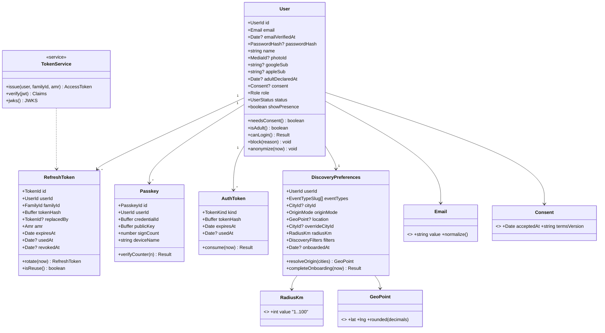
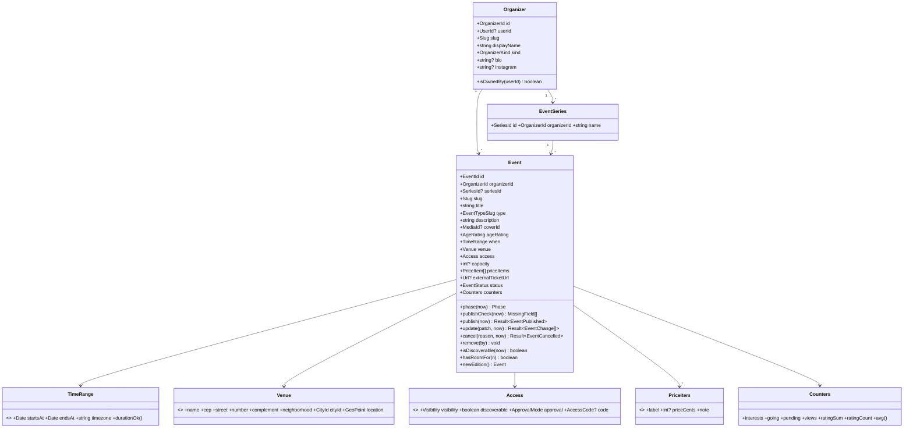
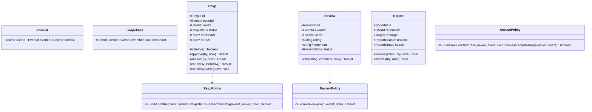
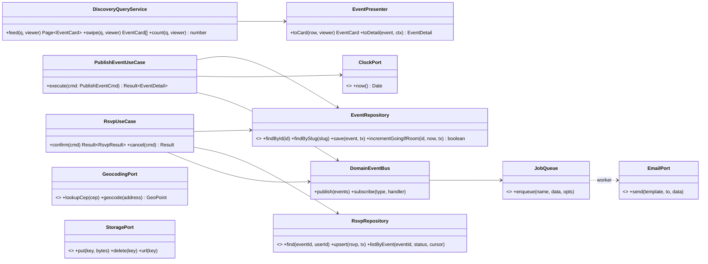
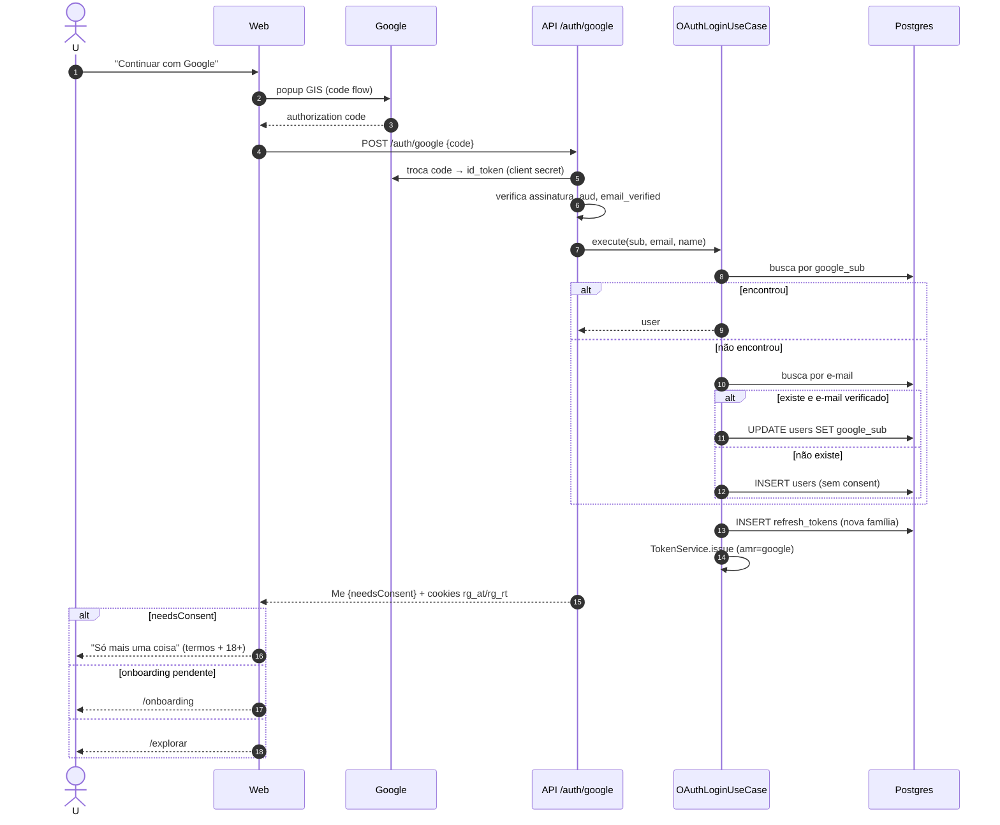
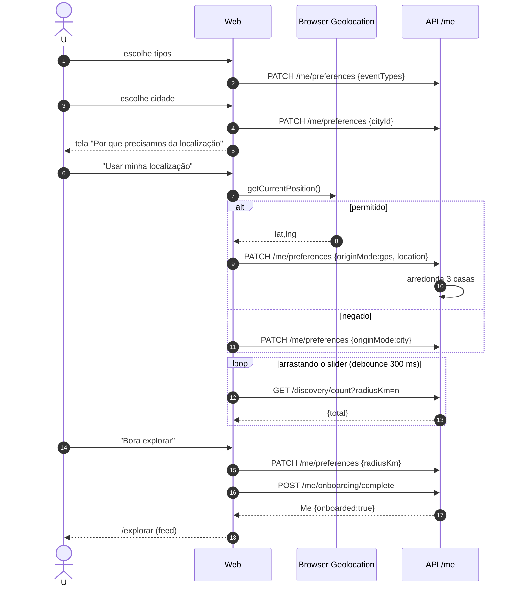
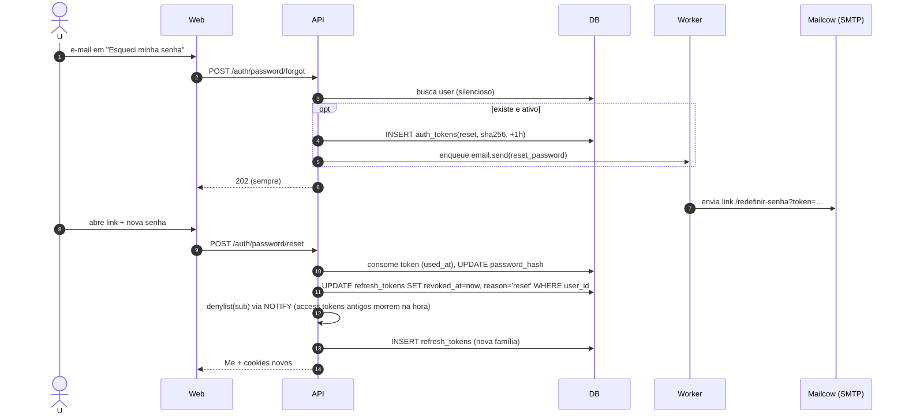
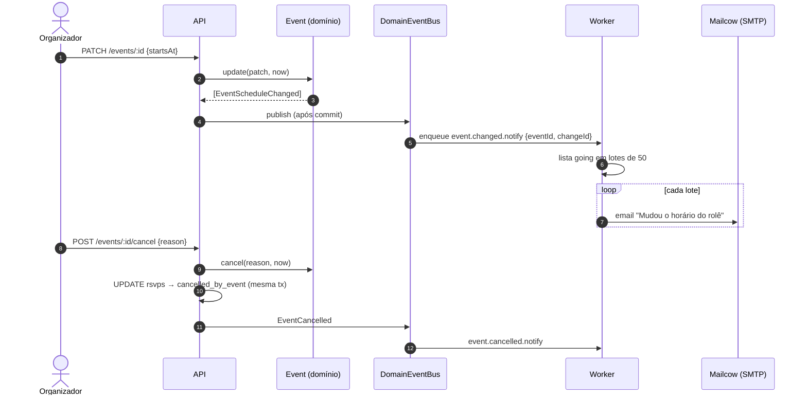
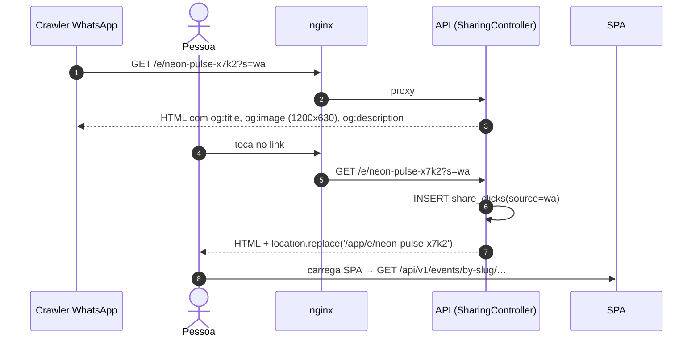
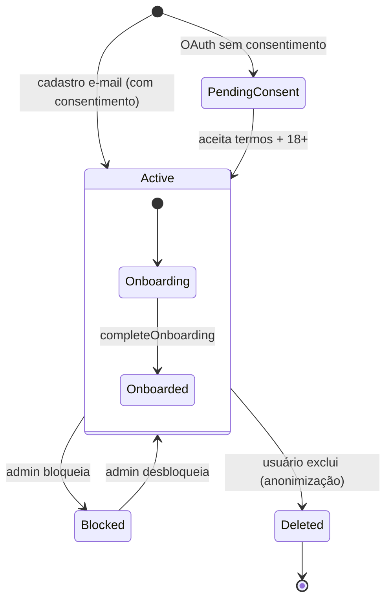

# RoleGo Beta — Diagramas (sequência, classes, estados, atividade, deploy)

Todos os diagramas estão em Mermaid (o GitHub e o VS Code renderizam). Os nomes de classes e métodos são os que devem existir no código. Quando o código divergir, este documento é atualizado no mesmo PR.

## Índice
1. [Diagramas de classe (domínio)](#1-diagramas-de-classe)
2. [Sequência — E01 e autenticação](#2-sequência--e01-conta-e-onboarding)
3. [Sequência — E02](#3-sequência--e02-publicação-e-descoberta)
4. [Sequência — E03](#4-sequência--e03-ciclo-de-vida)
5. [Estados](#5-máquinas-de-estado)
6. [Atividade — wizard de criação](#6-atividade--wizard-de-criação-de-evento)
7. [Deploy](#7-deploy)
8. [Navegação do app](#8-mapa-de-navegação)

---

## 1. Diagramas de classe

### 1.1 Domínio — Identity & Profile



### 1.2 Domínio — Organizer & Events



### 1.3 Domínio — Engagement, Reviews, Moderation



### 1.4 Aplicação — casos de uso e ports (camada `application`)



---

## 2. Sequência — E01 Conta e onboarding

### 2.1 Cadastro por e-mail (US-01.01)
```mermaid
sequenceDiagram
  autonumber
  actor U as Usuário
  participant W as Web (PWA)
  participant A as API /auth
  participant S as RegisterUseCase
  participant DB as Postgres
  participant Q as pg-boss
  U->>W: preenche e-mail, senha, aceites
  W->>W: valida com schema Zod (contracts)
  W->>A: POST /auth/register
  A->>S: execute(cmd)
  S->>DB: SELECT users WHERE email
  alt e-mail existe
    S-->>A: EMAIL_TAKEN
    A-->>W: 409 Problem
    W-->>U: "Este e-mail já tem conta. Quer entrar?"
  else novo
    S->>S: hash argon2id
    S->>DB: BEGIN; INSERT users, discovery_preferences, auth_tokens(verify), refresh_tokens(nova família)
    S->>Q: enqueue email.send(verify_email) [mesma tx]
    S->>DB: COMMIT
    S->>S: TokenService.issue → JWT EdDSA 10 min (sub, role, sid, amr=pwd)
    A-->>W: 201 Me + Set-Cookie rg_at (JWT) + rg_rt (refresh)
    W-->>U: /onboarding/preferencias
  end
```

### 2.2 Login com Google (US-01.02)


### 2.3 Onboarding completo (US-01.07 → 01.10)


### 2.4 Recuperar senha (US-01.05)


---

### 2.5 Refresh silencioso com rotação e detecção de reuso (ADR-008)
```mermaid
sequenceDiagram
  autonumber
  participant W as Web (http client)
  participant A as API
  participant G as JwtGuard
  participant R as RefreshUseCase
  participant DB
  W->>A: GET /discovery/feed (cookie rg_at expirado)
  A->>G: verifica assinatura EdDSA + exp (sem banco)
  G-->>W: 401 TOKEN_EXPIRED
  W->>W: single-flight: outras requisições aguardam
  W->>A: POST /auth/refresh (cookie rg_rt)
  A->>R: rotate(hash(rt))
  R->>DB: SELECT refresh_tokens WHERE token_hash FOR UPDATE
  alt válido e não usado
    R->>DB: UPDATE used_at, replaced_by; INSERT novo (mesma família)
    R-->>A: novo JWT + novo refresh
    A-->>W: 204 + Set-Cookie rg_at, rg_rt
    W->>A: repete GET /discovery/feed
  else já usado (reuso = possível roubo)
    R->>DB: UPDATE refresh_tokens SET revoked_at, reason='reuse' WHERE family_id
    R->>R: log de segurança + métrica auth_refresh_reuse_total (alerta no Grafana)
    A-->>W: 401 REFRESH_REUSED
    W-->>W: limpa estado → /login
  else expirado/revogado
    A-->>W: 401 UNAUTHENTICATED → /login
  end
```

### 2.6 Login com passkey (US-01.15)
```mermaid
sequenceDiagram
  autonumber
  actor U
  participant W as Web
  participant AU as Autenticador (Face ID / digital)
  participant A as API /auth/passkey
  participant DB
  W->>A: POST /login/options
  A->>DB: grava challenge (5 min, uso único)
  A-->>W: requestOptions (rpId=rolego.com.br, userVerification=required)
  W->>AU: navigator.credentials.get (conditional UI no campo de e-mail)
  U->>AU: biometria
  AU-->>W: assertion assinada
  W->>A: POST /login/verify
  A->>DB: SELECT passkeys WHERE credential_id
  A->>A: verifica assinatura, origin, rpId, challenge, signCount crescente
  A->>DB: UPDATE sign_count, last_used_at; INSERT refresh_tokens
  A-->>W: Me + cookies (amr=passkey)
```

## 3. Sequência — E02 Publicação e descoberta

### 3.1 Criar e publicar evento (US-02.02 → 02.06)
```mermaid
sequenceDiagram
  autonumber
  actor O as Organizador
  participant W as Web (wizard)
  participant A as API /events
  participant G as GeocodingPort
  participant M as MediaService
  participant DB
  participant Q as Worker
  O->>W: passo 1 (título, tipo)
  W->>A: POST /events
  A->>DB: INSERT events(status=draft, slug)
  A-->>W: EventDetail(draft)
  O->>W: capa
  W->>A: PUT /events/:id/cover (multipart)
  A->>M: valida magic bytes, salva tmp
  M->>Q: enqueue media.process
  A-->>W: cover {status: processing, previewUrl}
  Q->>Q: sharp → 1080x1350, 360x450, 1200x630
  O->>W: passo 2 (datas) e passo 3 (CEP, número)
  W->>A: POST /events/:id/geocode {cep, number}
  A->>G: lookupCep → geocode (cache 30d)
  G-->>A: endereço + GeoPoint
  A-->>W: VenuePreview "Confere?"
  O->>W: confirma; passos 4 e 5 (acesso, valores)
  W->>A: PATCH /events/:id (autosave a cada passo)
  O->>W: Revisão → "Publicar rolê"
  W->>A: POST /events/:id/publish
  A->>A: Event.publish(now): publishCheck + e-mail verificado
  alt pendências
    A-->>W: 422 EVENT_NOT_PUBLISHABLE {missing}
  else ok
    A->>DB: UPDATE status=published, published_at; INSERT audit
    A-->>W: EventDetail + shareUrl
    W-->>O: folha "Compartilhar"
  end
```

### 3.2 Feed (US-02.11)
```mermaid
sequenceDiagram
  autonumber
  actor U
  participant W as Web
  participant A as API /discovery
  participant D as DiscoveryQueryService
  participant P as EventPresenter
  participant DB as PostGIS
  U->>W: abre Explorar
  W->>A: GET /discovery/feed (TanStack Query, staleTime 30s)
  A->>D: feed(query ∪ preferences, viewer)
  D->>D: resolveOrigin(override → gps → city)
  D->>DB: SELECT … ST_DWithin … ORDER BY starts_at,id LIMIT 21
  DB-->>D: rows + distance_km
  D->>P: toCard(row, viewer) (arredonda distância; omite endereço)
  D-->>A: Page{items, nextCursor}
  A-->>W: 200
  W->>W: agrupa Hoje/Amanhã/Fim de semana (fuso do evento)
  U->>W: rola até o fim
  W->>A: GET /discovery/feed?cursor=…
```

### 3.3 Swipe com like, passe e desfazer (US-02.12)
```mermaid
sequenceDiagram
  autonumber
  actor U
  participant W as Web (pilha de cards)
  participant A as API
  participant DB
  W->>A: GET /discovery/swipe
  A-->>W: 10 cards
  U->>W: arrasta → direita
  W->>W: otimista: remove card, anima ♥
  W->>A: PUT /events/:id/interest
  A->>DB: INSERT interests ON CONFLICT DO NOTHING; interests_count+1 (se inseriu)
  U->>W: arrasta → esquerda
  W->>A: PUT /events/:id/pass
  U->>W: "↺ Desfazer"
  W->>A: DELETE /events/:id/pass
  W->>W: devolve o card ao topo
  opt restam ≤ 3 cards
    W->>A: GET /discovery/swipe (prefetch, exclui ids em memória)
  end
```

---

## 4. Sequência — E03 Ciclo de vida

### 4.1 Confirmar presença com capacidade (US-03.04)
```mermaid
sequenceDiagram
  autonumber
  actor U
  participant W as Web
  participant A as API
  participant R as RsvpUseCase
  participant DB
  participant Q as Worker
  U->>W: "Confirmar presença"
  W->>A: POST /events/:id/rsvp
  A->>R: confirm(eventId, viewer)
  R->>DB: SELECT event
  R->>R: RsvpPolicy.assertCanRsvp (status, fase, 18+, bloqueio)
  R->>R: initialStatus → confirmed (público)
  R->>DB: BEGIN
  R->>DB: UPDATE events SET going_count+1 WHERE capacity livre RETURNING
  alt 0 linhas
    R->>DB: ROLLBACK
    A-->>W: 409 EVENT_FULL
    W-->>U: "Lotado"
  else ok
    R->>DB: UPSERT rsvps(confirmed); INSERT interests ON CONFLICT
    R->>Q: enqueue email.send(rsvp_confirmed)
    R->>DB: COMMIT
    A-->>W: {status: confirmed, counts}
    W-->>U: "Você vai! 🎉" + .ics + compartilhar
  end
```

### 4.2 Evento privado: link → pedido → aprovação → endereço (US-03.05/03.06)
```mermaid
sequenceDiagram
  autonumber
  actor C as Convidado
  actor H as Anfitrião
  participant W as Web
  participant A as API
  participant P as EventPresenter
  participant DB
  participant Q as Worker
  C->>W: abre /e/social-do-laercio?c=RG7K2Q
  W->>A: GET /events/by-slug/social-do-laercio?c=RG7K2Q
  A->>DB: event + rsvp(viewer)
  A->>P: toDetail(ctx{rsvp:null})
  P->>P: AccessPolicy.canSeeExactAddress = false → omite rua/coords, distância ~1 km
  A-->>W: EventDetail{addressLocked:true}
  C->>W: "Pedir para entrar"
  W->>A: POST /events/:id/rsvp {accessCode}
  A->>A: valida código (rate limit) → approval=manual → PENDING
  A->>DB: INSERT rsvps(pending); pending_count+1
  A->>Q: email.send(host_new_request)
  A-->>W: {status: pending}
  H->>W: Organizar → Lista → Aprovar
  W->>A: POST /events/:id/guests/:userId/approve
  A->>DB: BEGIN; UPDATE events going+1 (se vaga), pending-1; UPDATE rsvps approved; COMMIT
  A->>Q: email.send(guest_approved)
  C->>W: reabre evento
  W->>A: GET /events/by-slug/…
  A->>P: ctx{rsvp:approved} → canSeeExactAddress = true
  A-->>W: EventDetail{venue.street, number, location}
```

### 4.3 Editar data / cancelar evento (US-02.07, US-03.09)


### 4.4 Avaliação pós-evento (US-03.10)
```mermaid
sequenceDiagram
  autonumber
  participant CR as Cron (worker, 30 min)
  participant DB
  participant M as Mailcow (SMTP)
  actor U
  participant W as Web
  participant A as API
  CR->>DB: eventos com ends_at entre now-2h e now, ainda não convidados
  CR->>M: email "Como foi o {evento}?" para os going
  U->>W: abre feed
  W->>A: GET /me/reviews/pending
  A-->>W: [evento]
  W-->>U: card "Como foi?"
  U->>W: 5★ + comentário
  W->>A: PUT /events/:id/review
  A->>A: ReviewPolicy.canReview (going, ends_at ≤ now ≤ ends_at+7d)
  A->>A: filtro de conteúdo (palavrões/links)
  A->>DB: UPSERT reviews; rating_sum/count ajustados
  A-->>W: Review
```

### 4.5 Compartilhamento com Open Graph (US-03.07)


### 4.6 Denúncia e moderação (US-03.14, US-ADM.02)
```mermaid
sequenceDiagram
  autonumber
  actor U
  actor ADM as Admin
  participant A as API
  participant DB
  U->>A: POST /reports {event, "Golpe/falso"}
  A->>DB: INSERT reports (UNIQUE reporter+target)
  ADM->>A: GET /admin/reports?status=open
  ADM->>A: POST /admin/reports/:id/resolve {action: remove}
  A->>DB: BEGIN; events.status=removed; reports do mesmo alvo → resolved; audit_log; COMMIT
  A-->>ADM: 200
```

---

## 5. Máquinas de estado

Evento e RSVP: ver [E03 §Máquina de estados](02-historias/E03-ciclo-de-vida.md#máquina-de-estados).

### 5.1 Conta


### 5.2 Denúncia
```mermaid
stateDiagram-v2
  [*] --> OPEN
  OPEN --> RESOLVED: remover / ocultar / bloquear
  OPEN --> DISMISSED: descartar
```

### 5.3 Mídia
```mermaid
stateDiagram-v2
  [*] --> PROCESSING: upload validado
  PROCESSING --> READY: variantes geradas
  PROCESSING --> FAILED: erro (retry 3x)
  READY --> [*]: substituída/excluída (job remove arquivos)
```

---

## 6. Atividade — wizard de criação de evento

```mermaid
flowchart TD
  S([Organizar → + Novo rolê]) --> O{Tem perfil de organizador?}
  O -- não --> OP[Ativar modo organizador] --> B
  O -- sim --> B[1 · Básico: título, tipo, capa, faixa etária]
  B -->|cria rascunho| Q[2 · Quando: início, fim]
  Q --> L[3 · Onde: local, CEP, número]
  L --> GC{Geocoding ok?}
  GC -- não --> GF[Usar minha localização / corrigir] --> L
  GC -- sim --> AC[4 · Acesso: público/privado, aprovação, capacidade]
  AC --> V[5 · Valores: itens + link externo]
  V --> R[6 · Revisão com prévia do card e da página]
  R --> PC{publishCheck ok?}
  PC -- não --> FIX[Ir ao passo com pendência] --> R
  PC -- sim --> EV{E-mail verificado?}
  EV -- não --> VE[Reenviar verificação] --> R
  EV -- sim --> PUB[[Publicar]] --> SH([Folha de compartilhamento])
  B & Q & L & AC & V -.autosave.-> D[(rascunho)]
```

---

## 7. Deploy

```mermaid
flowchart TB
  subgraph GH[GitHub]
    PR[PR] --> CI[Actions: lint · typecheck · unit · integração · e2e · build]
    CI -->|merge main| IMG[docker build → ghcr.io/rolego/api:sha + web dist artifact]
  end
  subgraph VPS[Contabo VPS 144.126.154.90]
    NG[nginx host + certbot<br/>rolego.com.br · staging.rolego.com.br]
    subgraph prod[compose: rolego-prod]
      API1[api :3000]
      WK1[worker]
      PG1[(postgis 16)]
    end
    subgraph stg[compose: rolego-staging]
      API2[api :3100]
      WK2[worker]
      PG2[(postgis 16)]
    end
    MEDIA[(/srv/rolego/prod/media)]
    BK[cron backup: pg_dump + media → storage externo]
    ALY[Grafana Alloy]
  end
  subgraph VPS2[VPS mail + observabilidade]
    MC[Mailcow<br/>mail.rolego.com.br]
    LGTM[Grafana · Loki · Prometheus · Tempo<br/>grafana.rolego.com.br]
  end
  IMG -->|deploy staging automático| stg
  IMG -->|deploy prod manual - aprovação| prod
  NG --> API1
  NG --> API2
  NG --> MEDIA
  PG1 --> BK
  API1 -.SMTP 587.-> MC
  ALY --> LGTM
```

---

## 8. Mapa de navegação

```mermaid
flowchart LR
  SPL[T-01 Splash] --> CAD[T-02 Criar conta]
  SPL --> LOG[T-03 Entrar]
  LOG --> REC[T-04 Recuperar senha]
  CAD --> ON1[T-05 O que você curte]
  LOG --> ON1
  ON1 --> ON2[T-06 Cidade] --> ON3[T-07 Localização] --> ON4[T-08 Raio]
  ON4 --> FEED
  subgraph Tabs
    FEED[T-10 Explorar: Feed]
    SW[T-11 Swipe]
    LST[T-12 Lista]
    MR[T-30 Meus rolês]
    ORG[T-46 Organizar]
    PRF[T-31 Perfil]
  end
  FEED <--> SW <--> LST
  FEED --> FIL[T-13 Filtros]
  FEED --> LOC[T-14 Trocar cidade]
  FEED --> BUS[T-15 Busca]
  FEED --> EVT[T-20 Página do evento]
  SW --> EVT
  EVT --> PPL[T-21 Quem vai]
  EVT --> OK[T-22 Você vai!]
  EVT --> PRIV[T-23 Privado / pedir para entrar]
  EVT --> SHR[T-24 Compartilhar]
  EVT --> RAT[T-25 Como foi?]
  EVT --> ORGP[T-26 Organizador]
  EVT --> REP[T-27 Denunciar]
  PRF --> EDT[T-32 Editar perfil]
  PRF --> PRE[T-33 Preferências e privacidade]
  PRF --> ATV[T-40 Ativar organizador]
  ORG --> W1[T-41..45 Wizard] --> SHR
  ORG --> GST[T-48 Lista de convidados]
  ORG --> CAN[T-49 Cancelar evento]
  ORG --> GAL[T-47 Galeria]
```
