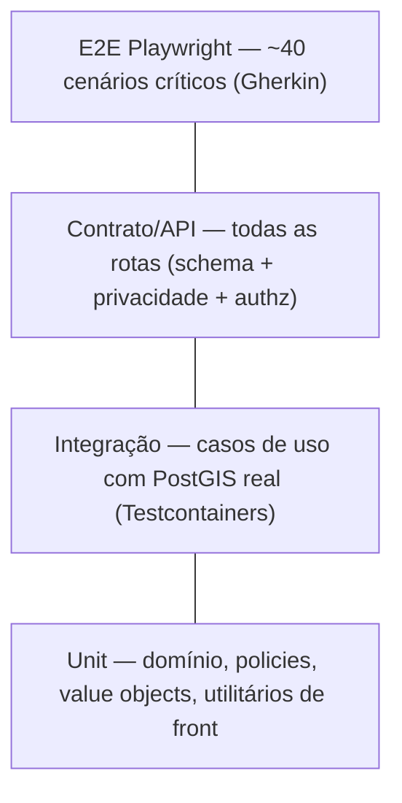

# RoleGo Beta — Estratégia de testes e qualidade

## 1. Pirâmide

| Nível | Ferramenta | Roda em | Meta |
|---|---|---|---|
| Unit | Vitest | pre-commit (alterados) + CI | domínio/policies 100% dos ramos; geral ≥ 80% |
| Integração | Vitest + Testcontainers `postgis/postgis:16-3.4` | CI | todo caso de uso com o caminho feliz + cada `DomainError` |
| Contrato | Vitest + supertest + schemas `contracts` | CI | 100% das rotas: resposta valida no schema de saída |
| Componente | Vitest + Testing Library | CI | ui/ e componentes de feature com lógica |
| E2E | Playwright (Chromium mobile 390×844 + WebKit) + Mailpit para e-mails | CI (smoke por PR) / nightly (completo) | cenários **M** das histórias |
| Visual | Playwright screenshots | nightly | telas-chave contra baseline aprovada do protótipo |
| Carga | k6 | antes do beta aberto | feed p95 < 400 ms com 50 req/s e 10 mil eventos |
| Acessibilidade | `@axe-core/playwright` | e2e | zero violação serious/critical |

## 2. Rastreabilidade Gherkin → teste

- Os cenários das [histórias](02-historias/) vão para `e2e/features/*.feature` (Playwright + `playwright-bdd`) **ou** viram `test()` com o mesmo título.
- Tag por história: `@US-03.04`. O relatório de CI agrupa por tag para mostrar a cobertura de requisitos.
- Matriz no fim de cada sprint: `US → cenários → status`.

## 3. Dados de teste

- `pnpm db:seed --profile=e2e`: determinístico (seed fixa), com um relógio fixo `2026-11-20T18:00-03:00` via `ClockPort` (env `FAKE_NOW` só em teste).
- Factories (`test/factories/*.ts`): `makeUser()`, `makeEvent({ visibility:'private' })`.
- Cada teste de integração roda numa transação revertida ou num schema isolado.

## 4. Testes que não podem faltar (riscos do PRD)

| Risco | Teste |
|---|---|
| Vazamento de endereço privado | Contrato: para **cada** rota que devolve evento (feed, swipe, list, search, by-slug, organizer page, me/rsvps, editions), com viewer anônimo / logado sem RSVP / pending / declined, verifica a **ausência** de `street`, `number`, `cep`, `location`, e que `distanceKm % 1 === 0`. Teste de "snapshot negativo" do JSON |
| Corrida na capacidade | Integração: 20 RSVPs concorrentes (`Promise.all`) num evento de capacidade 5 → exatamente 5 `confirmed`, `going_count = 5` |
| Raio | Integração: eventos a 0,9 / 1,1 / 9,9 / 10,1 km com raio 1 e 10 → borda correta (fixtures com coordenadas calculadas) |
| Fuso/madrugada | Unit: evento 22:00 → 06:00 cai em "Hoje" no feed às 23:30 e fica `LIVE` |
| Janela de avaliação | Unit: `ends_at + 7d − 1s` permitido, `+ 7d + 1s` negado |
| Refresh com reuso | Integração: usar o mesmo refresh duas vezes → 2ª chamada `401 REFRESH_REUSED` e **toda a família** revogada (o refresh novo também falha) |
| JWT adulterado | Unit/contrato: `alg=none`, `alg=HS256` com a chave pública como segredo, `kid` desconhecido, `exp` vencido, `aud`/`iss` errados → 401 |
| Revogação imediata | Integração: bloquear usuário → access token ainda válido passa a dar 401 (denylist) em todas as instâncias (teste com 2 apps e `NOTIFY`) |
| Reset de senha | Integração: reset → refresh antigo 401; outros aparelhos saem |
| Passkey | Integração com autenticador virtual (Playwright `WebAuthn` CDP): registrar → entrar; `signCount` regressivo → 401 |
| E-mail | e2e com **Mailpit**: o fluxo de reset captura o e-mail, extrai o link e conclui; templates renderizam sem erro (snapshot) |
| Usuário bloqueado | Integração: eventos dele somem do feed; login negado |
| Força bruta no código | Integração: a 6ª tentativa em 10 min → 429 |
| Upload malicioso | Integração: PDF com extensão .jpg → 415; JPEG com EXIF GPS → a variante não tem EXIF |

## 5. Critérios de qualidade (gates)

| Gate | Onde | Bloqueia merge? |
|---|---|---|
| Lint, typecheck, format | CI | Sim |
| Unit + integração + contrato | CI | Sim |
| E2E smoke (cadastro → onboarding → feed → evento → RSVP) | CI | Sim |
| Cobertura domínio < 100% / geral < 80% | CI | Sim |
| size-limit (JS inicial > 250 KB gz) | CI | Sim |
| Lighthouse mobile (Perf ≥ 85, A11y ≥ 95, PWA ok) | nightly staging | Não (vira issue) |
| E2E completo + visual | nightly | Não (vira issue de severidade alta) |

## 6. Testes manuais / beta fechado

- Roteiro exploratório por persona (explorador, anfitrião PF, bar) em aparelhos reais: iPhone (Safari) e Android médio (Chrome), em 4G.
- Checklist de compartilhamento: preview no WhatsApp, Instagram DM e Telegram.
- Canal de feedback no app ("Mandar feedback" no perfil → e-mail/form) e triagem semanal.

## 7. Plano de eventos de analytics

Nomes `objeto_ação`, propriedades sem PII. Mede as metas O1–O5 do PRD.

| Evento | Propriedades | Meta |
|---|---|---|
| `signup_completed` | method (email/google/apple) | funil E01 |
| `onboarding_step_completed` | step, durationMs | funil E01 |
| `onboarding_completed` | typesCount, radiusKm, originMode | O2 |
| `feed_viewed` | resultCount, radiusKm, filtersActive | O2 |
| `swipe_action` | action (like/pass/undo), position | O2 |
| `event_viewed` | eventId, source (feed/swipe/list/share/search), visibility | O3 |
| `interest_toggled` | eventId, on | O2 |
| `rsvp_requested` | eventId, result (confirmed/pending/full) | O3, North Star |
| `event_shared` | eventId, channel | O1 |
| `event_published` | eventId, visibility, hasPrice, hasExternalUrl | O1 |
| `review_submitted` | eventId, rating, hasComment | O5 |
