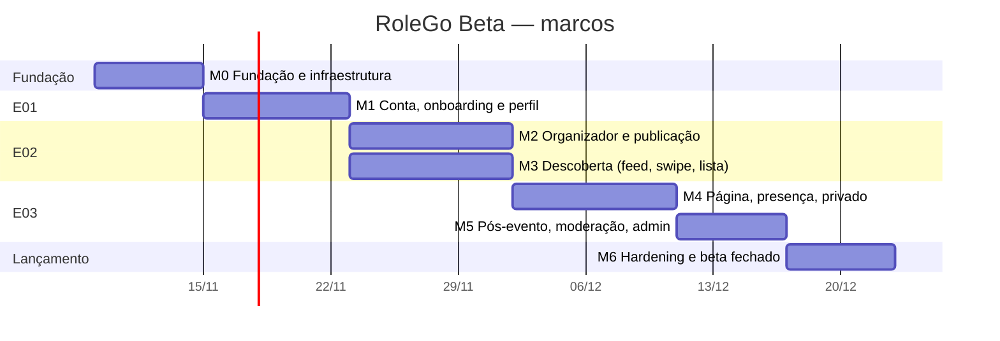
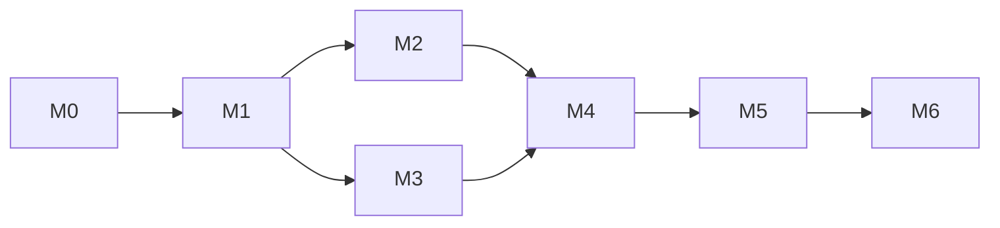
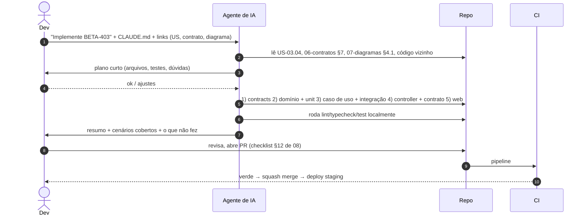

# RoleGo Beta — Plano de implementação

Entrega em **7 marcos (M0–M6)**, cerca de 9 semanas para 1–2 devs com apoio de IA. Cada task `BETA-nnn` é pensada para **um PR** (≤ 1 dia de trabalho) e tem dependências explícitas, o que deixa claro o que pode correr em paralelo e o que um agente de IA pode pegar sozinho.

## 1. Visão geral

> As datas são ilustrativas (a partir da próxima segunda-feira). M2 e M3 podem rodar em paralelo com 2 devs; com 1 dev, M3 começa depois de M2.

| Marco | Saída verificável (demo) | Histórias |
|---|---|---|
| M0 | Monorepo com CI verde; "hello" da API + PWA em staging com HTTPS; banco com PostGIS e migrations; design system base com tokens | — |
| M1 | Criar conta / Google / login / reset / onboarding completo / perfil / exclusão em staging | US-01.01 → 01.14 |
| M2 | Organizador publica um evento público e um privado pelo wizard; "Meus eventos" | US-02.01 → 02.10 |
| M3 | Feed, swipe e lista reais sobre o seed de Curitiba, com filtros e troca de cidade | US-02.11 → 02.16 |
| M4 | Página do evento, interesse, RSVP com capacidade, privado com aprovação, compartilhamento com OG, cancelamento | US-03.01 → 03.09 |
| M5 | Avaliação pós-evento, página do organizador, edições anteriores, denúncia + admin | US-03.10 → 03.14, US-ADM.* |
| M6 | Carga, segurança, a11y, observabilidade, backups, termos; beta fechado com cerca de 100 pessoas | — |

## 2. Grafo de dependências entre marcos

## 3. Backlog por marco

Legenda: **Tam.** P (≤ ½ dia), M (≤ 1 dia), G (1–2 dias, quebrar se der).
**IA** = nível de autonomia indicado para agente: 🟢 autônomo com revisão; 🟡 pareado (decisões de design no meio); 🔴 humano lidera.

### M0 — Fundação

| ID | Task | Dep. | Tam. | IA |
|---|---|---|---|---|
| BETA-001 | Monorepo pnpm + Turborepo, `packages/config` (tsconfig, eslint, prettier, stylelint) | — | M | 🟢 |
| BETA-002 | `apps/api` NestJS: env Zod, pino, `requestId`, Problem Details, `/health`, OpenAPI | 001 | M | 🟢 |
| BETA-003 | Postgres/PostGIS no docker-compose dev; Drizzle + primeira migration (extensões) | 002 | M | 🟢 |
| BETA-004 | `shared/`: ClockPort, JobQueue (pg-boss), StoragePort (disco), EmailPort (console), DomainEventBus | 003 | G | 🟡 |
| BETA-005 | `packages/contracts`: estrutura, `errors.ts`, helpers de Page/cursor | 001 | P | 🟢 |
| BETA-006 | `apps/web`: Vite + React Router + TanStack Query + PWA manifest/SW + http client tipado | 005 | M | 🟢 |
| BETA-007 | `packages/tokens` + `ui/` base: Button, Chip, Input, Slider, Sheet, Toast, Card, TopBar, TabBar, Wordmark | 006 | G | 🟡 |
| BETA-008 | Testes: Vitest, Testcontainers, Playwright + factories + seed determinístico mínimo | 003, 006 | M | 🟢 |
| BETA-009 | CI GitHub Actions (lint, typecheck, test, build, size-limit, gitleaks) | 008 | M | 🟢 |
| BETA-010 | Infra staging: compose (api, worker, postgis, mailpit), nginx `staging.rolego.com.br`, deploy por SSH | 009 | M | 🔴 |
| BETA-011 | VPS mail + observabilidade: **Mailcow** (DNS MX/SPF/DKIM/DMARC/PTR, MTA-STS, caixa `nao-responda@`, aquecimento) | — | G | 🔴 |
| BETA-012 | Stack **Grafana** (Loki, Prometheus, Tempo, Grafana, Alloy em cada VPS) + OpenTelemetry na API + Faro no front | 002, 006 | G | 🟡 |

### M1 — E01 Conta, onboarding e perfil

| ID | Task | Dep. | US | Tam. | IA |
|---|---|---|---|---|---|
| BETA-101 | Schema `users`, `refresh_tokens`, `passkeys`, `jwt_keys`, `auth_tokens`, `discovery_preferences`, `cities`, `event_types` + seed catálogo | 003 | — | M | 🟢 |
| BETA-102 | Auth: `TokenService` (EdDSA, JWKS, rotação de chave), guard JWT global, `@Public`, refresh rotativo com detecção de reuso, denylist + `LISTEN/NOTIFY`, CSRF, refresh single-flight no http client | 101 | — | G | 🔴 |
| BETA-103 | Registro + login + logout (argon2id, rate limit) | 102 | 01.01, 01.04, 01.06 | M | 🟢 |
| BETA-104 | Google OAuth + etapa de consentimento | 103 | 01.02 | M | 🟡 |
| BETA-105 | Apple Sign in | 104 | 01.03 | M | 🟡 |
| BETA-106 | Recuperar/redefinir senha + verificação de e-mail + templates React Email + `SmtpEmail` (Mailcow) / Mailpit | 103, 004, 011 | 01.05, 01.14 | M | 🟢 |
| BETA-107 | Web: Splash, Criar conta, Entrar, Recuperar, Redefinir, guards de rota | 007, 103 | 01.01–06 | G | 🟢 |
| BETA-108 | API preferências + catálogo + `discovery/count` (stub até M3) + concluir onboarding | 101 | 01.07–10 | M | 🟢 |
| BETA-109 | Web: onboarding 4 passos (tipos, cidade, localização, raio com prévia) | 108, 007 | 01.07–10 | G | 🟢 |
| BETA-110 | Mídia: upload, magic bytes, job `media.process`, variantes WebP | 004 | 01.11 | M | 🟡 |
| BETA-111 | Perfil: editar nome/e-mail/foto, preferências, privacidade | 110, 108 | 01.11, 01.12 | M | 🟢 |
| BETA-112 | Excluir conta (anonimização + job purge) | 111 | 01.13 | M | 🟡 |
| BETA-114 | Passkeys: registro (T-09), login com conditional UI, gestão em Privacidade | 102, 109 | 01.15 | G | 🟡 |
| BETA-113 | E2E E01 (todos os cenários M) | 107, 109, 111 | — | M | 🟢 |

### M2 — E02 Oferta (organizador e publicação)

| ID | Task | Dep. | US | Tam. | IA |
|---|---|---|---|---|---|
| BETA-201 | Schema `organizers`, `events`, `event_series`, `event_media`, `geocode_cache`, `audit_log` | 101 | — | M | 🟢 |
| BETA-202 | Domínio `Event` (TimeRange, Venue, Access, PriceItem, publishCheck, phase) + unit 100% | 201 | 02.02–06 | G | 🟡 |
| BETA-203 | Ativar organizador (API + Web) + aba Organizar | 201 | 02.01 | M | 🟢 |
| BETA-204 | GeocodingPort: ViaCEP + Nominatim + cache + fake | 004 | 02.03 | M | 🟢 |
| BETA-205 | API rascunho: criar/patch/capa/geocode/publish-check/publish/excluir + `EventPresenter` (versão 1) | 202, 204, 110 | 02.02–06 | G | 🟡 |
| BETA-206 | Web: wizard 6 passos com autosave e revisão (prévia do card) | 205, 007 | 02.02–06 | G | 🟢 |
| BETA-207 | Editar publicado + evento de domínio `EventScheduleChanged` + job de e-mails | 205 | 02.07 | M | 🟢 |
| BETA-208 | Painel Meus eventos (API + Web) | 205 | 02.08 | M | 🟢 |
| BETA-209 | Galeria + nova edição (série) | 205 | 02.09, 02.10 | M | 🟢 |
| BETA-210 | E2E E02-oferta | 206, 208 | — | M | 🟢 |

### M3 — E02 Demanda (descoberta)

| ID | Task | Dep. | US | Tam. | IA |
|---|---|---|---|---|---|
| BETA-301 | Seed grande (10 mil eventos sintéticos) + seed Curitiba realista (60 eventos) | 201 | — | M | 🟢 |
| BETA-302 | `DiscoveryQueryService.feed` + índices + `EXPLAIN` + testes de raio/fuso | 301 | 02.11 | G | 🟡 |
| BETA-303 | Interesse e passe (`interests`, `swipe_passes`, contadores) | 302 | 02.12, 03.03 | M | 🟢 |
| BETA-304 | Swipe + lista + count + origem (override/gps/city) | 302 | 02.12, 02.13, 02.15 | M | 🟢 |
| BETA-305 | Web: Explorar (feed agrupado, EventCard, estado vazio, chips ativos) | 302, 007 | 02.11 | G | 🟢 |
| BETA-306 | Web: SwipeDeck (gestos com `motion`, botões, teclado, desfazer, prefetch) | 303, 304 | 02.12 | G | 🟡 |
| BETA-307 | Web: Lista + Filtros (sheet) + Trocar cidade | 304 | 02.13–15 | M | 🟢 |
| BETA-308 | Busca por texto (`unaccent` + trigram) | 302 | 02.16 | M | 🟢 |
| BETA-309 | E2E E02-demanda + teste de contrato de privacidade (versão 1) | 305–307 | — | M | 🟢 |

### M4 — E03 Página, presença e privado

| ID | Task | Dep. | US | Tam. | IA |
|---|---|---|---|---|---|
| BETA-401 | Schema `rsvps` + `RsvpPolicy` + `AccessPolicy` (unit 100%) | 201 | 03.04, 03.05 | M | 🟡 |
| BETA-402 | `GET by-slug` com `EventPresenter` completo por perfil + `people` | 401, 303 | 03.01, 03.02 | M | 🟡 |
| BETA-403 | RSVP confirmar/cancelar com capacidade atômica + teste de concorrência + e-mail + `.ics` | 401 | 03.04 | G | 🟡 |
| BETA-404 | Privado: código de acesso, pedido, aprovar/recusar/aprovar todos + e-mails | 403 | 03.05, 03.06 | G | 🟡 |
| BETA-405 | Web: Página do evento (todas as seções + rodapé de ações) + Quem vai | 402 | 03.01–03 | G | 🟢 |
| BETA-406 | Web: fluxo RSVP ("Você vai!"), privado ("Pedir para entrar", "Tenho um código") | 403, 404, 405 | 03.04, 03.05 | M | 🟢 |
| BETA-407 | Web: Lista de convidados do organizador | 404 | 03.06 | M | 🟢 |
| BETA-408 | Sharing: `/e/:slug` com OG + imagem OG + `share_clicks` + folha de compartilhar | 205 | 03.07 | M | 🟢 |
| BETA-409 | Cancelar evento (API + Web + e-mails) + estado Ao vivo / "Estou aqui" | 403 | 03.08, 03.09 | M | 🟢 |
| BETA-410 | Meus rolês (próximos/passados) | 403 | 01.17 | P | 🟢 |
| BETA-411 | Contrato de privacidade (versão final, todas as rotas × perfis) | 402–404 | — | M | 🟡 |
| BETA-412 | E2E E03 (presença, privado, cancelamento, compartilhamento) | 406–409 | — | M | 🟢 |

### M5 — E03 Pós-evento + moderação

| ID | Task | Dep. | US | Tam. | IA |
|---|---|---|---|---|---|
| BETA-501 | Reviews: `ReviewPolicy`, PUT review, filtro de conteúdo, agregados | 403 | 03.10, 03.11 | M | 🟢 |
| BETA-502 | Cron `review.invite` + card "Como foi?" + tela de avaliação | 501 | 03.10 | M | 🟢 |
| BETA-503 | Página do organizador `/o/:slug` + nota agregada | 501 | 03.13 | M | 🟢 |
| BETA-504 | Edições anteriores na página do evento | 209, 501 | 03.12 | P | 🟢 |
| BETA-505 | Denúncias (API + Web) | 402 | 03.14 | M | 🟢 |
| BETA-506 | Admin: papel, CLI `admin:grant`, fila de denúncias, bloquear, restaurar, audit | 505 | ADM.01–03 | G | 🟡 |
| BETA-507 | Admin: organizador sem usuário + publicar em nome dele + convite "assuma seu perfil" | 506 | ADM.04 | M | 🟢 |
| BETA-508 | E2E E03-pós + admin | 502–507 | — | M | 🟢 |

### M6 — Hardening e beta fechado

| ID | Task | Dep. | Tam. | IA |
|---|---|---|---|---|
| BETA-601 | k6 no feed/swipe/by-slug + ajustes de índice | M5 | M | 🟡 |
| BETA-602 | ZAP baseline + headers/CSP + revisão de rate limits | M5 | M | 🟡 |
| BETA-603 | Axe + Lighthouse + correções de a11y/performance | M5 | M | 🟢 |
| BETA-604 | Dashboards (RED, feed p95, filas, e-mail, Web Vitals) + alertas no Grafana + blackbox para uptime | 012 | M | 🟢 |
| BETA-610 | Entregabilidade: testes mail-tester ≥ 9/10, Gmail/Outlook/iCloud na caixa de entrada, DMARC reports, leitura de bounces | 011 | P | 🔴 |
| BETA-605 | Backup diário criptografado + restore testado (runbook) | M0 | M | 🔴 |
| BETA-606 | Termos, Privacidade, banner de cookies, PostHog com consentimento | M5 | M | 🔴 |
| BETA-607 | Produção: compose prod, nginx `rolego.com.br` (trocar o protótipo), migração de DNS/rollback | 605 | M | 🔴 |
| BETA-608 | Onboarding de parceiros: admin cadastra 30 organizadores + eventos iniciais | 607 | — | 🔴 |
| BETA-609 | Canal de feedback in-app + triagem | 607 | P | 🟢 |

## 4. Caminho crítico

`001 → 002 → 003 → 101 → 102 (auth JWT) → 103 → 201 → 202 → 205 → 302 → 401 → 403 → 404 → 411 → 501 → 506 → 607`

Os riscos de atraso estão em **102** (auth JWT + refresh rotativo), **011** (DNS/PTR/reputação do Mailcow, que deve começar na semana 1 para dar tempo de aquecer o IP), **202/205** (modelagem do evento), **302** (consulta geo) e **403/404** (capacidade + privado). São os pontos 🟡 que pedem revisão humana mais atenta.

## 5. Sequência de trabalho por task (fluxo com IA)

Detalhes e prompts prontos: [13-guia-desenvolvimento-com-ia](13-guia-desenvolvimento-com-ia.md).

## 6. Definition of Done

Uma task/história está **pronta** quando:
1. Os critérios de aceite (Gherkin) da US passam em teste automatizado do nível adequado.
2. Contrato em `packages/contracts` atualizado e OpenAPI regenerado.
3. Lint, typecheck e testes verdes no CI; cobertura dentro dos gates.
4. A tela confere com o [protótipo](12-prototipos.md) (screenshot no PR), em 390×844 e 360×800.
5. Sem regressão do contrato de privacidade.
6. Textos em pt-BR revisados; estados de carregamento, vazio e erro implementados.
7. Logs/métricas de analytics do [plano de eventos](09-estrategia-de-testes.md#7-plano-de-eventos-de-analytics) emitidos, quando aplicável.
8. Deploy em staging feito e demo validada pelo PO.
9. Docs atualizados se a decisão mudou (contratos, diagramas, ADR).

## 7. Cerimônias (sugestão)

- Ciclos semanais: planejamento na segunda (escolher BETA-nnn do marco), demo na sexta em staging.
- Board Trello RoleGo: uma lista por marco; card = BETA-nnn com o link da US.
- Revisão dos docs no fim de cada marco: o que mudou vira ADR novo ou atualização do PRD.
