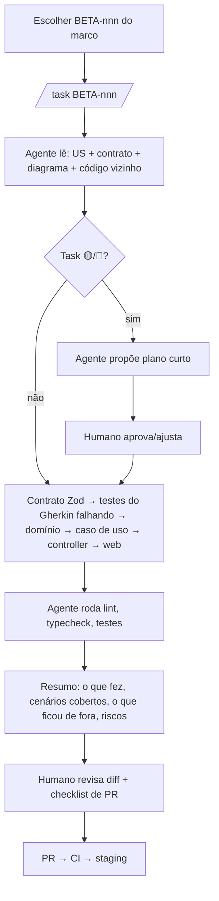

# RoleGo Beta — Guia de desenvolvimento com IA

Como usar agentes de IA (Claude Code e similares) para construir o Beta a partir destes documentos, com qualidade previsível.

## 1. Princípios

1. **Os documentos são o contexto, o código é a verdade.** O agente lê os docs para entender a intenção e o código vizinho para seguir os padrões. Quando os dois divergem, a divergência vira pergunta, não suposição.
2. **Uma task por sessão.** Cada `BETA-nnn` é pequena (≤ 1 dia). Sessões longas com muitos objetivos degradam a qualidade.
3. **Plano antes do código** nas tasks 🟡/🔴 ([11 §3](11-plano-de-implementacao.md#3-backlog-por-marco)): o agente propõe arquivos, testes e dúvidas; um humano aprova.
4. **Testes primeiro a partir do Gherkin.** O cenário vira teste falhando, depois a implementação.
5. **O humano revisa tudo** que toca autenticação, privacidade de evento privado, capacidade/concorrência, migrations e infra.
6. **Sem dados reais** em prompts: use o seed. Nunca cole segredos (`.env`, chaves JWT, senha SMTP).

## 2. Arquivos de contexto

| Arquivo | Onde fica no repo | Conteúdo |
|---|---|---|
| `CLAUDE.md` | raiz do monorepo | Regras essenciais, comandos, mapa de pastas, links para os docs. Modelo pronto: [`ia/CLAUDE.md`](ia/CLAUDE.md) |
| `apps/api/CLAUDE.md` | API | Padrões de módulo, transação, eventos de domínio, testes de integração |
| `apps/web/CLAUDE.md` | Web | Padrões de feature, TanStack Query, design system, a11y |
| `docs/` | cópia viva destes documentos | PRD, histórias, contratos, diagramas, ADRs |
| `.claude/commands/*.md` | comandos reutilizáveis | `/task BETA-nnn`, `/review-privacy`, `/new-endpoint` (ver [`ia/prompts.md`](ia/prompts.md)) |

Mantenha o `CLAUDE.md` **curto (≤ 150 linhas)**: o que o agente precisa em toda sessão. O detalhe fica nos docs, que ele lê quando precisa.

## 3. Fluxo por task

## 4. Ordem de implementação dentro de uma task (camadas)

1. `packages/contracts`: schemas de request/response e códigos de erro.
2. Testes: unit do domínio + integração do caso de uso a partir dos cenários Gherkin (devem falhar).
3. `domain/`: regra pura.
4. `application/`: caso de uso + policies + ports.
5. `infra/`: repositório Drizzle (+ migration revisada).
6. `http/`: controller fino + presenter + teste de contrato.
7. `apps/web`: `api.ts` → hook TanStack Query → componentes → página, conferindo a tela `T-xx` no [protótipo](prototipos/index.html).
8. E2E do cenário principal (se a task fecha uma história).

## 5. O que pedir explicitamente ao agente

- "Cite o arquivo e a linha da regra que você está seguindo."
- "Liste as suposições que fez."
- "Não altere arquivos fora de `<escopo>`."
- "Se precisar de uma decisão de produto ou arquitetura, pare e pergunte."
- "Rode `pnpm verify` antes de dizer que terminou e cole o resumo do resultado."

## 6. Antipadrões (rejeitar no review)

| Antipadrão | Por quê |
|---|---|
| Gerar o módulo inteiro de uma vez | Diff grande, difícil de revisar, erros escondidos |
| Criar abstração "para o futuro" | Viola [08 §1](08-boas-praticas-codigo.md#1-princípios) |
| Serializar um evento sem o `EventPresenter` | Risco de vazar endereço privado |
| `new Date()`, `any`, hex solto, `SELECT *` | Regras de [08](08-boas-praticas-codigo.md) |
| Teste que só confirma o mock | Não prova nada; use Postgres real (Testcontainers) |
| Mexer em migration já aplicada | Quebra os ambientes |
| Inventar endpoint fora de [06](06-contratos-api.md) | Contrato primeiro: atualize o doc/schema e peça revisão |
| Desabilitar regra de lint/teste para "passar" | Mascara problema |

## 7. Revisão assistida por IA

- Antes do PR: `/review-privacy` (checa presenter, policies e logs) e `/code-review` no diff.
- A IA não aprova PR sozinha: o aprovador é humano.
- Os achados da revisão viram commits no mesmo PR, ou issues se estiverem fora do escopo.

## 8. Manter os docs vivos

- Mudou uma regra durante a implementação? Atualize no mesmo PR: a história (Gherkin), os contratos, os diagramas e o protótipo (`data-notes`).
- Uma decisão nova de arquitetura vira um ADR novo em `docs/04-adrs.md`.
- No fim de cada marco: peça ao agente "compare os docs com o código e liste as divergências", e um humano decide o que corrigir.

## 9. Métricas do processo (acompanhar por marco)

| Métrica | Alvo |
|---|---|
| Tamanho médio de PR | ≤ 400 linhas |
| PRs que voltaram por violar as regras de 08 | < 10% |
| Bugs em staging por história | ≤ 1 |
| Tempo do PR até o merge | < 1 dia útil |
