# RoleGo — Épicos

Fonte de verdade dos épicos do produto, derivada do [documento de visão](README.md), dos materiais de MVP/slides em [`input/`](input/), da [apresentação técnica](RoleGo%20apresenta%C3%A7%C3%A3o%20t%C3%A9cnica.pdf) e das telas atuais de [Explorar](WhatsApp%20Image%202026-11-20%20at%2017.12.41%282%29.jpeg) e [Perfil](WhatsApp%20Image%202026-11-20%20at%2017.12.41%283%29.jpeg).

Versão em PDF: [`epics.pdf`](epics.pdf), gerada por [`docs/_build_epics.py`](docs/_build_epics.py).

Cada épico agrupa um conjunto coerente de valor; histórias e BDD vêm depois.

---

## Índice

| ID | Épico |
|----|-------|
| E01 | Conta, onboarding e perfil |
| E02 | Publicação e descoberta de eventos |
| E03 | Ciclo de vida do evento |
| E04 | Ingressos e pagamento |
| E05 | Cardápio digital e consumação |
| E06 | Gamificação e RoleGo Wallet |
| E07 | Vitrine de influenciadores |
| E08 | Publicidade e visibilidade paga |
| E09 | Assinatura Premium |
| E10 | Notificações e alertas |
| E11 | Reputação anfitrião–convidado |
| E12 | Perfil social, seguidores e momentos |
| E13 | Verificação de identidade |
| E14 | Eventos privados e lista de convidados |
| E15 | Chat em grupo do evento |
| E16 | Segurança e moderação |
| E17 | Rolê junto: amigos, match e Modo Solo |

---

## E01 — Conta, onboarding e perfil

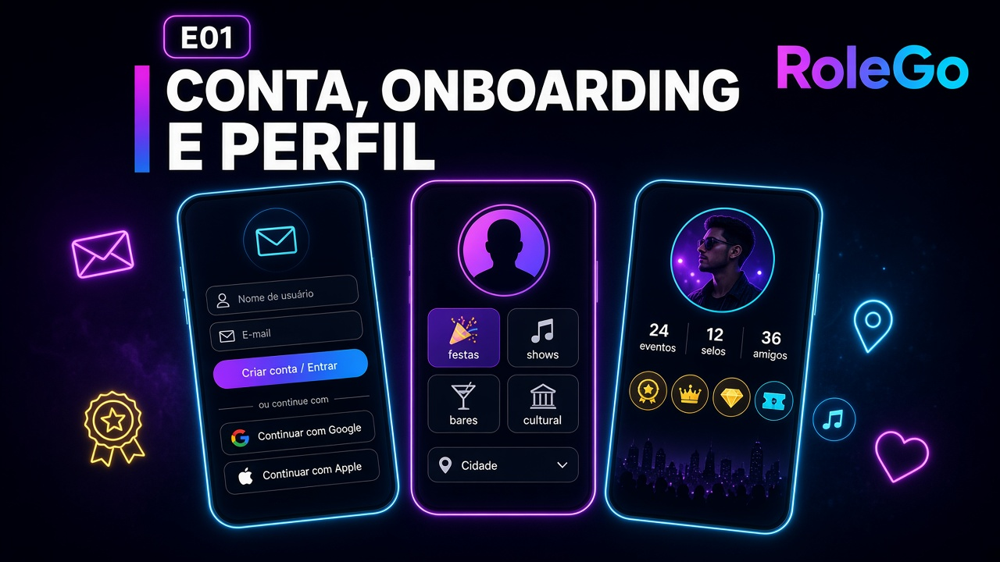

O usuário cria conta, configura preferências de descoberta e mantém um perfil social básico. Escopo abaixo — para análise e aprovação.

Protótipo React das telas: [`web/README.md`](web/README.md) (`npm run dev` em `web/`).

App v0.1 (React + NestJS, com API e banco): [`app/README.md`](app/README.md).

### Conta e autenticação
- Criar conta com e-mail, senha e confirmar senha (sem celular no cadastro)
- Entrar com conta Google
- Entrar com conta Apple
- Login com conta já existente (e-mail ou social)
- Recuperar acesso / redefinir senha (fluxo e-mail)
- Encerrar sessão (logout)

### Onboarding
- Escolher preferências de tipo de evento (festa, show, evento privado etc.)
- Informar / selecionar cidade
- Solicitar e gravar permissão de localização
- Definir raio de busca (range contínuo de 1 km a 100 km)
- Concluir onboarding e entrar no app com preferências aplicadas à descoberta

### Perfil
- Definir / alterar foto de perfil
- Editar nome completo
- Editar e-mail

### Fora de escopo deste épico
- Descoberta/publicação de eventos → [E02](#e02--publicação-e-descoberta-de-eventos)
- Seguidores, posts e perfil de outro usuário → [E12](#e12--perfil-social-seguidores-e-momentos)
- Direct → [E15](#e15--chat-em-grupo-do-evento); convite a amigo e Modo Solo → [E17](#e17--rolê-junto-amigos-match-e-modo-solo)
- Envio de documento e selo Verificada → [E13](#e13--verificação-de-identidade)
- Histórico de eventos, fotos por evento e selos/status no perfil → [E03](#e03--ciclo-de-vida-do-evento) / [E06](#e06--gamificação-e-rolego-wallet)
- Avaliação anfitrião–convidado → [E11](#e11--reputação-anfitriãoconvidado)

## E02 — Publicação e descoberta de eventos

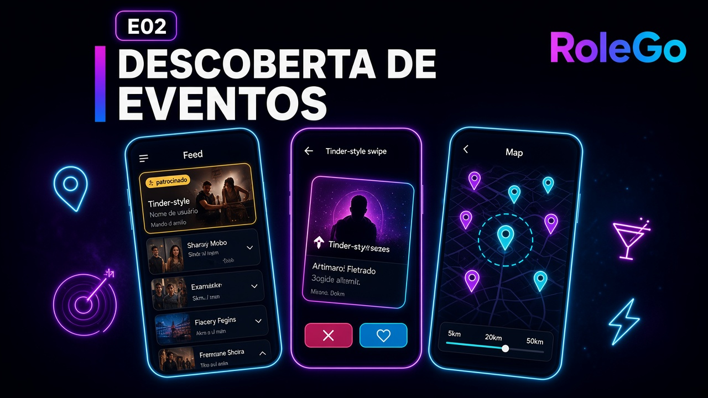

Lado oferta: anfitriões, casas e produtores criam e publicam o evento (público ou privado, com controle de lista e revelação de local). Lado demanda: o usuário encontra o que está rolando perto por geolocalização e raio configurável (1–100 km), com modos Feed, Tinder (swipe), Lista e Mapa (conforme premium/patrocínio), filtros por tipo e dia, destaque de eventos patrocinados e radar dinâmico — oferta e descoberta no mesmo loop, unificando o que hoje está espalhado em Instagram, Google, sites e WhatsApp. O fluxo do evento privado está detalhado em [E14](#e14--eventos-privados-e-lista-de-convidados).

## E03 — Ciclo de vida do evento

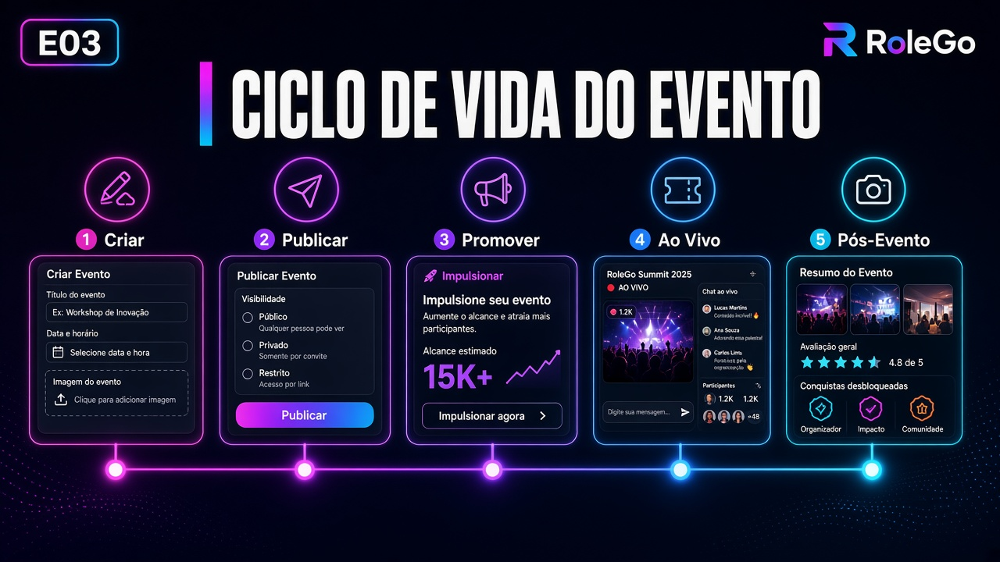

Cada evento publicado tem página completa (local, horários, valores de entrada/VIP/bebida, confirmados, interessados, influenciadores contratados e fotos de edições anteriores) e o ciclo da promoção ao pós-evento (promover, ao vivo, avaliação, comentário e selos) — informação suficiente para decidir, comprar e lembrar o rolê. Criar/publicar e descobrir ficam em [E02](#e02--publicação-e-descoberta-de-eventos); o grupo de quem confirmou presença, em [E15](#e15--chat-em-grupo-do-evento).

## E04 — Ingressos e pagamento

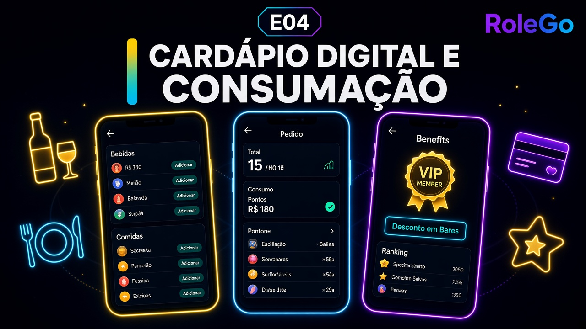

Compra de ingresso no app (pista, VIP etc.) com taxa de serviço, gateway de pagamento, QR Code, carteira de ingressos, compartilhamento com o grupo e reserva de mesa/consumação antecipada em parceiros — do descarte ao ingresso em poucos cliques.

## E05 — Cardápio digital e consumação

O usuário consome pelo app no bar parceiro via cardápio digital; a compra gera score de consumo e benefícios ligados a status/premium, com comissão para o estabelecimento (percentuais ainda em aberto na visão).

## E06 — Gamificação e RoleGo Wallet

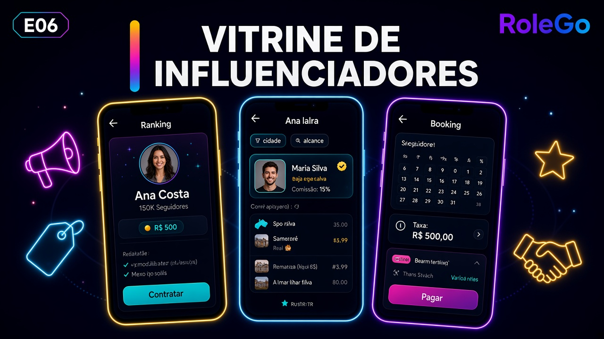

Pontos, selos, rankings entre amigos, recompensas (descontos, ingressos com preço reduzido, furo de fila) e status (ex.: Rolê Gold, Platina) incentivam uso e compra pelo app. A RoleGo Wallet guarda histórico de experiências, fotos, avaliações e selos, reforçando retenção e adesão dos estabelecimentos.

## E07 — Vitrine de influenciadores

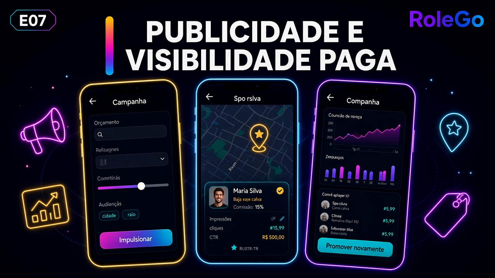

Influenciadores cadastram disponibilidade; casas e produtores contratam pela plataforma; o nome do influenciador confirmado aparece na página do evento como chamariz, com comissão sobre o cachê e tração em novas cidades.

## E08 — Publicidade e visibilidade paga

Eventos e casas pagam para aparecer além do alcance orgânico: impulsionamento fora do raio padrão, visibilidade no mapa, destaques no feed e parcerias de mídia paga — monetização B2B alinhada à visão.

## E09 — Assinatura Premium

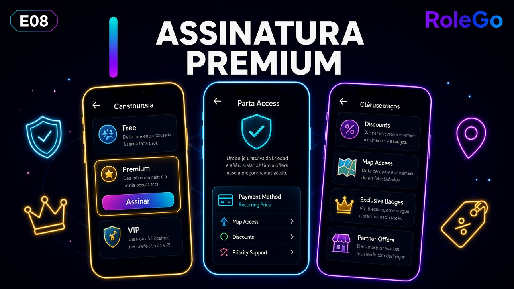

O usuário paga por recursos extras: mapa completo de eventos, descontos em bares parceiros, visualização de fotos e participantes sem restrição e demais diferenciais do roadmap — gerando receita recorrente e engajamento diferenciado.

## E10 — Notificações e alertas

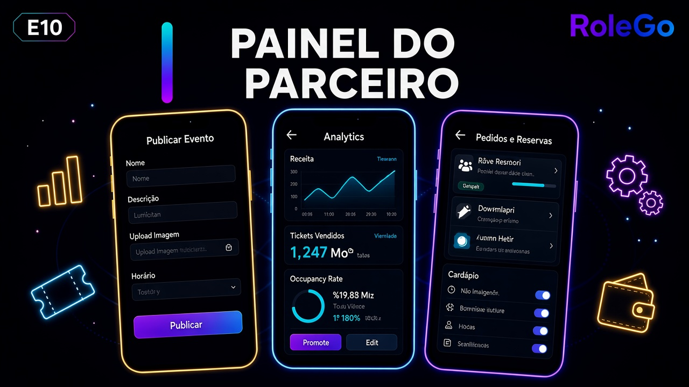

Push e central in-app avisam novo evento no raio, interações sociais (like, match, progresso do grupo), ingresso, segurança e pós-evento — reabrindo o app e acelerando a decisão no momento certo.

## E11 — Reputação anfitrião–convidado

Anfitrião e convidado se avaliam por estrelas após o evento; a reputação fica no perfil e influencia listas e decisões de convite, mitigando risco social em eventos privados.

---

## E12 — Perfil social, seguidores e momentos

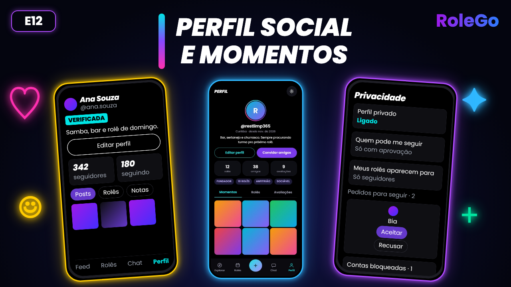

O perfil vira rede social: o usuário tem @usuário e bio, segue e é seguido, controla quem vê seus rolês e publica momentos que aparecem no perfil e no Explorar.

### Escopo
- Ver o próprio perfil, editar e abrir o perfil de outra pessoa
- @usuário único de 3 a 20 caracteres e bio de até 150
- Perfil público ou privado; no privado, o seguidor precisa ser aprovado (aceitar ou recusar)
- Definir para quem os meus rolês aparecem (ex.: só seguidores)
- Contadores de rolês, rede e avaliações, atualizados a cada seguir ou post
- Abas Momentos, Rolês e Avaliações
- Publicar momentos; fila de stories e posts de quem você acompanha no Explorar
- Curtir e comentar fotos vinculadas ao evento
- Exibir o selo Verificada e os selos de conquista (Fundador, 10 rolês, Anfitrião, Sociável)

### Entidades
- User(id, username, bio, is_private)
- Follow(follower, followee, status)
- Post

### Depende de
- Cadastro ([E01](#e01--conta-onboarding-e-perfil)); o selo Verificada vem de [E13](#e13--verificação-de-identidade)

### Fora de escopo deste épico
- Regras dos selos, pontos e rankings → [E06](#e06--gamificação-e-rolego-wallet)
- Nota anfitrião–convidado → [E11](#e11--reputação-anfitriãoconvidado)
- Bloqueio e denúncia → [E16](#e16--segurança-e-moderação)

### Referência
- Apresentação técnica, slides 2 e 3; telas Perfil e Explorar; visão, seção 5.2

## E13 — Verificação de identidade

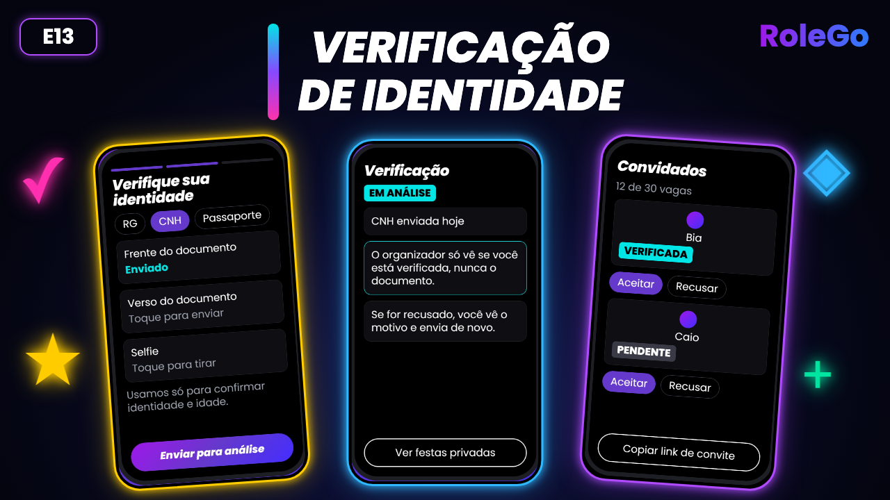

O usuário envia documento e selfie para confirmar identidade e idade. Aprovado, ganha o selo Verificada, que dá acesso aos eventos privados que exigem verificação.

### Escopo
- Escolher RG, CNH ou passaporte e enviar o documento (frente e verso) mais selfie
- Status: pendente (em análise), aprovado, recusado ou expirado
- A recusa mostra o motivo e permite enviar de novo
- A aprovação coloca o selo Verificada no perfil
- O organizador vê só o selo, nunca a imagem
- Arquivos criptografados, com exclusão pela conta (LGPD)

### Entidades
- IdentityDoc(user, type, status, reviewed_at)

### Depende de
- Cadastro ([E01](#e01--conta-onboarding-e-perfil))

### Fora de escopo deste épico
- Regra "exigir verificação" no evento → [E14](#e14--eventos-privados-e-lista-de-convidados)

### Referência
- Apresentação técnica, slides 2 e 4

## E14 — Eventos privados e lista de convidados

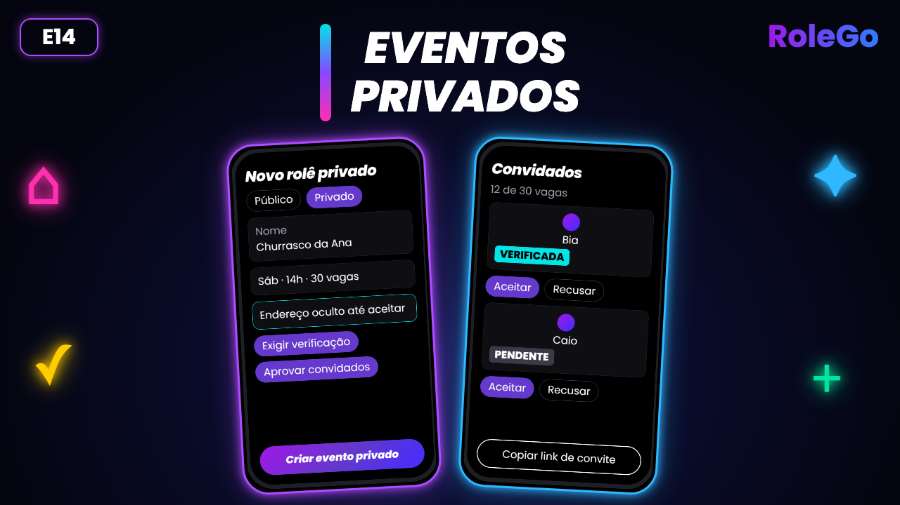

O anfitrião cria um rolê privado, decide quem entra e só revela o endereço a quem foi aceito, com vagas limitadas e verificação opcional.

### Escopo
- Visibilidade: público, privado por convite ou privado com aprovação
- Criar evento com nome, data, horário e número de vagas
- Endereço exato visível só para quem foi aceito
- Capacidade com lista de espera
- Exigir verificação: só entra quem tem documento aprovado
- Aceitar ou recusar pedidos, vendo quem está verificado e quantas vagas estão ocupadas
- Copiar link de convite

### Entidades
- Event(visibility, capacity, requires_verified)
- GuestRequest(event, user, status)

### Depende de
- Documentos ([E13](#e13--verificação-de-identidade)) e publicação ([E02](#e02--publicação-e-descoberta-de-eventos))

### Fora de escopo deste épico
- Grupo dos convidados → [E15](#e15--chat-em-grupo-do-evento)
- Avaliação após o evento → [E11](#e11--reputação-anfitriãoconvidado)

### Referência
- Apresentação técnica, slides 2 e 5

## E15 — Chat em grupo do evento

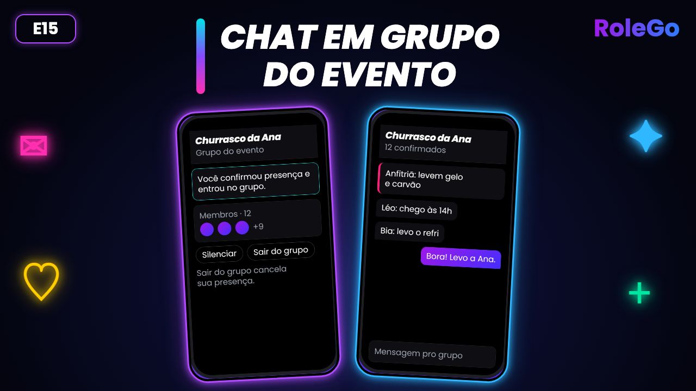

Cada evento tem um grupo com quem confirmou presença, para combinar o rolê antes e durante, sem sair do app.

### Escopo
- Sala criada junto com o evento
- Entra ao confirmar presença e sai ao cancelar; sair do grupo cancela a presença
- Em evento privado, só entram os aceitos
- Mensagens em tempo real, com histórico e destaque para o anfitrião
- Ver membros, silenciar e sair
- Mensagem direta entre usuários, inclusive a partir de uma curtida (vem da visão, não da apresentação técnica)

### Entidades
- ChatRoom(event_id)
- Membership(room, user, role)
- Message(room, user, body, ts)

### Depende de
- Confirmação de presença, "Eu vou" ([E03](#e03--ciclo-de-vida-do-evento)), e lista de aceitos ([E14](#e14--eventos-privados-e-lista-de-convidados))

### Fora de escopo deste épico
- Denúncia, bloqueio e limite de mensagens → [E16](#e16--segurança-e-moderação)

### Referência
- Apresentação técnica, slides 2 e 6; visão, seção 5.2

## E16 — Segurança e moderação

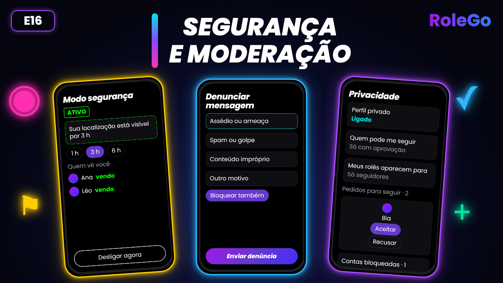

Segurança em camadas: compartilhar a localização durante o rolê, denunciar, bloquear e conter spam.

### Escopo
- Modo segurança: localização ao vivo por 1, 3 ou 6 horas
- Ver quem está acompanhando e desligar a qualquer momento
- Denunciar por categoria (assédio ou ameaça, spam ou golpe, conteúdo impróprio, outro motivo), com opção de bloquear junto
- Fila de moderação para as denúncias
- O bloqueio esconde perfil, posts e mensagens; lista de contas bloqueadas
- Limite de mensagens por minuto contra spam

### Entidades
- SafetySession(user, contacts, expires_at)
- Report(target, reason, status)
- Block(blocker, blocked)

### Depende de
- Perfil ([E12](#e12--perfil-social-seguidores-e-momentos)) e chat ([E15](#e15--chat-em-grupo-do-evento))

### Fora de escopo deste épico
- Documento de identidade → [E13](#e13--verificação-de-identidade)
- Reputação por estrelas → [E11](#e11--reputação-anfitriãoconvidado)

### Referência
- Apresentação técnica, slides 2 e 7

## E17 — Rolê junto: amigos, match e Modo Solo

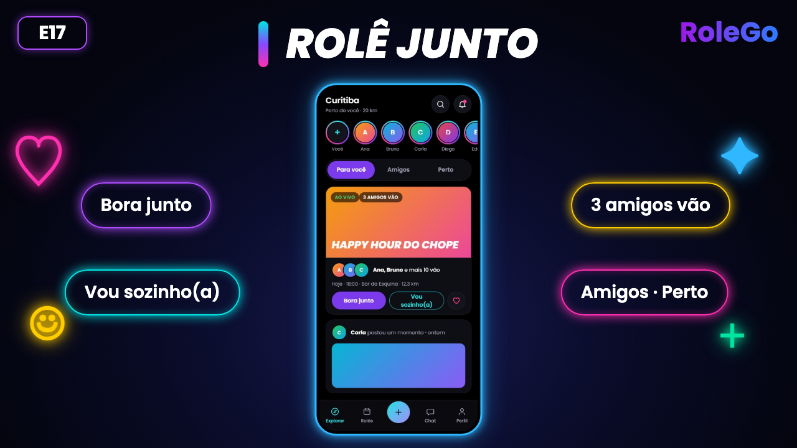

A decisão de sair vira social: o usuário vê quais amigos vão, chama a turma ou avisa que vai sozinho para encontrar companhia no próprio evento.

### Escopo
- Ações no card do evento: "Bora junto" e "Vou sozinho(a)"
- Mostrar quais amigos vão (ex.: "Ana, Bruno e mais 10 vão")
- Abas Para você, Amigos e Perto no Explorar
- Convidar amigos e contatos para o app e para o evento
- Match do grupo: curtir e decidir juntos
- Modo Solo: conectar com quem curtiu o mesmo evento e dividir custos e experiência

### Entidades
- A definir

### Depende de
- Descoberta ([E02](#e02--publicação-e-descoberta-de-eventos)), presença ([E03](#e03--ciclo-de-vida-do-evento)) e rede ([E12](#e12--perfil-social-seguidores-e-momentos))

### Fora de escopo deste épico
- Conversa entre os participantes → [E15](#e15--chat-em-grupo-do-evento)

### Referência
- Telas Explorar e Perfil; visão, seções 3.1, 4 e 5.2. Não aparece na apresentação técnica: o comportamento de cada ação ainda precisa ser definido

---

## Notas de priorização (orientação)

Ordem sugerida para um MVP alinhado aos wireframes e à jornada principal da visão:

1. **E01** Conta e onboarding  
2. **E02** Publicação e descoberta de eventos  
3. **E03** Ciclo de vida do evento  
4. **E04** Ingressos  
5. **E10** Notificações  
6. **E06** Gamificação básica + pós-evento  

Demais épicos (premium, ads, influenciadores, cardápio, reputação) como **além do MVP**, conforme validação e go-to-market.

### Fechamento do app (apresentação técnica)

1. **E01** Cadastro e **E13** verificação de documentos
2. **E12** Perfil e **E14** eventos privados
3. **E15** Chat em grupo e **E16** segurança
4. Teste fechado antes do lançamento

**E17** não aparece na apresentação e ainda não tem ordem definida.

## Pontos a decidir

- **Seguidores ou amigos:** a apresentação usa seguidores; as telas e a visão usam amigos
- **Lista de espera:** está na apresentação; o [PRD do Beta](beta-docs/01-prd.md) diz que não há no Beta (RN-05)
- **Chat e social:** a apresentação os trata como parte do fechamento do app; o PRD os deixa fora do Beta 1.0 (amigos, match, chat e Modo Solo na release 1.1)
- **Documentos:** definir quem analisa, por quanto tempo guardar e se substitui a autodeclaração de maioridade do PRD (RN-11)
- **Priorização:** conciliar a ordem de MVP acima com a ordem de fechamento da apresentação

