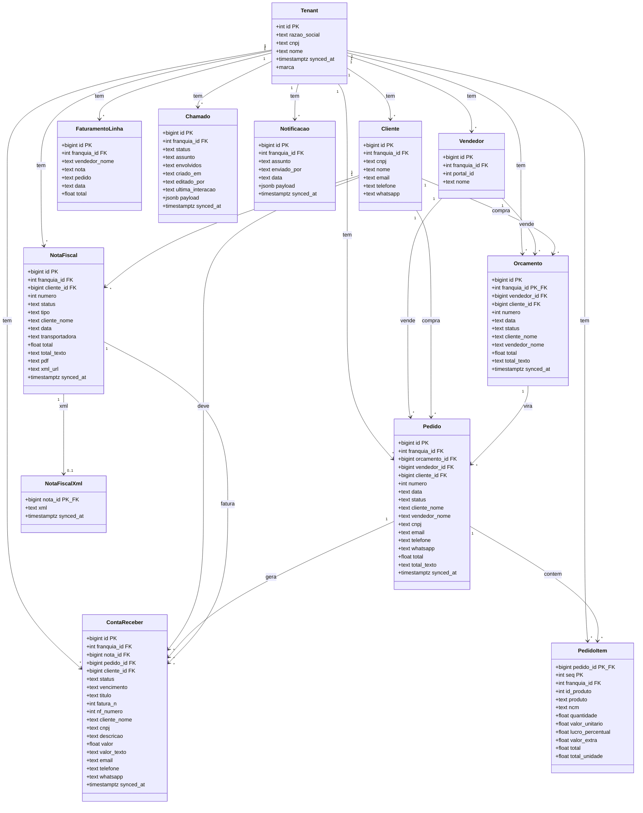

# Modelagem de dados — Super Portal

**Por quê:** espelhar no Super Portal **todos os campos** das tabelas da base e dos docs de domínio.  
**Base:** [`SCHEMA-REPLICA.md`](../../conectmax/portal-api/SCHEMA-REPLICA.md) · [`schema-normalizado.sql`](../../conectmax/portal-api/sql/schema-normalizado.sql) · [visão](../README.md) (Tenant white-label ≡ `franquia`).

## Funil

```text
Tenant (franquia) ─┬─ Vendedor
                   ├─ Cliente
                   ├─ Orcamento ──► Pedido ─┬─ PedidoItem
                   │                        ├─ NotaFiscal (+ NotaFiscalXml)
                   │                        └─ ContaReceber
                   ├─ FaturamentoLinha
                   ├─ Chamado
                   └─ Notificacao
```

## Diagrama de classes

Campos = colunas da base (`portal_franqueado`). `Tenant.marca` vem da visão white-label (não existe no legado).



## Tabelas / campos

| Classe (tabela) | PK | Campos |
|-----------------|----|--------|
| **Tenant** (`franquia`) | `id` | `razao_social`, `cnpj`, `nome`, `synced_at` + **`marca`** (visão WL) |
| **Vendedor** | `id` | `franquia_id`, `portal_id`, `nome` |
| **Cliente** | `id` | `franquia_id`, `cnpj`, `nome`, `email`, `telefone`, `whatsapp` |
| **Orcamento** | `(franquia_id, id)` | `vendedor_id`, `cliente_id`, `numero`, `data`, `status`, `cliente_nome`, `vendedor_nome`, `total`, `total_texto`, `synced_at` |
| **Pedido** | `id` | `franquia_id`, `orcamento_id`, `vendedor_id`, `cliente_id`, `numero`, `data`, `status`, `cliente_nome`, `vendedor_nome`, `cnpj`, `email`, `telefone`, `whatsapp`, `total`, `total_texto`, `synced_at` |
| **PedidoItem** | `(pedido_id, seq)` | `franquia_id`, `id_produto`, `produto`, `ncm`, `quantidade`, `valor_unitario`, `lucro_percentual`, `valor_extra`, `total`, `total_unidade` |
| **NotaFiscal** | `id` | `franquia_id`, `cliente_id`, `numero`, `status`, `tipo`, `cliente_nome`, `data`, `transportadora`, `total`, `total_texto`, `pdf`, `xml_url`, `synced_at` |
| **NotaFiscalXml** | `nota_id` | `xml`, `synced_at` |
| **ContaReceber** | `id` | `franquia_id`, `nota_id`, `pedido_id`, `cliente_id`, `status`, `vencimento`, `titulo`, `fatura_n`, `nf_numero`, `cliente_nome`, `cnpj`, `descricao`, `valor`, `valor_texto`, `email`, `telefone`, `whatsapp`, `synced_at` |
| **FaturamentoLinha** | `id` | `franquia_id`, `vendedor_nome`, `nota`, `pedido`, `data`, `total` |
| **Chamado** | `id` | `franquia_id`, `status`, `assunto`, `envolvidos`, `criado_em`, `editado_por`, `ultima_interacao`, `payload`, `synced_at` |
| **Notificacao** | `id` | `franquia_id`, `assunto`, `enviado_por`, `data`, `payload`, `synced_at` |

## Fontes

- Schema: [`SCHEMA-REPLICA.md`](../../conectmax/portal-api/SCHEMA-REPLICA.md) · [`schema-normalizado.sql`](../../conectmax/portal-api/sql/schema-normalizado.sql)
- Mapa UI: [`portal-mapa`](../../conectmax/connectmax/docs/portal-mapa/README.md) · prints [`../inputs/portal-conectmax-prints/`](../inputs/portal-conectmax-prints/)
- Processos: [`../inputs/conectmax-processos(4).html`](../inputs/conectmax-processos(4).html)
- Visão (Tenant / marca): [`../README.md`](../README.md)

## Caminho inverso

Versão enxuta (só funil sem agregados/suporte/blobs): ver commit anterior deste arquivo ou cortar `FaturamentoLinha`, `Chamado`, `Notificacao`, `NotaFiscalXml` e campos denormalizados.
