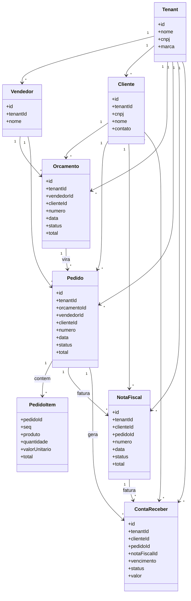

# Modelagem de dados — Super Portal

**Por quê:** fixar o núcleo do domínio antes do PRD.  
**Base:** réplica [`portal_franqueado`](../../conectmax/portal-api/SCHEMA-REPLICA.md) + funil orçamento → pedido → NF → receber; white-label da [visão](../README.md).  
**Regra:** só o **indispensável** — sem espelho 1:1 do legado, sem agregados, sem blobs/suporte.

## Funil

```text
Tenant ─┬─ Vendedor
        ├─ Cliente
        └─ Orcamento ──► Pedido ─┬─ PedidoItem
                                 ├─ NotaFiscal
                                 └─ ContaReceber
```

## Diagrama de classes



## Entidades (só núcleo)

| Classe | Papel | Campos essenciais |
|--------|-------|-------------------|
| **Tenant** | Isolamento white-label (equiv. franquia) | id, nome, cnpj, marca |
| **Vendedor** | Quem vende no tenant | id, tenantId, nome |
| **Cliente** | Comprador | id, tenantId, cnpj, nome, contato |
| **Orcamento** | Proposta | id, tenantId, vendedor/cliente, numero, data, status, total |
| **Pedido** | Venda a partir do orçamento | id, tenantId, orcamentoId, vendedor/cliente, numero, data, status, total |
| **PedidoItem** | Linha do pedido | pedidoId+seq, produto, qtd, valor unitário, total |
| **NotaFiscal** | Documento fiscal | id, tenantId, cliente, pedido, numero, data, status, total |
| **ContaReceber** | Cobrança | id, tenantId, cliente, pedido, nota, vencimento, status, valor |

`marca` no Tenant = identidade white-label mínima (nome/tema/logo — detalhe no PRD).

## Fora deste diagrama (de propósito)

| Legado / tema | Por quê fica de fora |
|---------------|----------------------|
| `faturamento_linha` | Agregado / relatório |
| `chamado`, `notificacao` | Suporte / inbox — não são o funil |
| `nota_fiscal_xml` | Blob opcional |
| Campos denormalizados (`*_nome`, `*_texto`, `synced_at`) | Espelho de sync do portal PHP |
| Templates, filas, handoff humano | Automação — modelo operacional no PRD, não neste núcleo |

## Fontes

- Schema: [`SCHEMA-REPLICA.md`](../../conectmax/portal-api/SCHEMA-REPLICA.md) · [`schema-normalizado.sql`](../../conectmax/portal-api/sql/schema-normalizado.sql)
- Mapa UI: [`portal-mapa`](../../conectmax/connectmax/docs/portal-mapa/README.md) · prints em [`../inputs/portal-conectmax-prints/`](../inputs/portal-conectmax-prints/)
- Processos: [`../inputs/conectmax-processos(4).html`](../inputs/conectmax-processos(4).html)

## Caminho inverso

Voltar ao modelo espelho do legado: usar o diagrama completo em [`SCHEMA-REPLICA.md`](../../conectmax/portal-api/SCHEMA-REPLICA.md) (inclui faturamento, chamado, notificação, XML e denormalizações).
